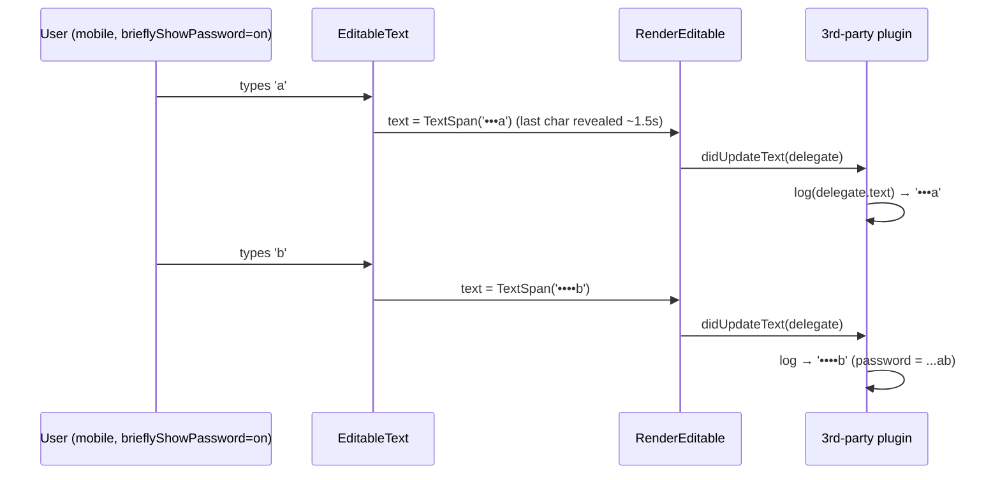

# Addressing Renzo's Review Comments on `flutter/rfc#35`

**PR:** [Add Design Doc for Composable Text Plugins in Flutter (`flutter/rfc#35`)](https://github.com/flutter/rfc/pull/35)
**Review:** [`@Renzo-Olivares`, 2026-10-26](https://github.com/flutter/rfc/pull/35#pullrequestreview-5658375166) — 5 inline comments, **none replied to yet**.
**Verified against:** RFC head `f8e84c9` (`rfc/170.0000-composable-text-plugins.md`), local prototype on branch `text-plugin-testing`
([rendering/text_plugin.dart](file:///Users/jinhangyu/Documents/GitHub/flutter/packages/flutter/lib/src/rendering/text_plugin.dart),
[widgets/text_plugin.dart](file:///Users/jinhangyu/Documents/GitHub/flutter/packages/flutter/lib/src/widgets/text_plugin.dart)),
and current framework sources.

---

## 0. TL;DR

| # | Thread | Anchored section | Theme | Priority | One-line resolution |
| :-- | :-- | :-- | :-- | :-- | :-- |
| 5 | [r4382721457](https://github.com/flutter/rfc/pull/35#discussion_r4382721457) | §2.1 Non-goals | Password leak via `brieflyShowPassword` | **P0 — fix before landing** | Exclude `obscureText` fields by default; `supportsObscuredText` opt-in; `delegate.text` never contains revealed chars; new §7.13 |
| 3 | [r4382352921](https://github.com/flutter/rfc/pull/35#discussion_r4382352921) | §7.8 Pointer routing | Double-click-to-select fires link twice; static vs editable | **P1 — needs API** | Document gesture-arena pattern (`recognizer.addPointer` in `handlePointerEvent`); add `TextDelegate.isEditable` / `isReadOnly` / `isSelectable`; demo uses modifier-click in editable text |
| 4 | [r4382405556](https://github.com/flutter/rfc/pull/35#discussion_r4382405556) | §5.2.2 #2 Selection color | Subtree selection-style override; leans toward migrating `SelectableRegion` | **P1** (dedup rule is initial API) / P2 (migration) | Fix stale text (delegate already has `selections` / `selectionColor`); public `SelectionHighlightTextPlugin`; plugin-controlled dedup key; phased migration plan |
| 2 | [r4382035273](https://github.com/flutter/rfc/pull/35#discussion_r4382035273) | §2.2.2 Community plugins | Spell check should be first-party; plugin vs `InlineSpan` | P2 — doc only | Move `SpellCheckPlugin` to §2.2.1 follow-ups; add §2.2.4 decision rule |
| 1 | [r4381988205](https://github.com/flutter/rfc/pull/35#discussion_r4381988205) | §5.1.2 LCA ordering | Share LCA ordering with `SelectableRegion` | P3 — follow-up | Extract comparator into shared rendering helper; opt-in experiment in `SelectableRegion`; note in §5.1.2 |

> [!IMPORTANT]
> Two cross-cutting API decisions fall out of these comments and should be settled **before** the first implementation PR, because changing them later is breaking:
> 1. **`TextDelegate` metadata getters** (`isEditable`, `isReadOnly`, `isObscured`, `isSelectable`) — needed by #3 and #5. Today a plugin cannot tell *what kind* of text it is attached to.
> 2. **`TextPluginScope` dedup key** — today it is the concrete `runtimeType` ([text_plugin.dart#L225](file:///Users/jinhangyu/Documents/GitHub/flutter/packages/flutter/lib/src/widgets/text_plugin.dart#L225)), which makes "subclass to override a built-in plugin" (#4) impossible.

---

## 1. Comment #5 — Obscured text can leak through `brieflyShowPassword` (P0)

**Thread:** [r4382721457](https://github.com/flutter/rfc/pull/35#discussion_r4382721457) on §2.1, the non-goal bullet *"`TextPlugin` is not a security or PII redaction mechanism … Apps must scrub sensitive strings at the data layer."*

> I think this makes sense! One thing i'd like to callout is a `TextField`s obscured text may still leak if a device has `brieflyShowPassword` enabled. We should consider this case or a third-party plugin may unknowingly leak a password since there is no indicator whether the text it is decorating/logging is a password or not.

### Context in plain English

- A password `TextField` (`obscureText: true`) does not hand the real string to the render layer. [`EditableTextState.buildTextSpan`](file:///Users/jinhangyu/Documents/GitHub/flutter/packages/flutter/lib/src/widgets/editable_text.dart#L6111-L6131) replaces every character with `obscuringCharacter` (`•`) before building the `TextSpan` that `RenderEditable` lays out and paints.
- **Except** on Android / iOS / Fuchsia when the OS setting `brieflyShowPassword` is on (Android's "Show passwords", on by default for iOS). Then, after each typed character, the *just-typed character is shown in plaintext* for `_kObscureShowLatestCharCursorTicks = 3` cursor ticks (~1.5 s) — see [the reveal trigger](file:///Users/jinhangyu/Documents/GitHub/flutter/packages/flutter/lib/src/widgets/editable_text.dart#L3778-L3785) and [the span substitution](file:///Users/jinhangyu/Documents/GitHub/flutter/packages/flutter/lib/src/widgets/editable_text.dart#L6124-L6129).
- The prototype's [`TextDelegate.text`](file:///Users/jinhangyu/Documents/GitHub/flutter/packages/flutter/lib/src/rendering/text_plugin.dart#L189-L197) for a `RenderEditable` returns `_editable.text.toPlainText(...)` — i.e. the **displayed** span. So during that window `delegate.text == '•••••a'`.
- `didUpdateText` fires on **every keystroke**. A plugin that records `delegate.text` in `didUpdateText` (analytics, SEO extractor, AI grounding, crash breadcrumbs…) sees `•a`, `••b`, `•••c`, … and reconstructs the entire password one character at a time. Nothing on `TextDelegate` tells the plugin it is attached to a password field.
- The RFC's current mitigation ("scrub at the data layer") does not apply: the user is *typing* the secret; there is no data layer to scrub. The only signal is `obscureText`.



**Framework precedent — `obscureText` is already treated as a hard sensitivity boundary:**
- [`cutEnabled` / `copyEnabled`](file:///Users/jinhangyu/Documents/GitHub/flutter/packages/flutter/lib/src/widgets/editable_text.dart#L2723-L2735) (and share / look-up / search-web) are `false` for obscured fields.
- Semantics marks the node [`isObscured`](file:///Users/jinhangyu/Documents/GitHub/flutter/packages/flutter/lib/src/rendering/editable.dart#L1541) so screen readers never read the value.
- Browsers do not expose `<input type=password>` to find-in-page.

### Assessment

Renzo is right and this is the one comment I would treat as **blocking for the initial implementation**: it is a secure-by-default question, and the default has to be decided before any third-party plugin exists. Wrapping password fields in `TextPluginScope.none` works today, but it relies on every app author remembering to do it.

### Proposed design (defense in depth)

1. **Excluded by default.** `RenderEditable` with `obscureText == true` creates no `TextDelegate`s for plugins that have not opted in — equivalent to an implicit `TextPluginScope.none`. Toggling the "eye" icon (`obscureText` true → false) goes through the normal `_syncTextPluginDelegates` path and fires `didAddText`; toggling back fires `didRemoveText`. When the user chooses to reveal the password it is on screen anyway, so this is consistent.
2. **Explicit opt-in for plugins that must run on password fields.** `bool get supportsObscuredText => false` on `TextPlugin`. The future `_SelectionHighlightTextPlugin` must return `true` (password fields still show selection highlight). Few others should.
3. **Even opted-in plugins never see revealed characters.** For an obscured delegate, `delegate.text` and `delegate.textSpan` return `obscuringCharacter * length` — i.e. the *fully* obscured string, overriding the briefly revealed character. Offsets stay aligned with layout because [`obscuringCharacter.length == 1`](file:///Users/jinhangyu/Documents/GitHub/flutter/packages/flutter/lib/src/widgets/editable_text.dart#L948) is asserted and the reveal only triggers when exactly one code unit was inserted.
4. **Expose `TextDelegate.isObscured`** so opted-in plugins can adapt (don't index, don't log).

### Action items

- [ ] **RFC §2.1** — amend the non-goal bullet: "…Apps must scrub sensitive strings at the data layer. The one exception the framework handles itself is `obscureText` fields, which are excluded from the plugin pipeline by default (see §7.13)."
- [ ] **RFC §3.2** — add `supportsObscuredText` to the `TextPlugin` contract; **§3.3** — add `isObscured` to the delegate metadata.
- [ ] **RFC new §7.13 "Obscured text fields (`obscureText`) and `brieflyShowPassword`"** — the leak scenario above + the four rules.
- [ ] **Prototype** — `RenderEditable._syncTextPluginDelegates`: skip plugins with `!supportsObscuredText` when `obscureText`; re-sync when `obscureText` changes. `TextDelegate.text/textSpan`: return fully obscured string for obscured editables.
- [ ] **Test** — `text_plugin_test.dart`: type into an obscured `TextField` inside `TextPluginScope` with `tester.binding.platformDispatcher.brieflyShowPasswordTestValue = true` ([flutter_test hook](file:///Users/jinhangyu/Documents/GitHub/flutter/packages/flutter_test/lib/src/window.dart#L444)); assert the plugin never receives `didAddText`, and that an opted-in plugin's `delegate.text` never contains a plaintext character.
- [ ] **Demo** — add a password field to the demo page to show it is ignored by search / linkify.

### Draft reply

> Great catch, thank you. I confirmed it in the prototype: `TextDelegate.text` for a `RenderEditable` returns the *displayed* span, so with `brieflyShowPassword` on mobile the last typed character is in `delegate.text` for ~3 cursor ticks — and since `didUpdateText` fires on every keystroke, a logging plugin could reconstruct the whole password one character at a time. "Scrub at the data layer" doesn't help here because the user is typing the secret.
>
> I'll make this a framework guarantee rather than plugin etiquette:
> 1. **Obscured fields are excluded by default.** `RenderEditable` with `obscureText == true` creates no `TextDelegate`s (same effect as `TextPluginScope.none`); toggling the eye icon adds/removes delegates through the normal `didAddText` / `didRemoveText` path. This matches `copyEnabled` / `cutEnabled` being false for obscured fields and browsers skipping password inputs for find-in-page.
> 2. Plugins that genuinely need obscured fields (e.g. the future selection highlighter) opt in via `TextPlugin.supportsObscuredText` (default `false`) and can check `TextDelegate.isObscured`.
> 3. Even for opted-in plugins, `delegate.text` / `textSpan` return the fully obscured string (`obscuringCharacter * length`, never the briefly revealed character). Offsets stay aligned with layout since `obscuringCharacter.length == 1`.
>
> I'll add this as §7.13, amend the §2.1 non-goal bullet, and add a widget test that types into an obscured field with `brieflyShowPasswordTestValue = true` and asserts no plaintext ever reaches a plugin.

---

## 2. Comment #3 — Double-click-to-select opens the link twice; static vs editable text (P1)

**Thread:** [r4382352921](https://github.com/flutter/rfc/pull/35#discussion_r4382352921) on §7.8 *Pointer event routing and scroll gesture slop*.

> I think more than scrolling is affected when plugins handle pointer events, for example, if we have a link plugin that opens links on click, and that link is selectable either through an ancestor `SelectableRegion` or `TextField`, then double-clicking to select the text of the link will trigger opening the link twice. I'm not sure how a user would handle that with the current design other than wrapping with `SelectionContainer.disabled` (loses selection for the link) for `SelectableRegion` but no workaround for `TextField`.
>
> In google docs, double clicking content of a link acts as a normal selection gesture + surfaces a link pop up to actually go to the link, that is something users will need to reason this behavior on their own when making the plugin. With static text it's more reasonable for the click to immediately open the link, but it feels like a user will need some indication that the text that are acting on is static/editable.

### Context in plain English

- Flutter has two layers of input: **raw pointer events** (`PointerDownEvent` / `PointerUpEvent`, delivered to every render object on the hit-test path) and the **gesture arena** (recognizers compete so that exactly one "tap", "double-tap", or "drag" wins).
- §7.8 only talks about the first layer. The prototype forwards raw events: [`RenderParagraph.handleEvent`](file:///Users/jinhangyu/Documents/GitHub/flutter/packages/flutter/lib/src/rendering/paragraph.dart#L1078-L1086) and [`RenderEditable.handleEvent`](file:///Users/jinhangyu/Documents/GitHub/flutter/packages/flutter/lib/src/rendering/editable.dart#L2206-L2222) call `plugin.handlePointerEvent(delegate, event)` for every event, and the demo `LinkifyPlugin` / `StockTickerPlugin` hand-roll "down then up within `kTouchSlop` ⇒ tap".
- A double-click is just two down/up pairs ~100 ms apart. The hand-rolled check passes twice ⇒ the URL launches twice. Meanwhile [`SelectableRegion`](file:///Users/jinhangyu/Documents/GitHub/flutter/packages/flutter/lib/src/widgets/selectable_region.dart#L745-L788) (via `TapAndPanGestureRecognizer`, `consecutiveTapCount == 2 ⇒ _selectWordAt`) and `TextField` (via `TextSelectionGestureDetector`) interpret the same two clicks as "select word". Both things happen — Renzo's scenario is exactly what the prototype does today.
- The only app-level escape hatches are blunt: `SelectionContainer.disabled` around the text (loses selection) for `SelectableRegion`, and nothing at all for `TextField`.
- **What is already possible without new API:** `handlePointerEvent` is invoked *during* `PointerDownEvent` dispatch — the same moment [`TextSpan.handleEvent`](file:///Users/jinhangyu/Documents/GitHub/flutter/packages/flutter/lib/src/painting/text_span.dart#L274) calls `recognizer?.addPointer(event)` for `TextSpan.recognizer` links. So a plugin can own a `TapGestureRecognizer` and call `addPointer` on down. Because `RenderParagraph` / `RenderEditable` are deeper in the hit-test path than the ancestor `SelectableRegion` / `TextSelectionGestureDetector` (and `RenderEditable` adds its own `_tap` / `_longPress` *after* the plugin loop), the plugin's recognizer enters the arena in the same position a span recognizer would. Scroll drags then cancel the tap for free — no `kTouchSlop` bookkeeping.
- **What the arena cannot decide:** policy. A `TapGestureRecognizer` fires on the first up before it knows a second click is coming; `DoubleTapGestureRecognizer` would delay every single-click link by `kDoubleTapTimeout` (300 ms). Editors solve this at the product level: in editable / selectable text, *click selects, Cmd/Ctrl+click (or a popup) opens* (Google Docs, VS Code, Slack compose); in static text, *click opens*. For a plugin to pick the right behavior it must know what it is attached to, and today `TextDelegate` exposes neither "is this a `RenderEditable`?" ([`RenderEditable.readOnly`](file:///Users/jinhangyu/Documents/GitHub/flutter/packages/flutter/lib/src/rendering/editable.dart#L1113) is also hidden) nor "is this paragraph inside a `SelectableRegion`?" ([`RenderParagraph.registrar != null`](file:///Users/jinhangyu/Documents/GitHub/flutter/packages/flutter/lib/src/rendering/paragraph.dart#L484)).

### Assessment

Correct, and it is a gap in both the doc and the demo. Two layers to the fix: (1) make the demo and §7.8 use the gesture arena, which brings plugin links to parity with `TextSpan.recognizer` links (no worse, no better, same arena rules); (2) add the delegate metadata so plugins can apply editor conventions. Neither requires changing the `handlePointerEvent` signature.

### Action items

- [ ] **RFC §3.3** — add metadata getters to `TextDelegate`:
  ```dart
  /// True for RenderEditable (EditableText / TextField).
  bool get isEditable;
  /// RenderEditable.readOnly; always false for RenderParagraph.
  bool get isReadOnly;
  /// True when a RenderParagraph is registered with an ancestor
  /// SelectionRegistrar (SelectionArea / SelectableRegion).
  bool get isSelectable;
  ```
- [ ] **RFC §7.8** — retitle to *"Pointer event routing: scroll slop, the gesture arena, and selection gestures"* and restructure:
  1. Raw events vs. recognizers; recommended pattern = create a `GestureRecognizer` per plugin (or per delegate), `addPointer` in `handlePointerEvent` on `PointerDownEvent`, dispose in `didRemoveText`.
  2. Why this matches `TextSpan.recognizer` behavior inside `SelectableRegion` / `TextField` today.
  3. Double-click conflict + the editor convention table (static: click opens; selectable/editable: click selects, modifier-click or hover/tap popup opens).
- [ ] **RFC §4.1 #5 (`LinkifyPlugin`)** — describe the editable/selectable branch: `HardwareKeyboard.instance.isControlPressed || isMetaPressed` ⇒ open; otherwise show the existing hover/preview popup with an "Open link" affordance.
- [ ] **Demo** — refactor `LinkifyPlugin` and `StockTickerPlugin` to `TapGestureRecognizer`; implement the modifier-click branch; remove the hand-rolled slop code.
- [ ] **Tests** — (a) double-click on a link inside `SelectionArea` selects the word and launches **zero** times; (b) single click on a static-text link launches once; (c) drag starting on a link scrolls and does not launch.
- [ ] **RFC §6 (future direction, non-blocking)** — "interactive ranges": let a plugin declare `List<TextRange>` of interactive spans so `hitTestChildren` can add a plugin `HitTestTarget` ahead of the paragraph (exactly like `TextSpan` does), and so `MouseCursor` (`SystemMouseCursors.click`) and `TextPluginSemanticAnnotation` derive from the same data. Mention; do not block on it.

### Draft reply

> Good catch — this is a real gap in §7.8; the slop check only addresses scroll drags, and the demo does exactly what you describe on double-click. Two changes:
>
> 1. **Use the gesture arena instead of hand-rolled tap detection.** `handlePointerEvent` is invoked during `PointerDownEvent` dispatch, which is exactly where `TextSpan.handleEvent` calls `recognizer.addPointer(event)`, so a `LinkifyPlugin` can own a `TapGestureRecognizer` and `addPointer` on down. That puts plugin links in the same arena position as `TextSpan.recognizer` links inside `SelectableRegion` / `TextField` today, and scroll drags cancel the tap for free. I'll rewrite §7.8 around this pattern and update the demo plugins.
> 2. **Give plugins the "static vs editable" signal.** The arena alone can't decide policy for double-click-to-select — a `TapGestureRecognizer` fires before it knows a second click is coming, and `DoubleTapGestureRecognizer` would delay every link by `kDoubleTapTimeout`. As you said, the editor convention is "click selects, Cmd/Ctrl+click or a popup opens" for editable/selectable text and "click opens" for static text. Today nothing on `TextDelegate` says which one you're on, so I'll add `isEditable` / `isReadOnly` (`RenderEditable`) and `isSelectable` (`RenderParagraph` with a `SelectionRegistrar`), and make the demo `LinkifyPlugin` require a modifier click (or show its hover popup) when either is true. I'll add a test that double-clicking a link inside `SelectionArea` selects the word and launches nothing.
>
> Longer term I'd like plugins to declare *interactive ranges* so hit testing can put the plugin's recognizer ahead of the paragraph (like `TextSpan` `HitTestTarget`s) and so mouse cursor + semantics come from the same data — I'll note it under §6 as a future direction rather than block on it.

---

## 3. Comment #4 — Subtree selection-style override; lean toward migrating `SelectableRegion` (P1 / P2)

**Thread:** [r4382405556](https://github.com/flutter/rfc/pull/35#discussion_r4382405556) on §5.2.2 #2 *Per-widget `Text(selectionColor: …)` and inline `WidgetSpan`s*.

> Good callout, I wonder if we can have a `OverrideSelectionStyleTextPlugin` or similar that a user can wrap around a subtree to handle this use-case. Probably non-blocking for initial implementation but we should consider it if we do plan to migrate selectableregion to use the plugin. Personally I lean towards that migration since it further decouples selection from text.

### Context in plain English

- §5.2.2 #2 currently says a root-level selection plugin "only knows the default selection color from `DefaultSelectionStyle`" and "cannot render accurately **unless** `TextDelegate` exposes per-paragraph `selectionColor` and `selections`". That reads as a hypothetical, but the prototype **already has both**: [`TextDelegate.selections`](file:///Users/jinhangyu/Documents/GitHub/flutter/packages/flutter/lib/src/rendering/text_plugin.dart#L241-L253) and [`TextDelegate.selectionColor`](file:///Users/jinhangyu/Documents/GitHub/flutter/packages/flutter/lib/src/rendering/text_plugin.dart#L257-L265), reading `RenderParagraph.selectionColor` / `RenderEditable.selectionColor`.
- `Text` already resolves [`selectionColor ?? DefaultSelectionStyle.of(context).selectionColor`](file:///Users/jinhangyu/Documents/GitHub/flutter/packages/flutter/lib/src/widgets/text.dart#L774) before handing it to `RenderParagraph`. So a selection plugin that paints with `delegate.selectionColor` automatically honors (a) per-widget `Text(selectionColor:)` and (b) a subtree `DefaultSelectionStyle(selectionColor: …)` — **color overrides need no new API.** The RFC text is stale.
- What `DefaultSelectionStyle` cannot do is change *how* the highlight is painted (rounded corners, animated, collaborative cursors). That is the real value of Renzo's "wrap a subtree in an override plugin": make the highlighter a **public, subclassable `SelectionHighlightTextPlugin`** so an inner `TextPluginScope(plugin: RoundedSelectionPlugin())` replaces the root one for its subtree.
- **The catch that is not deferrable:** `TextPluginScope` dedups by concrete `runtimeType` ([`pluginMap[item.runtimeType] = item`](file:///Users/jinhangyu/Documents/GitHub/flutter/packages/flutter/lib/src/widgets/text_plugin.dart#L225)). A subclass has a different `runtimeType`, so it would **not** replace the base plugin — both would paint a highlight. The prototype already has an `@internal` [`handlesSelectionHighlight`](file:///Users/jinhangyu/Documents/GitHub/flutter/packages/flutter/lib/src/rendering/text_plugin.dart#L82-L90) flag ("paints last, replaces built-in selection painting") that can double as the dedup identity for this family. Dedup semantics are part of the initial public API; changing them after plugins exist is breaking.
- Renzo (who owns selection) says he leans toward migrating `SelectableRegion` onto the pipeline. §5.2.4 currently frames that as "*if* we choose to migrate"; it can be firmed up into a phased plan, and the prototype's `handlesSelectionHighlight` path is already the Phase-2 hook.

### Assessment

Agree with both halves. The style-override part is mostly a doc fix plus one real API decision (dedup key). The migration part is roadmap: keep it out of the initial scope but make the phases explicit and invite Renzo to co-own.

### Proposed dedup rule

Option A (recommended — general): `TextPlugin` gets `Object get scopeKey => runtimeType;`. `TextPluginScope` dedups by `scopeKey`. `SelectionHighlightTextPlugin` returns a fixed sentinel so every subclass competes for the same slot ("innermost selection highlighter wins"). `TextPluginScope.exclude(types:)` keeps matching by `Type` for ergonomics, or grows an `exclude(keys:)` variant.
Option B (narrow): keep `runtimeType` dedup but add a second pass: at most one plugin with `handlesSelectionHighlight == true`, innermost wins. Simpler, but only solves the selection case; third-party plugin families (e.g. `LinkifyPlugin` subclasses) hit the same wall.

### Action items

- [ ] **RFC §5.2.2 #2** — rewrite: delegate exposes `selections` / `selectionColor`; `Text(selectionColor:)` and `DefaultSelectionStyle` compose with zero new API; remaining gap = custom *painting*, solved by a public `SelectionHighlightTextPlugin` + scope override.
- [ ] **RFC §3.4 and §7.7** — specify the dedup key (`scopeKey`, default `runtimeType`) and the "innermost wins" rule for plugin families; note the subclass pitfall explicitly.
- [ ] **RFC §2.2.1** — rename `_SelectionHighlightTextPlugin` → `SelectionHighlightTextPlugin` (public, subclassable) in the follow-up list.
- [ ] **RFC §5.2.4** — turn "if we choose to migrate" into phases:
  - *Phase 1 (this RFC):* pipeline lands; built-in selection painting untouched.
  - *Phase 2:* highlight painting for `RenderParagraph` **and** `RenderEditable` moves behind `handlesSelectionHighlight` (prototype already stubs this); covers `misspelledSelectionColor`-style per-range colors.
  - *Phase 3:* mobile handles via `registerHandleLayers` (`LeaderLayer`), removal of legacy painting.
- [ ] **Prototype** — implement `scopeKey` dedup in `TextPluginScope`; add a test that an inner subclass of a plugin replaces the outer base instance.
- [ ] **Ask Renzo** — co-own Phase 2; confirm whether `DefaultSelectionStyle` should remain the color override path (so the plugin never introduces a competing color knob).

### Draft reply

> Thanks — and agreed on the direction. A couple of updates first: the prototype's `TextDelegate` already exposes per-paragraph `selections` and `selectionColor` (it reads `RenderParagraph.selectionColor`, which `Text` resolves from `selectionColor ?? DefaultSelectionStyle.of(context).selectionColor`). So the §5.2.2 #2 wording is stale: a root selection plugin that paints with `delegate.selectionColor` already honors both `Text(selectionColor:)` and a subtree `DefaultSelectionStyle`, with no new API. I'll fix the text.
>
> Your `OverrideSelectionStyleTextPlugin` idea is what's needed for custom *painting* (rounded corners, animated / collaborative cursors) rather than color: make the highlighter a public, subclassable `SelectionHighlightTextPlugin`, so an inner `TextPluginScope(plugin: RoundedSelectionPlugin())` overrides the root one for its subtree. That surfaces one thing that is *not* deferrable: `TextPluginScope` currently dedups by concrete `runtimeType`, so a subclass wouldn't replace the base plugin — both would paint. I'll change dedup to a plugin-controlled key (`TextPlugin.scopeKey`, default `runtimeType`; the selection highlighter family shares one key) so "innermost selection highlighter wins". Since dedup semantics are part of the initial API, I'd rather get that right now.
>
> For the migration itself I'll turn §5.2.4 from "if" into a phased plan: Phase 1 lands the pipeline (this RFC); Phase 2 moves highlight painting for `RenderParagraph` and `RenderEditable` behind `handlesSelectionHighlight` (the prototype already stubs that path); Phase 3 handles via `LeaderLayer` registration and removal of the legacy painting. Would you be up for co-owning Phase 2?

---

## 4. Comment #2 — Spell check as a first-party plugin; plugin vs `InlineSpan` for built-in decorations (P2)

**Thread:** [r4382035273](https://github.com/flutter/rfc/pull/35#discussion_r4382035273) on §2.2.2 #1 *`SpellCheckPlugin` (`package:flutter_spellcheck`)*.

> I'd argue this may be a good candidate for a first-party plugin since spell check is a default feature we currently provide. That decoration is baked into the `InlineSpan` itself but it does surface the question about what default capabilities should use the plugin system or just directly modify the `InlineSpan` for decorations.

### Context in plain English

- Spell check today is an `EditableText`-only feature. `EditableText` asks the platform (`DefaultSpellCheckService`) for misspelled ranges (`SuggestionSpan`s), then [`EditableTextState.buildTextSpan`](file:///Users/jinhangyu/Documents/GitHub/flutter/packages/flutter/lib/src/widgets/editable_text.dart#L6159-L6174) calls [`buildTextSpanWithSpellCheckSuggestions`](file:///Users/jinhangyu/Documents/GitHub/flutter/packages/flutter/lib/src/widgets/spell_check.dart#L206), which **rebuilds the `TextSpan` tree**, splitting it into children and applying `SpellCheckConfiguration.misspelledTextStyle` (a `TextStyle` with a wavy red `TextDecoration.underline`) to the misspelled ranges, interleaved with the composing-region underline. Material / Cupertino provide the default styles and the `SpellCheckSuggestionsToolbar`.
- Consequences of baking the decoration into the span:
  - Every new spell-check result rebuilds the span and **relays out** the field, even though squiggles never change metrics. A plugin painter would only `markNeedsPaint`.
  - Visuals are limited to what `TextStyle.decoration` can express (color / style / thickness). No custom squiggle shapes, no animation.
  - Static `Text` gets nothing — there is no way to show grammar / style-guide underlines on read-only content.
  - As far as I can tell from `buildTextSpan`, once results have been received the controller's own `TextEditingController.buildTextSpan` override is bypassed, so custom controller styling (mentions, hashtags) is lost while spell check is active. A painter-based squiggle would not touch the controller's spans.
- The RFC currently puts `SpellCheckPlugin` under community packages (§2.2.2 #1) and demos a heuristic `SpellcheckLinterPlugin` (§4.1 #3) — which already proves the rendering half works on static `Text`.
- Renzo's deeper question: the framework has *two* ways to decorate text now — authored `InlineSpan` styling and plugin overlays. Which built-in behaviors belong where?

### Assessment

Agree on both counts. Spell check is the clearest first-party candidate after selection highlight, and the RFC should state a decision rule rather than leave it implicit. Note the split: the **rendering** half (squiggles, tap → toolbar) maps onto `foregroundPainter` + `handlePointerEvent`; the **mutating** half (service calls, `SpellCheckSuggestionsToolbar` actions, replacing the word in the controller) stays in `EditableText` because plugins are non-mutating by design (§2.1).

### Proposed decision rule (new §2.2.4)

| Use `InlineSpan` / `TextStyle` when… | Use a `TextPlugin` when… |
| :-- | :-- |
| The decoration is part of the **authored content** (bold, author-specified links, fonts, inline widgets). | The decoration is **derived** from analyzing the text (spell check, search matches, linkification, selection). |
| It must survive copy / semantics / layout as content. | It must **not** change layout metrics or the span tree. |
| Only the span owner (controller / author) decides. | It should apply **uniformly** across `Text`, `RichText`, and `EditableText`, including static text. |
| It changes with the content. | It changes on a **different cadence** than the content (paint-only updates). |

Applied to today's built-ins: selection highlight → plugin candidate (§5.2); spell-check squiggles → plugin candidate; composing-region underline → stays in the span for now (IME-coupled, tiny); `TextSpan.recognizer` links → stay authored; search highlights → plugin (already).

### Action items

- [ ] **RFC §2.2.1** — add `SpellCheckPlugin` as a *follow-up* first-party candidate (not initial scope), next to the selection highlighter. Keep the heuristic `SpellcheckLinterPlugin` in §2.2.2 / §4.1 as the community example (rename to avoid confusion, e.g. `StyleGuideLinterPlugin`).
- [ ] **RFC new §2.2.4** — the decision rule table above + the "what moves / what stays" split for spell check: plugin = `SuggestionSpan` ranges → `foregroundPainter` squiggles (honoring `misspelledTextStyle`'s decoration color / style for backward compatibility) + tap → show toolbar; `EditableText` keeps the service, toolbar actions, and text replacement.
- [ ] **RFC §4.1 #3** — one sentence noting the static-`Text` linter demo is the same rendering path a first-party `SpellCheckPlugin` would use.
- [ ] **Optional follow-up issue** — "Migrate `EditableText` spell-check squiggles to `TextPlugin`" with the relayout / controller-bypass motivations; cc Renzo.

### Draft reply

> That's fair — spell check is a default feature, so I'll move `SpellCheckPlugin` into §2.2.1 as a first-party follow-up candidate (alongside the selection highlighter) and keep the heuristic linter as the community example.
>
> On the broader question, I'll add a short §2.2.4 with the rule of thumb I've been using: keep it in `InlineSpan` / `TextStyle` when the decoration is part of the *authored content* (bold, author-specified links, fonts) and must survive copy / semantics; use a `TextPlugin` when it's a *derived, cross-cutting overlay* that (a) must not change layout metrics or the span tree, (b) should apply uniformly across `Text` and `EditableText`, and (c) updates on a different cadence than the content (paint-only). Spell-check squiggles check all three: today `buildTextSpanWithSpellCheckSuggestions` re-splits the span tree and relays out on every result (and, as far as I can tell, bypasses the controller's custom `buildTextSpan` while results are active), whereas a plugin would only `markNeedsPaint`, and static `Text` could get grammar underlines too. The parts that *mutate* text — service calls, `SpellCheckSuggestionsToolbar` actions, replacing the word in the controller — stay in `EditableText`, since plugins are non-mutating by design. Composing-region underline and `TextSpan.recognizer` links I'd leave as they are.

---

## 5. Comment #1 — Share LCA document ordering with `SelectableRegion` (P3)

**Thread:** [r4381988205](https://github.com/flutter/rfc/pull/35#discussion_r4381988205) on §5.1.2 *Document-order sorting*.

> `SelectableRegion` has this same problem, we've worked around this in the text case by ordering by `topLeft`, but this likely is not robust enough for all text use-cases. Would be interested in seeing if this same LCA ordering can be used for `SelectableRegion` and if there's anything that can be shared here.

### Context in plain English

- Both features need to know "which text comes first in the document?" — search for *Next match*, `SelectableRegion` for the order text is concatenated on copy and for shift-click / drag extension across widgets.
- `SelectableRegion` uses geometry: [`MultiSelectableSelectionContainerDelegate._compareScreenOrder`](file:///Users/jinhangyu/Documents/GitHub/flutter/packages/flutter/lib/src/widgets/selectable_region.dart#L2600-L2646) transforms each `Selectable`'s bounding box to global coordinates (`getTransformTo(null)` + `MatrixUtils.transformRect`), compares vertically with a tolerance, then horizontally with "encloses" rules. It is the default of the overridable `@protected` [`compareOrder`](file:///Users/jinhangyu/Documents/GitHub/flutter/packages/flutter/lib/src/widgets/selectable_region.dart#L2593-L2598) and is used when selectables are added ([`_flushAdditions`](file:///Users/jinhangyu/Documents/GitHub/flutter/packages/flutter/lib/src/widgets/selectable_region.dart#L2498)).
- Geometry breaks when visual position ≠ reading order: two side-by-side columns whose rows do not align, RTL rows (visual left→right is the *reverse* of reading order), `Wrap`, rotated / transformed children, `Stack`s. It also needs matrix math on every comparison and must be redone when layout moves things.
- The RFC's [`TextDelegate.compareTo`](file:///Users/jinhangyu/Documents/GitHub/flutter/packages/flutter/lib/src/rendering/text_plugin.dart#L531) uses the render tree instead: walk `parent` pointers from both objects to their lowest common ancestor, then ask that ancestor's `visitChildren` which branch comes first. O(D + B) pointer hops, no matrices, independent of screen position. Nothing in it is text-specific — it only needs two `RenderObject`s.
- Two things to work through before `SelectableRegion` can adopt it:
  1. **`Selectable` is not a `RenderObject`.** Text selectables are `_SelectableFragment`s owned by a `RenderParagraph` (several per paragraph when `WidgetSpan`s split it). The shared comparator would need either a render-object handle on `Selectable` (new API) or a two-level compare: tree order between owning render objects, then fragment `range.start` within the same paragraph.
  2. **Tree order is *logical* order, not visual order.** For `Stack`, `Flex(verticalDirection: up)`, reversed `Wrap`, and custom layouts, the copy output of `SelectionArea` would change. For RTL rows tree order is arguably *more* correct (it matches semantics traversal), but it is still a behavior change for existing apps — so opt-in / experiment first.

### Assessment

Good idea and cheap to enable: factor the comparator out of `TextDelegate` into a rendering-layer helper, keep `TextDelegate.compareTo` delegating to it, and let `SelectableRegion` try it via its existing `compareOrder` hook. Not blocking for this RFC.

### Action items

- [ ] **Prototype** — extract the LCA walk into a shared helper in `package:flutter/rendering.dart` (working name `int compareRenderObjectTreeOrder(RenderObject a, RenderObject b)`; could also live as a static on `RenderObject`). `TextDelegate.compareTo` calls it.
- [ ] **RFC §5.1.2** — add a paragraph: the comparator is generic over `RenderObject`s and shared with / available to `SelectableRegion` (`compareOrder` is already overridable); call out the `Selectable`-is-not-a-`RenderObject` wrinkle and the logical-vs-visual caveat.
- [ ] **Follow-up issue** — "Evaluate tree-order comparator for `MultiSelectableSelectionContainerDelegate.compareOrder`": run existing selection tests with the alternative comparator; add cases for two-column layout, RTL `Row`, `Wrap`, `Stack`; decide default later. cc Renzo.
- [ ] **Optional** — small benchmark comparing `_compareScreenOrder` vs tree order for N = 100 / 1000 selectables (expect tree order to be comparable or faster: no `getTransformTo(null)`).

### Draft reply

> Agreed — `_compareScreenOrder` and `TextDelegate.compareTo` solve the same problem, and the LCA walk isn't text-specific: it only needs two `RenderObject`s and uses `visitChildren` order at their lowest common ancestor.
>
> Plan: (1) extract the comparator from `TextDelegate.compareTo` into a shared rendering-layer helper (working name `compareRenderObjectTreeOrder(a, b)`) and have `TextDelegate` delegate to it; (2) since `MultiSelectableSelectionContainerDelegate.compareOrder` is already an overridable hook, `SelectableRegion` can try it behind an opt-in first. It does change copy order for layouts where tree order ≠ screen order (`Stack`, `verticalDirection: up`, reversed `Wrap`; for RTL rows tree order is arguably *more* correct since it matches semantics traversal), so I'd want the selection tests plus a few new multi-column / RTL / `Wrap` cases before flipping any default.
>
> One wrinkle to work through together: `Selectable` isn't a `RenderObject` — `_SelectableFragment`s live inside `RenderParagraph` — so we'd need either a render-object handle on `Selectable` or a two-level compare (tree order between owning render objects, then `range.start` within a paragraph). I'll add a note to §5.1.2 and file a follow-up issue; happy to pair on the `SelectableRegion` side.

---

## 6. Suggested order of operations

1. **Reply to all five threads** with the drafts above (edited to taste) so Renzo sees the plan before the next revision.
2. **Revision A (API-affecting, do together):**
   - `TextDelegate` metadata: `isEditable`, `isReadOnly`, `isObscured`, `isSelectable` (§3.3).
   - `TextPlugin.supportsObscuredText` + obscured-field exclusion (§3.2, §7.13) and the §2.1 bullet.
   - `TextPlugin.scopeKey` dedup (§3.4, §7.7).
   - Prototype + tests for all three.
3. **Revision B (doc restructuring):** §7.8 rewrite + §4.1 #5 `LinkifyPlugin` text; §5.2.2 #2 fix + §5.2.4 phases; §2.2.1 / §2.2.4 spell check; §5.1.2 shared-comparator note.
4. **Demo:** password field, recognizer-based `LinkifyPlugin` with modifier-click, subclassed selection highlighter once Phase 2 exists.
5. **Follow-up issues** (cc Renzo): tree-order comparator for `SelectableRegion`; spell-check squiggle migration; selection highlight Phase 2.

## 7. Open questions to put to Renzo

- #5: Is excluding obscured fields *by default* acceptable to the text-input owners, or would they prefer opt-out (`TextPluginScope.none`) plus `isObscured`? (My recommendation: default exclusion.)
- #4: Should `DefaultSelectionStyle` stay the *only* color-override path (plugin just reads `delegate.selectionColor`), so we never introduce a second color knob?
- #4: Preference between `scopeKey` (general) and `handlesSelectionHighlight`-only dedup (narrow)?
- #1: Would adding a render-object accessor to `Selectable` be acceptable, or should the shared comparator stay internal to `RenderParagraph` fragments?
- #3: Is "modifier-click opens, click selects" the convention he wants for `TextField` on desktop, and should mobile (no modifier) use long-press / popup?
