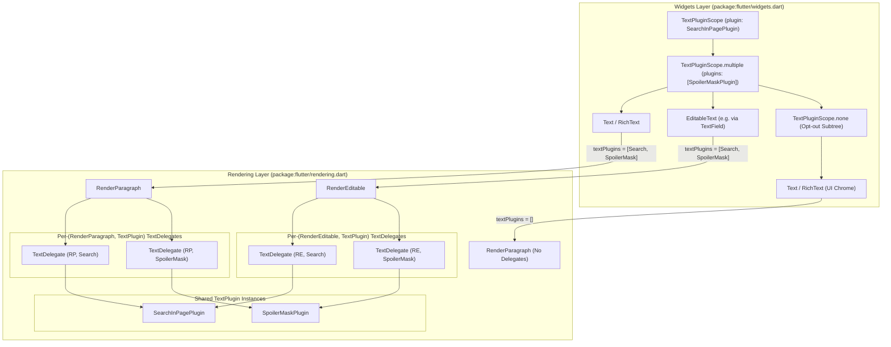
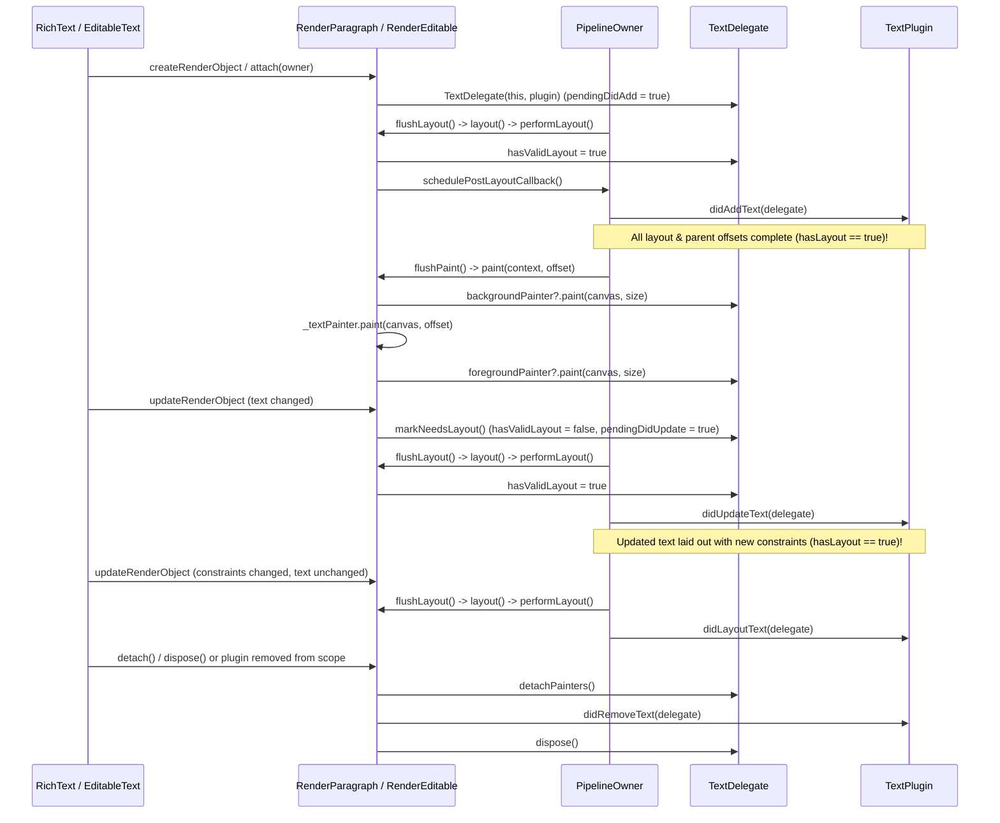
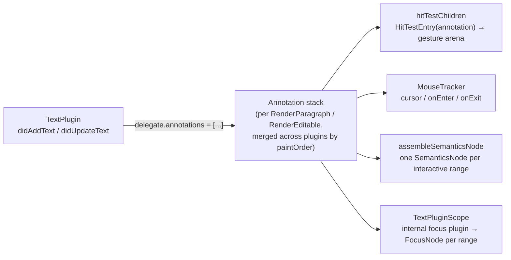
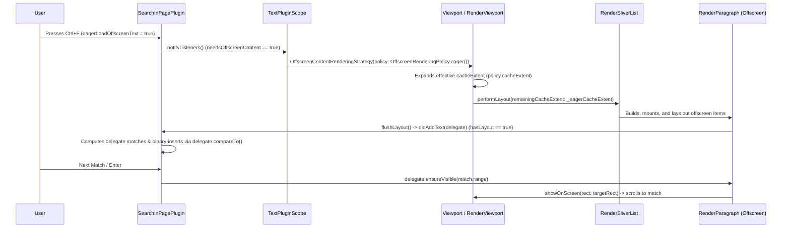

# RFC 170.0000: Composable Text Plugins in Flutter

## Overview

This RFC proposes a composable text plugin system in `package:flutter/rendering.dart` and `package:flutter/widgets.dart` centered on `TextPluginScope`, `TextPlugin`, and `TextDelegate`.

By attaching plugins through an `InheritedWidget` (`TextPluginScope`) directly to `RenderParagraph` and `RenderEditable`, applications and third-party packages can inspect rendered text, paint background and foreground decorations, declare interactive ranges (`TextAnnotation`) that participate in the gesture arena and are exposed to assistive technology and keyboard focus, scroll character ranges into view, and request offscreen sliver rendering (`OffscreenContentRenderingStrategy`) across standard `Text`, `RichText`, and `EditableText` (`TextField`) subtrees without modifying existing widget code.

## Table of contents

- [Overview](#overview)
- [1. Problem statement and motivation](#1-problem-statement-and-motivation)
  - [1.1 Why custom `Text` subclasses fail](#11-why-custom-text-subclasses-fail)
  - [1.2 Historical context, prior art, and acknowledgments](#12-historical-context-prior-art-and-acknowledgments)
- [2. Design goals and package boundaries](#2-design-goals-and-package-boundaries)
  - [2.1 Goals and non-goals](#21-goals-and-non-goals)
  - [2.2 Built-in framework plugins versus community packages](#22-built-in-framework-plugins-versus-community-packages)
- [3. Architecture and component design](#3-architecture-and-component-design)
  - [3.1 Layering and file organization](#31-layering-and-file-organization)
  - [3.2 `TextPlugin` lifecycle contract](#32-textplugin-lifecycle-contract)
  - [3.3 `TextDelegate` proxy for text render objects](#33-textdelegate-proxy-for-text-render-objects)
  - [3.4 `TextPluginScope` and hierarchical merging](#34-textpluginscope-and-hierarchical-merging)
  - [3.5 `RenderParagraph` and `RenderEditable` painting and Z-order pipeline](#35-renderparagraph-and-rendereditable-painting-and-z-order-pipeline)
  - [3.6 First-party `SearchInPagePlugin` implementation](#36-first-party-searchinpageplugin-implementation)
  - [3.7 Interactive ranges: `TextAnnotation` for gestures, mouse, semantics, and focus](#37-interactive-ranges-textannotation-for-gestures-mouse-semantics-and-focus)
- [4. Community package use cases](#4-community-package-use-cases)
  - [4.1 Use cases implemented in the demo app](#41-use-cases-implemented-in-the-demo-app)
  - [4.2 Additional community package ideas](#42-additional-community-package-ideas)
- [5. Feature deep dives](#5-feature-deep-dives)
  - [5.1 Scrolling, document ordering, and offscreen content rendering](#51-scrolling-document-ordering-and-offscreen-content-rendering)
  - [5.2 Should selection highlighting be a `TextPlugin`?](#52-should-selection-highlighting-be-a-textplugin)
- [6. Future directions and forward compatibility](#6-future-directions-and-forward-compatibility)
  - [6.1 Custom `TextPainter` render objects and non-text widgets with searchable labels](#61-custom-textpainter-render-objects-and-non-text-widgets-with-searchable-labels)
  - [6.2 Native text fields and platform views](#62-native-text-fields-and-platform-views)
- [7. Corner cases and architectural analysis](#7-corner-cases-and-architectural-analysis)
  - [7.1 `ChangeNotifier` and `setState` re-entrancy during build, layout, and dispose](#71-changenotifier-and-setstate-re-entrancy-during-build-layout-and-dispose)
  - [7.2 Why `didAddText`, `didUpdateText`, and `didLayoutText` are flushed post-layout](#72-why-didaddtext-didupdatetext-and-didlayouttext-are-flushed-post-layout)
  - [7.3 Embedded `WidgetSpan`s and UTF-16 offset alignment](#73-embedded-widgetspans-and-utf-16-offset-alignment)
  - [7.4 Text truncation and overflow clipping](#74-text-truncation-and-overflow-clipping)
  - [7.5 Multi-line wrapping, bidirectional text, and surrogate pairs](#75-multi-line-wrapping-bidirectional-text-and-surrogate-pairs)
  - [7.6 Plugin list reconciliation and stateful delegate preservation](#76-plugin-list-reconciliation-and-stateful-delegate-preservation)
  - [7.7 Deduplicating plugins by `Type` and instance across nested scopes](#77-deduplicating-plugins-by-type-and-instance-across-nested-scopes)
  - [7.8 Pointer event routing: the gesture arena, overlapping plugins, and selection gestures](#78-pointer-event-routing-the-gesture-arena-overlapping-plugins-and-selection-gestures)
  - [7.9 `SelectionArea` and `SelectableRegion` coexistence](#79-selectionarea-and-selectableregion-coexistence)
  - [7.10 Unintended capture of UI chrome and `TextPluginScope.none`](#710-unintended-capture-of-ui-chrome-and-textpluginscopenone)
  - [7.11 Lazy slivers and offscreen viewport recycling](#711-lazy-slivers-and-offscreen-viewport-recycling)
  - [7.12 Canvas state corruption in plugin painters](#712-canvas-state-corruption-in-plugin-painters)
  - [7.13 Semantics tree shape for annotated text](#713-semantics-tree-shape-for-annotated-text)
  - [7.14 Keyboard focus for annotated text](#714-keyboard-focus-for-annotated-text)

---

## 1. Problem statement and motivation

Flutter applications often need cross-cutting text features that inspect, decorate, or attach interactions to text across a page or widget subtree.

1. Find-in-page search locates all matches across separate [Text](https://github.com/flutter/flutter/blob/master/packages/flutter/lib/src/widgets/text.dart) and [RichText](https://github.com/flutter/flutter/blob/master/packages/flutter/lib/src/widgets/basic.dart) widgets. It also paints active and passive highlights and scrolls the active match into view.

2. Entity and pattern decoration highlights stock tickers (`GOOG`, `AAPL`), hashtags, mentions, or citations without mutating the source string. Callers do not need to pre-tokenize `TextSpan` trees.

3. Automatic linkification detects URLs (`https://...`, `www....`) in plain `Text` widgets, paints link underlines, and handles tap gestures.

4. Live content and SEO extraction indexes visible text across a subtree to generate Schema.org JSON-LD metadata, reading-time analytics, or crawler snapshots.

### 1.1 Why custom `Text` subclasses fail

Historically, package authors solved these problems by creating custom replacement widgets such as `LinkifyText`, `SearchableText`, and `ParsedText`. That approach fails in production apps for three reasons.

First, custom widgets do not compose. A developer cannot combine `LinkifyText` from one package with `StockTickerText` from another package on the same paragraph.

Second, replacing widgets requires invasive refactoring. Developers must replace every `Text` widget in the app, including those inside third-party packages or Material and Cupertino components (`ListTile`, `Card`, `DataTable`).

Third, individual text widgets lack document-level coordination unless paired with custom ancestor state management.

Cross-cutting text features therefore belong in an ambient, composable plugin pipeline attached via `InheritedWidget` (`TextPluginScope`). [RenderParagraph](https://github.com/flutter/flutter/blob/master/packages/flutter/lib/src/rendering/paragraph.dart) and [RenderEditable](https://github.com/flutter/flutter/blob/master/packages/flutter/lib/src/rendering/editable.dart) execute this pipeline directly, leaving standard `Text`, `RichText`, and `EditableText` widgets unchanged.

### 1.2 Historical context, prior art, and acknowledgments

This design builds on years of prototyping and architectural discussions across the Flutter team. We want to thank **Michael Goderbauer (`@goderbauer`)**, **Renzo Olivares (`@Renzo-Olivares`)**, and **Kevin Moore (`@kevmoo`)** for their work in this area.

#### 1. Michael Goderbauer's original Text Plugins proposal (November 2023)

In late 2023, **Michael Goderbauer** authored the original [Text Plugins One-Pager](https://docs.google.com/document/d/1doToFSPGJO29_FJ-VE7mD6XiNgF-s2xVaIi-UC495m8/edit?tab=t.0) after building an early [Find-in-Page web demo](https://goderbauer.github.io/demos/find-in-page/) with a custom `SearchableText` widget.

Goderbauer recognized that `SearchableText` could not compose with SEO text extraction, auto-linkification, or stock ticker highlighting. It also could not reach `Text` widgets inside third-party packages. He proposed the three core abstractions used in this design: `TextPluginScope`, `TextPlugin` (`didAddText`, `didUpdateText`, `didRemoveText`), and `TextDelegate` (`text`, `foregroundPainter`, `backgroundPainter`, `getBoxesForSelection`, `handleEvent`).

#### 2. Renzo Olivares's `Ctrl+F` and `TextPluginScope` prototype

**Renzo Olivares** turned the one-pager into a working framework prototype on his [text-plugins-alt](https://github.com/Renzo-Olivares/flutter/tree/text-plugins-alt) branch. His branch demonstrated end-to-end `Ctrl+F` (`SearchInPagePlugin`) alongside selection highlighting (`_SelectionHighlightTextPlugin`).

Renzo's prototype solved several rendering-layer problems that we carry forward here. He made `TextDelegate` implement `Listenable` (notifying plugins after `RenderParagraph.performLayout`) and `Comparable<TextDelegate>` (sorting delegates in visual document order via a Lowest Common Ancestor walk of the `RenderObject` tree).

He also exposed `placeholderRanges` (`includePlaceholders: false`) so regex and substring queries do not match across `WidgetSpan` `0xFFFC` boundaries, and added `ensureVisible()` to scroll active matches into view. Finally, he prototyped `_SelectionHighlightTextPlugin` inside `SelectableRegion` to test whether selection highlighting could use the `TextPlugin` paint pipeline.

#### 3. Kevin Moore's Find-in-Page experiment

**Kevin Moore** built an end-to-end `Ctrl+F` and `Cmd+F` prototype ([PR #193186](https://github.com/flutter/flutter/pull/193186), [RFC #25](https://github.com/flutter/rfc/pull/25)) that implemented Find-in-Page on top of `SelectableRegion`, `SelectionRegistrar`, and `RenderParagraph`'s internal `_SelectableFragment`.

This experiment validated developer demand and surfaced key edge cases, including offscreen lazy sliver discovery and `Semantics` label search. It also showed why `SelectableRegion` could not be the underlying foundation.

Adding search-specific properties (`searchHighlightColor`, `setSearchHighlights`) directly onto `Text`, `RenderParagraph`, and `Selectable` solved `Ctrl+F` in isolation. However, it could not generalize to linkification, spellcheck, or custom highlights, and could not support `EditableText` (`TextField`), which does not register with an ancestor `SelectableRegion`.

In addition, `_SelectableFragment` requires a `SelectionRegistrar`. Searching non-selectable pages required wrapping the subtree in a hidden "find-only" `SelectableRegion` (`_enableSelection: false`). That wrapper still added extra `SelectionContainer` elements per `Text` widget and required special logic to suppress selection cursors, focus changes, and gesture recognizers. These findings motivated unifying our work around `TextPluginScope`.

---

## 2. Design goals and package boundaries

### 2.1 Goals and non-goals

#### Goals

- Existing `Text('...')`, `Text.rich(...)`, and `EditableText` (`TextField`) widgets automatically participate when placed inside a `TextPluginScope`.

- Static text (`RenderParagraph`) and editable text (`RenderEditable`) both support plugins and update decorations live during text editing.

- Multiple plugins can inspect, paint behind or in front of, and make ranges interactive on the same `RenderParagraph` or `RenderEditable`, ordered by `TextPlugin.paintOrder` (with root-to-leaf scope installation order as a stable tie-breaker). The same order resolves which plugin wins a tap, which mouse cursor shows, and which plugin a screen reader describes when ranges overlap.

- Plugin-decorated ranges are first-class citizens for accessibility: a `TextAnnotation` with an action is exposed to VoiceOver/TalkBack as a link or button node, and is reachable with Tab and activated with Enter on desktop and web, with no extra work by the plugin author.

- Plugins interact with a capability-scoped `TextDelegate` wrapping `RenderParagraph` or `RenderEditable`, rather than mutating RenderObject internals directly.

- Subtrees such as toolbars, search inputs, or decorative chrome can opt out of ancestor plugins via `TextPluginScope.none` or filter specific plugin types via `TextPluginScope.exclude`.

- Rendering primitives live in `package:flutter/rendering.dart` (`packages/flutter/lib/src/rendering/text_plugin.dart`), and widget scoping lives in `package:flutter/widgets.dart` (`packages/flutter/lib/src/widgets/text_plugin.dart`). Neither layer depends on Material or Cupertino.

- While the initial implementation targets `RenderParagraph` and `RenderEditable`, `TextDelegate` and `TextPluginScope` are shaped so custom `TextPainter` render objects, non-text widgets, and native platform-view text fields can be integrated without breaking existing plugins (see [Section 6](#6-future-directions-and-forward-compatibility)).

#### Non-goals (current scope)

- We do not aim to build every plugin in the framework. We define the extensible architecture and provide core plugins (`SearchInPagePlugin` and `_SelectionHighlightTextPlugin`), while community packages provide domain-specific plugins.

- Non-text widgets (`Image`, `Icon`, custom `RenderBox` subclasses) are out of the initial scope. Section [6.1](#61-custom-textpainter-render-objects-and-non-text-widgets-with-searchable-labels) shows with concrete code how custom `TextPainter` render objects and non-text widgets can participate via `TextDelegateHost`.

- Text rendered by native OS or browser DOM views inside a Platform View (`HtmlElementView`, `UITextView`, `EditText`) is out of the initial scope. Section [6.2](#62-native-text-fields-and-platform-views) shows how `TextDelegate` can connect to the W3C `Range` and CSS Custom Highlight APIs (`CSS.highlights`) in a future phase.

- `TextPlugin` is not a security or PII redaction mechanism. Drawing an opaque bar in `foregroundPainter` only hides glyphs on screen, while the plain text remains accessible to `Ctrl+F`, `SelectionArea` copy-paste, the `Semantics` tree, and DevTools. Apps must scrub sensitive strings at the data layer before passing them to `Text` widgets.

- Plugins do not mutate the input `InlineSpan` tree or alter text layout metrics. They decorate and observe laid-out text via [CustomPainter](https://github.com/flutter/flutter/blob/master/packages/flutter/lib/src/rendering/custom_paint.dart) hooks (`backgroundPainter` and `foregroundPainter`).

---

### 2.2 Built-in framework plugins versus community packages

We separate what belongs in the core Flutter framework (`package:flutter`) from what belongs in community packages on `pub.dev`.

#### 2.2.1 Framework-builtin plugins (`package:flutter`)

Only plugins that implement platform-standard features with zero external dependencies belong inside `package:flutter`:

1. `SearchInPagePlugin` provides desktop and web `Ctrl+F` search highlighting, sequential match navigation, and viewport offscreen rendering management.

2. `_SelectionHighlightTextPlugin` is a candidate internal plugin for migrating `SelectionArea` and `SelectableRegion` selection highlighting onto the `TextPlugin` pipeline (evaluated in [Section 5.2](#52-should-selection-highlighting-be-a-textplugin)).

#### 2.2.2 Community package plugins (`pub.dev`)

Domain-specific or third-party-dependent features belong in standalone community packages:

1. `SpellCheckPlugin` (`package:flutter_spellcheck`) renders IME spellcheck squiggly underlines and grammar suggestions.

2. `LinkifyPlugin` (`package:flutter_linkify_plugin`) parses URLs with regular expressions, applies custom link styles, shows hover preview popups, and launches URLs via `url_launcher`.

3. `StockTickerPlugin` decorates financial symbols (`GOOG`, `AAPL`), detects crypto addresses, and formats currency conversions.

4. `SpoilerMaskPlugin` (`package:flutter_spoiler_mask`) renders interactive tap-to-reveal spoiler bars (`||...||`) and flashcard cloze-deletion study masks (`{{...}}`).

5. `ReadAloudPlugin` (`package:flutter_read_aloud`) synchronizes word-by-word TTS karaoke highlights with `flutter_tts` or cloud speech APIs.

6. `SeoExtractorPlugin` (`package:flutter_seo_text`) extracts plain text for Schema.org JSON-LD web crawlers.

7. `AiGroundingPlugin` renders LLM citation grounding popups and interactive source attribution spans.

#### 2.2.3 Principles for a general-purpose API

The `TextPlugin` API follows four design rules so it can support both core selection and community packages:

1. `TextDelegate` exposes an opinionated plain-text getter (`text`) and low-level geometry and painting primitives (`getBoxesForSelection`, `getPositionForOffset`, `getWordBoundary`, `getLineBoundary`, `getOffsetForCaret`, `backgroundPainter`, and `foregroundPainter`) rather than feature-specific methods.

2. `TextPluginScope` stacks plugins across the widget tree, deduplicating by plugin `Type` (so inner scopes can override outer scopes of the same `Type`, matching `Actions` and `Shortcuts`) and sorting by `TextPlugin.paintOrder`. `TextPluginScope.exclude(types: {...})` lets app developers filter out specific plugin types on UI chrome without disabling core plugins like `_SelectionHighlightTextPlugin`.

3. `bool get needsOffscreenContent` on `TextPlugin` and the standalone `OffscreenContentRenderingStrategy` widget (`OffscreenRenderingPolicy.lazy()` versus `OffscreenRenderingPolicy.eager({ScrollCacheExtent cacheExtent})`) let document-wide plugins request eager offscreen sliver rendering in `ListView.builder` viewports while allowing subtrees to customize or bound the offscreen `ScrollCacheExtent`. This keeps `Viewport` decoupled from `TextPluginScope`.

4. Interactivity is declared, not hand-rolled. A plugin describes *what a range is and does* with a `TextAnnotation` (`range`, `onTap`/`onLongPress` or a custom `recognizer`, `cursor`, `onEnter`/`onExit`, `semanticsLabel`, `linkUrl`) installed via `TextDelegate.annotations`. The host derives gesture-arena participation, mouse cursor and hover, `SemanticsNode`s, and keyboard focus from that one declaration (see [Section 3.7](#37-interactive-ranges-textannotation-for-gestures-mouse-semantics-and-focus)), so plugins never compete with scrolling, text selection, or each other through raw pointer events.

---

## 3. Architecture and component design

At the widget level, developers wrap any subtree in `TextPluginScope`:

```dart
TextPluginScope.multiple(
  plugins: [
    SearchInPagePlugin(query: 'Flutter'),
    SpoilerMaskPlugin(), // e.g., tap-to-reveal ||spoiler|| & {{cloze}} masks
  ],
  child: Column(
    children: [
      // Standard widgets automatically participate in the plugin pipeline!
      Text('Welcome to Flutter! ||Plot twist||'), // Automatically highlighted & masked
      TextField(),                                // Text input also automatically inspected

      // Developers can easily firewall UI chrome from being affected:
      TextPluginScope.none(
        child: Text('Search query: Flutter'), // Safely isolated from plugins
      ),
    ],
  ),
)
```



### 3.1 Layering and file organization

| Layer | File | Public Symbols | Responsibility |
| :--- | :--- | :--- | :--- |
| **Rendering** | `packages/flutter/lib/src/rendering/text_plugin.dart` | `TextPlugin`, `TextDelegate`, `TextAnnotation` | Defines the plugin lifecycle interface (`needsOffscreenContent`, `paintOrder`, post-layout callbacks), the per-plugin `TextDelegate` proxy wrapping `RenderParagraph` or `RenderEditable`, and `TextAnnotation`, the span-shaped overlay (`HitTestTarget` + `MouseTrackerAnnotation`) from which hosts derive hit testing, cursor, and semantics for a range. |
| **Rendering** | [packages/flutter/lib/src/rendering/object.dart](https://github.com/flutter/flutter/blob/master/packages/flutter/lib/src/rendering/object.dart) | `PipelineOwner.schedulePostLayoutCallback` | Flushes post-layout callbacks at the end of `PipelineOwner.flushLayout()` after all dirty `RenderObject`s have completed layout and before `flushPaint()`. |
| **Rendering** | [packages/flutter/lib/src/rendering/paragraph.dart](https://github.com/flutter/flutter/blob/master/packages/flutter/lib/src/rendering/paragraph.dart) | `RenderParagraph.textPlugins` | Reconciles delegates, schedules post-layout lifecycle callbacks, adds annotations to the hit-test path, splits semantics nodes at annotation boundaries, routes raw pointer events, and executes painters for static text. |
| **Rendering** | [packages/flutter/lib/src/rendering/editable.dart](https://github.com/flutter/flutter/blob/master/packages/flutter/lib/src/rendering/editable.dart) | `RenderEditable.textPlugins` | Same as `RenderParagraph` for editable text fields; annotation semantics nodes are only produced for read-only, non-obscured fields so an editable field stays one text-field node. |
| **Widgets** | `packages/flutter/lib/src/widgets/text_plugin.dart` | `TextPluginScope` | Scopes, deduplicates by `Type`, and sorts `TextPlugin`s by `paintOrder` down the widget tree, configures `OffscreenContentRenderingStrategy` when any active plugin has `needsOffscreenContent == true`, and installs an internal focus plugin that mirrors interactive annotations as `FocusNode`s (Tab/Enter) and paints the focus ring. |
| **Widgets** | [packages/flutter/lib/src/widgets/viewport.dart](https://github.com/flutter/flutter/blob/master/packages/flutter/lib/src/widgets/viewport.dart) | `OffscreenRenderingPolicy`, `OffscreenContentRenderingStrategy` | Inherited strategy controlling whether descendant `Viewport` and `ShrinkWrappingViewport` widgets render offscreen sliver content lazily or eagerly with a configurable `ScrollCacheExtent`. |
| **Widgets** | [packages/flutter/lib/src/widgets/basic.dart](https://github.com/flutter/flutter/blob/master/packages/flutter/lib/src/widgets/basic.dart) | `RichText.textPlugins` | Resolves `textPlugins ?? TextPluginScope.maybeOf(context)` and forwards to `RenderParagraph`. |
| **Widgets** | [packages/flutter/lib/src/widgets/editable_text.dart](https://github.com/flutter/flutter/blob/master/packages/flutter/lib/src/widgets/editable_text.dart) | `EditableText.textPlugins` | Resolves `textPlugins ?? TextPluginScope.maybeOf(context)` and forwards to `_Editable` and `RenderEditable`. |

### 3.2 `TextPlugin` lifecycle contract

Defined in `packages/flutter/lib/src/rendering/text_plugin.dart`, `TextPlugin` exposes declarative `needsOffscreenContent` and `paintOrder` getters and four lifecycle hooks:

```dart
abstract class TextPlugin {
  const TextPlugin();

  bool get needsOffscreenContent => false; // Eagerly build offscreen slivers when true
  int get paintOrder => 0;                 // Smaller values paint further behind

  void didAddText(TextDelegate delegate) {}
  void didUpdateText(TextDelegate delegate) {}
  void didLayoutText(TextDelegate delegate) {}
  void didRemoveText(TextDelegate delegate) {}
}
```

There is deliberately **no raw pointer hook** on `TextPlugin`. All input, including taps, long-presses, drags, mouse cursor, and hover, is declared per range with a `TextAnnotation` ([Section 3.7](#37-interactive-ranges-textannotation-for-gestures-mouse-semantics-and-focus)), which is itself a `HitTestTarget`: it receives the pointer events for its glyphs and routes them through the gesture arena, so scrolling, text selection, authored `TextSpan.recognizer`s, and other plugins are arbitrated by the framework rather than by each plugin. An earlier prototype had a `handlePointerEvent(delegate, event)` hook; it was removed because it was the one path that bypassed the arena ([Section 7.8](#78-pointer-event-routing-the-gesture-arena-overlapping-plugins-and-selection-gestures)) and because `TextSpan`, the model for `TextAnnotation`, has never needed one.

#### Post-layout lifecycle guarantee (`didAddText`, `didUpdateText`, `didLayoutText`)

Plugins often need to query word boxes (`getBoxesForSelection`) or screen positions (`localToGlobal`) and attach a painter as soon as text appears or changes:

- **Before or during layout is too early:** Sizes and parent offsets are not finalized yet, so geometry queries crash or return stale coordinates.
- **After the frame (`addPostFrameCallback`) is too late:** The frame has already painted, causing a 1-frame flash of unhighlighted (or unmasked) text.

To hit the exact sweet spot **after layout finishes and before paint starts**, `RenderParagraph` and `RenderEditable` schedule these callbacks at the end of `PipelineOwner.flushLayout()` via `PipelineOwner.schedulePostLayoutCallback` (see [Section 7.2](#72-why-didaddtext-didupdatetext-and-didlayouttext-are-flushed-post-layout) for pipeline details). Every glyph box and screen coordinate is ready (`delegate.hasLayout == true`), and any `backgroundPainter` or `foregroundPainter` set in the callback paints in the **same frame**:

1. **`didAddText(delegate)`**: Fires once after a new `(RenderObject, TextPlugin)` pair finishes its first layout.
2. **`didUpdateText(delegate)`**: Fires post-layout when the text or span styles changed.
3. **`didLayoutText(delegate)`**: Fires post-layout when layout constraints changed without the text changing. *(A delegate receives at most one of `didAddText`, `didUpdateText`, or `didLayoutText` per frame.)*
4. **`didRemoveText(delegate)`**: Fires synchronously when a plugin is removed from scope or the render object detaches. *(Skipped if layout never ran, so `didAddText` and `didRemoveText` are always paired.)*



### 3.3 `TextDelegate` proxy for text render objects

Passing `RenderParagraph` directly to plugins would allow plugins to corrupt layout state, mutate constraints, or overwrite each other's painters. Instead, **each `(RenderObject, TextPlugin)` pair gets its own dedicated `TextDelegate` instance** (a strict 1-to-1 cardinality per `(RenderObject, TextPlugin)` pair):

- If a `RenderParagraph` is inside a scope with 3 active `TextPlugin`s (`SearchInPagePlugin`, `LinkifyPlugin`, and `SpoilerMaskPlugin`), `RenderParagraph` creates 3 distinct `TextDelegate` instances.
- Each `TextDelegate` owns isolated `backgroundPainter` and `foregroundPainter` slots for its specific `TextPlugin`. When `SearchInPagePlugin` sets `delegate.backgroundPainter = null`, it only clears its own delegate's painter slot and never affects `LinkifyPlugin` or `SpoilerMaskPlugin`. Setting or replacing a painter checks `shouldRepaint`, attaches or detaches the painter's `Listenable` (`addListener(_paragraph.markNeedsPaint)`), and calls `markNeedsPaint()` only when needed.

```dart
class TextDelegate extends ChangeNotifier {
  final RenderBox renderObject;
  final TextPlugin plugin;

  // Text & layout state
  String get text;
  InlineSpan get textSpan;
  bool get hasLayout;
  Size get size;

  // Isolated per-plugin painter slots
  CustomPainter? backgroundPainter;
  CustomPainter? foregroundPainter;

  // Isolated per-plugin interactive ranges (Section 3.7)
  List<TextAnnotation> annotations;
  List<TextAnnotation> annotationsAt(int offset); // All plugins, topmost first
  Rect? getBoundsForAnnotation(TextAnnotation annotation);

  // What kind of text this is, for click policy (Section 7.8)
  bool get isEditable;   // RenderEditable (TextField / SelectableText)
  bool get isReadOnly;   // RenderEditable.readOnly
  bool get isSelectable; // Registered with a SelectionRegistrar, or editable with selection enabled

  // Geometry & scrolling
  List<ui.TextBox> getBoxesForSelection(TextSelection selection, { ... });
  ui.TextPosition getPositionForOffset(Offset offset);
  void ensureVisible(ui.TextRange range, { ... });
}
```

#### Opinionated plain-text and geometry contract

To prevent subtle offset alignment bugs across plugins, `TextDelegate` is deliberately opinionated about how text and glyph boxes are exposed:

1. **`delegate.text`**: Always returns `_paragraph.text.toPlainText(includeSemanticsLabels: false)` (keeping `includePlaceholders: true`, so each inline `WidgetSpan` is represented by a single `\uFFFC` character matching `ui.Paragraph`'s internal UTF-16 buffer). Plugin authors never call `InlineSpan.toPlainText` themselves and never have to worry about `TextSpan.semanticsLabel` shifting character offsets or plugins accidentally matching accessibility label overrides. `delegate.textSpan` remains available as a read-only inspection getter for plugins that explicitly inspect font styles.
2. **`delegate.getBoxesForSelection`**: Defaults to `bool includePlaceholders = false` (`List<ui.TextBox> getBoxesForSelection(TextSelection selection, {ui.BoxHeightStyle boxHeightStyle = ui.BoxHeightStyle.tight, ui.BoxWidthStyle boxWidthStyle = ui.BoxWidthStyle.tight, bool includePlaceholders = false})`), automatically splitting selection ranges around `delegate.placeholderRanges` so text highlights and underlines do not paint across inline `WidgetSpan` children unless explicitly requested.
3. **`delegate.hasLayout`**: Tracks `renderObject.hasSize && _hasValidLayout` (where `_hasValidLayout` is set to `false` in `markNeedsLayout()` and `true` at the end of `performLayout()`). Unlike `RenderObject.debugNeedsLayout` (which always returns `false` in release builds), `delegate.hasLayout` is accurate in both debug and release modes, and is guaranteed to be `true` inside `didAddText`, `didUpdateText`, `didLayoutText`, and `CustomPainter.paint`.

Finally, `TextDelegate` provides coordinate conversion and scrolling helpers: `localToGlobal`, `globalToLocal`, `getTransformTo`, `showOnScreen`, and `ensureVisible`. These helpers allow find-in-page plugins to scroll the active match into the viewport.

### 3.4 `TextPluginScope` and hierarchical merging

`TextPluginScope` uses an internal `InheritedWidget` (`_InheritedTextPluginScope`) that resolves, deduplicates, and orders active plugins down the widget tree during `build`:

```dart
class TextPluginScope extends StatefulWidget {
  const TextPluginScope({required TextPlugin plugin, required Widget child, Key? key});
  const TextPluginScope.multiple({required List<TextPlugin> plugins, required Widget child, Key? key});
  const TextPluginScope.exclude({required Set<Type> types, required Widget child, Key? key});
  const TextPluginScope.none({required Widget child, Key? key});

  static List<TextPlugin>? maybeOf(BuildContext context);
  static List<TextPlugin> of(BuildContext context);
}
```

1. **`Type`-based deduplication and inner-scope override**: Like Flutter's `Actions` and `Shortcuts` widgets, `TextPluginScope` deduplicates plugins by their concrete `runtimeType` (`Map<Type, TextPlugin>`). When an inner `TextPluginScope` provides a plugin of type `T`, it overrides any ancestor plugin of the same type `T` for its descendant subtree. This matches `TextPluginScope.exclude(types: {T})` and guarantees that at most one instance of any given `TextPlugin` subclass is active on a `RenderParagraph` or `RenderEditable`.

2. **Ordering via `TextPlugin.paintOrder`**: After merging ancestor and local plugins into the `Map<Type, TextPlugin>`, `TextPluginScope` stably sorts the active plugins in ascending order of `plugin.paintOrder` (default `0`), using root-to-leaf scope installation order as a tie-breaker when two plugins have the same `paintOrder`. This decouples visual Z-order and pointer routing priority from widget-tree nesting depth when needed (for example, allowing an outer `SelectionArea` highlight plugin with `paintOrder: 100` to paint above an inner background badge plugin with `paintOrder: 0`).

3. **Filtering and opt-out (`exclude` and `none`)**: `TextPluginScope.exclude(types: {...})` filters out ancestor plugins whose `runtimeType` is in `types`, while `TextPluginScope.none` installs an empty scope (`plugins: const <TextPlugin>[]`), disabling all ancestor plugins for its `child` subtree.

### 3.5 `RenderParagraph` and `RenderEditable` painting and Z-order pipeline

`RichText` and `EditableText` forward `textPlugins ?? TextPluginScope.maybeOf(context)` to `RenderParagraph` and `RenderEditable`, which reconcile `TextDelegate`s, schedule post-layout callbacks, and paint in three core stages from back to front:

```dart
class RenderParagraph extends RenderBox { // Same host contract on RenderEditable
  List<TextPlugin>? textPlugins; // Reconciles 1-to-1 TextDelegate instances

  @override
  void performLayout() {
    _layoutTextWithConstraints(constraints);
    owner?.schedulePostLayoutCallback(_flushTextPluginNotifications);
  }

  @override
  void paint(PaintingContext context, Offset offset) {
    for (final d in _delegates) d.backgroundPainter?.paint(...); // 1. Backgrounds
    _textPainter.paint(context.canvas, offset);                  // 2. Glyphs & spans
    for (final d in _delegates) d.foregroundPainter?.paint(...); // 3. Foregrounds
  }
}
```

1. Plugin `backgroundPainter`s run in ascending `paintOrder` (with root-to-leaf `TextPluginScope` installation order breaking ties), clipped to `offset & size` when `_needsClipping` is true.

2. Paragraph glyphs and inline children (`_textPainter.paint` and `paintInlineChildren`) paint with any applicable overflow shader or clipping.

3. Plugin `foregroundPainter`s run in ascending `paintOrder` (with root-to-leaf `TextPluginScope` installation order breaking ties), clipped when `_needsClipping` is true.

In our current prototype, existing `SelectionArea` and `EditableText` selection layers remain in place around stage 2 (`_SelectableFragment.paintSelection` before `_textPainter.paint` and `_SelectableFragment.paintHandles` after `foregroundPainter`s in `RenderParagraph`; `_backgroundRenderObject` and `_foregroundRenderObject` in `RenderEditable`). When selection highlighting is migrated to `_SelectionHighlightTextPlugin` (see [Section 5.2](#52-should-selection-highlighting-be-a-textplugin)), selection highlight rectangles paint as a `backgroundPainter` in stage 1 with a higher `paintOrder` than default feature plugins.

### 3.6 First-party `SearchInPagePlugin` implementation

`SearchInPagePlugin` is the primary first-party `TextPlugin` motivating this proposal, providing drop-in `Ctrl+F` / `Cmd+F` Find-in-Page across any subtree of `Text`, `RichText`, and `EditableText` widgets.

#### 3.6.1 Public API and `ChangeNotifier` integration

`SearchInPagePlugin` extends `TextPlugin` and mixes in `ChangeNotifier` for two reasons. First, search bar UIs can wrap `ListenableBuilder(listenable: searchPlugin, ...)` to display `"${activeMatchIndex + 1} of ${matches.length}"` and enable or disable next/previous buttons. Second, `TextPluginScope` detects `plugin is Listenable` and subscribes to `needsOffscreenContent` transitions automatically when `eagerLoadOffscreenText` is toggled.

```dart
@immutable
class SearchMatch {
  const SearchMatch({required this.delegate, required this.range});
  final TextDelegate delegate;
  final TextRange range;
  List<ui.TextBox> getBoxes();
}

class SearchInPagePlugin extends TextPlugin with ChangeNotifier {
  SearchInPagePlugin({bool caseSensitive = false, bool eagerLoadOffscreenText = false, ...});

  String query;
  bool caseSensitive;
  bool eagerLoadOffscreenText;

  List<SearchMatch> get matches;
  int get activeMatchIndex;
  SearchMatch? get activeMatch;

  void nextMatch();
  void previousMatch();
  void scrollToActiveMatch();

  @override
  bool get needsOffscreenContent => eagerLoadOffscreenText;

  @override
  void didAddText(TextDelegate delegate) { ... }

  @override
  void didUpdateText(TextDelegate delegate) { ... }

  @override
  void didRemoveText(TextDelegate delegate) { ... }
}
```

#### 3.6.2 Incremental per-delegate match indexing and active match preservation

`SearchInPagePlugin` caches matches per delegate (`Map<TextDelegate, List<SearchMatch>> _matchesByDelegate`) and keeps only the $K$ delegates that currently have matches in a document-ordered list (`List<TextDelegate> _orderedMatchingDelegates`), so a change to one text widget never costs work proportional to the $N$ mounted widgets on the page (abridged):

```dart
@override
void didUpdateText(TextDelegate delegate) {
  _updateDelegateMatches(delegate, _computeMatchesForDelegate(delegate)); // Scans only this delegate.
}

void _updateDelegateMatches(TextDelegate delegate, List<SearchMatch> newMatches) {
  final List<SearchMatch> oldMatches = _matchesByDelegate[delegate] ?? const <SearchMatch>[];
  if (listEquals(oldMatches, newMatches)) return; // Unrelated edit: zero work.

  // Splice only this delegate's slice in `_orderedMatchingDelegates` and `_matches`
  // (binary-insert if newly matching, remove if empty, or replaceRange in place).
  _spliceDelegateMatches(delegate, oldMatches, newMatches);
  _reconcileActiveMatch();             // Preserve active match by (delegate, range) value.
  _updatePainterForDelegate(delegate); // Update only affected delegate painters.
  _notifyListenersSafely();
}
```

1. **Single-delegate updates**: `didAddText`, `didUpdateText`, and `didRemoveText` scan and splice only the affected delegate. A full scan (`_rescanAllDelegates()`) runs only when `query` or `caseSensitive` changes, and even then sorts only the $K$ matching delegates.

2. **No full re-sorts**: because `_orderedMatchingDelegates` stays sorted by `TextDelegate.compareTo`, an update checks at most its two neighbors (`_isDelegateOutOfOrder`, in case keyed children were reordered) and falls back to a sort only in that rare case.

3. **Active match preservation**: `_reconcileActiveMatch` finds `previousActive` in the spliced `_matches` by `SearchMatch` value equality on `(delegate, range)`, so `activeMatchIndex` shifts with the content instead of resetting to `0` while items mount, unmount, or edit above the focused match.

#### 3.6.3 Two-layer custom painting (`backgroundPainter` and `foregroundPainter`)

Instead of looping over all mounted `_delegates` on every update or match navigation, `_updatePainterForDelegate(delegate)` updates painters only on the changed `delegate` (plus `oldActive.delegate` and `newActive.delegate` whenever `activeMatch` moves between delegates):

1. If a delegate has no matches, both `delegate.backgroundPainter` and `delegate.foregroundPainter` are set to `null`. Because each `(RenderObject, TextPlugin)` pair has its own dedicated `TextDelegate` instance (see [Section 3.3](#33-textdelegate-proxy-for-text-render-objects)), setting `delegate.backgroundPainter = null` only clears `SearchInPagePlugin`'s painter on that paragraph and never affects painters attached by other plugins in the scope.

2. Every delegate with one or more matches receives a `_SearchBackgroundPainter` on `delegate.backgroundPainter`. During stage 1 of `RenderParagraph.paint` (behind the text glyphs), it queries `delegate.getBoxesForSelection(...)` and fills rounded rectangles (`Radius.circular(3.0)`) using `matchHighlightColor` for passive matches and `activeMatchBackgroundColor` for the active match.

3. Only the delegate containing `activeMatch` receives a `_SearchForegroundPainter` on `delegate.foregroundPainter`. During stage 3 of `RenderParagraph.paint` (in front of the text glyphs), it strokes a `1.75px` rounded border (`activeMatchBorderColor`, inflated by `2.0px`) around the active match boxes so the focused match stands out clearly against dense text.

#### 3.6.4 Post-layout scrolling and safe notification coalescing

Because `didAddText`, `didUpdateText`, and `didLayoutText` run at the end of `PipelineOwner.flushLayout()`, `delegate.hasLayout` is already `true` whenever a delegate is added or updated:

1. Calling `scrollToActiveMatch()` from `nextMatch()` or `previousMatch()` can immediately invoke `current.delegate.ensureVisible(current.range, duration: duration, curve: curve)` because every delegate in `_matches` has already completed layout.

2. As detailed in [Section 7.1](#71-changenotifier-and-setstate-re-entrancy-during-build-layout-and-dispose), `_notifyListenersSafely()` checks `SchedulerBinding.instance.schedulerPhase == SchedulerPhase.persistentCallbacks`. Because `flushLayout()` runs inside `SchedulerPhase.persistentCallbacks`, `_notifyListenersSafely()` sets `_notificationScheduled = true` and coalesces all delegate mutations in that frame into a single `addPostFrameCallback` call to `notifyListeners()`.

### 3.7 Interactive ranges: `TextAnnotation` for gestures, mouse, semantics, and focus

Painters cover *how a range looks*. Everything about *how a range behaves and what it means* (tapping, mouse cursor and hover, what a screen reader announces, keyboard focus) is declared with one value type, `TextAnnotation`, installed through `TextDelegate.annotations`:

```dart
class TextAnnotation implements HitTestTarget, MouseTrackerAnnotation {
  TextAnnotation({
    required ui.TextRange range,     // UTF-16 offsets into TextDelegate.text
    Object? key,                     // Identity across re-scans (defaults to range + linkUrl + semanticsLabel)
    VoidCallback? onTap,             // Backed by an annotation-owned TapGestureRecognizer
    VoidCallback? onLongPress,       // Backed by an annotation-owned LongPressGestureRecognizer
    GestureRecognizer? recognizer,   // Escape hatch: plugin-owned, like TextSpan.recognizer
    MouseCursor cursor = MouseCursor.defer,
    PointerEnterEventListener? onEnter,
    PointerHoverEventListener? onHover, // Pointer moves within the range (tooltips that follow the pointer)
    PointerExitEventListener? onExit,
    String? semanticsLabel,          // Replaces the spoken text of the range
    Uri? linkUrl,                    // Exposes the range as a link
  });
}
```

A `TextAnnotation` is deliberately shaped like a `TextSpan` without text and style: `TextSpan` already `implements HitTestTarget, MouseTrackerAnnotation`, carries a `recognizer`, `mouseCursor`, `onEnter`/`onExit`, and `semanticsLabel`, and `RenderParagraph` already knows how to turn it into a hit-test entry, a cursor, and a `SemanticsNode`. Plugins cannot mutate the span tree (a non-goal in [Section 2.1](#21-goals-and-non-goals)), so annotations let them hand the host the *same information for a range*, and the host reuses the same machinery:



#### 3.7.1 Hit testing and the gesture arena

In `RenderParagraph.hitTestChildren` and `RenderEditable.hitTestChildren`, the glyph under the pointer is resolved as before; the host then adds a `HitTestEntry` for every annotation covering that code unit (topmost first), followed by the authored `TextSpan` (if it is a `HitTestTarget`) and finally the paragraph itself. `TextAnnotation.handleEvent` does exactly what `TextSpan.handleEvent` does: on `PointerDownEvent` it calls `addPointer` on its recognizers. From there the gesture arena, not plugin code, arbitrates:

- A drag that starts on a link scrolls the page: the tap recognizer rejects itself once the pointer moves past the slop, and the scrollable's drag recognizer wins. No `kTouchSlop` bookkeeping in plugins.
- Two plugins annotating the same characters both enter the arena; when the pointer is released the arena sweeps and the **first member wins**, which is the topmost annotation. Exactly one callback fires.
- A plugin `onLongPress` and an authored span `onTap` on the same range are different gesture types, so both keep working.
- A spoiler mask painted over an authored link is visually on top and is added first: tapping it reveals the spoiler instead of navigating.
- In static text a single click on a link wins over the `TapAndPanGestureRecognizer` of an enclosing `SelectableRegion`, because the paragraph is deeper in the hit-test path and its entries come first.

Annotation-owned recognizers are created lazily on the first pointer and disposed by the host when the annotation is uninstalled, so plugins that use `onTap`/`onLongPress` have no gesture lifecycle to manage. The `recognizer` escape hatch is for everything else, including deciding *per pointer* whether to compete at all: `LinkifyPlugin` uses a `TapGestureRecognizer` whose `isPointerAllowed` only accepts modifier-clicks inside editable or selectable text ([Section 7.8](#78-pointer-event-routing-the-gesture-arena-overlapping-plugins-and-selection-gestures)). As with `TextSpan.recognizer`, a plugin-owned recognizer is disposed by the plugin.

#### 3.7.2 Mouse cursor and hover

Nothing extra is needed. `MouseTracker` collects every `MouseTrackerAnnotation` on the hit-test path, calls `onEnter`/`onExit` per annotation, and `MouseCursorManager` uses the first non-deferred cursor in hit-test order. Because the annotation is also a `HitTestTarget`, `PointerHoverEvent`s for its glyphs reach `TextAnnotation.handleEvent` and are forwarded to `onHover`, the equivalent of `MouseRegion.onHover`, for tooltips that follow the pointer. `cursor: SystemMouseCursors.click` gives a link a hand cursor; the default `MouseCursor.defer` lets a lower annotation's cursor or the `SelectionArea` text cursor show through. `validForMouseTracker` becomes `false` as soon as the host uninstalls an annotation, so stale annotations never receive `onExit`.

#### 3.7.3 Semantics

`RenderParagraph.describeSemanticsConfiguration` builds `List<InlineSpanSemanticsInformation>` from the span tree; the concatenation of `info.text` is exactly `delegate.text` (same `\uFFFC` placeholder convention as [Section 7.3](#73-embedded-widgetspans-and-utf-16-offset-alignment)), so annotation ranges and semantics runs share one coordinate space. A single pure function, `applyTextAnnotationsToSemantics`, splits the runs at annotation boundaries and wraps the covered segments in a `TextAnnotationSemanticsInformation` (a subclass that overrides `requiresOwnNode`). After that the **existing** `assembleSemanticsNode` loop builds the child nodes exactly as it does for `TextSpan.recognizer`: rect from `getBoxesForSelection`, `OrdinalSortKey`, `isHidden` for clipped ranges, no node for truncated ranges ([Section 7.4](#74-text-truncation-and-overflow-clipping)), stable node identity via `_cachedChildNodes`, and `showOnScreen`. The only annotation-specific code is `TextAnnotation.describeSemanticsConfiguration`, which sets `onTap`/`onLongPress`, `isLink` + `linkUrl` (or `isButton` for a tappable range without a URL), and `isFocusable`/`isFocused`/`onFocus` when a focus node exists.

The rules that keep the semantics tree sane are spelled out in [Section 7.13](#713-semantics-tree-shape-for-annotated-text); the short version is that **decoration never fragments the tree**: only an annotation with an action or a `linkUrl` creates its own node, a `semanticsLabel` alone just replaces the spoken text inside the merged paragraph label, and `SearchInPagePlugin`, `SpellcheckLinterPlugin`, and `ReadAloudPlugin` set no annotations at all.

#### 3.7.4 Keyboard focus

`FocusNode`s need a `BuildContext` (`attach`, scope reparenting, traversal geometry), so focus cannot live in the rendering layer, and it should not require new plumbing through `RichText` and `EditableText`. `TextPluginScope` therefore installs an internal `_TextAnnotationFocusPlugin` in its own plugin list, the same trick `SelectableRegion` uses for `_SelectionHighlightTextPlugin`. Being a plugin, it discovers every text widget through `didAddText`/`didRemoveText`, listens to each delegate (which is notified whenever *any* plugin changes annotations on that text), and mirrors the focusable annotations as `_TextAnnotationFocusNode`s attached to the scope's context. Details are in [Section 7.14](#714-keyboard-focus-for-annotated-text).

#### 3.7.5 One ordering rule

Where annotations of different plugins overlap, the annotation of the plugin with the highest `paintOrder` (then innermost scope) is the topmost one. The same order is used for the hit-test path (so it wins the arena), for the cursor candidates (so its cursor shows), and for semantics (so a screen reader describes it). This mirrors Flutter's universal "hit test in reverse paint order" rule, and it means "what you see on top is what you interact with". Within one plugin, annotations must be sorted and non-overlapping (asserted in debug mode).

#### 3.7.6 What `LinkifyPlugin` looks like with annotations

```dart
void _scanLinks(TextDelegate delegate) {
  final matches = <_LinkMatch>[for (final m in _urlRegExp.allMatches(delegate.text)) _LinkMatch.from(m)];
  delegate.foregroundPainter = matches.isEmpty ? null : _LinkPainter(delegate, matches, underlineColor);

  // Editor convention: in editable or selectable text a plain click places the
  // caret / selects a word, so there a link only opens on modifier-click.
  final bool requiresModifier = delegate.isEditable || delegate.isSelectable;
  delegate.annotations = <TextAnnotation>[
    for (final link in matches)
      TextAnnotation(
        range: link.range,
        key: link.url,
        cursor: SystemMouseCursors.click,
        linkUrl: Uri.tryParse(link.url),
        onTap: requiresModifier ? null : () => onLinkTapped?.call(link.url),
        recognizer: requiresModifier ? _ModifierClickRecognizer(onActivate: () => onLinkTapped?.call(link.url)) : null,
      ),
  ];
}
```

Compared with the earlier prototype, the `PointerDownEvent`/`PointerUpEvent` bookkeeping is gone, and the plugin gains a hand cursor, hover callbacks, link nodes for VoiceOver/TalkBack, and Tab/Enter support it never had. `StockTickerPlugin` (`isButton` nodes labelled "GOOG, Alphabet Inc., up 2.4 percent") and `SpoilerMaskPlugin` (whose `semanticsLabel` is "Spoiler, hidden" while masked and `null` once revealed, so screen-reader users get the same reveal experience as sighted users) convert the same way.

---

## 4. Community package use cases

`TextPlugin` combines text inspection (`text`, `placeholderRanges`), sub-span geometry (`getBoxesForSelection`, `getPositionForOffset`, `getWordBoundary`), custom painting (`backgroundPainter`, `foregroundPainter`), interactive ranges (`annotations`), and viewport control (`ensureVisible`, `compareTo`, `needsOffscreenContent`, `paintOrder`). Together, these primitives support drop-in packages across any `Text`, `RichText`, or `EditableText` subtree.

### 4.1 Use cases implemented in the demo app

Alongside `SearchInPagePlugin` (covered in [Section 3.6](#36-first-party-searchinpageplugin-implementation) and [Section 5.1](#51-scrolling-document-ordering-and-offscreen-content-rendering)), our demo app (`examples/text_plugins`) implements six community-style plugins to validate the API across real interactions:

#### 1. TTS read-aloud karaoke synchronizer (`ReadAloudPlugin`)

`ReadAloudPlugin` sorts mounted `TextDelegate`s in visual reading order via `delegates.sort()` (`TextDelegate.compareTo`) and tokenizes words while skipping `0xFFFC` `WidgetSpan` placeholders. It tints the active paragraph in `backgroundPainter`, paints a pill highlight over the spoken word in `foregroundPainter`, and calls `delegate.ensureVisible(wordRange)` when narration crosses a paragraph boundary. Updating word highlights via `CustomPainter` and `TextDelegate.markNeedsPaint()` avoids rebuilding or re-laying out `RenderParagraph` on every word boundary.

#### 2. Interactive spoiler and study-cloze masking (`SpoilerMaskPlugin`)

`SpoilerMaskPlugin` scans `delegate.text` for spoiler tags (`||...||`, `[spoiler]...[/spoiler]`) or flashcard cloze-deletion markers (`{{...}}`). In `foregroundPainter` (which runs after `_textPainter.paint()`), it draws an opaque rounded cover over the hidden glyphs. Each mask is a `TextAnnotation` whose `onTap` toggles revealing or re-masking that span and calls `markNeedsPaint()`; while masked, its `semanticsLabel` is `"Spoiler, hidden"` so screen-reader users get the same reveal experience as sighted users.

Because `TextPlugin` is non-destructive and does not mutate the input `InlineSpan` string or alter glyph layout metrics, the delimiter characters (`||` or `{{`) remain part of the laid-out paragraph run when revealed. Depending on the desired UX, the plugin can either leave the syntax delimiters visible around the revealed text or paint an opaque background-colored mask over the delimiter `ui.TextBox`es (`range.start..range.start + 2` and `range.end - 2..range.end`) in `foregroundPainter` so the `||` markers remain visually hidden after reveal without triggering text relayout.

#### 3. Read-only spellcheck and style-guide linter (`SpellcheckLinterPlugin`)

`SpellcheckLinterPlugin` inspects rendered text for common misspellings (`recieve`, `seperate`, `occured`, `teh`) and terminology rules. In `foregroundPainter`, it draws wavy red or amber underlines along `box.toRect().bottom` using `Path`, and shows replacement suggestions when tapped.

#### 4. Interactive financial ticker badges (`StockTickerPlugin`)

`StockTickerPlugin` matches financial ticker symbols (`GOOG`, `AAPL`, `MSFT`, `NVDA`) in `delegate.text`, paints green or red pill backgrounds in `backgroundPainter`, and draws underline accents in `foregroundPainter`. Each ticker is a `TextAnnotation` with `onTap` (so the gesture arena keeps scroll drags from opening it), a hand cursor, and a `semanticsLabel` such as `"GOOG, Alphabet Inc., up 2.4 percent"` that assistive technology reads as a button.

#### 5. Automatic URL linkification (`LinkifyPlugin`)

`LinkifyPlugin` detects URLs (`https://...`, `www....`) inside plain `Text` and `EditableText` widgets. It draws link tints and underlines with `backgroundPainter` and `foregroundPainter`, and declares one `TextAnnotation` per URL ([Section 3.7.6](#376-what-linkifyplugin-looks-like-with-annotations)) with `onTap`, `cursor: SystemMouseCursors.click`, and `linkUrl`, without requiring callers to split strings into `TextSpan`s with `TapGestureRecognizer`s.

Because annotations are `MouseTrackerAnnotation`s, **mouse-over tooltips or preview popups** need no workaround: `onEnter` fires with the hover position when the pointer enters the link's glyphs and `onExit` fires when it leaves them (also when the paragraph scrolls away under a stationary pointer), so the plugin can anchor an `OverlayPortal` at `delegate.localToGlobal(delegate.getBoundsForAnnotation(annotation)!.topLeft)` and dismiss it on exit. In editable or selectable text the plugin follows the editor convention described in [Section 7.8](#78-pointer-event-routing-the-gesture-arena-overlapping-plugins-and-selection-gestures): a plain click keeps placing the caret or selecting, and the link opens on Cmd/Ctrl+click (or a touch tap).


#### 6. Live content and SEO metadata extraction (`SeoExtractorPlugin`)

`SeoExtractorPlugin` is a headless inspection plugin that attaches no painters. As `TextDelegate`s mount, update, and unmount, it indexes visible text in document order (`compareTo`) to compute live word counts, reading-time estimates, and structured Schema.org JSON-LD metadata.

### 4.2 Additional community package ideas

Beyond the plugins implemented in the demo app, the same `TextPlugin` primitives can support other community packages:

- Inline dictionary, translation, and furigana popovers triggered by hover or long-press via `getPositionForOffset` and `getWordBoundary`, or focus reading rulers that dim surrounding lines in `foregroundPainter`.
- Staging-build QA detectors that highlight untranslated l10n keys (`auth.login.button_title`), broken interpolation placeholders (`{userName}`), or typography widows and orphans.
- Collaborative document annotations, persistent user highlights, and multiplayer presence carets positioned via `getOffsetForCaret`.
- AI source-attribution citations, 120fps shader shimmer effects driven by an `AnimationController` on `foregroundPainter` without text relayout, and smart entity links for log viewers (UUIDs, Git SHAs, `file.dart:123:45` stack traces, and timestamps).

---

## 5. Feature deep dives

### 5.1 Scrolling, document ordering, and offscreen content rendering

Supporting browser-style Find-in-Page (`Ctrl+F`) across scrollable Flutter views requires solving three problems at the rendering and widget layers:

1. Scrolling to a matched character range (`TextDelegate.ensureVisible`).

2. Sorting matches in visual document order regardless of lazy mount order (`TextDelegate.compareTo`).

3. Eagerly rendering offscreen content in `ListView.builder`, `SliverList.builder`, and `CustomScrollView` when `Ctrl+F` is active so offscreen items are built, laid out, and searchable (`TextPlugin.needsOffscreenContent` and `OffscreenContentRenderingStrategy`).



---

#### 5.1.1 Scrolling to a specific character range (`TextDelegate.ensureVisible`)

Scrolling to an entire `RenderParagraph` (`showOnScreen(rect: null)`) is not enough when a paragraph spans multiple screens or when a nested scroll view clips part of a line.

`TextDelegate.ensureVisible` computes the glyph bounding rectangle for any `TextRange` and reveals it across all enclosing viewports:

```dart
void ensureVisible(ui.TextRange range, {Duration duration = Duration.zero, Curve curve = Curves.ease}) {
  assert(hasLayout);
  final List<ui.TextBox> boxes = getBoxesForSelection(
    TextSelection(baseOffset: range.start, extentOffset: range.end),
    boxHeightStyle: ui.BoxHeightStyle.max,
  );
  // Union glyph boxes (or fall back to the caret rect at `range.start` if empty):
  final Rect targetRect = boxes.isNotEmpty
      ? boxes.map((b) => b.toRect()).reduce((a, b) => a.expandToInclude(b))
      : _caretRectAt(range.start);
  showOnScreen(rect: targetRect, duration: duration, curve: curve);
}
```

When `showOnScreen` runs, `_paragraph.showOnScreen(descendant: _paragraph, rect: targetRect, duration: duration, curve: curve)` walks up the `RenderObject.parent` chain.

Each enclosing [RenderViewportBase](https://github.com/flutter/flutter/blob/master/packages/flutter/lib/src/rendering/viewport.dart) invokes `RenderViewportBase.showInViewport`. It queries `viewport.getOffsetToReveal(descendant, 0.0, rect: rect)` for the leading edge and `viewport.getOffsetToReveal(descendant, 1.0, rect: rect)` for the trailing edge.

If `targetRect` is already visible between the leading and trailing edges of the viewport, `RevealedOffset.clampOffset` returns `null` and no scroll occurs. Otherwise, `offset.moveTo(targetOffset.offset, duration: duration, curve: curve)` scrolls the minimal distance needed to bring `targetRect` onscreen, then continues walking up `super.showOnScreen` so nested scroll views scroll both axes into view.

---

#### 5.1.2 Document-order sorting (`TextDelegate implements Comparable<TextDelegate>`)

When a user starts in the middle of a `ListView.builder` (such as `Item 10`) and scrolls upward, `RenderSliverList` mounts `Item 9`, then `Item 8`, then `Item 7`. As a result, `didAddText` fires in the order `[Item 10, Item 9, Item 8, Item 7]`. If `SearchInPagePlugin` iterates over `_delegates` in registration order, pressing "Next Match" jumps backward up the document.

Comparing global screen coordinates (`localToGlobal(Offset.zero).dy`) also fails for general layouts. Two side-by-side columns or wrapped flex items can have overlapping vertical coordinates even though they have a well-defined reading order in the widget tree.

We solve this with Lowest Common Ancestor (LCA) render-tree traversal:

1. `RenderParagraph` registers its `TextDelegate`s once attached to the `PipelineOwner` (when `RenderParagraph.parent` and the ancestor chain up to the root are linked) and unregisters them in `detach()`.

2. `TextDelegate.compareTo` walks up `RenderObject.parent` from both `this.renderObject` and `other.renderObject` to find their lowest common ancestor (`commonParent`) and the two diverging child branches (`thisBranch` and `otherBranch`).

3. It calls `commonParent.visitChildren(...)` to check which branch comes first. Because `ContainerRenderObjectMixin.visitChildren` (used by `RenderFlex`, `RenderWrap`, `RenderViewport`, and `RenderSliverList`) visits children from `firstChild` to `lastChild` in ascending logical index order, `delegates.sort()` produces top-to-bottom document order even when children are prepended during upward scrolling.

#### Performance characteristics of LCA sorting

For $N$ mounted `TextDelegate`s in a render tree of depth $D$ (typically $D \le 30$) and branching factor $B$ at the common container, a single `compareTo` call takes $O(D + B)$ pointer hops without allocating any geometric transforms, and sorting $N$ delegates takes $O((D + B) \cdot N \log N)$ time. In addition, because `RenderSliverList` and `RenderFlex` store doubly-linked sibling pointers (`SliverMultiBoxAdaptorParentData` / `ContainerBoxParentData`), when two delegates share the same sliver or flex parent, sibling order can be resolved or cached in $O(1)$ per item during a single linear pass over the container's children. Finally, as shown in [Section 3.6.2](#362-incremental-per-delegate-match-indexing-and-active-match-preservation), `SearchInPagePlugin` only maintains sorted order for the $K$ delegates that actually contain matches (binary-inserting a newly matching delegate in $O((D + B) \log K)$ comparisons and splicing matches in place on `didUpdateText` without re-sorting), keeping document-order sorting well under `<0.5ms` even for hundreds of mounted paragraphs.

---

#### 5.1.3 Declarative offscreen content rendering (`needsOffscreenContent` and `OffscreenContentRenderingStrategy`)

In Flutter's sliver protocol ([RenderViewport._attemptLayout](https://github.com/flutter/flutter/blob/master/packages/flutter/lib/src/rendering/viewport.dart) and [RenderSliverList.performLayout](https://github.com/flutter/flutter/blob/master/packages/flutter/lib/src/rendering/sliver_list.dart)), `RenderViewport` computes `_calculatedCacheExtent` from `scrollCacheExtent` (defaulting to `250.0` logical pixels before and after the visible viewport).

`RenderSliverList` only builds and lays out children whose layout offsets fall within `[scrollOffset + cacheOrigin, scrollOffset + cacheOrigin + remainingCacheExtent]`. It calls `collectGarbage(leadingGarbage, trailingGarbage)` to destroy children outside that window. In a `ListView.builder` with 50 items, items #10 through #50 do not exist in the Element or RenderObject trees until scrolled near the viewport.

Rather than coupling `Viewport` to `TextPluginScope`, we split the design into two clean abstractions: `bool get needsOffscreenContent` on `TextPlugin` (defaulting to `false`, returning `true` when document-wide scanning is active) and `OffscreenContentRenderingStrategy` (`OffscreenRenderingPolicy`) on `Viewport`.

When multiple plugins are composed in a `TextPluginScope`, the scope requests eager offscreen rendering if any active plugin has `needsOffscreenContent == true`. In `SearchInPagePlugin`, pressing `Ctrl+F` or `Cmd+F` sets `eagerLoadOffscreenText = true` (`needsOffscreenContent => true`) and calls `notifyListeners()`.

At the widget layer, `OffscreenRenderingPolicy` holds a configurable `ScrollCacheExtent?`, and `OffscreenContentRenderingStrategy` is a standalone `InheritedWidget` in `package:flutter/widgets.dart`:

```dart
@immutable
class OffscreenRenderingPolicy {
  const OffscreenRenderingPolicy.lazy() : isEager = false, cacheExtent = null;
  const OffscreenRenderingPolicy.eager({
    ScrollCacheExtent this.cacheExtent = const ScrollCacheExtent.pixels(1e6),
  }) : isEager = true;

  final bool isEager;
  final ScrollCacheExtent? cacheExtent;
}

class OffscreenContentRenderingStrategy extends InheritedWidget {
  const OffscreenContentRenderingStrategy({required this.policy, required super.child, super.key});
  final OffscreenRenderingPolicy policy;
  static OffscreenRenderingPolicy of(BuildContext context) { ... }
}
```

`Viewport` and `ShrinkWrappingViewport` in [packages/flutter/lib/src/widgets/viewport.dart](https://github.com/flutter/flutter/blob/master/packages/flutter/lib/src/widgets/viewport.dart) do not import `text_plugin.dart`; they only query `OffscreenContentRenderingStrategy.of(context)`.

`TextPluginScope` separates `_InheritedTextPluginScope` (which provides `List<TextPlugin>` to `RichText` and `EditableText`) from `OffscreenContentRenderingStrategy` (which provides `OffscreenRenderingPolicy` to `Viewport`). When a plugin's `needsOffscreenContent` flips between `false` and `true`, only `Viewport` and `ShrinkWrappingViewport` rebuild; existing onscreen `RichText` widgets do not rebuild.

When `policy.isEager` is `true`, `Viewport` and `ShrinkWrappingViewport` apply `policy.cacheExtent` (defaulting to `const ScrollCacheExtent.pixels(1e6)`).

We use `1e6` (`1,000,000.0` logical pixels, ~1,200–1,500 screens of scroll) as the default eager cache extent instead of `double.maxFinite` or `double.infinity`. In `RenderViewport._attemptLayout`, `fullCacheExtent = mainAxisExtent + 2 * _calculatedCacheExtent` and `centerCacheOffset = centerOffset + _calculatedCacheExtent`. Using `double.maxFinite` (`1.79e308`) overflows `2 * _calculatedCacheExtent` to `double.infinity` (producing `NaN` in `fullCacheExtent - centerCacheOffset`) and loses floating-point mantissa precision when adding `centerOffset`. By contrast, `1e6` pixels stays well within IEEE-754 float64 exact precision while remaining overridable via `OffscreenContentRenderingStrategy`.

When the user closes `Ctrl+F` (`eagerLoadOffscreenText = false`), `OffscreenContentRenderingStrategy` switches back to `const OffscreenRenderingPolicy.lazy()` and restores the normal `250.0` pixel `cacheExtent`. On the next layout pass, `RenderSliverList.collectGarbage` unmounts offscreen items and triggers `didRemoveText` for each one.

#### Performance trade-offs and bounding `cacheExtent`

Because Flutter's `Widget`, `Element`, and `RenderObject` trees (`RenderSliverList`, `RenderParagraph`) are single-threaded on the UI isolate, offscreen widgets cannot be inflated or laid out on a background isolate. Eagerly building and laying out offscreen children in a single frame has a main-thread cost proportional to the number of items within `cacheExtent`.

Because `OffscreenRenderingPolicy` carries a configurable `ScrollCacheExtent?`, developers can bound or disable eager offscreen rendering for any expensive or infinite scroll view using `OffscreenContentRenderingStrategy`:
- **Bounding `cacheExtent` per scroll view**: Wrap a large `ListView` or `CustomScrollView` in `OffscreenContentRenderingStrategy(policy: const OffscreenRenderingPolicy.eager(cacheExtent: ScrollCacheExtent.pixels(5000.0)), child: ...)` (or `ScrollCacheExtent.viewport(5.0)`) to cap how far ahead of the viewport offscreen items are eagerly built.
- **Opting out a scroll view (`OffscreenRenderingPolicy.lazy()`)**: Wrap an expensive or infinite list (`itemCount == null`) in `OffscreenContentRenderingStrategy(policy: const OffscreenRenderingPolicy.lazy(), child: ...)` so it remains strictly lazy even when an ancestor `TextPluginScope` has `needsOffscreenContent == true`.

---

### 5.2 Should selection highlighting be a `TextPlugin`?

When a user drags to select text inside a [SelectionArea](https://github.com/flutter/flutter/blob/master/packages/flutter/lib/src/material/selection_area.dart) or [SelectableRegion](https://github.com/flutter/flutter/blob/master/packages/flutter/lib/src/widgets/selectable_region.dart), Flutter draws a colored rectangle behind the selected characters. A natural architectural question is what parts of text selection can be implemented as a `TextPlugin`, and what parts cannot.

#### 5.2.1 What `TextPlugin` can do: painting selection highlights

In `RenderParagraph` today, selection highlight painting (`_SelectableFragment.paintSelection`) queries `getBoxesForSelection` and draws rectangles on the canvas before the text glyphs paint:

```dart
for (final TextBox textBox in paragraph.getBoxesForSelection(selection)) {
  context.canvas.drawRect(textBox.toRect().shift(offset), selectionPaint);
}
```

Because this is the same operation performed by a plugin `backgroundPainter`, `SelectableRegion` can install a `_SelectionHighlightTextPlugin` via `TextPluginScope` that reads the paragraph's active selection from `TextDelegate` and paints the highlight boxes.

Moving selection highlight painting into a `TextPlugin` simplifies `RenderParagraph.paint` and allows apps to customize how selection highlights look (such as rounded selection corners or collaborative cursors) using the standard plugin pipeline.

---

#### 5.2.2 Trade-offs and what `TextPlugin` cannot do alone

Evaluating selection as a `TextPlugin` highlights four architectural trade-offs and boundaries:

##### 1. Paint order between `SelectionArea` and inner feature plugins (solved by `TextPlugin.paintOrder`)

`SelectionArea` is typically mounted near the root of an app or page, while feature plugins (such as `StockTickerPlugin`, which paints an opaque green pill behind `"GOOG"`) are mounted deeper inside the page body:

```dart
SelectionArea( // Outer scope: _SelectionHighlightTextPlugin (paintOrder: 100)
  child: Scaffold(
    body: TextPluginScope(
      plugin: stockTickerPlugin, // Inner scope: opaque green pill (paintOrder: 0)
      child: const Text('Buy GOOG today'),
    ),
  ),
)
```

If plugin paint order were locked strictly to root-to-leaf widget tree nesting, the inner opaque `"GOOG"` pill would paint over the outer `SelectionArea` highlight, making `"GOOG"` look unselected. `TextPlugin.paintOrder` (see [Section 3.2](#32-textplugin-lifecycle-contract) and [Section 3.4](#34-textpluginscope-and-hierarchical-merging)) solves this cleanly: `_SelectionHighlightTextPlugin` declares a higher `paintOrder` (for example, `int get paintOrder => 100`) than default feature plugins (`paintOrder => 0`), so selection highlights always paint above opaque background badges from inner `TextPluginScope`s while still painting behind the paragraph's text glyphs.

##### 2. Per-widget `Text(selectionColor: ...)` and inline `WidgetSpan`s

A single `_SelectionHighlightTextPlugin` installed at the root `SelectableRegion` only knows the default selection color from `DefaultSelectionStyle`. If a descendant `Text('Warning', selectionColor: Colors.red)` overrides its selection color, or if a `Text.rich` contains inline `WidgetSpan`s that split the paragraph into multiple selectable ranges, the plugin cannot render accurately unless `TextDelegate` exposes per-paragraph `selectionColor` and `selections` (where `getBoxesForSelection` defaults to `includePlaceholders: false` so inline widgets are not highlighted).

##### 3. Plugin opt-out (`TextPluginScope.none` versus `TextPluginScope.exclude`)

If a developer wraps a sidebar in `TextPluginScope.none` so `SeoExtractorPlugin` ignores the sidebar text, `TextPluginScope.none` removes all ancestor plugins, including `_SelectionHighlightTextPlugin`. Users could still copy the sidebar text, but the visual selection highlight would disappear. Using `TextPluginScope.exclude(types: {SeoExtractorPlugin})` lets developers disable specific feature plugins without stripping selection highlighting.

##### 4. Mobile drag handles and cross-widget selection

While `CustomPainter` can draw selection rectangles on a `Canvas`, it cannot replace the rest of `_SelectableFragment` inside `RenderParagraph`:

1. Mobile selection drag handles (the teardrop handles on Android and iOS) require pushing composited `LeaderLayer`s (`context.pushLayer(LeaderLayer(...))`) into the `PaintingContext` during `RenderParagraph.paint`. A `CustomPainter` only receives a `Canvas` and cannot push composited layers.

2. `SelectionArea` coordinates selection gestures across both text (`RenderParagraph`) and non-text widgets (such as selectable images), so `RenderParagraph` must still register its selectable fragments with `SelectionRegistrar`.

---

#### 5.2.3 Summary: what can and cannot move to `TextPlugin`

| Selection Responsibility | Can be a `TextPlugin`? | Architectural Reason |
| :--- | :--- | :--- |
| **Drawing selection highlight boxes** | **Yes** | Maps directly to `TextDelegate.backgroundPainter` + `getBoxesForSelection(...)` + `paintOrder`, provided `TextDelegate` exposes `selections` and `selectionColor`. |
| **Custom selection styles (rounded rects, animations)** | **Yes** | Custom `TextPlugin` painters can draw any `Canvas` decoration behind or in front of selected glyphs. |
| **Mobile drag handle positioning (`LeaderLayer`)** | **No (not via `CustomPainter`)** | Requires `PaintingContext.pushLayer(LeaderLayer(...))` and `alwaysNeedsCompositing` on `RenderParagraph`. |
| **Gesture dispatch and cross-widget selection** | **No** | Handled by `SelectableRegion` and `SelectionRegistrar` across both text and non-text `Selectable` render objects. |

#### 5.2.4 Follow-up roadmap: what it would take to migrate `SelectionArea` to `TextPlugin`

Moving all of `SelectionArea`'s text responsibilities into a `TextPlugin` involves a core trade-off: it removes roughly 2,100 lines of `_SelectableFragment` code from `RenderParagraph`, but it requires expanding `TextDelegate` beyond canvas painting into composited layer management and `SelectionRegistrar` plumbing.

Because of that trade-off, this initial proposal keeps Flutter's built-in selection rendering unchanged while landing the core `TextPlugin` pipeline first. If we choose to migrate `SelectionArea` to `TextPlugin` in a follow-up, it would require four steps:

1. Expose per-paragraph `selections` (`List<TextSelection>`) and `selectionColor` (`Color?`) on `TextDelegate`, and have `SelectionContainer` and `SelectableRegion` install `_SelectionHighlightTextPlugin` to draw selection boxes via `delegate.backgroundPainter`.

2. Set `_SelectionHighlightTextPlugin.paintOrder` above default feature plugins (`0`) so outer `SelectionArea` highlights paint over opaque background badges from inner feature plugins.

3. Extend `TextDelegate` with `delegate.registerHandleLayers(startLink, endLink)` so a selection plugin can push composited `LeaderLayer`s for mobile drag handles during `RenderParagraph.paint` and `RenderEditable._paintContents`.

4. Use `TextPluginScope.exclude(types: {...})` on UI chrome so disabling feature plugins never strips `_SelectionHighlightTextPlugin`, and then remove the legacy selection highlight painting code from `RenderParagraph` and `RenderEditable`.

The scope's internal focus plugin ([Section 7.14](#714-keyboard-focus-for-annotated-text)) is a second instance of the same pattern (a framework concern implemented as an ordinary `TextPlugin` installed by a widget), which is encouraging for this migration.

---

## 6. Future directions and forward compatibility

Although the initial scope targets `RenderParagraph` and `RenderEditable`, we shaped `TextDelegate`, `TextPlugin`, and `TextPluginScope` so the architecture can expand to custom `TextPainter` render objects, non-text widgets, and native platform-view text fields without breaking existing plugins.

---

### 6.1 Custom `TextPainter` render objects and non-text widgets with searchable labels

Users searching a page (`Ctrl+F` via `SearchInPagePlugin`) or listening to an article (`ReadAloudPlugin`) often expect custom widgets that paint text directly with `TextPainter` (such as custom chips, table cells, or canvas badges) as well as labeled non-text widgets (`Image(semanticLabel: '...')`, `Icon(semanticLabel: '...')`, or custom charts like `BarChart` and `Sparkline`) to be discoverable, highlighted, scrolled into view, and narrated in document order alongside standard `Text` paragraphs.

#### 1. Concrete example: custom widget and `RenderBox` using `TextPainter` directly

Because `TextDelegate.renderObject` is typed as `RenderBox`, `TextDelegateHostMixin` on `RenderBox` provides the `textPlugins` setter, post-layout `TextDelegate` flush scheduling (`markNeedsTextDelegateUpdate()`, `didLayoutTextDelegates()`), pointer event forwarding (`handleEvent`), and painter hooks (`paintTextPluginBackgrounds`, `paintTextPluginForegrounds`). Any custom `RenderBox` that paints text directly with `TextPainter` can mix in `TextDelegateHostMixin` to participate in `TextPluginScope`:

```dart
mixin TextDelegateHostMixin on RenderBox {
  String get plainText;
  InlineSpan get textSpan => TextSpan(text: plainText);
  ui.TextDirection get textDirection;
  List<ui.TextBox> getBoxesForSelection(TextSelection selection, { ... });

  List<TextPlugin>? textPlugins;

  @protected void markNeedsTextDelegateUpdate();
  @protected void didLayoutTextDelegates();
  @protected void paintTextPluginBackgrounds(PaintingContext context, Offset offset);
  @protected void paintTextPluginForegrounds(PaintingContext context, Offset offset);
}

class RenderCustomBadgeText extends RenderBox with TextDelegateHostMixin {
  // Widget forwards `textPlugins ?? TextPluginScope.maybeOf(context)`.
  // Label setter updates `_textPainter.text` and calls `markNeedsTextDelegateUpdate()`.
  final TextPainter _textPainter;

  @override
  String get plainText => _textPainter.plainText;

  @override
  List<ui.TextBox> getBoxesForSelection(TextSelection selection, { ... }) =>
      _textPainter.getBoxesForSelection(selection, ...);

  @override
  void performLayout() {
    _textPainter.layout(maxWidth: constraints.maxWidth);
    size = constraints.constrain(_textPainter.size);
    didLayoutTextDelegates();
  }

  @override
  void paint(PaintingContext context, Offset offset) {
    paintTextPluginBackgrounds(context, offset);
    _textPainter.paint(context.canvas, offset);
    paintTextPluginForegrounds(context, offset);
  }
}
```

#### 2. Concrete example: simple non-text widget (`LabeledColorBox` / `Image` / `Icon`)

Unlike a `TextPainter`-backed widget where substrings map to individual glyph boxes, a simple non-text `RenderBox` (such as an image, icon, or colored thumbnail) exposing a searchable `label` maps any non-empty `TextSelection` within `0..label.length` to the widget's full bounding box:

```dart
class RenderLabeledColorBox extends RenderBox with TextDelegateHostMixin {
  // Constructor, LeafRenderObjectWidget, and property setters omitted for brevity.
  String _label;
  Color _color;
  Size _boxSize;

  @override
  String get plainText => _label; // Setter calls markNeedsTextDelegateUpdate()

  @override
  List<ui.TextBox> getBoxesForSelection(TextSelection selection, { ... }) {
    if (!selection.isValid || selection.isCollapsed) return const <ui.TextBox>[];
    // Map any matched range within 0.._label.length to the widget's full bounds:
    return <ui.TextBox>[
      ui.TextBox.fromLTRBD(0, 0, size.width, size.height, textDirection),
    ];
  }

  @override
  void performLayout() {
    size = constraints.constrain(_boxSize);
    didLayoutTextDelegates();
  }

  @override
  void paint(PaintingContext context, Offset offset) {
    paintTextPluginBackgrounds(context, offset);
    context.canvas.drawRect(offset & size, Paint()..color = _color);
    paintTextPluginForegrounds(context, offset);
  }
}
```

While whole-widget highlighting works well for Search, TTS, and SEO, character-level typographic plugins like `SpellCheckPlugin` (which draws wavy underlines under words) should not underline an entire `Image`. Exposing `bool get hasCharacterBoxes` on `TextDelegate` lets character-specific plugins skip non-text delegates. Because an `Image` or opaque box paints across its bounds, non-text delegates can render highlight borders or tints in `foregroundPainter`.


#### 3. Complex non-text widgets (`BarChart`, `Sparkline`): widget-owned highlight rendering

A complex widget such as a `BarChart` or `Sparkline` may want to control how matched content is highlighted. A rectangular `CustomPainter` overlay does not know how to highlight a specific bar, pie slice, or sparkline vertex.

In `Ctrl+F` (`SearchInPagePlugin`) or TTS (`ReadAloudPlugin`), the plugin owns the document-wide coordinator state (the active search query, the `"3 of 12"` match count, and Next/Previous navigation). Meanwhile, the `BarChart` widget owns the domain-specific rendering of its data series.

We can separate match discovery (owned by the plugin) from highlight rendering (owned by the widget or host) by passing structured highlight ranges to `TextDelegate`, with the plugin's `CustomPainter` acting as the default fallback when a widget does not override highlight rendering:

```dart
class TextPluginHighlight {
  const TextPluginHighlight({
    required this.range,
    required this.role, // e.g., searchMatch, activeSearchMatch, spokenWord
    this.fallbackStyle, // Default color/decoration if host uses default painter
  });

  final ui.TextRange range;
  final Object role;
  final TextHighlightStyle? fallbackStyle;
}
```

`TextPluginHighlight` is the painting-side sibling of `TextAnnotation` ([Section 3.7](#37-interactive-ranges-textannotation-for-gestures-mouse-semantics-and-focus)): both are declarative, per-range data handed to the host. A natural evolution is to fold it into `TextAnnotation` as an optional `highlight` field, so a plugin describes a range once and hosts that cannot be painted on (charts, platform views) still receive it.

First, a `BarChart` exposes its data labels to `TextDelegate` (for example, `"Q1: $10M\nQ2: $15M\nQ3: $22M\nQ4: $18M"`).

Second, when `SearchInPagePlugin` queries `delegate.getBoxesForSelection(rangeForQ3)` for `ensureVisible`, the `BarChart` returns the bounding `Rect` of the Q3 bar so `Ctrl+F` scrolls directly to that bar.

Third, instead of painting a flat yellow rectangle over the chart, the `BarChart` receives the active `List<TextPluginHighlight>`, maps range `18..26` (`"Q3: $22M"`) back to `barIndex = 2`, and highlights that bar or sparkline vertex using its own graphics.

#### Summary across target widgets

| Target Widget | How `TextDelegate.text` Is Provided | How `getBoxesForSelection(range)` Works | Who Renders the Highlight? |
| :--- | :--- | :--- | :--- |
| **Standard `Text` / `EditableText`** | `InlineSpan.toPlainText(includeSemanticsLabels: false)` | `TextPainter` glyph boxes | **Plugin's default painter** (`CustomPainter` on `RenderParagraph`) |
| **Custom `TextPainter` `RenderBox`** | `TextPainter.plainText` via `TextDelegateHostMixin` | `TextPainter.getBoxesForSelection` | **Plugin's default painter** (`paintTextPluginBackgrounds` / `Foregrounds`) |
| **Simple `Image` / `Icon`** | `semanticLabel` | Whole widget bounding box (`0..w, 0..h`) | **Plugin's default painter** (or foreground border/tint) |
| **Complex Graphic (`BarChart`, `Sparkline`)** | Concatenated series / datum labels | Bounding box of the matched bar / datum | **The Chart Widget itself** (glows bar, pulses sparkline point, elevates slice) |
| **Native Platform View (`HtmlElementView`, `UITextView`)** | DOM `textContent` / native text | W3C `Range.getClientRects()` / `UITextInput` | **The Platform View itself** (via W3C `CSS.highlights` / `::highlight()` or `NSLayoutManager`) |

---

### 6.2 Native text fields and platform views

On Web and mobile platforms, apps may embed platform-rendered text fields or HTML views via Platform Views (`HtmlElementView`, `UiKitView`, `AndroidView`), where text shaping and painting happen inside the browser DOM or native OS toolkit rather than Flutter's `TextPainter`.

On Web (`HtmlElementView`), the W3C `Range` API and W3C CSS Custom Highlight API (`CSS.highlights` and `::highlight()`) use the same non-destructive decoration model as `TextPlugin`:

| `TextDelegate` Capability | Flutter (`RenderParagraph` / `RenderEditable`) | Web Platform View (W3C DOM APIs) | iOS / Android Native Text Views |
| :--- | :--- | :--- | :--- |
| **`text`** | `InlineSpan.toPlainText(includeSemanticsLabels: false)` | `element.textContent` | `UITextView.text` / `EditText.getText()` |
| **`getBoxesForSelection(range)`** | `ui.Paragraph.getBoxesForRange` | `Range.getClientRects()` (mapped to local `RenderBox` coordinates) | `UITextInput.selectionRects(for:)` / `Layout.getSelectionPath` |
| **`getPositionForOffset(point)`** | `TextPainter.getPositionForOffset` | `document.caretPositionFromPoint(x, y)` | `UITextInput.closestPosition(to:)` / `Layout.getOffsetForHorizontal` |
| **`ensureVisible(range)`** | `RenderObject.showOnScreen(rect)` | `Range.getBoundingClientRect()` + `scrollIntoView` / `showOnScreen` | `UITextView.scrollRangeToVisible` |
| **Range Decoration** | `CustomPainter` (`backgroundPainter` / `foregroundPainter`) | **`CSS.highlights.set(id, new Highlight(range))`** + `::highlight(id)` | `NSLayoutManager` temporary attributes / `Spannable` `CharacterStyle` |

To support platform views without breaking existing plugins:

1. `TextDelegate` can delegate text, geometry, and painting hooks to a `TextDelegateHost` interface that Platform View render objects can also implement.

2. A Flutter `CustomPainter` cannot paint between a native platform view's background and its text glyphs, and a canvas overlay cannot stay frame-synchronized with internal DOM compositor scrolling. The declarative `TextDelegate.annotations` slot ([Section 3.7](#37-interactive-ranges-textannotation-for-gestures-mouse-semantics-and-focus)) is the natural vehicle: extending `TextAnnotation` with an optional highlight style lets `RenderParagraph` and `RenderEditable` paint ranges with an internal `CustomPainter`, while Web Platform Views translate the same ranges into W3C `Range` instances registered in `CSS.highlights` (`::highlight()`), and the DOM `<a>`/`role="button"` elements they already own carry the annotation's `linkUrl` and `semanticsLabel`.

3. In browsers, W3C `Range` and `CSS.highlights` operate on DOM `Text` nodes. Because HTML `<input>` and `<textarea>` store their text inside a closed User-Agent shadow root (`.value`), native web text fields using `CSS.highlights` should use `<div contenteditable="plaintext-only">` (or a synchronized mirror DOM node) so character offsets map to DOM `Text` nodes.

---

## 7. Corner cases and architectural analysis

Below are 12 corner cases identified during design and prototyping, along with how the architecture handles each one.

### 7.1 `ChangeNotifier` and `setState` re-entrancy during build, layout, and dispose

Suppose a search bar widget at the top of the screen listens to `SearchInPagePlugin` (`ChangeNotifier`) via `ListenableBuilder` to display a match counter such as `"1 of 5 matches"`.

When the user scrolls a `ListView` and a new `Text` item mounts on screen, `PipelineOwner.flushLayout()` invokes `searchPlugin.didAddText(delegate)` while Flutter is in the middle of laying out the frame (`SchedulerPhase.persistentCallbacks`). Inside `didAddText`, `SearchInPagePlugin` scans the new paragraph and finds a sixth match (`"1 of 6 matches"`).

If `SearchInPagePlugin` calls `notifyListeners()` synchronously inside `didAddText` (or inside `didUpdateText`, `didLayoutText`, or `didRemoveText`), the search bar widget will call `setState()` while Flutter is still building or laying out the widget tree. Flutter then throws a `setState() or markNeedsBuild() called during build` assertion error.

To avoid this crash, plugins separate canvas repaints from external widget notifications:

- Updating `delegate.backgroundPainter = ...` inside `didAddText` or `didUpdateText` only calls `RenderParagraph.markNeedsPaint()`, which is always safe during build and layout because painting (`flushPaint()`) happens later in the same frame.
- When notifying external UI widgets (such as the `"1 of 6 matches"` counter in `SearchInPagePlugin._notifyListenersSafely`), if `SchedulerBinding.instance.schedulerPhase == SchedulerPhase.persistentCallbacks`, the plugin defers `notifyListeners()` to the end of the frame via `SchedulerBinding.instance.addPostFrameCallback`. When the user types in the search box between frames (`SchedulerPhase.idle`), `notifyListeners()` runs immediately.

---

### 7.2 Why `didAddText`, `didUpdateText`, and `didLayoutText` are flushed post-layout

In an early iteration of the prototype, `didAddText` ran synchronously inside `attach()` / `updateRenderObject()` (during `buildScope`), `didUpdateText` ran synchronously inside `RenderParagraph.text = ...` (immediately after `markNeedsLayout()`), and `didLayoutText` ran at the end of `RenderParagraph.performLayout()`. Empirical testing uncovered four subtle bugs with that timing:

1. **`_needsLayout` is still `true` inside `performLayout()`**: `RenderObject.layout()` sets `_needsLayout = false` *after* `performLayout()` returns. Calling `didLayoutText` inside `performLayout()` meant `debugNeedsLayout` was still `true`, so `delegate.hasLayout` returned `false` and `delegate.getBoxesForSelection(...)` crashed with `Assertion failed: !debugNeedsLayout is not true`.
2. **Release-mode false positives on `debugNeedsLayout`**: `RenderObject.debugNeedsLayout` unconditionally returns `false` in release builds (`if (!kDebugMode) return false;`). Checking `!renderObject.debugNeedsLayout` in `TextDelegate.hasLayout` falsely returned `true` in release mode when `RenderParagraph` had a dirty layout, causing `getBoxesForSelection` to return boxes computed under stale constraints or stale text.
3. **`RenderObject.debugActiveLayout` assertions**: While any `RenderObject` is inside `performLayout()`, `RenderObject.debugActiveLayout` is non-null, causing `otherDelegate.size` to fail an assertion in `RenderBox.size`.
4. **Unpositioned parent offsets**: Inside `RenderParagraph.performLayout()`, parent containers (`RenderFlex`, `RenderSliverList`) have not yet set `childParentData.offset` on the child, so `delegate.localToGlobal(Offset.zero)` returned unpositioned coordinates.

To solve all four issues:

1. `TextDelegate` tracks a dedicated `_hasValidLayout` boolean (set to `false` in `markNeedsLayout()` and `true` at the end of `performLayout()`), so `delegate.hasLayout` is accurate in both debug and release builds.
2. `RenderParagraph` and `RenderEditable` schedule `didAddText`, `didUpdateText`, and `didLayoutText` via `PipelineOwner.schedulePostLayoutCallback`, which flushes at the end of `PipelineOwner.flushLayout()` after all dirty `RenderObject`s have exited `layout()` and finalized parent offsets, and right before `PipelineOwner.flushPaint()`.
3. As a result, `delegate.hasLayout` is guaranteed to be `true` in all three callbacks (`didAddText`, `didUpdateText`, and `didLayoutText`), all geometry and coordinate queries (`getBoxesForSelection`, `size`, `localToGlobal`) succeed immediately, and painters set in those callbacks paint in the same frame.

---

### 7.3 Embedded `WidgetSpan`s and UTF-16 offset alignment

A `Text.rich` widget can contain inline `WidgetSpan` children:

```dart
Text.rich(
  TextSpan(
    children: [
      TextSpan(text: 'Buy '),
      WidgetSpan(child: Icon(Icons.trending_up)),
      TextSpan(text: ' GOOG today'),
    ],
  ),
)
```

Inside `TextPainter` and `ui.Paragraph`, every `PlaceholderSpan` occupies 1 UTF-16 code unit represented by the Unicode Object Replacement Character `\uFFFC` (`0xFFFC`).

If `delegate.text` omitted placeholders (`includePlaceholders: false`), `' GOOG today'` would start at index `4` in `delegate.text`, but at offset `5` in `TextPainter`. Passing `TextSelection(baseOffset: 4, extentOffset: 8)` to `getBoxesForSelection` would highlight `'GOO'` instead of `'GOOG'`. Conversely, if `delegate.text` used `includeSemanticsLabels: true` (the default of `InlineSpan.toPlainText()`), a `TextSpan(text: 'GOOG', semanticsLabel: 'Alphabet Inc.')` would return `'Alphabet Inc.'` in `delegate.text`, desynchronizing string indices from `TextPainter` glyph offsets and causing plugins to process accessibility label overrides instead of visible text.

To make this impossible to get wrong, `TextDelegate` enforces an opinionated contract:

1. `TextDelegate.text` always calls `_paragraph.text.toPlainText(includeSemanticsLabels: false)` internally (preserving `\uFFFC` placeholder code units and ignoring `semanticsLabel`). Plugin authors simply read `delegate.text` and never call `InlineSpan.toPlainText` directly.
2. Because `\uFFFC` is not a word character (`\w`) or whitespace (`\s`), regex patterns like `\bGOOG\b` naturally treat adjacent `WidgetSpan`s as word boundaries without shifting character indices.
3. `TextDelegate.getBoxesForSelection` defaults to `includePlaceholders: false`, automatically splitting any selection range around `delegate.placeholderRanges` so multi-word matches never highlight across an inline `WidgetSpan`.

---

### 7.4 Text truncation and overflow clipping

Suppose a `Text` widget has `maxLines: 1, overflow: TextOverflow.ellipsis` and a 500-character string where `'GOOG'` appears at character 400 (truncated behind `'...'`).

`delegate.text` returns the full 500-character string from `InlineSpan.toPlainText`, so a regex in `SearchInPagePlugin` or `StockTickerPlugin` still matches `'GOOG'` at offset `400..404`. For characters past the ellipsis cutoff, `ui.Paragraph.getBoxesForRange` returns an empty list `[]` or a collapsed zero-width box at the ellipsis end. For a match that straddles the ellipsis cutoff (`'https://flut...'`), `getBoxesForSelection` returns the box for the visible prefix (`'https://flut'`).

In `RenderParagraph.paint`, when `_needsClipping` is `true` (`TextOverflow.clip`, `TextOverflow.ellipsis`, `TextOverflow.fade`), both `backgroundPainter` and `foregroundPainter` passes are clipped to `offset & size` via `context.canvas.clipRect(offset & size)` so badges cannot bleed outside the paragraph bounds. In the future, exposing `bool didExceedMaxLines` or `TextRange getVisibleTextRange()` on `TextDelegate` can let search plugins filter out truncated matches when desired.

---

### 7.5 Multi-line wrapping, bidirectional text, and surrogate pairs

A single logical substring (such as a long URL wrapping across two lines, or an English phrase inside an Arabic or Hebrew RTL paragraph) does not map to a single `Rect`. `getBoxesForSelection` returns multiple `ui.TextBox` instances, one per line fragment and bidirectional run.

In addition, Dart `String` indices and `TextSelection` offsets are UTF-16 code units. Characters outside the Basic Multilingual Plane (such as emoji characters like U+1F680 or regional indicator flag pairs) occupy 2 or more UTF-16 code units.

Plugins should iterate over every `ui.TextBox` returned by `delegate.getBoxesForSelection(...)` for both painting and pointer hit-testing (`boxes.any((box) => box.toRect().contains(localPosition))`). When scrolling a multi-line match into view (`SearchInPagePlugin.scrollToActiveMatch`), `TextDelegate.ensureVisible` computes the bounding union of all boxes (`boxes.map((b) => b.toRect()).reduce((a, b) => a.expandToInclude(b))`) and passes it to `showOnScreen(rect: bounds)`.

---

### 7.6 Plugin list reconciliation and stateful delegate preservation

Suppose a user toggles a single plugin on or off in `TextPluginScope.multiple(plugins: _activePlugins, ...)`, changing the active plugin list from `[stockPlugin, linkifyPlugin, searchPlugin]` to `[stockPlugin, linkifyPlugin]`.

If `RenderParagraph` disposed all delegates and recreated them whenever `textPlugins` changed, `stockPlugin` and `linkifyPlugin` would receive unnecessary `didRemoveText` and `didAddText` calls on every toggle, losing any per-delegate state cached by `stockPlugin`.

In `RenderParagraph._syncTextPluginDelegates`, we diff the existing `_textPluginDelegates` keys against `newPlugins`:

1. Only plugins removed from `newPlugins` have their `TextDelegate` detached, notified via `plugin.didRemoveText(delegate)`, and disposed.

2. Plugins present in both the old and new lists keep their existing `TextDelegate` instance and attached painters, re-ordered to match the new `paintOrder` and installation order.

3. Only newly added plugins receive a new `TextDelegate` and schedule a post-layout `didAddText(delegate)`.

---

### 7.7 Deduplicating plugins by `Type` and instance across nested scopes

A widget tree might mount two scopes with the same plugin `Type` (for example, an outer `TextPluginScope(plugin: LinkifyPlugin(color: Colors.blue))` and an inner `TextPluginScope(plugin: LinkifyPlugin(color: Colors.green))`), or pass the same `TextPlugin` instance twice in `TextPluginScope.multiple(plugins: [pluginA, pluginA])`.

If `RenderParagraph` active plugins were not deduplicated by `Type`, both `LinkifyPlugin` instances would run on the same paragraph, doubling alpha opacity on highlights and firing two URL launch callbacks per tap.

We deduplicate at both layers:

1. **`Type`-based deduplication in `TextPluginScope`**: `TextPluginScope.build` merges ancestor and local plugins into a `Map<Type, TextPlugin>` keyed by `plugin.runtimeType`. An inner `TextPluginScope` providing a plugin of type `T` overrides any outer plugin of the same `Type` `T` for its subtree (matching `Actions`, `Shortcuts`, and `TextPluginScope.exclude(types: {T})`).
2. **Instance deduplication in `RenderParagraph` and `RenderEditable`**: `_syncTextPluginDelegates` also checks `if (orderedDelegates.containsKey(plugin)) continue;` in case duplicate plugin instances are passed directly to `RichText(textPlugins: [...])`.

---

### 7.8 Pointer event routing: the gesture arena, overlapping plugins, and selection gestures

Flutter has two layers of input: raw pointer events, delivered to every render object on the hit-test path, and the gesture arena, where recognizers compete so that exactly one tap, double-tap, or drag wins. An early prototype only used the first layer: a `TextPlugin.handlePointerEvent` hook fanned raw events to every plugin and each plugin hand-rolled "down, then up within `kTouchSlop`". That worked for scroll drags but nothing arbitrated between plugins, authored `TextSpan.recognizer`s, `SelectableRegion`, and `TextField`: two plugins on one range both fired, and a double-click to select a link's word inside a `SelectionArea` also opened the link twice.

The design now routes all interaction through the arena ([Section 3.7.1](#371-hit-testing-and-the-gesture-arena)):

1. **There is no raw pointer hook.** `TextPlugin.handlePointerEvent` was removed: a plugin cannot receive a pointer without going through an annotation, so it cannot bypass the arena. Hover-driven features use `TextAnnotation.onHover`/`onEnter`/`onExit` (annotations without an action or label have no semantics impact, so annotating every word for a dictionary popover is fine), and drag interactions use `recognizer: PanGestureRecognizer()`, which, unlike raw events, competes correctly with scrolling.
2. **Taps and long-presses** are declared with `TextAnnotation.onTap`/`onLongPress` (or a plugin-owned `recognizer`). `hitTestChildren` adds every annotation covering the glyph to the `HitTestResult` topmost first, then the authored span target, then the paragraph itself (whose `hitTestSelf` returns `true`). The arena then handles scroll-versus-tap, same-type conflicts between plugins (first member, i.e. topmost, wins on sweep), and different-type coexistence for free.

| Scenario | Outcome |
| :--- | :--- |
| Drag starting on a link inside a `ListView` | Tap rejects on slop; scroll wins; nothing opens. |
| Two plugins annotate the same characters | Both recognizers join the arena; the topmost (highest `paintOrder`) wins; exactly one callback. |
| Plugin `onLongPress` + authored span `onTap` on one range | Different gesture types; both work. |
| Spoiler mask covering an authored link | The mask is added first; tapping reveals instead of navigating. |
| Single click on a link in static text inside `SelectionArea` | The plugin tap wins over the region's `TapAndPanGestureRecognizer`; the link opens. |
| Click, double-click, or drag on a link inside `TextField` or `SelectionArea` | Policy, not arena, see below. |

3. **Static versus editable text is a policy decision** the arena cannot make: a `TapGestureRecognizer` fires on the first up before it knows a second click is coming, and a `DoubleTapGestureRecognizer` would delay every link by `kDoubleTapTimeout`. Editors (Google Docs, VS Code, Slack compose) solve this at the product level: in editable or selectable text *click selects, Cmd/Ctrl+click opens*; in static text *click opens*. `TextDelegate` exposes `isEditable`, `isReadOnly`, and `isSelectable` so a plugin can apply that convention. `LinkifyPlugin` uses `onTap` on static text and, on editable or selectable text, a `TapGestureRecognizer` whose `isPointerAllowed` only accepts a mouse click with a modifier held (touch taps are always accepted). A declined pointer never enters the arena, so a plain click still places the caret and a double-click still selects the word, with zero launches.

---

### 7.9 `SelectionArea` and `SelectableRegion` coexistence

When a `Text` widget is inside both a `SelectionArea` and a `TextPluginScope`, both `RenderParagraph`'s `_SelectableFragment`s and `TextDelegate` painters are active on the same `RenderParagraph`.

If a plugin's `backgroundPainter` painted on top of the user's text selection highlight, an opaque plugin badge would hide the user's selection rectangle. If a plugin's `foregroundPainter` painted on top of selection drag handles, the handles could be covered.

In `RenderParagraph.paint`, plugin `backgroundPainter`s paint behind `_SelectableFragment.paintSelection` (or with lower `paintOrder` than `_SelectionHighlightTextPlugin`) so user text selection remains visible over plugin background tints. Plugin `foregroundPainter`s paint in front of glyphs (for underlines and overlays) but behind `_SelectableFragment.paintHandles`.

---

### 7.10 Unintended capture of UI chrome and `TextPluginScope.none`

In Flutter, many UI controls use `Text` and `RichText` internally, including `AppBar` titles, `FilledButton` labels, `FilterChip` labels, `Tooltip` popups, `SnackBar` messages, and `TextField` hint or counter text.

If a developer wraps their entire `MaterialApp` or `Scaffold` in a `TextPluginScope(plugin: searchPlugin, ...)`, searching for `'Add'` highlights the `'Add Text'` button label. Worse, if the search bar itself is inside the `TextPluginScope` and displays `'1 / 4'`, typing `'1'` matches the search bar's own match counter.

`TextPluginScope.none` strips all ancestor `TextPlugin`s for its `child` subtree (and `TextPluginScope.exclude(types: {SearchInPagePlugin})` strips specific plugin types while preserving selection). Developers should either place `TextPluginScope` around the content body rather than the outer `Scaffold` chrome, or wrap embedded toolbars and search bars in `TextPluginScope.none`.

---

### 7.11 Lazy slivers and offscreen viewport recycling

In a `ListView.builder` or `CustomScrollView` with 1,000 paragraphs, Flutter by default only builds and mounts `RenderParagraph` instances for items inside the viewport plus `cacheExtent` (`250.0` logical pixels).

As the user scrolls down, top paragraphs are deactivated (`detach()` fires `didRemoveText`) and bottom paragraphs are mounted (post-layout flush fires `didAddText`). Visual decoration plugins (`StockTickerPlugin`, `LinkifyPlugin`) keep `needsOffscreenContent => false` and work with $O(\text{visible items})$ memory overhead.

Document-wide plugins (`SearchInPagePlugin`, `SeoExtractorPlugin`) handle upward scroll mount order via `TextDelegate.compareTo`, character-range scrolling via `TextDelegate.ensureVisible`, and configurable offscreen item discovery via `TextPlugin.needsOffscreenContent` and `OffscreenContentRenderingStrategy` (`OffscreenRenderingPolicy.eager(cacheExtent: ...)`; see [Section 5.1.3](#513-declarative-offscreen-content-rendering-needsoffscreencontent-and-offscreencontentrenderingstrategy)).

---

### 7.12 Canvas state corruption in plugin painters

All plugin `backgroundPainter`s and `foregroundPainter`s share `PaintingContext.canvas` with `RenderParagraph`. A buggy plugin painter that calls `canvas.save()` without `canvas.restore()`, or mutates the canvas transform without restoring, could corrupt the rendering of subsequent plugins, the paragraph text itself, or sibling widgets in the same repaint boundary.

`RenderParagraph._paintWithCustomPainter` wraps each individual plugin painter call in its own `canvas.save()`, `canvas.translate(offset.dx, offset.dy)`, and `canvas.restore()` pair. In debug mode, it records `canvas.getSaveCount()` before and after `painter.paint(canvas, size)` and throws a `FlutterError` naming the offending `CustomPainter` if its `save()` and `restore()` calls are unbalanced.

---

### 7.13 Semantics tree shape for annotated text

Screen-reader users should hear plugin links and buttons, but a page full of highlighted search matches must not turn into hundreds of tiny nodes. The rules in `applyTextAnnotationsToSemantics` ([Section 3.7.3](#373-semantics)) are:

1. **Decoration never fragments the tree.** A plugin that only paints sets no annotations, so `SearchInPagePlugin` leaves `Text('Visit https://flutter.dev today')` as one node with one label. Only an annotation with an action (`onTap`, `onLongPress`, or an activatable `recognizer`) or a `linkUrl` produces its own child node. A `semanticsLabel` alone replaces the spoken text of the range inside the merged paragraph label (`'The killer is ||the butler||.'` reads as `'The killer is spoiler.'`).
2. **Interactive ranges look like authored links.** `Text('Visit https://flutter.dev today')` under `LinkifyPlugin` becomes three nodes, `"Visit "`, a link node (`isLink`, `linkUrl`, `onTap`, `isFocusable`) labelled `"https://flutter.dev"`, and `" today"`, which is the exact shape `TextSpan(recognizer:)` produces today, so assistive-technology behavior is already understood and tested. A tappable range without a URL is a button.
3. **Placeholders are never annotated.** A `WidgetSpan` keeps its own child nodes; `getBoxesForSelection` already excludes placeholders by default.
4. **Indivisible runs snap.** A span with its own `semanticsLabel`, `semanticsIdentifier`, or `recognizer` cannot be split (a label has no character mapping), so it is annotated as a whole by the topmost annotation overlapping it. The annotation's actions take precedence; if it has none, the authored recognizer still provides `onTap`.
5. **Overlaps resolve to the topmost annotation per segment**, the same rule as hit testing and cursor ([Section 3.7.5](#375-one-ordering-rule)).
6. **Editable text stays a text field.** `RenderEditable` only produces per-range nodes when `readOnly && !obscureText` (and not on macOS, which cannot select across nodes), the same condition it already applies to authored recognizers. A `TextField` with a linkified URL remains a single `isTextField` node whose `value` is the real text; a read-only `SelectableText` exposes the link node.
7. **Same-frame updates.** Setting `delegate.annotations` calls `markNeedsSemanticsUpdate()` and clears the host's semantics caches. Because `didAddText`/`didUpdateText` run at the end of `flushLayout()`, the semantics update lands in the same frame's `flushSemantics()`. Removing a plugin (or a text widget) that had annotations invalidates semantics the same way.

---

### 7.14 Keyboard focus for annotated text

`TextSpan.recognizer` links have never been reachable with Tab: there is no `FocusNode` behind them. For plugin annotations the scope fixes this at the widgets layer ([Section 3.7.4](#374-keyboard-focus)):

1. **Discovery through the plugin pipeline.** `TextPluginScope` appends an internal `_TextAnnotationFocusPlugin` to its own plugin list (`paintOrder` above everything else). Nested scopes dedupe it by type, so the innermost scope owns the focus nodes of its subtree and attaches them under whatever `FocusScope` or `FocusTraversalGroup` encloses that scope; `TextPluginScope.none` removes it together with every other plugin; `TextPluginScope.exclude` keeps it. The plugin listens to each delegate, which is notified whenever any plugin changes annotations on that text widget.
2. **One node per focusable annotation.** An annotation is focusable when it has an activation callback and is the topmost annotation where it starts. Nodes are reconciled by `TextAnnotation.key` (defaulting to `range + linkUrl + semanticsLabel`), so focus survives a re-scan when the text around a link changes, and a node is disposed when its annotation disappears.
3. **Traversal order follows the glyphs.** `FocusNode.rect` normally reports the bounds of the widget the node is attached to, which would make every link in a paragraph (and every paragraph in the scope) share one rectangle. `_TextAnnotationFocusNode` overrides `rect` with the on-screen bounds of the annotated range, so `ReadingOrderTraversalPolicy` visits links in reading order among their neighboring widgets.
4. **Activation goes through `Actions`.** The scope wraps its subtree in `Actions` mapping `ActivateIntent` and `ButtonActivateIntent` to the focused annotation's `activate()`, and attaches the nodes to a context *below* that `Actions`, so `Shortcuts` at the `WidgetsApp` level (Enter, Space, gamepad select) keep working and apps can remap them. The action is only enabled while an annotation node has primary focus.
5. **Semantics stay in sync.** The node pushes `isFocused` and a focus-request handler onto the annotation, which `assembleSemanticsNode` reports as `isFocusable`, `isFocused`, and `onFocus` (skipped on iOS, like `Focus`), so VoiceOver on macOS and web tab stops follow Flutter focus.
6. **A visible focus indicator.** In `FocusHighlightMode.traditional` the focus plugin paints a 2 px rounded ring around the focused range in its own `foregroundPainter`, using the paragraph's resolved `selectionColor` at full opacity (which `Text` derives from `DefaultSelectionStyle`, i.e. the theme accent) so no widgets-layer theme dependency is needed. Touch users never see it.
7. **Not inside editable text.** Tab must leave a `TextField`, so annotations on `RenderEditable` get no focus nodes; they remain reachable through the field's own navigation and assistive technology.

