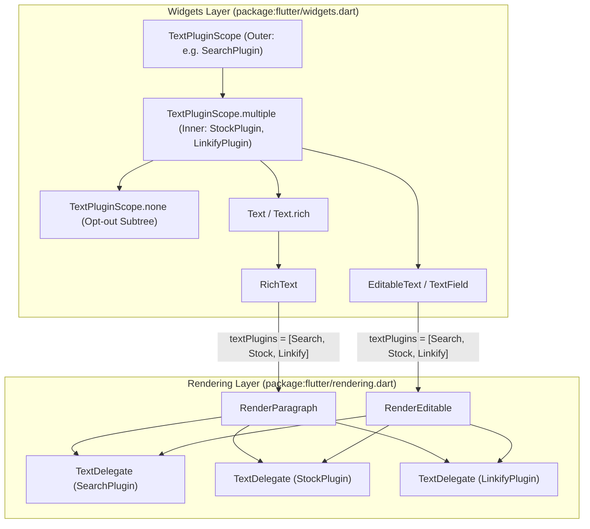
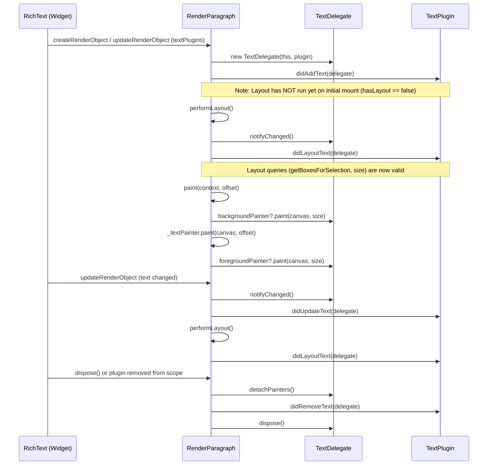
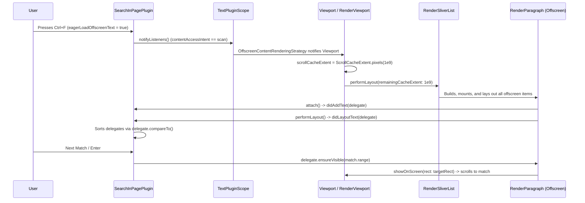
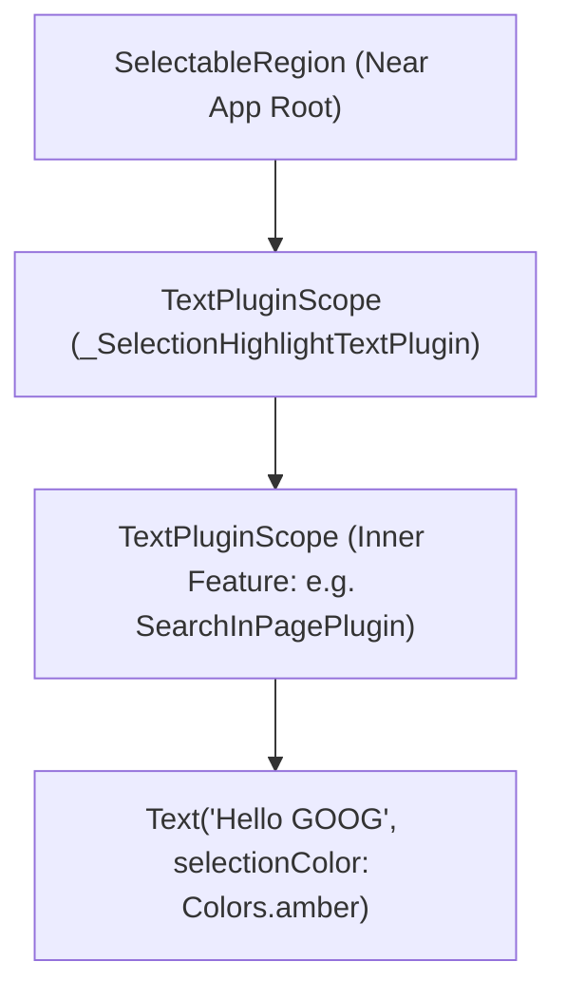

# Design Document: Composable Text Plugins in Flutter

**Author**: Antigravity & User  
**Status**: Implemented Prototype (`packages/flutter` + `examples/text_plugins`)  
**Reference**: [Text-Plugins-One-Pager.md](Text-Plugins-One-Pager.md)

---

## Table of Contents

- [1. Problem Statement & Motivation](#1-problem-statement--motivation)
  - [1.1 Why Custom `Text` Subclasses Fail](#11-why-custom-text-subclasses-fail)
  - [1.2 Historical Context, Prior Art & Acknowledgments](#12-historical-context-prior-art--acknowledgments)
- [2. Design Goals & Framework/Community Taxonomy](#2-design-goals--frameworkcommunity-taxonomy)
  - [2.1 Design Goals & Non-Goals](#21-design-goals--non-goals)
  - [Goals](#goals)
  - [Non-Goals (Current Scope)](#non-goals-current-scope)
  - [2.2 Framework-Builtin vs. Community Package Taxonomy & Generic API Design](#22-framework-builtin-vs-community-package-taxonomy--generic-api-design)
- [3. Architecture & Component Design](#3-architecture--component-design)
  - [3.1 Layering & File Organization](#31-layering--file-organization)
  - [3.2 `TextPlugin` Lifecycle Contract](#32-textplugin-lifecycle-contract)
  - [3.3 `TextDelegate`: Capability-Scoped Proxy for `RenderParagraph`](#33-textdelegate-capability-scoped-proxy-for-renderparagraph)
  - [3.4 `TextPluginScope` & Hierarchical Merging](#34-textpluginscope--hierarchical-merging)
  - [3.5 `RenderParagraph` Painting & Z-Order Pipeline](#35-renderparagraph-painting--z-order-pipeline)
- [4. Broader Ecosystem Use Cases](#4-broader-ecosystem-use-cases)
  - [4.1 Accessibility, Reading Aids & Language Learning](#41-accessibility-reading-aids--language-learning)
  - [4.2 Interactive Spoiler & Study-Cloze Masking](#42-interactive-spoiler--study-cloze-masking)
  - [4.3 Editorial, Localization (l10n) & QA Tooling](#43-editorial-localization-l10n--qa-tooling)
  - [4.4 Collaborative Annotation & Multi-User Presence](#44-collaborative-annotation--multi-user-presence)
  - [4.5 AI / LLM Grounding, Citations & 120fps Effects](#45-ai--llm-grounding-citations--120fps-effects)
  - [4.6 Domain-Specific Smart Entities](#46-domain-specific-smart-entities)
- [5. Feature Deep Dives](#5-feature-deep-dives)
  - [5.1 Scrolling, Document Ordering, and Offscreen Content Rendering (`Ctrl+F`)](#51-scrolling-document-ordering-and-offscreen-content-rendering-ctrlf)
  - [5.2 Deep Dive: Should Selection Highlighting Be a `TextPlugin`?](#52-deep-dive-should-selection-highlighting-be-a-textplugin)
- [6. Future Directions & Forward-Compatible API Design](#6-future-directions--forward-compatible-api-design)
  - [6.1 Non-Text Widgets with Searchable Labels (`Image`, `Icon`, & `Semantics`)](#61-non-text-widgets-with-searchable-labels-image-icon--semantics)
  - [6.2 Native Text Fields & Platform Views (W3C `Range` & CSS Custom Highlight API)](#62-native-text-fields--platform-views-w3c-range--css-custom-highlight-api)
- [7. Exhaustive Corner Cases & Architectural Analysis](#7-exhaustive-corner-cases--architectural-analysis)
  - [Corner Case 1: `ChangeNotifier` / `setState` Re-entrancy During Build, Layout, and Dispose](#corner-case-1-changenotifier--setstate-re-entrancy-during-build-layout-and-dispose)
  - [Corner Case 2: Calling Layout Queries in `didAddText` or `didUpdateText` (`!delegate.hasLayout`)](#corner-case-2-calling-layout-queries-in-didaddtext-or-didupdatetext-delegatehaslayout)
  - [Corner Case 3: Embedded `WidgetSpan`s (`PlaceholderSpan`) and UTF-16 Offset Alignment](#corner-case-3-embedded-widgetspans-placeholderspan-and-utf-16-offset-alignment)
  - [Corner Case 4: Text Truncation (`maxLines`, `TextOverflow.ellipsis`, `TextOverflow.clip`, `TextOverflow.fade`)](#corner-case-4-text-truncation-maxlines-textoverflowellipsis-textoverflowclip-textoverflowfade)
  - [Corner Case 5: Multi-Line Wrapping, Bidirectional (BiDi) Text, and Surrogate Pairs](#corner-case-5-multi-line-wrapping-bidirectional-bidi-text-and-surrogate-pairs)
  - [Corner Case 6: Dynamic Plugin List Reconciliation & Stateful Delegate Preservation](#corner-case-6-dynamic-plugin-list-reconciliation--stateful-delegate-preservation)
  - [Corner Case 7: Duplicate Plugin Instances Across Nested `TextPluginScope`s](#corner-case-7-duplicate-plugin-instances-across-nested-textpluginscopes)
  - [Corner Case 8: Pointer Event Routing, Multi-Plugin Conflicts, and Scroll Gesture Slop](#corner-case-8-pointer-event-routing-multi-plugin-conflicts-and-scroll-gesture-slop)
  - [Corner Case 9: `SelectionArea` / `SelectableRegion` Coexistence](#corner-case-9-selectionarea--selectableregion-coexistence)
  - [Corner Case 10: Unintended Capture of UI Chrome & `TextPluginScope.none`](#corner-case-10-unintended-capture-of-ui-chrome--textpluginscopenone)
  - [Corner Case 11: Lazy Slivers (`ListView.builder`) & Offscreen Viewport Recycling](#corner-case-11-lazy-slivers-listviewbuilder--offscreen-viewport-recycling)
  - [Corner Case 12: Canvas State Corruption in Plugin `CustomPainter`s](#corner-case-12-canvas-state-corruption-in-plugin-custompainters)

---


## 1. Problem Statement & Motivation

Flutter applications frequently need cross-cutting text capabilities that inspect, decorate, or attach interactions to text across an entire page or subtree:

1. **Find-in-Page / Search Highlighting**: Locating all occurrences of a query across disparate [Text](widgets/text.dart) and [RichText](widgets/basic.dart#L7892-L8098) widgets, painting active/inactive highlights, and scrolling the active match into view.
2. **Entity & Pattern Decoration**: Highlighting and making stock tickers (`GOOG`, `AAPL`), hashtags, mentions, or citations interactive without mutating the source string or requiring callers to pre-tokenize `TextSpan` trees.
3. **Automatic Linkification**: Detecting URLs (`https://...`, `www....`) in plain [Text](widgets/text.dart) widgets, painting link underlines, and handling tap gestures.
4. **Live Content & SEO Extraction**: Indexing visible text across a subtree to generate Schema.org JSON-LD metadata, word/reading-time analytics, or crawler snapshots.

### 1.1 Why Custom `Text` Subclasses Fail

Historically, package authors solved these problems by creating custom drop-in replacement widgets (`LinkifyText`, `SearchableText`, `ParsedText`). This approach breaks down in real applications:

- **Zero Composability**: A developer cannot simultaneously use `LinkifyText` from Package A and `StockTickerText` from Package B on the same paragraph.
- **Invasive Refactoring**: Every [Text](widgets/text.dart) widget in the app—including those buried inside third-party widgets or Material/Cupertino components ([ListTile](material/list_tile.dart), [Card](material/card.dart), [DataTable](material/data_table.dart))—would have to be replaced.
- **No Document-Level Coordination**: Individual custom text widgets lack a shared coordinator unless accompanied by bespoke ancestor state management.

> [!IMPORTANT]
> **Core Architectural Insight**: Text cross-cutting concerns belong in an ambient, composable **plugin pipeline** attached via `InheritedWidget` ([TextPluginScope](widgets/text_plugin.dart#L30-L117)) and executed directly by [RenderParagraph](rendering/paragraph.dart#L317-L1381), leaving standard [Text](widgets/text.dart) and [RichText](widgets/basic.dart#L7892-L8098) widgets unchanged.

### 1.2 Historical Context, Prior Art & Acknowledgments

This design builds directly upon years of exploration, prototyping, and architectural discussions across the Flutter team. We want to specially thank **Michael Goderbauer (`@goderbauer`)**, **Renzo Olivares (`@Renzo-Olivares`)**, and **Kevin Moore (`@kevmoo`)** for their foundational contributions:

1. **Michael Goderbauer's Original Text Plugins Proposal (November 2023)**
   - In late 2023, **Michael Goderbauer** authored the original [Text Plugins One-Pager](https://docs.google.com/document/d/1doToFSPGJO29_FJ-VE7mD6XiNgF-s2xVaIi-UC495m8/edit?tab=t.0) (preserved locally in [Text-Plugins-One-Pager.md](Text-Plugins-One-Pager.md)) after building an early [Find-in-Page web demo](https://goderbauer.github.io/demos/find-in-page/) using a custom `SearchableText` widget.
   - Goderbauer's key realization was that `SearchableText` could not compose with other cross-cutting text needs—such as SEO text extraction, auto-linkification, or interactive stock ticker highlighting—nor could it reach `Text` widgets inside third-party packages. He proposed the core abstraction triplet that anchors this design today: an ambient `TextPluginScope` widget, a `TextPlugin` lifecycle interface (`didAddText`, `didUpdateText`, `didRemoveText`), and a capability-scoped `TextDelegate` (`text`, `foregroundPainter`, `backgroundPainter`, `getBoxesForSelection`, `handleEvent`).

2. **Renzo Olivares's `Ctrl+F` & `TextPluginScope` Prototype ([`Renzo-Olivares:text-plugins-alt`](https://github.com/Renzo-Olivares/flutter/tree/text-plugins-alt))**
   - **Renzo Olivares** turned the one-pager into a working framework prototype on his [`text-plugins-alt`](https://github.com/Renzo-Olivares/flutter/tree/text-plugins-alt) branch and demoed end-to-end `Ctrl+F` (`SearchInPagePlugin`) alongside selection highlighting (`_SelectionHighlightTextPlugin`).
   - Renzo's branch solved several crucial rendering-layer problems that we carry forward in this design:
     - Making `TextDelegate` implement `Listenable` (notifying plugins after `RenderParagraph.performLayout`) and `Comparable<TextDelegate>` (sorting delegates in visual document order via a Lowest Common Ancestor walk of the `RenderObject` tree).
     - Exposing `placeholderRanges` (`includePlaceholders: false`) so regex/substring queries do not match across `WidgetSpan` `0xFFFC` object replacement boundaries, plus `ensureVisible()` to scroll active matches into view.
     - Prototyping `_SelectionHighlightTextPlugin` inside `SelectableRegion` to validate whether selection highlighting itself could use the `TextPlugin` paint pipeline.

3. **Kevin Moore's Find-in-Page Experiment ([`flutter/flutter#193186`](https://github.com/flutter/flutter/pull/193186) & [`flutter/rfc#25`](https://github.com/flutter/rfc/pull/25))**
   - **Kevin Moore** built an end-to-end `Ctrl+F` / `Cmd+F` prototype ([PR #193186](https://github.com/flutter/flutter/pull/193186), [RFC #25](https://github.com/flutter/rfc/pull/25)) that explored implementing Find-in-Page directly on top of `SelectableRegion`, `SelectionRegistrar`, and `RenderParagraph`'s internal `_SelectableFragment`.
   - This experiment was instrumental in validating developer demand and surfacing key edge cases—such as offscreen lazy sliver discovery and `Semantics` label search—while also revealing why `SelectableRegion` could not serve as the underlying foundation:
     - **Lack of generality**: Adding search-specific properties (`searchHighlightColor`, `setSearchHighlights`) directly onto `Text`, `RenderParagraph`, and `Selectable` solved `Ctrl+F` in isolation, but could not generalize to other cross-cutting features (like linkification, spellcheck, or custom highlights) or support `EditableText` (`TextField`), which does not register with an ancestor `SelectableRegion`.
     - **Selection coupling overhead**: Because `_SelectableFragment` requires a `SelectionRegistrar`, searching non-selectable pages required wrapping the subtree in a hidden "find-only" `SelectableRegion` (`_enableSelection: false`), which still added extra `SelectionContainer` elements per `Text` widget and required special handling to suppress selection cursors, focus changes, and gesture recognizers.
   - These findings directly motivated unifying our efforts around the composable `TextPluginScope` architecture presented in this document.

---

## 2. Design Goals & Framework/Community Taxonomy

### 2.1 Design Goals & Non-Goals

### Goals
- **Zero-boilerplate adoption**: Existing `Text('...')`, `Text.rich(...)`, and `EditableText` (`TextField`) widgets automatically participate when placed inside a [TextPluginScope](widgets/text_plugin.dart#L30-L117).
- **Full support for static & editable text**: Works seamlessly across both [RenderParagraph](rendering/paragraph.dart#L317-L1381) (`Text` / `RichText`) and [RenderEditable](rendering/editable.dart#L285) (`EditableText` / `TextField`), updating decorations live during text editing.
- **Deterministic multi-plugin composition**: Multiple plugins can inspect, paint behind/in front of, and handle pointer events on the same [RenderParagraph](rendering/paragraph.dart#L317-L1381) or [RenderEditable](rendering/editable.dart#L285) in a predictable root-to-leaf installation order.
- **Encapsulation of RenderObjects**: Plugins interact with a capability-scoped [TextDelegate](rendering/text_plugin.dart#L108) wrapping either `RenderParagraph` or `RenderEditable`, rather than mutating RenderObject internals directly.
- **Subtree opt-out**: Subtrees (such as toolbars, search inputs, or decorative chrome) can opt out of ancestor plugins via [TextPluginScope.none](widgets/text_plugin.dart#L48-L52).
- **Strict layer separation**: Rendering primitives live in `package:flutter/rendering.dart` ([rendering/text_plugin.dart](rendering/text_plugin.dart)); widget scoping lives in `package:flutter/widgets.dart` ([widgets/text_plugin.dart](widgets/text_plugin.dart)). Neither depends on Material or Cupertino.
- **Forward-compatible API boundaries**: While the initial implementation targets `RenderParagraph` and `RenderEditable`, `TextDelegate` and `TextPluginScope` are designed so non-text widgets (via searchable labels) and native platform-view text fields (via DOM/OS range & highlight APIs) can be integrated in the future without breaking existing plugins (see [Section 6](#6-future-directions--forward-compatible-api-design)).

### Non-Goals (Current Scope)
- **Implementing all plugins upfront**: Our goal is to define the extensible architecture and provide a few minimal core plugins (like `SearchInPagePlugin` and `_SelectionHighlightTextPlugin`). We expect the community to build and publish the long tail of domain-specific plugins (linkifiers, spelling linters, etc.).
- **Supporting non-text widgets (in the initial scope)**: `TextPlugin` initially targets Flutter's text render objects ([RenderParagraph](rendering/paragraph.dart#L317-L1381) and [RenderEditable](rendering/editable.dart#L285)). Inspecting or highlighting non-text widgets (`Image`, `Icon`, custom `RenderBox`es) via their `semanticLabel` is out of the initial scope, though the `TextDelegate` API is shaped to support whole-box delegation in the future (see [Section 6.1](#61-non-text-widgets-with-searchable-labels-image-icon--semantics)).
- **Supporting native platform-view text fields (in the initial scope)**: Text rendered by native OS or browser DOM views inside a Platform View (`HtmlElementView` on Web, `UITextView` on iOS, `EditText` on Android) is not wired into `TextPluginScope` in the initial scope. See [Section 6.2](#62-native-text-fields--platform-views-w3c-range--css-custom-highlight-api) for how `TextDelegate` can bridge to the W3C `Range` and CSS Custom Highlight APIs (`CSS.highlights`) in a future phase.
- **Security / PII redaction & compliance masking**: Because `TextPlugin` operates purely as a visual paint and inspection layer over `RenderParagraph` and `RenderEditable`, drawing an opaque bar in `foregroundPainter` only obscures glyphs visually on screen—the underlying plain text remains exposed to `Ctrl+F` (`SearchInPagePlugin` could even be used as a character-by-character oracle to read hidden text), `SelectionArea` copy-paste (`Ctrl+C`), the `Semantics` accessibility tree, and DevTools inspection. True PII/security redaction must scrub or tokenize sensitive strings at the data layer before passing them to `Text` widgets.
- **Mutating the input `InlineSpan` tree or changing text metrics**: Plugins decorate and observe laid-out text via [CustomPainter](rendering/custom_paint.dart)s (`backgroundPainter` / `foregroundPainter`); they do not rewrite font sizes or insert layout-shifting inline widgets during layout.

---


### 2.2 Framework-Builtin vs. Community Package Taxonomy & Generic API Design

A critical architectural consideration is defining **what belongs in the core Flutter framework (`package:flutter`)** versus **what should be published by the community as packages (`pub.dev`)**, and how to design the core API to maximize universality.

#### 2.2.1 Framework-Builtin Plugins (`package:flutter`)

Only plugins that fulfill universal, platform-standard expectations and have zero external dependencies belong inside `package:flutter`:

1. **`_SelectionHighlightTextPlugin`**: Internal plugin supporting `SelectionArea` / `SelectableRegion` text selection highlighting across all platforms.
2. **`SearchInPagePlugin`**: Standard desktop/web `Ctrl+F` search highlighting, sequential match navigation, and viewport lazy-loading management.

#### 2.2.2 Community Package Plugins (`pub.dev`)

Domain-specific, opinionated, or third-party-dependent features should be maintained by the community as standalone packages:

1. **`SpellCheckPlugin` (`package:flutter_spellcheck`)**: Integration for IME spellcheck squiggly underlines and grammar suggestions.
1. **`LinkifyPlugin` (`package:flutter_linkify_plugin`)**: Regex URL parsing, custom link styles, and integration with `url_launcher`.
2. **`StockTickerPlugin` / `FinancialTextPlugin`**: Financial symbol decoration (`GOOG`, `AAPL`), crypto address detection, and currency conversions.
3. **`SpoilerMaskPlugin` / `ClozeStudyPlugin` (`package:flutter_spoiler_mask`)**: Interactive tap-to-reveal spoiler bars (`||...||`) and flashcard cloze-deletion study masks (`{{...}}`).
4. **`ReadAloudPlugin` (`package:flutter_read_aloud`)**: TTS karaoke narration synchronizers integrated with `flutter_tts` or cloud speech APIs.
5. **`SeoExtractorPlugin` (`package:flutter_seo_text`)**: Scraping plain text for Schema.org JSON-LD web crawlers.
6. **`AiGroundingPlugin`**: LLM citation grounding popups and interactive source attribution spans.

#### 2.2.3 Principles for Designing a Universal, Generic API

To ensure `TextPlugin` scales smoothly from simple core selection to complex community packages, the API adheres to four core design principles:

1. **Capability-Based Primitives over Hardcoded Assumptions**:
   - Instead of creating specific APIs for links or search matches, `TextDelegate` exposes generic low-level primitives: `getBoxesForSelection`, `getPositionForOffset`, `getWordBoundary`, `getLineBoundary`, `getOffsetForCaret`, `backgroundPainter`, and `foregroundPainter`.
2. **Layered Composability & Selective Filtering**:
   - `TextPluginScope` permits stacking arbitrary numbers of plugins.
   - `TextPluginScope.exclude(types: {...})` provides typed subtree filtering so app developers can exclude specific plugins on UI chrome without breaking core plugins like `_SelectionHighlightTextPlugin`.
3. **Declarative Offscreen Content Rendering Protocol**:
   - The `ContentAccessIntent` (`highlight` vs. `scan`) property on `TextPlugin` and the standalone `OffscreenContentRenderingStrategy` widget (`OffscreenRenderingPolicy.lazy` vs. `OffscreenRenderingPolicy.eager`) let document-wide plugins (search, SEO) temporarily request eager offscreen sliver rendering across `ListView.builder` viewports while keeping `Viewport` completely decoupled from `TextPluginScope`.
4. **Semantics & Accessibility Alignment**:
   - `TextDelegate` provides a path to register `TextPluginSemanticAnnotation`s so visually decorated text (links, tickers, spoiler/study masks) automatically maps to focusable, accessible `SemanticsNode`s for screen readers.

---

## 3. Architecture & Component Design

Before diving into the internal rendering pipeline, here is what the developer experience looks like at the Widget level:

```dart
TextPluginScope.multiple(
  plugins: [
    SearchInPagePlugin(query: 'Flutter'),
    SpoilerMaskPlugin(), // e.g., tap-to-reveal ||spoiler|| & {{cloze}} masks
  ],
  child: Column(
    children: [
      // Standard widgets automatically participate in the plugin pipeline!
      Text('Welcome to Flutter! ||Plot twist||'), // Automatically highlighted & masked
      TextField(),                                // Text input also automatically inspected
      
      // Developers can easily firewall UI chrome from being affected:
      TextPluginScope.none(
        child: Text('Search query: Flutter'), // Safely isolated from plugins
      ),
    ],
  ),
)
```





### 3.1 Layering & File Organization

| Layer | File | Public Symbols | Responsibility |
| :--- | :--- | :--- | :--- |
| **Rendering** | [rendering/text_plugin.dart](packages/flutter/lib/src/rendering/text_plugin.dart) | [ContentAccessIntent](packages/flutter/lib/src/rendering/text_plugin.dart#L31-L48), [TextPlugin](packages/flutter/lib/src/rendering/text_plugin.dart#L74-L123), [TextDelegate](packages/flutter/lib/src/rendering/text_plugin.dart#L139) | Defines the plugin lifecycle interface, `ContentAccessIntent`, and the unified delegate handle wrapping `RenderParagraph` or `RenderEditable`. |
| **Rendering** | [rendering/paragraph.dart](packages/flutter/lib/src/rendering/paragraph.dart) | [RenderParagraph.textPlugins](packages/flutter/lib/src/rendering/paragraph.dart#L565-L575) | Reconciles delegates, dispatches lifecycle & pointer events, and executes painters for static text. |
| **Rendering** | [rendering/editable.dart](packages/flutter/lib/src/rendering/editable.dart) | [RenderEditable.textPlugins](packages/flutter/lib/src/rendering/editable.dart#L285) | Reconciles delegates, dispatches typing/layout & pointer events, and executes painters for editable text fields. |
| **Widgets** | [widgets/text_plugin.dart](packages/flutter/lib/src/widgets/text_plugin.dart) | [TextPluginScope](packages/flutter/lib/src/widgets/text_plugin.dart#L44-L115) | Scopes and merges `TextPlugin` lists down the widget tree and configures `OffscreenContentRenderingStrategy` when any active plugin requests `ContentAccessIntent.scan`. |
| **Widgets** | [widgets/viewport.dart](packages/flutter/lib/src/widgets/viewport.dart) | [OffscreenRenderingPolicy](packages/flutter/lib/src/widgets/viewport.dart#L540-L549), [OffscreenContentRenderingStrategy](packages/flutter/lib/src/widgets/viewport.dart#L565-L604) | General-purpose inherited strategy controlling whether descendant `Viewport` and `ShrinkWrappingViewport` widgets render offscreen sliver content lazily or eagerly. |
| **Widgets** | [widgets/basic.dart](packages/flutter/lib/src/widgets/basic.dart) | [RichText.textPlugins](packages/flutter/lib/src/widgets/basic.dart#L6652) | Resolves `textPlugins ?? TextPluginScope.maybeOf(context)` and forwards to `RenderParagraph`. |
| **Widgets** | [widgets/editable_text.dart](packages/flutter/lib/src/widgets/editable_text.dart) | [EditableText.textPlugins](packages/flutter/lib/src/widgets/editable_text.dart#L947) | Resolves `textPlugins ?? TextPluginScope.maybeOf(context)` and forwards to `_Editable` / `RenderEditable`. |

### 3.2 `TextPlugin` Lifecycle Contract

Defined in [rendering/text_plugin.dart](packages/flutter/lib/src/rendering/text_plugin.dart#L74-L123), `TextPlugin` exposes a declarative `contentAccessIntent` property and five lifecycle hooks:

```dart
enum ContentAccessIntent { highlight, scan }

abstract class TextPlugin {
  const TextPlugin();

  ContentAccessIntent get contentAccessIntent => ContentAccessIntent.highlight;

  void didAddText(TextDelegate delegate) {}
  void didUpdateText(TextDelegate delegate) {}
  void didLayoutText(TextDelegate delegate) {}
  void didRemoveText(TextDelegate delegate) {}
  void handlePointerEvent(TextDelegate delegate, PointerEvent event) {}
}
```




### 3.3 `TextDelegate`: Capability-Scoped Proxy for `RenderParagraph`

Instead of passing [RenderParagraph](rendering/paragraph.dart#L317-L1381) directly to plugins—which would allow plugins to corrupt layout state, mutate constraints, or overwrite each other's painters—each `(RenderParagraph, TextPlugin)` pair gets its own [TextDelegate](rendering/text_plugin.dart#L86-L287) instance:

- **Isolated Painter Slots**: Each [TextDelegate](rendering/text_plugin.dart#L86-L287) owns its own [backgroundPainter](rendering/text_plugin.dart#L153-L162) and [foregroundPainter](rendering/text_plugin.dart#L141-L150). Setting or replacing a painter checks `shouldRepaint`, attaches/detaches the painter's `Listenable` (`addListener(_paragraph.markNeedsPaint)`), and calls `markNeedsPaint()` only when needed.
- **Content Inspection**:
  - [delegate.text](rendering/text_plugin.dart#L102): Returns `_paragraph.text.toPlainText(includeSemanticsLabels: false)` so plugins see the exact UTF-16 character stream laid out by `TextPainter` (without `semanticsLabel` overrides corrupting character offsets).
  - [delegate.textSpan](rendering/text_plugin.dart#L106): Exposes the raw `InlineSpan` tree for plugins that need style or span-structure inspection.
- **Layout & Coordinate Queries**:
  - [hasLayout](rendering/text_plugin.dart#L125) (`_paragraph.hasSize && !_paragraph.debugNeedsLayout`), [hasSize](rendering/text_plugin.dart#L117), and [size](rendering/text_plugin.dart#L130).
  - [getBoxesForSelection](rendering/text_plugin.dart#L183-L193), [getPositionForOffset](rendering/text_plugin.dart#L199-L201), [getWordBoundary](rendering/text_plugin.dart#L206-L208), [getOffsetForCaret](rendering/text_plugin.dart#L214-L216), and [getFullHeightForCaret](rendering/text_plugin.dart#L221-L223).
  - Coordinate conversion & scrolling helpers: [localToGlobal](rendering/text_plugin.dart#L234-L236), [globalToLocal](rendering/text_plugin.dart#L241-L243), [getTransformTo](rendering/text_plugin.dart#L227-L229), and [showOnScreen](rendering/text_plugin.dart#L247-L249) (enabling find-in-page plugins to auto-scroll the active match into the viewport).

### 3.4 `TextPluginScope` & Hierarchical Merging

[TextPluginScope](widgets/text_plugin.dart#L30-L117) uses an internal `InheritedWidget` (`_InheritedTextPluginScope`) that eagerly computes the merged, deduplicated list of plugins from root to leaf during `build`:

1. **Single & Multiple Registration**: `TextPluginScope(plugin: p, child: ...)` and `TextPluginScope.multiple(plugins: [p1, p2], child: ...)` look up `TextPluginScope.of(context)` and append their plugins after any ancestor plugins.
2. **Root-to-Leaf Deduplication**: If a plugin instance is already present in an ancestor scope, it retains its outer position so each `(RenderParagraph, TextPlugin)` pair is 1-to-1.
3. **Subtree Opt-Out (`TextPluginScope.none`)**: Installs an `_InheritedTextPluginScope` with `plugins: const <TextPlugin>[]`, shadowing all ancestor scopes for its `child` subtree.

### 3.5 `RenderParagraph` Painting & Z-Order Pipeline

Within [RenderParagraph.paint](rendering/paragraph.dart#L1218-L1319), layers are painted in the following strict Z-order (from back to front):

1. **Plugin `backgroundPainter`s** (in root-to-leaf plugin installation order, clipped to `offset & size` if `_needsClipping` is true).
2. **Selection highlights** (`_lastSelectableFragments` when inside a `SelectionArea` / `SelectableRegion`).
3. **Paragraph glyphs & inline children** (`_textPainter.paint` and `paintInlineChildren`, with overflow shader/clipping if applicable).
4. **Plugin `foregroundPainter`s** (in root-to-leaf plugin installation order, clipped if `_needsClipping` is true).
5. **Selection handles** (`_lastSelectableFragments` drag handles).

---

## 4. Broader Ecosystem Use Cases

Because `TextPlugin` combines **text inspection** (`plainText`, `placeholderRanges`), **sub-span geometry** (`getBoxesForSelection`, `getPositionForOffset`, `getWordBoundary`), **composited painting** (`backgroundPainter`, `foregroundPainter` without re-laying out text), **pointer routing** (`handlePointerEvent`), and **viewport control** (`ensureVisible`, `compareTo`, `contentAccessIntent` / `OffscreenContentRenderingStrategy`), it unlocks a broad ecosystem of drop-in plugins across any existing `Text` or `RichText` subtree.

Below is a summary of six broader ecosystem categories:

### 4.1 Accessibility, Reading Aids & Language Learning
1. **TTS "Read-Aloud Karaoke" Synchronizer**:
   - **How it works**: Sorts all mounted `TextDelegate`s in true visual reading order via `delegates.sort()` (`TextDelegate.compareTo`), tokenizes words while skipping `0xFFFC` `WidgetSpan` placeholders, tints the active paragraph in `backgroundPainter` and paints a pill highlight + underline over the currently spoken word in `foregroundPainter`, and automatically calls `delegate.ensureVisible(wordRange)` when narration crosses a paragraph or viewport boundary.
   - **Why `TextPlugin` shines**: Word-by-word TTS highlighting updates multiple times per second; using a `CustomPainter` via `TextDelegate.markNeedsPaint()` avoids rebuilding or re-shaping `RenderParagraph` on every word boundary.
2. **Inline Dictionary / Translation / Furigana Lookup**:
   - **How it works**: Listens for hover or long-press via `handlePointerEvent`, resolves the word via `getPositionForOffset` + `getWordBoundary`, highlights the hovered word, and anchors a translation or phonetic popover to `localToGlobal(wordBox.toRect().topCenter)`.
3. **Dyslexia / Focus Reading Ruler & Bionic Reading Guide**:
   - **How it works**: Tracks the pointer's vertical coordinate across paragraphs and uses `foregroundPainter` to dim surrounding lines while keeping a crisp spotlight window over the active line (`getLineBoundary`).

### 4.2 Interactive Spoiler & Study-Cloze Masking
1. **Tap-to-Reveal Spoiler Bars & Flashcard Cloze Study Masks (`SpoilerMaskPlugin`)**:
   - **How it works**: Scans `delegate.text` for spoiler tags (`||...||`, `[spoiler]...[/spoiler]`) or flashcard cloze-deletion study markers (`{{...}}`). In `foregroundPainter` (which paints **after** `_textPainter.paint()`), draws an opaque dark rounded cover with diagonal stripes hiding the underlying answer or spoiler glyphs. In `handlePointerEvent`, tapping a masked box toggles revealing or re-masking that specific span (`markNeedsPaint()`).
   - **Why `TextPlugin` shines**: Forum/chat apps (like Discord/Reddit-style spoiler bars) and education/flashcard apps (like Anki/Quizlet cloze passages) can wrap any existing article or note subtree in `TextPluginScope(plugin: spoilerMaskPlugin)` to get interactive tap-to-reveal masking without splitting strings into custom stateful inline widgets.

### 4.3 Editorial, Localization (l10n) & QA Tooling
1. **Read-Only Spellcheck, Grammar & Style-Guide Linter**:
   - **How it works**: Inspects rendered `Text` widgets for spelling errors (`recieve`, `seperate`, `occured`, `teh`) and company terminology violations (`utilize` vs. `use`). In `foregroundPainter`, draws classic wavy red (spelling) or amber (style) squiggly underlines along `box.toRect().bottom` using `Path`, and surfaces replacement suggestions when tapped.
2. **Untranslated / Broken-Interpolation l10n Detector**:
   - **How it works**: In staging builds, highlights raw translation keys (`auth.login.button_title`), uninterpolated placeholders (`{userName}`, `%1$s`), or `NaN` / `undefined` leaks in bright magenta and logs offending widget locations.
3. **Typography & Layout QA Inspector (Overflow / Orphans / Rivers)**:
   - **How it works**: Compares `getLineBoundary` and `getBoxesForSelection` across lines to highlight "widow/orphan" single-word last lines, clipped paragraphs, or cramped line heights for design QA.

### 4.4 Collaborative Annotation & Multi-User Presence
1. **Medium / Kindle-Style Persistent User Highlights & Margin Notes**:
   - **How it works**: Persists user character-range highlights and comment anchors in articles/documentation; `backgroundPainter` renders pastel highlighter strokes and `foregroundPainter` draws a comment badge at the end of the annotated span.
2. **Multiplayer Presence Carets & Live Co-Viewing Cursors**:
   - **How it works**: In collaborative doc viewers or review tools, renders remote teammates' selection ranges and named cursor flags using `getOffsetForCaret` and `getBoxesForSelection`.

### 4.5 AI / LLM Grounding, Citations & 120fps Effects
1. **RAG Source Attribution & Fact-Check Grounding Spans**:
   - **How it works**: Highlights claims in AI-generated responses that map to retrieved source documents; hovering or tapping a grounded span reveals the source citation card.
2. **Zero-Relayout Animated Shimmer**:
   - **How it works**: Animates a gradient shader over streaming LLM tokens or highlighted ranges at 120fps via `foregroundPainter` (`repaint: animationController`) with **zero** `TextPainter.layout()` cost.

### 4.6 Domain-Specific Smart Entities
1. **DevOps & Log Viewers**: Auto-detects UUIDs, Git commit SHAs, stack-trace `file.dart:123:45` references, and RFC-3339 timestamps inside plain `Text` logs—making them clickable to copy, jump to source, or preview local timezones.
2. **Medical, Legal & Scientific Reference Linkers**: Automatically turns ICD-10 codes, statute citations, or `arXiv:` / `DOI:` identifiers into interactive reference cards.

---

## 5. Feature Deep Dives

### 5.1 Scrolling, Document Ordering, and Offscreen Content Rendering (`Ctrl+F`)

Supporting browser-grade **"Find in Page" (`Ctrl+F`)** across scrollable Flutter views requires solving three interconnected problems at the rendering and widget layers:
1. **Scrolling to a matched character range** (`TextDelegate.ensureVisible`).
2. **Sorting matches in true document order** regardless of lazy mount order (`TextDelegate.compareTo`).
3. **Eagerly rendering offscreen content** in `ListView.builder` / `SliverList.builder` / `CustomScrollView` when `Ctrl+F` is active so offscreen items are built, laid out, and searchable (`TextPlugin.contentAccessIntent` + `OffscreenContentRenderingStrategy` integration).




---

#### 5.1.1 Scrolling to a Specific Character Range (`TextDelegate.ensureVisible`)

Scrolling to an entire `RenderParagraph` (`showOnScreen(rect: null)`) is insufficient when a paragraph is a multi-screen article block or when a horizontal/vertical nested scroll view clips part of a line.

[TextDelegate.ensureVisible](packages/flutter/lib/src/rendering/text_plugin.dart#L345-L373) computes the exact glyph bounding rectangle for any `TextRange` and reveals it across all enclosing viewports:

```dart
void ensureVisible(
  ui.TextRange range, {
  Duration duration = Duration.zero,
  Curve curve = Curves.ease,
}) {
  assert(hasLayout);
  final List<ui.TextBox> boxes = getBoxesForSelection(
    TextSelection(baseOffset: range.start, extentOffset: range.end),
    boxHeightStyle: ui.BoxHeightStyle.max,
    includePlaceholders: false,
  );
  if (boxes.isNotEmpty) {
    var targetRect = boxes.first.toRect();
    for (var i = 1; i < boxes.length; i += 1) {
      targetRect = targetRect.expandToInclude(boxes[i].toRect());
    }
    showOnScreen(rect: targetRect, duration: duration, curve: curve);
    return;
  }
  final position = ui.TextPosition(offset: range.start);
  final Offset caretOffset = getOffsetForCaret(position, Rect.zero);
  final double caretHeight = getFullHeightForCaret(position);
  showOnScreen(
    rect: Rect.fromLTWH(caretOffset.dx, caretOffset.dy, 1.0, caretHeight),
    duration: duration,
    curve: curve,
  );
}
```

#### How `showOnScreen` Traverses Slivers & Nested Viewports
1. `_paragraph.showOnScreen(descendant: _paragraph, rect: targetRect, duration: duration, curve: curve)` walks up the `RenderObject.parent` chain.
2. Each enclosing [RenderViewportBase](packages/flutter/lib/src/rendering/viewport.dart#L1429-L1517) invokes `RenderViewportBase.showInViewport`, querying `viewport.getOffsetToReveal(descendant, 0.0, rect: rect)` (leading edge) and `viewport.getOffsetToReveal(descendant, 1.0, rect: rect)` (trailing edge).
3. If `targetRect` is already fully visible between the leading and trailing edges of the viewport, `RevealedOffset.clampOffset` returns `null` and no unnecessary scroll occurs.
4. Otherwise, `offset.moveTo(targetOffset.offset, duration: duration, curve: curve)` scrolls (or animates) the minimal distance required to bring `targetRect` onscreen, and then continues walking up `super.showOnScreen` so **nested scroll views** (e.g., a horizontal scrollable inside a vertical `CustomScrollView`) scroll both axes into view.
5. **Deferred Scroll on Newly Mounted Items**: If [SearchInPagePlugin.scrollToActiveMatch](examples/text_plugins/lib/plugins/search_in_page_plugin.dart#L156-L171) is invoked while a newly mounted delegate has not yet completed layout (`!delegate.hasLayout`), the plugin sets `_pendingScrollToActiveMatch = true` and triggers `ensureVisible` inside `didLayoutText(delegate)` as soon as layout completes.

---

#### 5.1.2 Document-Order Sorting (`TextDelegate implements Comparable<TextDelegate>`)

#### The Problem: Mount Order $\neq$ Document Order
When a user starts at the middle of a `ListView.builder` (say at `Item 10`) and scrolls **upward**, `RenderSliverList` mounts `Item 9`, then `Item 8`, then `Item 7`. Consequently, `didAddText` is called in the chronological order `[Item 10, Item 9, Item 8, Item 7]`. If `SearchInPagePlugin` iterates over `_delegates` in registration order, pressing "Next Match" jumps **backward** up the document!

Furthermore, comparing global screen coordinates (`localToGlobal(Offset.zero).dy`) is insufficient for general layouts because two columns side-by-side or wrapped flex items may have overlapping vertical coordinates despite having a well-defined logical reading order in the widget tree.

#### How We Solved It: Lowest Common Ancestor Render-Tree Traversal
1. **Attach-Synchronized Registration**: [RenderParagraph](packages/flutter/lib/src/rendering/paragraph.dart#L568-L674) registers its `TextDelegate`s in `attach(PipelineOwner)` (when `RenderParagraph.parent` and the entire ancestor chain up to the root are already linked) and unregisters them immediately in `detach()`.
2. **Tree-Order Comparison ([TextDelegate.compareTo](packages/flutter/lib/src/rendering/text_plugin.dart#L384-L440))**:
   - Walks up `RenderObject.parent` from both `this._paragraph` and `other._paragraph` to find their **lowest common ancestor** (`commonParent`) and the two diverging child branches (`thisBranch` and `otherBranch`).
   - Calls `commonParent.visitChildren(...)` to determine which branch precedes the other.
   - Because `ContainerRenderObjectMixin.visitChildren` (used by `RenderFlex`, `RenderWrap`, `RenderViewport`, and `RenderSliverMultiBoxAdaptor` / `RenderSliverList`) always visits children from `firstChild` to `lastChild` in ascending logical index order—even when `insertAndLayoutLeadingChild` prepends children while scrolling upward—`delegates.sort()` guarantees true top-to-bottom document ordering.

---

#### 5.1.3 Declarative Offscreen Content Rendering (`ContentAccessIntent` & `OffscreenContentRenderingStrategy`)

#### Why Lazy Sliver Rendering Hides Offscreen Text
In Flutter's sliver protocol ([RenderViewport._attemptLayout](packages/flutter/lib/src/rendering/viewport.dart#L1765-L1844) and [RenderSliverList.performLayout](packages/flutter/lib/src/rendering/sliver_list.dart#L46-L320)):
- `RenderViewport` computes `_calculatedCacheExtent` from `scrollCacheExtent` (defaulting to `250.0` logical pixels before and after the visible viewport).
- `RenderSliverList` only builds and lays out children whose layout offsets fall within `[scrollOffset + cacheOrigin, scrollOffset + cacheOrigin + remainingCacheExtent]`, and calls `collectGarbage(leadingGarbage, trailingGarbage)` to destroy children outside that window.
- Therefore, in a `ListView.builder` or `SliverList.builder` with 50 items, items #10–#50 do not exist in the Element or RenderObject trees until scrolled near the viewport.

#### Decoupling Plugin Intent (`ContentAccessIntent`) from Viewport Policy (`OffscreenContentRenderingStrategy`)
Rather than coupling `Viewport` directly to `TextPluginScope` or exposing a low-level boolean flag on `TextPlugin`, we split the design into two clean, composable abstractions using **offscreen content rendering** (as opposed to network "lazy loading") terminology:

1. **Declarative Plugin Intent ([ContentAccessIntent](packages/flutter/lib/src/rendering/text_plugin.dart#L31-L48) on [TextPlugin.contentAccessIntent](packages/flutter/lib/src/rendering/text_plugin.dart#L101))**:
   ```dart
   enum ContentAccessIntent {
     /// The plugin only decorates or interacts with visible onscreen content
     /// (e.g., StockTickerPlugin, LinkifyPlugin, SpoilerMaskPlugin).
     highlight,

     /// The plugin scans content across the UI and requires offscreen children
     /// in scrollable viewports to be rendered (e.g., active Ctrl+F SearchInPagePlugin).
     scan,
   }
   ```
   - **Conflict-free multi-plugin composition**: Each plugin declares *what content it needs access to* rather than *how* a `Viewport` renders. When multiple plugins are composed in a `TextPluginScope`, their intents combine via a simple upper bound (`scan` if *any* active plugin requests `ContentAccessIntent.scan`, otherwise `highlight`).
   - **Future extensibility**: `ContentAccessIntent` can later grow intermediate intents (such as `lookahead` for `ReadAloudPlugin` pre-rendering the next 1–2 screens) without breaking API compatibility.
   - In [SearchInPagePlugin](examples/text_plugins/lib/plugins/search_in_page_plugin.dart#L77-L80), pressing `Ctrl+F` / `Cmd+F` (or toggling the **"Cancel Lazy Load"** chip) sets `eagerLoadOffscreenText = true` (`contentAccessIntent => ContentAccessIntent.scan`) and calls `notifyListeners()`.

2. **Standalone Inherited Strategy ([OffscreenContentRenderingStrategy](packages/flutter/lib/src/widgets/viewport.dart#L565-L604) in `package:flutter/widgets.dart`)**:
   ```dart
   enum OffscreenRenderingPolicy { lazy, eager }

   class OffscreenContentRenderingStrategy extends InheritedWidget {
     const OffscreenContentRenderingStrategy({
       super.key,
       required this.policy,
       required super.child,
     });

     final OffscreenRenderingPolicy policy;
     static OffscreenRenderingPolicy of(BuildContext context) { ... }
   }
   ```
   - **Zero coupling from `Viewport` to `TextPluginScope`**: `Viewport` and `ShrinkWrappingViewport` in [widgets/viewport.dart](packages/flutter/lib/src/widgets/viewport.dart) do not import `text_plugin.dart`; they only query `OffscreenContentRenderingStrategy.of(context)`.
   - **Split Inherited Notification**: [TextPluginScope](packages/flutter/lib/src/widgets/text_plugin.dart#L117-L214) separates `_InheritedTextPluginScope` (which provides `List<TextPlugin>` to `RichText` and `EditableText`) from `OffscreenContentRenderingStrategy` (which provides `OffscreenRenderingPolicy` to `Viewport`). When a plugin's `contentAccessIntent` flips between `highlight` and `scan`, **only** `Viewport` and `ShrinkWrappingViewport` are notified—existing onscreen `RichText` widgets are **not** rebuilt!
   - **General-purpose & overridable per subtree**: Because `OffscreenContentRenderingStrategy` is a standalone widget in `package:flutter/widgets.dart`, developers can also place it directly in the widget tree—either to pre-render offscreen items in a complex finite `ListView` without a `TextPlugin`, or to wrap an unbounded feed in `OffscreenContentRenderingStrategy(policy: OffscreenRenderingPolicy.lazy, child: ...)` so it stays lazy even inside a `Ctrl+F` scope.

3. **Viewport Cache Expansion ([Viewport._effectiveScrollCacheExtent](packages/flutter/lib/src/widgets/viewport.dart#L170-L187))**:
   - Both `Viewport` and `ShrinkWrappingViewport` check `OffscreenContentRenderingStrategy.of(context) == OffscreenRenderingPolicy.eager`.
   - When `true`, they apply `const ScrollCacheExtent.pixels(1e9)`.
   - Why `1e9` (`1,000,000,000.0` logical pixels) instead of `double.maxFinite` or `double.infinity`?
     - In [RenderViewport._attemptLayout](packages/flutter/lib/src/rendering/viewport.dart#L1793-L1804), `fullCacheExtent = mainAxisExtent + 2 * _calculatedCacheExtent` and `centerCacheOffset = centerOffset + _calculatedCacheExtent`.
     - Using `double.maxFinite` (`1.79e308`) overflows `2 * _calculatedCacheExtent` to `double.infinity` (producing `NaN` in `fullCacheExtent - centerCacheOffset`) and loses all floating-point mantissa precision when adding `centerOffset`.
     - `1e9` pixels (equivalent to ~1,600,000 screens of scroll) is well within IEEE-754 float64's exact precision (`9e15`), preserving sub-pixel layout accuracy while forcing finite `SliverList` / `SliverGrid` / `ListView.builder` delegates to render and lay out all children from index `0` to `itemCount - 1`.

4. **Automatic Restoration**:
   - When the user closes `Ctrl+F` (`eagerLoadOffscreenText = false`), `OffscreenContentRenderingStrategy` switches back to `OffscreenRenderingPolicy.lazy` and notifies the `Viewport` to restore its normal `250.0` pixel `cacheExtent`. On the very next layout pass, `RenderSliverList.collectGarbage` unmounts offscreen items and triggers `didRemoveText` for each one.

> [!WARNING]
> **Unbounded Infinite Lists (`itemCount == null`)**:  
> Developers should only use `OffscreenRenderingPolicy.eager` (`ContentAccessIntent.scan`) on finite lists (`itemCount != null`). If a `SliverChildBuilderDelegate` has `childCount == null` (an infinite procedural generator that never returns `null`), wrap that specific scroll view in `OffscreenContentRenderingStrategy(policy: OffscreenRenderingPolicy.lazy, child: ...)` so it does not build unbounded items.

---


### 5.2 Deep Dive: Should Selection Highlighting Be a `TextPlugin`?

A natural architectural question is whether Flutter's built-in text selection highlight ([_SelectableFragment.paintSelection](rendering/paragraph.dart#L3865-L3881)) should itself be migrated to a [TextPlugin](rendering/text_plugin.dart#L44-L89) installed by [SelectableRegion](widgets/selectable_region.dart#L240).

#### 5.2.1 What We Gain by Making Selection Highlight a `TextPlugin`

Look at how [_SelectableFragment.paintSelection](rendering/paragraph.dart#L3865-L3881) is implemented inside `RenderParagraph` today:

```dart
for (final TextBox textBox in paragraph.getBoxesForSelection(selection)) {
  context.canvas.drawRect(textBox.toRect().shift(offset), selectionPaint);
}
```

Mechanically, this is identical to a `TextPlugin` installing a `backgroundPainter` on [TextDelegate](rendering/text_plugin.dart#L102-L450). Extracting selection highlighting into a `TextPlugin` offers three major benefits:

1. **Composable Z-Order**: Instead of hardcoding whether selection highlights paint above or below plugin `backgroundPainter`s in [RenderParagraph.paint](rendering/paragraph.dart#L1245-L1333), the Z-order becomes controlled by scope ordering.
2. **Customizable Selection Visuals**: Applications could customize selection rendering (rounded `RRect` selection highlights, gradient highlights, or **multi-user collaborative cursors/selections** as in Google Docs) using standard `TextPlugin`s without modifying `RenderParagraph`.
3. **Decoupling `RenderParagraph`**: Over 2,100 lines of [paragraph.dart](rendering/paragraph.dart#L1752-L3937) are dedicated to `_SelectableFragment`. Moving selection highlight painting (and eventually selection state) out of `RenderParagraph` simplifies the core text render object.

---

#### 5.2.2 Corner Cases Discovered When Migrating Selection Highlight (`text-plugins-alt` Analysis)

Prototyping `_SelectionHighlightTextPlugin` inside `SelectableRegion` (as explored in [`Renzo-Olivares:text-plugins-alt`](https://github.com/Renzo-Olivares/flutter/commit/55f5d0af4503fe7950374addd625a5fd9ae8efb5)) reveals five subtle corner cases that must be addressed if selection highlighting is moved to a `TextPlugin`:




#### 1. Root-vs-Leaf Paint Order Inversion
- `SelectionArea` / `SelectableRegion` is almost always mounted near the root of a page or `Scaffold`, while feature plugins (`SearchInPagePlugin`, `StockTickerPlugin`, `LinkifyPlugin`) are mounted inside the page body.
- Under **root-first** painting (outermost scope paints first / at the back), the outer `_SelectionHighlightTextPlugin` paints *behind* inner feature plugins, so an opaque background badge from an inner plugin obscures the user's text selection highlight.
- Conversely, flipping all plugins to **leaf-first** painting (so the outer `SelectableRegion` paints on top) breaks the intuitive widget composition rule where a more specific inner `TextPluginScope` overrides a broader outer `TextPluginScope`.

#### 2. Per-Widget `Text(selectionColor: ...)` Overrides
- Flutter's [Text.selectionColor](widgets/text.dart#L713) allows an individual `Text` widget to override `DefaultSelectionStyle.of(context).selectionColor` on its own `RenderParagraph`.
- If `SelectableRegion` installs a single `_SelectionHighlightTextPlugin(color: defaultHighlightColor)` at the root of the selection scope and the painter uses `plugin.color`, per-widget `Text(selectionColor: ...)` overrides are lost unless `TextDelegate` exposes `Color? get selectionColor` from the underlying `RenderParagraph`.

#### 3. Disjoint Selections Across Embedded `WidgetSpan`s
- When a `RenderParagraph` contains inline `WidgetSpan`s (e.g., `"First [WidgetSpan] Second"`), `RenderParagraph` splits itself into multiple [_SelectableFragment](rendering/paragraph.dart#L1752)s around each `\uFFFC` placeholder code unit.
- Collapsing `_lastSelectableFragments` into a single `TextSelection?` union (`[minOffset, maxOffset]`) on `TextDelegate` causes two problems:
  1. Calling `getBoxesForSelection` on the union includes the box of the `\uFFFC` placeholder itself unless `includePlaceholders: false` is passed to slice around [TextDelegate.placeholderRanges](rendering/text_plugin.dart#L128-L145).
  2. If multi-fragment selection state is non-contiguous across nested selectables, a single union span cannot represent disjoint fragment ranges; exposing `List<TextSelection> get selections` on `TextDelegate` avoids lossy unioning.

#### 4. Legacy Fallback Suppression Bug (`skipLegacyHighlight`)
- To avoid double-painting semi-transparent selection colors when `_SelectionHighlightTextPlugin` is active, `_SelectableFragment.paintSelection` must know whether a plugin is already painting the selection highlight.
- Checking `final bool skipLegacyHighlight = paragraph.textPlugins.isNotEmpty;` is **broken**: if a developer uses a custom `SelectionRegistrar` (without `SelectableRegion`) and installs `LinkifyPlugin`, `textPlugins.isNotEmpty` is `true` and **silently disables selection highlighting** even though no selection highlight plugin is installed!
- **Fix**: Either remove legacy highlight painting from `_SelectableFragment` completely (having `SelectionContainer` always install the selection highlight plugin), or track an explicit `bool handlesSelectionHighlight` flag.

#### 5. Opt-Out Coupling (`TextPluginScope.none` vs. `SelectionContainer.disabled`)
- If `SelectableRegion` relies on `TextPluginScope` to paint selection highlights, wrapping a subtree in [TextPluginScope.none](widgets/text_plugin.dart#L50-L55) (for example, to exclude a card from `SeoExtractorPlugin` or `StockTickerPlugin`) will **also disable selection highlight painting** in that subtree, even though `_SelectableFragment` is still registered with `SelectionContainer` and copying text still works invisibly!
- **Fix**: Provide selective opt-out (`TextPluginScope.exclude`) or keep selection highlight registration orthogonal to `TextPluginScope.none`.

---

#### 5.2.3 Why Full Selection (`_SelectableFragment`) Requires More Than `CustomPainter`

While **selection highlight painting** fits into `TextDelegate.backgroundPainter`, the rest of [_SelectableFragment](rendering/paragraph.dart#L1752) cannot be moved out of `RenderParagraph` into a pure `TextPlugin` without extending `TextDelegate`:

1. **Mobile Selection Drag Handles Need `PaintingContext.pushLayer`**:
   [_SelectableFragment.paintHandles](rendering/paragraph.dart#L3883-L3907) pushes composited `LeaderLayer`s via `context.pushLayer(LeaderLayer(link: _startHandleLayerLink!, ...))` and requires [RenderParagraph.alwaysNeedsCompositing](rendering/paragraph.dart#L684) to return `true`. A `CustomPainter` only receives a `Canvas` and cannot push composited layers.
2. **Cross-RenderObject `SelectionRegistrar` Protocol**:
   `SelectionArea` selects across both text (`RenderParagraph`) and non-text `Selectable`s (such as selectable images). Any selection plugin must still bridge its fragments into `SelectionRegistrar`.

#### 5.2.4 Blueprint for Cleanly Extracting Selection into a `TextPlugin`

| Capability Needed | Required API on `TextDelegate` / `TextPluginScope` |
| :--- | :--- |
| **Per-fragment selection & color** | Expose `List<TextSelection> get selections` and `Color? get selectionColor` on `TextDelegate`. |
| **Skip `WidgetSpan` boxes** | Implemented via [TextDelegate.placeholderRanges](rendering/text_plugin.dart#L128-L145) and `includePlaceholders: false` on [TextDelegate.getBoxesForSelection](rendering/text_plugin.dart#L210-L257). |
| **Mobile drag handle layers** | Allow `TextDelegate` to register `LeaderLayer` handle links `(LayerLink, Offset)` painted during `RenderParagraph.paint` and reflected in `alwaysNeedsCompositing`. |
| **Orthogonal opt-out** | Add `TextPluginScope.exclude(types: {...})` so `TextPluginScope.none` does not inadvertently suppress `SelectionHighlightPlugin`. |

#### 5.2.5 Follow-up Roadmap Plan: Migrating `SelectionArea` / `SelectionContainer` to `TextPlugin`

Based on the prototype analysis of [`Renzo-Olivares:text-plugins-alt` (commit 55f5d0af4503fe7950374addd625a5fd9ae8efb5)](https://github.com/Renzo-Olivares/flutter/commit/55f5d0af4503fe7950374addd625a5fd9ae8efb5), migrating Flutter's built-in text selection highlights to a standard `TextPlugin` is planned as a four-phase follow-up item:

#### Phase 1: Internal `_SelectionHighlightTextPlugin` Prototype
- `SelectionContainer` / `SelectableRegion` installs a private `_SelectionHighlightTextPlugin` in its subtree.
- `_SelectionHighlightTextPlugin` listens to selection changes from `SelectionRegistrar`, reads selection bounds via `delegate.getBoxesForSelection(selection, includePlaceholders: false)`, and paints selection highlights using `delegate.backgroundPainter`.
- `RenderParagraph` and `RenderEditable` check whether a selection highlight plugin is active and suppress legacy `_SelectableFragment.paintSelection` fallback to avoid double-painting.

#### Phase 2: Mobile Selection Handle Layer Registration
- Extend `TextDelegate` with a handle layer registration method `delegate.registerHandleLayers(startLink, endLink)`, enabling selection plugins to push composited `LeaderLayer`s for mobile drag handles during `RenderParagraph.paint` / `RenderEditable._paintContents`.

#### Phase 3: Typed Subtree Opt-Out (`TextPluginScope.exclude`)
- Introduce `TextPluginScope.exclude(types: {SearchInPagePlugin, StockTickerPlugin})` alongside `TextPluginScope.none` so developers can disable feature plugins on UI chrome without inadvertently suppressing `_SelectionHighlightTextPlugin`.

#### Phase 4: Full Framework Decoupling
- Deprecate in-tree selection highlight painting inside `RenderParagraph` and `RenderEditable`, transferring 100% of selection highlight rendering to `_SelectionHighlightTextPlugin` for all Flutter applications.

---

## 6. Future Directions & Forward-Compatible API Design

Although the initial scope targets Flutter's `RenderParagraph` and `RenderEditable`, we intentionally shaped `TextDelegate`, `TextPlugin`, and `TextPluginScope` so the architecture can expand to **non-text widgets**, **native platform-view text fields**, and **declarative offscreen rendering policies** without breaking existing plugins.

---

### 6.1 Non-Text Widgets with Searchable Labels (`Image`, `Icon`, & `Semantics`)

#### Motivation
Users searching a page (`Ctrl+F` via `SearchInPagePlugin`) or listening to an article (`ReadAloudPlugin`) often expect labeled non-text widgets—such as `Image(semanticLabel: 'Golden retriever playing in the park')`, `Icon(semanticLabel: 'Settings')`, or custom data visualizations (`BarChart`, `Sparkline`, `PieChart`)—to be discoverable, highlighted, scrolled into view, and narrated in natural document order alongside paragraphs.

#### 1. Simple Non-Text Widgets: Whole-Widget Bounding Box Mapping
- **`RenderBox`-Backed `TextDelegate`**:
  [TextDelegate.renderObject](rendering/text_plugin.dart#L122) is typed as `RenderBox` rather than `RenderParagraph`. Document-order sorting (`compareTo`), viewport reveal (`showOnScreen`, `ensureVisible`), coordinate conversion (`localToGlobal`, `globalToLocal`), and painter attachment (`backgroundPainter`, `foregroundPainter`) already work on any `RenderBox`.
- **Whole-Box Geometry Fallback**:
  Unlike a paragraph where substrings map to individual glyph boxes, a simple non-text `RenderBox` (such as `Image` or `Icon`) exposing a searchable `label` maps any valid non-empty `TextSelection` within `0..label.length` to the widget's full bounding box:
  ```dart
  [ui.TextBox.fromLTRBD(0, 0, size.width, size.height, textDirection)]
  ```
- **API Safeguards (`hasCharacterBoxes` & Foreground Painting)**:
  - While whole-widget highlighting is ideal for Search, TTS, and SEO, character-level typographic plugins like `SpellCheckPlugin` (which draws wavy underlines under individual words) should not underline an entire `Image`. Exposing `bool get hasCharacterBoxes` on `TextDelegate` allows character-specific plugins to skip non-text delegates cleanly.
  - Because an `Image` paints opaque pixels across its entire bounds, a `backgroundPainter` highlight would be occluded; non-text delegates (or plugins inspecting `!delegate.hasCharacterBoxes`) can render highlight borders/tints in `foregroundPainter`.

#### 2. Complex Non-Text Widgets (`BarChart`, `Sparkline`, Custom Graphics): Widget-Owned Highlight Rendering
What if a widget has its own opinion about *how* to highlight matched content—for example, a `BarChart` or `Sparkline` that uses arbitrary vector shapes and graphics where a generic rectangular `CustomPainter` overlay wouldn't know how to highlight the inside of a bar, pie slice, or sparkline vertex?

- **Why a Widget Contributing Its Own `TextPlugin` Is Insufficient**:
  In a scenario like `Ctrl+F` (`SearchInPagePlugin`) or TTS (`ReadAloudPlugin`), the **plugin** owns the document-wide coordinator state (the active search query, the `"3 of 12"` match count, and Next/Previous navigation), while the **widget** (`BarChart`) owns the domain-specific rendering of its data series.
- **Separating Match Discovery (Plugin) from Highlight Rendering (Widget / Host)**:
  By allowing plugins to pass structured highlight ranges to `TextDelegate` (with the plugin's `CustomPainter` serving as the default fallback when a widget does not override highlight rendering):
  ```dart
  class TextPluginHighlight {
    const TextPluginHighlight({
      required this.range,
      required this.role, // e.g., searchMatch, activeSearchMatch, spokenWord
      this.fallbackStyle, // Default color/decoration if host uses default painter
    });

    final ui.TextRange range;
    final Object role;
    final TextHighlightStyle? fallbackStyle;
  }
  ```
  1. **Exposing Structured Series Text**: A `BarChart` exposes its data labels to `TextDelegate` (e.g., `"Q1: $10M\nQ2: $15M\nQ3: $22M\nQ4: $18M"`).
  2. **Sub-Element Geometry for Scrolling (`getBoxesForSelection`)**: When `SearchInPagePlugin` queries `delegate.getBoxesForSelection(rangeForQ3)` for `ensureVisible`, the `BarChart` returns the bounding `Rect` of the Q3 bar specifically so `Ctrl+F` scrolls directly to that bar.
  3. **Custom Graphic Highlight (`onHighlightsChanged`)**: Instead of painting a flat yellow rectangle over the chart, the `BarChart` intercepts the active `List<TextPluginHighlight>`, maps range `18..26` (`"Q3: $22M"`) back to `barIndex = 2`, and highlights the bar or sparkline vertex using its own graphics (e.g., glowing the bar fill, pulsing the sparkline node, or popping up the Q3 tooltip).

#### Unifying Spectrum Across All Target Widgets

| Target Widget | How `TextDelegate.text` Is Provided | How `getBoxesForSelection(range)` Works | Who Renders the Highlight? |
| :--- | :--- | :--- | :--- |
| **Standard `Text` / `EditableText`** | `InlineSpan.toPlainText()` | `TextPainter` glyph boxes | **Plugin's default painter** (`CustomPainter` on `RenderParagraph`) |
| **Simple `Image` / `Icon`** | `semanticLabel` | Whole widget bounding box (`0..w, 0..h`) | **Plugin's default painter** (or foreground border/tint) |
| **Complex Graphic (`BarChart`, `Sparkline`)** | Concatenated series / datum labels | Bounding box of the matched bar / datum | **The Chart Widget itself** (glows bar, pulses sparkline point, elevates slice) |
| **Native Platform View (`HtmlElementView`, `UITextView`)** | DOM `textContent` / native text | W3C `Range.getClientRects()` / `UITextInput` | **The Platform View itself** (via W3C `CSS.highlights` / `::highlight()` or `NSLayoutManager`) |

---

### 6.2 Native Text Fields & Platform Views (W3C `Range` & CSS Custom Highlight API)

#### Motivation
On Web and mobile platforms, apps (and future Flutter native text input implementations) may embed platform-rendered text fields or rich HTML views via Platform Views (`HtmlElementView`, `UiKitView`, `AndroidView`), where text shaping and painting happen inside the browser DOM or native OS toolkit rather than Flutter's `TextPainter`.

#### Mapping `TextDelegate` to W3C `Range` & `CSS.highlights`
On Web (`HtmlElementView`), the **W3C `Range` API** and **W3C CSS Custom Highlight API** (`CSS.highlights` + `::highlight()`) were designed for the exact same non-destructive decoration model as `TextPlugin`:

| `TextDelegate` Capability | Flutter (`RenderParagraph` / `RenderEditable`) | Web Platform View (W3C DOM APIs) | iOS / Android Native Text Views |
| :--- | :--- | :--- | :--- |
| **`text`** | `InlineSpan.toPlainText()` | `element.textContent` | `UITextView.text` / `EditText.getText()` |
| **`getBoxesForSelection(range)`** | `ui.Paragraph.getBoxesForRange` | `Range.getClientRects()` (mapped to local `RenderBox` coordinates) | `UITextInput.selectionRects(for:)` / `Layout.getSelectionPath` |
| **`getPositionForOffset(point)`** | `TextPainter.getPositionForOffset` | `document.caretPositionFromPoint(x, y)` | `UITextInput.closestPosition(to:)` / `Layout.getOffsetForHorizontal` |
| **`ensureVisible(range)`** | `RenderObject.showOnScreen(rect)` | `Range.getBoundingClientRect()` + `scrollIntoView` / `showOnScreen` | `UITextView.scrollRangeToVisible` |
| **Range Decoration** | `CustomPainter` (`backgroundPainter` / `foregroundPainter`) | **`CSS.highlights.set(id, new Highlight(range))`** + `::highlight(id)` | `NSLayoutManager` temporary attributes / `Spannable` `CharacterStyle` |

#### Forward-Compatible API Design Choices
1. **Decoupling `TextDelegate` via a Host Interface (`TextDelegateHost`)**:
   - Rather than restricting `TextDelegate` to `RenderParagraph` and `RenderEditable` forever, `TextDelegate` can delegate text, geometry, and painting hooks to a `TextDelegateHost` mixin/interface that Platform View render objects can also implement.
2. **Bridging Imperative `CustomPainter` and Declarative `Highlight` Ranges**:
   - A Flutter `CustomPainter` cannot easily paint *between* a native platform view's background and its text glyphs, nor can a Flutter canvas overlay stay frame-synchronized with internal DOM compositor scrolling.
   - By adding a declarative highlight primitive on `TextDelegate` (e.g., `setHighlights(Object pluginKey, List<TextHighlight> highlights)` specifying `TextRange`, `backgroundColor`, `textColor`, and `decorationStyle`) alongside `CustomPainter`:
     - `RenderParagraph` and `RenderEditable` render those declarative ranges using an internal `CustomPainter`.
     - Web Platform Views translate those ranges directly into W3C `StaticRange` / `Range` instances registered in `CSS.highlights` (`::highlight()`), painting native backgrounds and wavy/solid underlines behind DOM glyphs at 120fps.
   - Plugins that still use imperative `foregroundPainter`s (e.g., custom badges or shaders) continue to work over Platform Views via `Range.getClientRects()` geometry and Flutter overlay layers.
3. **Web DOM Nuance (`contenteditable` vs. `<input>` / `<textarea>`)**:
   - In browsers, W3C `Range` and `CSS.highlights` operate on DOM `Text` nodes. Because HTML `<input>` and `<textarea>` store their text inside a closed User-Agent shadow root (`.value`), native web text fields participating in `CSS.highlights` should use `<div contenteditable="plaintext-only">` (or a synchronized mirror DOM node) so character offsets map to real DOM `Text` nodes.

---

## 7. Exhaustive Corner Cases & Architectural Analysis

Below are the 12 critical corner cases identified during design and implementation, how our implementation handles them today, and what additional safeguards or trade-offs apply.

### Corner Case 1: `ChangeNotifier` / `setState` Re-entrancy During Build, Layout, and Dispose

**The Problem**:  
`TextPlugin` callbacks are invoked synchronously inside rendering pipeline phases:
- `didAddText` and `didUpdateText` run during `RichText.createRenderObject` and `RichText.updateRenderObject` (**Widget Build phase**, `SchedulerPhase.persistentCallbacks`).
- `didLayoutText` runs at the end of `RenderParagraph.performLayout` (**Layout phase**, also `SchedulerPhase.persistentCallbacks`).
- `didRemoveText` runs during `RenderParagraph.dispose` (**Finalize Tree phase**, `SchedulerPhase.persistentCallbacks`).

If a `TextPlugin` is also a `ChangeNotifier` (or calls a callback that triggers `setState` on an ancestor widget, such as a search bar showing `"1 / 4 matches"` or an SEO inspector showing `"7 Text Widgets"`), calling `notifyListeners()` synchronously inside `didAddText`, `didLayoutText`, or `didRemoveText` throws a framework assertion:
> `setState() or markNeedsBuild() called during build.`

**How We Solved It**:
- **Painter updates happen synchronously**: Setting `delegate.backgroundPainter = ...` only calls `RenderParagraph.markNeedsPaint()`, which is completely legal during build and layout (before the paint phase).
- **External UI notifications are coalesced to post-frame**: In stateful plugins like [SearchInPagePlugin._scheduleNotify](examples/text_plugins/lib/plugins/search_in_page_plugin.dart#L194-L208) and [SeoExtractorPlugin._scheduleNotify](examples/text_plugins/lib/plugins/seo_extractor_plugin.dart#L82-L96), if `SchedulerBinding.instance.schedulerPhase == SchedulerPhase.persistentCallbacks`, `notifyListeners()` is deferred and coalesced via `SchedulerBinding.instance.addPostFrameCallback`, whereas interactive updates (e.g., typing in the search field during `SchedulerPhase.idle`) notify listeners immediately.

---

### Corner Case 2: Calling Layout Queries in `didAddText` or `didUpdateText` (`!delegate.hasLayout`)

**The Problem**:  
When `didAddText(delegate)` is called during `RichText.createRenderObject`, `RenderParagraph.performLayout()` has **not** run yet (`!_paragraph.hasSize`). Similarly, when `RichText.updateRenderObject` mutates `RenderParagraph.text`, `markNeedsLayout()` is called before `didUpdateText(delegate)`, so `_paragraph.debugNeedsLayout` is `true`. Calling `delegate.getBoxesForSelection(...)` or `delegate.size` inside `didAddText` or `didUpdateText` will fail with a `!debugNeedsLayout` assertion in `RenderParagraph`.

**How We Solved It**:
1. Exposed [TextDelegate.hasLayout](rendering/text_plugin.dart#L125) (`_paragraph.hasSize && !_paragraph.debugNeedsLayout`).
2. Added the explicit [TextPlugin.didLayoutText](rendering/text_plugin.dart#L62) lifecycle hook invoked at the end of `RenderParagraph.performLayout()` (and immediately in `_updateTextPlugins` if a new plugin is attached to an already-laid-out `RenderParagraph`).
3. Designed plugin `CustomPainter`s to query `delegate.getBoxesForSelection(...)` lazily inside `CustomPainter.paint(Canvas canvas, Size size)` (guarded by `if (!delegate.hasLayout) return;`), where layout is guaranteed to be up to date.

---

### Corner Case 3: Embedded `WidgetSpan`s (`PlaceholderSpan`) and UTF-16 Offset Alignment

**The Problem**:  
A `Text.rich` widget can contain inline `WidgetSpan` children (e.g., an inline icon or badge):
```dart
Text.rich(
  TextSpan(
    children: [
      TextSpan(text: 'Buy '),
      WidgetSpan(child: Icon(Icons.trending_up)),
      TextSpan(text: ' GOOG today'),
    ],
  ),
)
```
Inside `TextPainter` and native `ui.Paragraph`, every `PlaceholderSpan` occupies **1 UTF-16 code unit** represented by the Unicode Object Replacement Character `\uFFFC` (`0xFFFC`).
- If `delegate.text` omitted placeholders (`includePlaceholders: false`), `' GOOG today'` would start at index `4` in `delegate.text`, but at offset `5` in `TextPainter`! Passing `TextSelection(baseOffset: 4, extentOffset: 8)` to `getBoxesForSelection` would highlight `'GOO'` instead of `'GOOG'`.
- Conversely, if `delegate.text` used `includeSemanticsLabels: true` (the default of `InlineSpan.toPlainText()`), a `TextSpan(text: 'GOOG', semanticsLabel: 'Alphabet Inc.')` would return `'Alphabet Inc.'` in `delegate.text`, completely desynchronizing string indices from `TextPainter` glyph offsets!

**How We Solved It**:
- [TextDelegate.text](rendering/text_plugin.dart#L102) explicitly calls:
  ```dart
  String get text => _paragraph.text.toPlainText(includeSemanticsLabels: false);
  ```
  which keeps `includePlaceholders: true` (emitting `\uFFFC` for each `PlaceholderSpan`) and sets `includeSemanticsLabels: false`. This guarantees a **1-to-1 UTF-16 offset correspondence** between `delegate.text` indices and `TextSelection` / `TextPosition` offsets in `TextPainter`.

> [!TIP]
> Plugin authors writing regex matchers should note that `\uFFFC` is not a word character (`\w`) or whitespace (`\s`), so patterns like `\bGOOG\b` naturally treat adjacent `WidgetSpan`s as word boundaries without shifting character indices.

---

### Corner Case 4: Text Truncation (`maxLines`, `TextOverflow.ellipsis`, `TextOverflow.clip`, `TextOverflow.fade`)

**The Problem**:  
Suppose a `Text` widget has `maxLines: 1, overflow: TextOverflow.ellipsis` and a 500-character string where `'GOOG'` appears at character 400 (which is truncated behind `'...'`):
1. `delegate.text` returns the full 500-character string from `InlineSpan.toPlainText`, so a regex in `SearchInPagePlugin` or `StockTickerPlugin` will still find `'GOOG'` at offset `400..404`.
2. What happens when the plugin queries `delegate.getBoxesForSelection(TextSelection(baseOffset: 400, extentOffset: 404))`?
   - For characters completely past the ellipsis cutoff, `ui.Paragraph.getBoxesForRange` returns either an empty list `[]` or a collapsed zero-width box at the ellipsis end.
   - For a match that *straddles* the ellipsis cutoff (e.g., `'https://flut...'`), `getBoxesForSelection` returns the box for the visible prefix (`'https://flut'`).
3. What if a plugin's `CustomPainter` draws a rounded badge (`inflate(2.0)`) that extends outside `RenderParagraph.size` when `_needsClipping` is true?

**How We Solved It**:
- In [RenderParagraph.paint](rendering/paragraph.dart#L1235-L1247) and [L1299-L1311](rendering/paragraph.dart#L1299-L1311), when `_needsClipping` is `true` (`TextOverflow.clip`, `TextOverflow.ellipsis`, `TextOverflow.fade`), both `backgroundPainter` and `foregroundPainter` passes are clipped to `offset & size` via `context.canvas.clipRect(offset & size)`.
- **Future Enhancement**: Exposing `bool didExceedMaxLines` or `TextRange getVisibleTextRange()` on `TextDelegate` would allow search/SEO plugins to distinguish between *logical* text and *visually non-truncated* text when desired.

---

### Corner Case 5: Multi-Line Wrapping, Bidirectional (BiDi) Text, and Surrogate Pairs

**The Problem**:  
1. **Multi-Line & BiDi Discontinuity**: A single logical substring (e.g., a long URL wrapping across two lines, or an English phrase embedded inside an Arabic/Hebrew RTL paragraph) does **not** map to a single `Rect`. `getBoxesForSelection` returns multiple `ui.TextBox` instances—one per line fragment and BiDi directional run.
2. **UTF-16 Surrogate Pairs & Grapheme Clusters**: Dart `String` indices and `TextSelection` offsets are UTF-16 code units. Characters outside the Basic Multilingual Plane (such as emojis `🚀` or flags `🇺🇸`) occupy 2 or more UTF-16 code units. A naive substring search that splits a surrogate pair or combining mark could request boxes for half a grapheme cluster.

**How We Solved It**:
- All demo plugins ([SearchInPagePlugin](examples/text_plugins/lib/plugins/search_in_page_plugin.dart#L219-L263), [StockTickerPlugin](examples/text_plugins/lib/plugins/stock_ticker_plugin.dart#L204-L266), [LinkifyPlugin](examples/text_plugins/lib/plugins/linkify_plugin.dart#L158-L210)) iterate over **every** `ui.TextBox` returned by `delegate.getBoxesForSelection(...)` for both painting and pointer hit-testing (`boxes.any((box) => box.toRect().contains(localPosition))`).
- When scrolling a multi-line match into view ([SearchInPagePlugin._scrollToActiveMatch](examples/text_plugins/lib/plugins/search_in_page_plugin.dart#L179-L192)), the bounding union (`boxes.map((b) => b.toRect()).reduce((a, b) => a.expandToInclude(b))`) is computed and passed to `delegate.showOnScreen(rect: bounds)`.

---

### Corner Case 6: Dynamic Plugin List Reconciliation & Stateful Delegate Preservation

**The Problem**:  
Suppose a user toggles a single plugin on or off in `TextPluginScope.multiple(plugins: _activePlugins, ...)`, changing the active plugin list from `[stockPlugin, linkifyPlugin, searchPlugin]` to `[stockPlugin, linkifyPlugin]`.
If `RenderParagraph` naively disposed all delegates and recreated them whenever `textPlugins` changed:
- `stockPlugin` and `linkifyPlugin` would receive spurious `didRemoveText` + `didAddText` calls on every toggle.
- Any per-delegate state cached by `stockPlugin` (such as an ongoing animation or pointer-down tracking in `_pointerDownPositions[delegate]`) would be lost.

**How We Solved It**:
In [RenderParagraph._updateTextPlugins](rendering/paragraph.dart#L569-L629):
1. We diff the old `_textPluginDelegates` keys against `newPlugins`.
2. **Removed plugins**: Only plugins no longer present in `newPlugins` have their `TextDelegate` detached, notified via `plugin.didRemoveText(delegate)`, and disposed.
3. **Retained plugins**: Plugins present in both the old and new lists keep their exact existing `TextDelegate` instance (and its attached painters), re-indexed into `orderedDelegates` to match the new installation order.
4. **Newly added plugins**: Only newly added plugins receive a fresh `TextDelegate`, `didAddText(delegate)`, and (if already laid out) `didLayoutText(delegate)`.

---

### Corner Case 7: Duplicate Plugin Instances Across Nested `TextPluginScope`s

**The Problem**:  
What if a widget tree accidentally mounts the same `TextPlugin` instance twice—either twice in `TextPluginScope.multiple(plugins: [pluginA, pluginA])` or in both an outer `TextPluginScope(plugin: pluginA)` and an inner `TextPluginScope(plugin: pluginA)`?
If `RenderParagraph` created two `TextDelegate`s for the same `pluginA`, `pluginA.didAddText` would be called twice for the same paragraph, its painter would paint twice (doubling alpha opacity on semi-transparent highlights!), and `pluginA.handlePointerEvent` would fire twice per tap!

**How We Solved It**:
- We enforce deduplication at **both** layers:
  1. [TextPluginScope.build](widgets/text_plugin.dart#L93-L99) deduplicates `combined` using a `Set<TextPlugin>` while preserving first-seen (outermost/root-most) order.
  2. [RenderParagraph._updateTextPlugins](rendering/paragraph.dart#L605-L608) also guards with `if (orderedDelegates.containsKey(plugin)) continue;` in case a caller passes duplicate plugins directly to `RichText(textPlugins: [...])`.

---

### Corner Case 8: Pointer Event Routing, Multi-Plugin Conflicts, and Scroll Gesture Slop

**The Problem**:  
`RenderParagraph.handleEvent` forwards `PointerEvent`s to all active plugins in installation order. Several subtle interaction edge cases arise:
1. **Scroll vs. Tap Disambiguation**: Inside a `SingleChildScrollView` or `ListView`, a user might press their finger down on a highlighted link (`https://flutter.dev`) or stock ticker (`GOOG`) and drag to scroll. If a plugin triggered on `PointerDownEvent` or unconditionally on `PointerUpEvent`, scrolling the page would accidentally open links/modals!
2. **Overlapping Matches Across Plugins**: What if a search query highlights `'flutter'` inside `'https://flutter.dev'`, or two interactive plugins match overlapping ranges?
3. **Built-in `TextSpan.recognizer` Coexistence**: What if a `Text.rich` already has a `TapGestureRecognizer` on a `TextSpan`?

**How We Solved It**:
- **Touch Slop & Cancel Handling**: Both [StockTickerPlugin.handlePointerEvent](examples/text_plugins/lib/plugins/stock_ticker_plugin.dart#L99-L130) and [LinkifyPlugin.handlePointerEvent](examples/text_plugins/lib/plugins/linkify_plugin.dart#L75-L103) record `event.localPosition` on `PointerDownEvent`, clear it on `PointerCancelEvent`, and on `PointerUpEvent` verify `(event.localPosition - downPos).distance <= kTouchSlop` before firing their tap callback.
- **`TextSpan.recognizer` Coexistence**: In [RenderParagraph.hitTestChildren](rendering/paragraph.dart#L973-L993), if a `TextSpan` implements `HitTestTarget` (i.e., has a `GestureRecognizer`), it is added to the `HitTestResult` *before* `RenderParagraph` itself, and `RenderParagraph.hitTestSelf` returns `true` so both the span's recognizer and `RenderParagraph.handleEvent` receive the pointer event.
- **Future Enhancement**: If mutually exclusive gesture consumption between plugins is needed, `TextDelegate` can expose a gesture arena helper or `bool handlePointerEvent` return value to allow an earlier plugin to consume an event.

---

### Corner Case 9: `SelectionArea` / `SelectableRegion` Coexistence

**The Problem**:  
When a `Text` widget is inside both a `SelectionArea` and a `TextPluginScope`, both `RenderParagraph`'s `_SelectableFragment`s and `TextDelegate` painters are active on the same `RenderParagraph`.
- If a plugin's `backgroundPainter` painted *on top of* the user's text selection highlight, an opaque plugin badge would obscure the user's blue selection rectangle.
- If a plugin's `foregroundPainter` painted *on top of* selection drag handles, the handles could be partially covered.

**How We Solved It**:
- As shown in [RenderParagraph.paint](rendering/paragraph.dart#L1231-L1319):
  - Plugin `backgroundPainter`s paint **behind** `_SelectableFragment.paintSelection`, so user text selection remains visible over plugin background tints.
  - Plugin `foregroundPainter`s paint **in front of** glyphs (for underlines/overlays) but **behind** `_SelectableFragment.paintHandles`.

---

### Corner Case 10: Unintended Capture of UI Chrome & `TextPluginScope.none`

**The Problem**:  
In Flutter, almost every widget uses [Text](widgets/text.dart) and [RichText](widgets/basic.dart#L7892-L8098) internally: `AppBar` titles, `FilledButton` labels, `FilterChip` labels, `Tooltip` popups, `SnackBar` messages, and `TextField` hint/label/counter text.
If a developer wraps their entire `MaterialApp` or `Scaffold` in a `TextPluginScope(plugin: searchPlugin, ...)`:
- Searching for `'Add'` will highlight the `'Add Text'` button label!
- Even worse, if the search bar itself is inside the `TextPluginScope` and displays `'1 / 4'`, typing `'1'` in the search bar will match the search bar's own match counter!

**How We Solved It**:
1. Provided [TextPluginScope.none](widgets/text_plugin.dart#L48-L52) as a declarative firewall that strips all ancestor `TextPlugin`s for its `child` subtree.
2. In [examples/text_plugins/lib/main.dart](examples/text_plugins/lib/main.dart#L445-L590), we demonstrate two best-practice patterns:
   - Scoping `TextPluginScope.multiple` around the **content body** rather than the entire `Scaffold` chrome.
   - Wrapping embedded interactive controls inside the content body (such as the "Add Text" `TextField` + `FilledButton` row and the explicit Opt-Out Zone card) in `TextPluginScope.none`.

---

### Corner Case 11: Lazy Slivers (`ListView.builder`) & Offscreen Viewport Recycling

**The Problem**:  
In a `ListView.builder` or `CustomScrollView` with 1,000 paragraphs, Flutter by default only builds and mounts `RenderParagraph` instances for items currently inside the viewport + `cacheExtent` (`250.0` logical pixels).
- As the user scrolls down, top paragraphs are deactivated (`detach()` fires `didRemoveText`) and bottom paragraphs are mounted (`attach()` fires `didAddText` + `didLayoutText`).
- For **visual decoration plugins** (`StockTickerPlugin`, `LinkifyPlugin`), this works automatically with $O(\text{visible items})$ memory overhead!
- For **document-wide plugins** (`SearchInPagePlugin`, `SeoExtractorPlugin`), three scrolling challenges arise:
  1. **Out-of-order mounting when scrolling upward**: Items mounted while scrolling upward register via `didAddText` in reverse document order.
  2. **Scrolling to a specific substring match**: A match inside a tall paragraph or nested scroll view needs character-level scroll-to-range rather than just scrolling to the widget's top edge.
  3. **Offscreen unbuilt items in lazy lists (`Ctrl+F`)**: Unbuilt items outside `cacheExtent` have no `RenderParagraph` until offscreen content rendering is switched to `OffscreenRenderingPolicy.eager`.
- **How We Solved All Three**: See [Section 5.1 (Scrolling, Document Ordering, and Offscreen Content Rendering)](#51-scrolling-document-ordering-and-offscreen-content-rendering-ctrlf) above for the full architecture (`TextDelegate.compareTo`, `TextDelegate.ensureVisible`, `TextPlugin.contentAccessIntent`, and `OffscreenContentRenderingStrategy`).

---

### Corner Case 12: Canvas State Corruption in Plugin `CustomPainter`s

**The Problem**:  
Because all plugin `backgroundPainter`s and `foregroundPainter`s share the `PaintingContext.canvas` with `RenderParagraph`, a buggy plugin painter that calls `canvas.save()` without `canvas.restore()`, or mutates the canvas transform without restoring, could corrupt the rendering of subsequent plugins, the paragraph text itself, or sibling widgets in the same repaint boundary.

**How We Solved It**:
- [RenderParagraph._paintWithCustomPainter](rendering/paragraph.dart#L1178-L1224) wraps every individual plugin painter invocation in its own `canvas.save()` / `canvas.translate(offset.dx, offset.dy)` / `canvas.restore()` pair.
- In debug mode, it records `canvas.getSaveCount()` before and after `painter.paint(canvas, size)` and throws a descriptive `FlutterError` pinpointing the exact offending `CustomPainter` if its `save()`/`restore()` calls are unbalanced.

---


