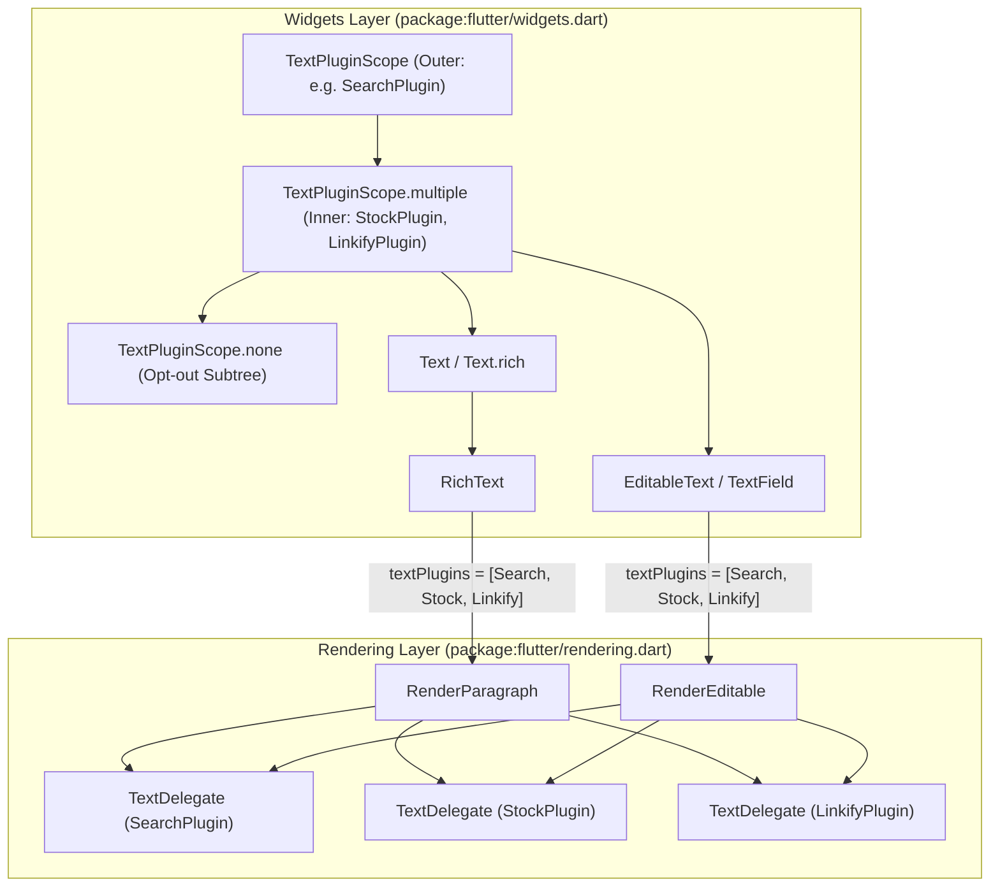
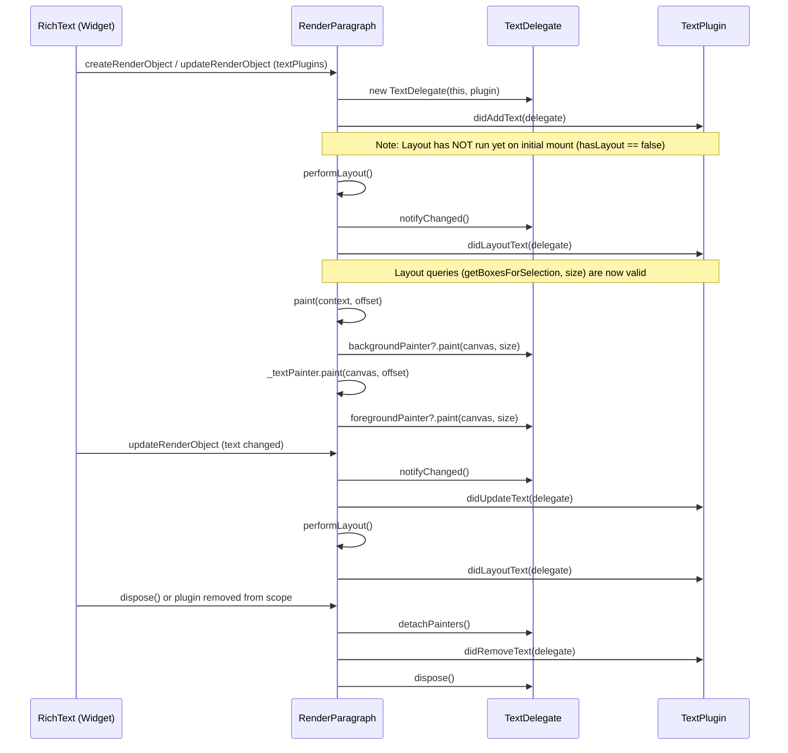
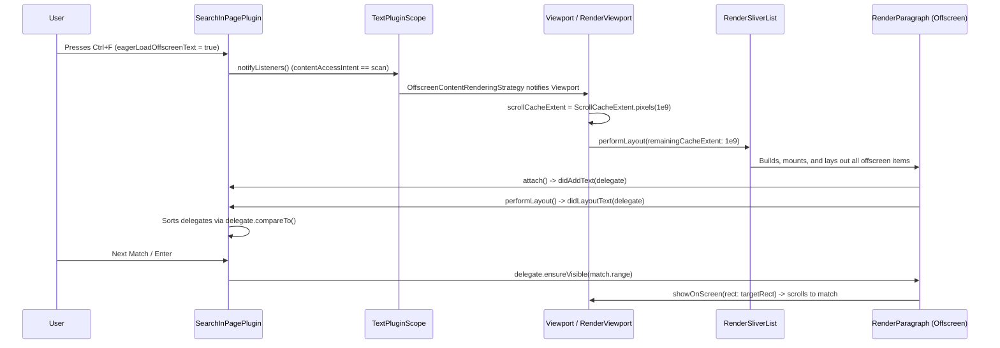
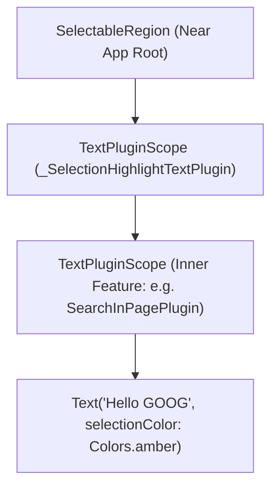

# RFC 170.0000: Flutter 可组合文本插件系统 (Composable Text Plugins in Flutter)

## 概述

本 RFC 提议在 `package:flutter/rendering.dart` 与 `package:flutter/widgets.dart` 中引入以 `TextPluginScope`、`TextPlugin` 和 `TextDelegate` 为核心的可组合文本插件系统。

通过 `InheritedWidget`（`TextPluginScope`）将插件直接挂载至底层的 `RenderParagraph` 与 `RenderEditable`，应用与第三方 Package 可以在不修改任何现有 `Text`、`RichText` 和 `EditableText`（`TextField`）组件代码的前提下，跨组件子树读取排版后的文本、绘制背景与前景装饰、响应指针手势、将任意字符区间滚入视口，以及声明式触发懒加载列表的屏幕外预渲染（`OffscreenContentRenderingStrategy`）。

## 目录

- [概述](#概述)
- [1. 问题背景与动机](#1-问题背景与动机)
  - [1.1 为什么自定义 `Text` 子类方案会失败](#11-为什么自定义-text-子类方案会失败)
  - [1.2 历史背景、先期探索与致谢](#12-历史背景先期探索与致谢)
- [2. 设计目标与包边界划分](#2-设计目标与包边界划分)
  - [2.1 设计目标与非目标](#21-设计目标与非目标)
  - [2.2 框架内置插件与社区 Package 划界](#22-框架内置插件与社区-package-划界)
- [3. 架构与组件设计](#3-架构与组件设计)
  - [3.1 分层架构与文件组织](#31-分层架构与文件组织)
  - [3.2 `TextPlugin` 生命周期契约](#32-textplugin-生命周期契约)
  - [3.3 `TextDelegate` 文本渲染对象代理](#33-textdelegate-文本渲染对象代理)
  - [3.4 `TextPluginScope` 与层级合并](#34-textpluginscope-与层级合并)
  - [3.5 `RenderParagraph` 绘制与 Z 轴顺序流水线](#35-renderparagraph-绘制与-z-轴顺序流水线)
- [4. 社区 Package 应用场景](#4-社区-package-应用场景)
  - [4.1 无障碍、阅读辅助与语言学习](#41-无障碍阅读辅助与语言学习)
  - [4.2 交互式剧透遮罩与填空学习遮罩](#42-交互式剧透遮罩与填空学习遮罩)
  - [4.3 编辑审校、多语言本地化与 QA 工具](#43-编辑审校多语言本地化与-qa-工具)
  - [4.4 协同标注与多用户光标](#44-协同标注与多用户光标)
  - [4.5 AI 引用溯源与 120fps 动态特效](#45-ai-引用溯源与-120fps-动态特效)
  - [4.6 领域特定智能实体识别](#46-领域特定智能实体识别)
- [5. 核心特性深度解析](#5-核心特性深度解析)
  - [5.1 视口滚动、文档顺序排序与屏幕外内容渲染](#51-视口滚动文档顺序排序与屏幕外内容渲染)
  - [5.2 文本选择高亮是否应当迁移为 `TextPlugin`？](#52-文本选择高亮是否应当迁移为-textplugin)
- [6. 未来演进方向与前向兼容设计](#6-未来演进方向与前向兼容设计)
  - [6.1 带有可搜索标签的非文本组件](#61-带有可搜索标签的非文本组件)
  - [6.2 原生输入框与 Platform View 集成](#62-原生输入框与-platform-view-集成)
- [7. 边界情况与架构分析](#7-边界情况与架构分析)
  - [7.1 Build、Layout 与 Dispose 期间的 `ChangeNotifier` 与 `setState` 重入](#71-buildlayout-与-dispose-期间的-changenotifier-与-setstate-重入)
  - [7.2 在 `didAddText` 或 `didUpdateText` 中调用布局查询](#72-在-didaddtext-或-didupdatetext-中调用布局查询)
  - [7.3 内嵌 `WidgetSpan` 与 UTF-16 偏移对齐](#73-内嵌-widgetspan-与-utf-16-偏移对齐)
  - [7.4 文本截断与溢出裁剪](#74-文本截断与溢出裁剪)
  - [7.5 多行折行、双向文本与 UTF-16 代理对](#75-多行折行双向文本与-utf-16-代理对)
  - [7.6 插件列表比对更新与有状态 Delegate 保留](#76-插件列表比对更新与有状态-delegate-保留)
  - [7.7 嵌套作用域中的重复插件实例](#77-嵌套作用域中的重复插件实例)
  - [7.8 指针事件路由与滚动滑动容差](#78-指针事件路由与滚动滑动容差)
  - [7.9 与 `SelectionArea` 及 `SelectableRegion` 共存](#79-与-selectionarea-及-selectableregion-共存)
  - [7.10 意外捕获 UI 控件文本与 `TextPluginScope.none`](#710-意外捕获-ui-控件文本与-textpluginscopenone)
  - [7.11 懒加载 Sliver 列表与屏幕外视口回收](#711-懒加载-sliver-列表与屏幕外视口回收)
  - [7.12 插件画笔中的 Canvas 状态污染](#712-插件画笔中的-canvas-状态污染)

---

## 1. 问题背景与动机

Flutter 应用经常需要跨整个页面或组件子树的横向文本能力，对文本进行检查、视觉装饰或附加交互事件。

1. 页面内查找（Find-in-Page）需要跨多个独立的 [Text](https://github.com/flutter/flutter/blob/master/packages/flutter/lib/src/widgets/text.dart) 和 [RichText](https://github.com/flutter/flutter/blob/master/packages/flutter/lib/src/widgets/basic.dart) 组件定位匹配项，绘制当前与非当前匹配高亮，并将当前匹配项滚动到可视区域内。

2. 实体与模式装饰需要高亮股票代码（`GOOG`、`AAPL`）、话题标签、提及或文献引用并响应点击，同时不修改源字符串，也不要求调用方预先拆分 `TextSpan` 树。

3. 自动链接识别需要检测普通 `Text` 组件中的 URL（`https://...`、`www....`），绘制链接下划线并处理点击跳转。

4. 实时内容与 SEO 提取需要索引子树中的可见文本，用于生成 Schema.org JSON-LD 元数据、阅读时长统计或搜索引擎快照。

### 1.1 为什么自定义 `Text` 子类方案会失败

过去，Package 作者通常通过编写自定义替代组件（如 `LinkifyText`、`SearchableText`、`ParsedText`）来实现这些需求。这种做法在实际应用中存在三个问题。

第一，自定义组件无法组合。开发者无法在同一段文本上同时叠加来自不同 Package 的 `LinkifyText` 与 `StockTickerText`。

第二，替换组件需要侵入式修改代码。开发者必须替换应用中的每一个 `Text` 组件，而嵌套在第三方 Package 或 Material、Cupertino 组件（如 `ListTile`、`Card`、`DataTable`）内部的 `Text` 根本无法直接替换。

第三，单个自定义文本组件缺乏文档级协调能力，除非额外自行维护一套跨组件的祖先状态管理机制。

> [!IMPORTANT]
> 跨组件文本能力应当作为通过 `InheritedWidget`（`TextPluginScope`）挂载的可组合插件流水线，由底层的 [RenderParagraph](https://github.com/flutter/flutter/blob/master/packages/flutter/lib/src/rendering/paragraph.dart) 和 [RenderEditable](https://github.com/flutter/flutter/blob/master/packages/flutter/lib/src/rendering/editable.dart) 直接执行，从而让标准的 `Text`、`RichText` 和 `EditableText` 组件无需任何代码改动即可接入。

### 1.2 历史背景、先期探索与致谢

本设计建立在 Flutter 团队多年的原型探索与架构讨论之上。在此特别感谢 **Michael Goderbauer (`@goderbauer`)**、**Renzo Olivares (`@Renzo-Olivares`)** 和 **Kevin Moore (`@kevmoo`)** 在这一方向上的贡献。

#### 1. Michael Goderbauer 的最初 Text Plugins 提案（2023 年 11 月）

2023 年底，**Michael Goderbauer** 在使用自定义 `SearchableText` 组件编写早期的 [Find-in-Page Web 演示](https://goderbauer.github.io/demos/find-in-page/)后，撰写了最初的 [Text Plugins One-Pager](https://docs.google.com/document/d/1doToFSPGJO29_FJ-VE7mD6XiNgF-s2xVaIi-UC495m8/edit?tab=t.0)。

Goderbauer 敏锐地意识到，`SearchableText` 无法与 SEO 文本提取、自动超链接识别或股票代码高亮等需求组合使用，也无法触及第三方 Package 内部的 `Text` 组件。为此，他提出了构成今天这一设计基础的三个核心抽象：`TextPluginScope`、`TextPlugin`（`didAddText`、`didUpdateText`、`didRemoveText`）以及 `TextDelegate`（`text`、`foregroundPainter`、`backgroundPainter`、`getBoxesForSelection`、`handleEvent`）。

#### 2. Renzo Olivares 的 `Ctrl+F` 与 `TextPluginScope` 原型

**Renzo Olivares** 在他的 [text-plugins-alt](https://github.com/Renzo-Olivares/flutter/tree/text-plugins-alt) 分支上将上述提案实现为可运行的框架原型，并演示了完整的 `Ctrl+F`（`SearchInPagePlugin`）以及选区高亮（`_SelectionHighlightTextPlugin`）。

Renzo 的原型解决了多个我们在本设计中沿用的渲染层问题。他让 `TextDelegate` 实现了 `Listenable`（在 `RenderParagraph.performLayout` 完成后通知插件）和 `Comparable<TextDelegate>`（通过遍历 `RenderObject` 树的最近公共祖先 LCA 实现视觉文档顺序排序）。

他还暴露了 `placeholderRanges`（`includePlaceholders: false`），防止正则或子串查询跨越 `WidgetSpan` 的 `0xFFFC` 占位符边界，并添加了 `ensureVisible()` 将当前匹配项滚动到视口内。此外，他在 `SelectableRegion` 内部构建了 `_SelectionHighlightTextPlugin` 原型，验证了选区高亮通过 `TextPlugin` 绘制流水线实现的可行性。

#### 3. Kevin Moore 的页面内查找实验

**Kevin Moore** 构建了端到端的 `Ctrl+F` 与 `Cmd+F` 原型（[PR #193186](https://github.com/flutter/flutter/pull/193186)、[RFC #25](https://github.com/flutter/rfc/pull/25)），尝试直接基于 `SelectableRegion`、`SelectionRegistrar` 以及 `RenderParagraph` 内部的 `_SelectableFragment` 来实现页面内查找。

这一实验验证了开发者对内置页面内查找的强烈需求，并揭示了屏幕外懒加载 Sliver 发现、`Semantics` 标签搜索等重要边界场景，同时也展现出了为什么 `SelectableRegion` 不适合作为底层通用基础设施。

将搜索专属属性（`searchHighlightColor`、`setSearchHighlights`）直接加到 `Text`、`RenderParagraph` 和 `Selectable` 上虽然能单独解决 `Ctrl+F`，但无法推广到链接识别、拼写检查或自定义高亮等其他跨组件文本特性，也无法支持不向祖先 `SelectableRegion` 注册的 `EditableText`（`TextField`）。

此外，由于 `_SelectableFragment` 依赖 `SelectionRegistrar`，在不需要文本选区的页面中开启查找仍然需要用隐藏的“仅查找” `SelectableRegion`（`_enableSelection: false`）包裹子树。这会为每个 `Text` 组件增加额外的 `SelectionContainer` 元素，并需要额外逻辑来抑制文本光标、焦点变更和手势竞争。这些经验促使我们将方案统一到可组合的 `TextPluginScope` 架构上。

---

## 2. 设计目标与包边界划分

### 2.1 设计目标与非目标

#### 设计目标

- 现有的 `Text('...')`、`Text.rich(...)` 和 `EditableText`（`TextField`）组件放入 `TextPluginScope` 后无需修改代码即可自动接入。

- 同时支持静态文本（`RenderParagraph`）和可编辑文本（`RenderEditable`），并在用户输入编辑时实时更新插件装饰效果。

- 多个插件可以按照从根到叶的安装顺序，在同一个 `RenderParagraph` 或 `RenderEditable` 上检查文本、绘制前景与背景并处理指针事件。

- 插件通过能力受限的 `TextDelegate`（包裹 `RenderParagraph` 或 `RenderEditable`）与渲染层交互，避免直接修改 RenderObject 内部状态。

- 工具栏、搜索框或装饰性 UI 子树可以通过 `TextPluginScope.none` 屏蔽祖先插件。

- 渲染层原语位于 `package:flutter/rendering.dart`（`packages/flutter/lib/src/rendering/text_plugin.dart`），组件作用域位于 `package:flutter/widgets.dart`（`packages/flutter/lib/src/widgets/text_plugin.dart`），不依赖 Material 或 Cupertino。

- 虽然首期实现面向 `RenderParagraph` 和 `RenderEditable`，但 `TextDelegate` 与 `TextPluginScope` 的接口设计预留了前向扩展能力，未来无需破坏现有插件即可接入非文本组件和原生 Platform View 输入框（参见[第 6 节](#6-未来演进方向与前向兼容设计)）。

#### 非目标（当前阶段范围）

- 我们不打算在框架内一次性内置所有插件。框架层的职责是提供可扩展的插件底座与核心插件（`SearchInPagePlugin` 和 `_SelectionHighlightTextPlugin`），长尾的领域特定插件交由社区 Package 实现。

- 非文本组件（`Image`、`Icon`、自定义 `RenderBox`）不在首期范围内。第 [6.1 节](#61-带有可搜索标签的非文本组件)介绍了未来如何通过整框代理支持这类组件。

- 由操作系统或浏览器 DOM 在 Platform View 内部渲染的原生输入框（Web 端 `HtmlElementView`、iOS 端 `UITextView`、Android 端 `EditText`）不在首期范围内。第 [6.2 节](#62-原生输入框与-platform-view-集成)说明了未来 `TextDelegate` 如何对接 W3C `Range` 与 CSS Custom Highlight API（`CSS.highlights`）。

- `TextPlugin` 不是安全脱敏或隐私（PII）擦除机制。在 `foregroundPainter` 中绘制不透明遮罩仅在视觉上遮挡屏幕字形，底层纯文本依然对 `Ctrl+F`、`SelectionArea` 复制粘贴、`Semantics` 无障碍树以及 DevTools 可见。真正的隐私脱敏必须在数据层传入 `Text` 组件之前完成。

- 插件不会修改输入的 `InlineSpan` 树，也不会改变文本排版度量。插件仅通过 [CustomPainter](https://github.com/flutter/flutter/blob/master/packages/flutter/lib/src/rendering/custom_paint.dart) 钩子（`backgroundPainter` 和 `foregroundPainter`）观察并装饰已完成排版的文本。

---

### 2.2 框架内置插件与社区 Package 划界

我们明确区分了哪些插件应当内置于 Flutter 核心框架（`package:flutter`），哪些应当作为独立 Package 发布在 `pub.dev` 上。

#### 2.2.1 框架内置插件（`package:flutter`）

只有具备跨平台标准预期且零外部依赖的插件才内置于 `package:flutter`：

1. `_SelectionHighlightTextPlugin` 是支撑全平台 `SelectionArea` 与 `SelectableRegion` 文本选区高亮的内部插件。

2. `SearchInPagePlugin` 提供桌面端与 Web 端标准的 `Ctrl+F` 搜索高亮、上下匹配项跳转以及视口屏幕外内容渲染控制。

#### 2.2.2 社区 Package 插件（`pub.dev`）

领域特定或依赖第三方服务的特性由社区作为独立 Package 维护：

1. `SpellCheckPlugin`（`package:flutter_spellcheck`）负责绘制拼写检查波浪下划线与语法建议。

2. `LinkifyPlugin`（`package:flutter_linkify_plugin`）使用正则表达式解析 URL、应用自定义链接样式并通过 `url_launcher` 打开链接。

3. `StockTickerPlugin` 装饰金融股票代码（`GOOG`、`AAPL`）、识别加密货币地址并展示汇率换算。

4. `SpoilerMaskPlugin`（`package:flutter_spoiler_mask`）绘制点击揭晓的剧透遮罩条（`||...||`）与抽认卡完形填空学习遮罩（`{{...}}`）。

5. `ReadAloudPlugin`（`package:flutter_read_aloud`）结合 `flutter_tts` 或云端语音接口实现逐词同步高亮朗读。

6. `SeoExtractorPlugin`（`package:flutter_seo_text`）提取页面纯文本以生成 Schema.org JSON-LD 结构化数据。

7. `AiGroundingPlugin` 渲染大模型回答中的引用溯源浮层与可交互来源标注。

#### 2.2.3 通用 API 设计原则

为了同时支撑核心选区高亮与丰富的社区插件，`TextPlugin` API 遵循四项设计原则：

1. `TextDelegate` 提供通用的底层几何与绘制原语（`getBoxesForSelection`、`getPositionForOffset`、`getWordBoundary`、`getLineBoundary`、`getOffsetForCaret`、`backgroundPainter` 和 `foregroundPainter`），而非绑定具体业务的专用方法。

2. `TextPluginScope` 支持叠加任意数量的插件。`TextPluginScope.exclude(types: {...})` 允许应用开发者在特定 UI 控件子树中按类型过滤特定插件，而不会误关 `_SelectionHighlightTextPlugin` 等核心插件。

3. `TextPlugin` 上的 `ContentAccessIntent`（`highlight` 与 `scan`）配合独立的 `OffscreenContentRenderingStrategy` 组件（`OffscreenRenderingPolicy.lazy` 与 `OffscreenRenderingPolicy.eager`），让全文类插件能够请求 `ListView.builder` 视口提前渲染屏幕外子项，同时保持 `Viewport` 与 `TextPluginScope` 解耦。

4. `TextDelegate` 预留了 `TextPluginSemanticAnnotation` 注册通道，使视觉装饰过的文本区间（链接、股票代码、剧透遮罩）能映射为无障碍树中可聚焦的 `SemanticsNode`。

---

## 3. 架构与组件设计

在 Widget 层，开发者只需用 `TextPluginScope` 包裹任意子树：

```dart
TextPluginScope.multiple(
  plugins: [
    SearchInPagePlugin(query: 'Flutter'),
    SpoilerMaskPlugin(), // e.g., tap-to-reveal ||spoiler|| & {{cloze}} masks
  ],
  child: Column(
    children: [
      // Standard widgets automatically participate in the plugin pipeline!
      Text('Welcome to Flutter! ||Plot twist||'), // Automatically highlighted & masked
      TextField(),                                // Text input also automatically inspected

      // Developers can easily firewall UI chrome from being affected:
      TextPluginScope.none(
        child: Text('Search query: Flutter'), // Safely isolated from plugins
      ),
    ],
  ),
)
```



### 3.1 分层架构与文件组织

| 层级 | 文件路径 | 公开符号 | 核心职责 |
| :--- | :--- | :--- | :--- |
| **Rendering** | `packages/flutter/lib/src/rendering/text_plugin.dart` | `ContentAccessIntent`, `TextPlugin`, `TextDelegate` | 定义插件生命周期接口、`ContentAccessIntent`，以及封装 `RenderParagraph` 或 `RenderEditable` 的代理句柄。 |
| **Rendering** | [packages/flutter/lib/src/rendering/paragraph.dart](https://github.com/flutter/flutter/blob/master/packages/flutter/lib/src/rendering/paragraph.dart) | `RenderParagraph.textPlugins` | 为静态文本比对更新 `TextDelegate`、分发组件生命周期与指针事件，并执行前后景画笔。 |
| **Rendering** | [packages/flutter/lib/src/rendering/editable.dart](https://github.com/flutter/flutter/blob/master/packages/flutter/lib/src/rendering/editable.dart) | `RenderEditable.textPlugins` | 为可编辑输入框比对更新 `TextDelegate`、分发输入/排版与指针事件，并执行前后景画笔。 |
| **Widgets** | `packages/flutter/lib/src/widgets/text_plugin.dart` | `TextPluginScope` | 在组件树中向下传递并合并 `TextPlugin` 列表；当任一激活插件声明 `ContentAccessIntent.scan` 时配置 `OffscreenContentRenderingStrategy`。 |
| **Widgets** | [packages/flutter/lib/src/widgets/viewport.dart](https://github.com/flutter/flutter/blob/master/packages/flutter/lib/src/widgets/viewport.dart) | `OffscreenRenderingPolicy`, `OffscreenContentRenderingStrategy` | 控制后代 `Viewport` 与 `ShrinkWrappingViewport` 是按需懒渲染还是提前全量渲染屏幕外 Sliver 子项。 |
| **Widgets** | [packages/flutter/lib/src/widgets/basic.dart](https://github.com/flutter/flutter/blob/master/packages/flutter/lib/src/widgets/basic.dart) | `RichText.textPlugins` | 解析 `textPlugins ?? TextPluginScope.maybeOf(context)` 并传递给 `RenderParagraph`。 |
| **Widgets** | [packages/flutter/lib/src/widgets/editable_text.dart](https://github.com/flutter/flutter/blob/master/packages/flutter/lib/src/widgets/editable_text.dart) | `EditableText.textPlugins` | 解析 `textPlugins ?? TextPluginScope.maybeOf(context)` 并传递给 `_Editable` 与 `RenderEditable`。 |

### 3.2 `TextPlugin` 生命周期契约

`TextPlugin` 定义在 `packages/flutter/lib/src/rendering/text_plugin.dart` 中，包含一个声明式的 `contentAccessIntent` 属性和五个生命周期回调：

```dart
enum ContentAccessIntent { highlight, scan }

abstract class TextPlugin {
  const TextPlugin();

  ContentAccessIntent get contentAccessIntent => ContentAccessIntent.highlight;

  void didAddText(TextDelegate delegate) {}
  void didUpdateText(TextDelegate delegate) {}
  void didLayoutText(TextDelegate delegate) {}
  void didRemoveText(TextDelegate delegate) {}
  void handlePointerEvent(TextDelegate delegate, PointerEvent event) {}
}
```



### 3.3 `TextDelegate` 文本渲染对象代理

如果把 `RenderParagraph` 直接暴露给插件，插件可能会破坏布局状态、篡改约束或互相覆盖画笔。为此，每个 `(RenderParagraph, TextPlugin)` 组合都会分配一个独立的 `TextDelegate` 实例。

每个 `TextDelegate` 独立持有自己的 `backgroundPainter` 和 `foregroundPainter` 槽位。设置或替换画笔时会检查 `shouldRepaint`，自动挂载或卸载画笔自身的 `Listenable`（`addListener(_paragraph.markNeedsPaint)`），且仅在需要时触发 `markNeedsPaint()`。

在文本内容读取方面，`delegate.text` 返回 `_paragraph.text.toPlainText(includeSemanticsLabels: false)`，使插件获取与 `TextPainter` 排版完全一致的 UTF-16 字符序列，避免 `semanticsLabel` 导致字符索引错位。`delegate.textSpan` 则暴露原始 `InlineSpan` 树，供需要检查样式或 Span 结构的插件使用。

在排版与几何查询方面，`TextDelegate` 暴露了 `hasLayout`（`_paragraph.hasSize && !_paragraph.debugNeedsLayout`）、`hasSize` 和 `size`，并提供 `getBoxesForSelection`、`getPositionForOffset`、`getWordBoundary`、`getOffsetForCaret` 与 `getFullHeightForCaret`。

此外，`TextDelegate` 提供坐标转换与视口滚动辅助方法：`localToGlobal`、`globalToLocal`、`getTransformTo`、`showOnScreen` 和 `ensureVisible`，支持页面内查找插件将当前匹配项滚动到视口中央。

### 3.4 `TextPluginScope` 与层级合并

`TextPluginScope` 内部通过 `_InheritedTextPluginScope` 在 `build` 阶段计算从根到叶合并去重后的插件列表：

1. `TextPluginScope(plugin: p, child: ...)` 与 `TextPluginScope.multiple(plugins: [p1, p2], child: ...)` 会查找 `TextPluginScope.of(context)`，并将当前层级的插件追加在祖先插件列表之后。

2. 若某个插件实例已存在于祖先作用域中，则保留其外层位置，保证每个 `(RenderParagraph, TextPlugin)` 维持一对一映射。

3. `TextPluginScope.none` 会安装一个 `plugins: const <TextPlugin>[]` 的 `_InheritedTextPluginScope`，为 `child` 子树屏蔽所有祖先插件。

### 3.5 `RenderParagraph` 绘制与 Z 轴顺序流水线

在 `RenderParagraph.paint` 内部，各图层按照从后到前的固定 Z 轴顺序依次绘制：

1. 插件 `backgroundPainter`（按从根到叶的插件安装顺序执行；若 `_needsClipping` 为 `true` 则裁剪至 `offset & size`）。

2. 文本选区高亮（当位于 `SelectionArea` 或 `SelectableRegion` 内部时绘制 `_lastSelectableFragments`）。

3. 段落文本字形与内联子组件（执行 `_textPainter.paint` 与 `paintInlineChildren`，包含溢出渐变或裁剪）。

4. 插件 `foregroundPainter`（按从根到叶的插件安装顺序执行；若 `_needsClipping` 为 `true` 则应用裁剪）。

5. 选区拖拽手柄（绘制 `_lastSelectableFragments` 的选择手柄图层）。

---

## 4. 社区 Package 应用场景

`TextPlugin` 结合了文本检查（`plainText`、`placeholderRanges`）、子串几何查询（`getBoxesForSelection`、`getPositionForOffset`、`getWordBoundary`）、自定义画笔（`backgroundPainter`、`foregroundPainter`）、指针事件路由（`handlePointerEvent`）以及视口控制（`ensureVisible`、`compareTo`、`contentAccessIntent`）。这些基础能力可以支撑各类即插即用的社区 Package。

### 4.1 无障碍、阅读辅助与语言学习

#### 1. TTS 逐词同步高亮朗读器

该插件通过 `delegates.sort()`（`TextDelegate.compareTo`）将挂载的 `TextDelegate` 按视觉阅读顺序排列，并在跳过 `0xFFFC` `WidgetSpan` 占位符的同时切分单词。它在 `backgroundPainter` 中为当前朗读段落渲染浅色背景，在 `foregroundPainter` 中为当前发声单词绘制胶囊高亮与下划线，并在朗读跨段时调用 `delegate.ensureVisible(wordRange)` 自动滚动视口。

逐词 TTS 高亮每秒会更新多次。通过 `CustomPainter` 配合 `TextDelegate.markNeedsPaint()` 仅触发重绘，避免了每次切换单词时重建或重新排版 `RenderParagraph`。

#### 2. 行内词典、翻译与注音查询

该插件通过 `handlePointerEvent` 监听悬停或长按事件，利用 `getPositionForOffset` 与 `getWordBoundary` 定位目标单词，高亮被选中的词，并将翻译或注音气泡锚定在 `localToGlobal(wordBox.toRect().topCenter)` 位置。

#### 3. 专注阅读尺

该插件跨段落追踪指针的垂直坐标，利用 `foregroundPainter` 压暗周围行，仅在当前阅读行（`getLineBoundary`）上保留高亮窗口。

### 4.2 交互式剧透遮罩与填空学习遮罩

`SpoilerMaskPlugin` 扫描 `delegate.text` 中的剧透标记（`||...||`、`[spoiler]...[/spoiler]`）或抽认卡完形填空标记（`{{...}}`）。在 `_textPainter.paint()` 之后执行的 `foregroundPainter` 中，它会绘制不透明的圆角遮罩层覆盖隐藏字形。

在 `handlePointerEvent` 中，点击被遮罩的区域即可切换显示或重新隐藏对应区间，并调用 `markNeedsPaint()`。论坛或背单词应用只需将文章子树包裹在 `TextPluginScope(plugin: spoilerMaskPlugin)` 中，即可获得点击揭晓遮罩的交互能力，无需将字符串拆分为有状态的内联组件。

### 4.3 编辑审校、多语言本地化与 QA 工具

#### 1. 只读拼写检查与术语规范检查器

该插件检查渲染出的 `Text` 组件中是否存在拼写错误（如 `recieve`、`seperate`、`occured`、`teh`）或术语违规。它在 `foregroundPainter` 中沿着 `box.toRect().bottom` 使用 `Path` 绘制红色或橙色波浪下划线，并在点击时弹出替换建议。

#### 2. 未翻译或插值破损检测器

在测试环境构建中，该插件会检测漏翻的原始多语言 Key（如 `auth.login.button_title`）、未替换的占位符（`{userName}`、`%1$s`）或意外出现的 `NaN`、`undefined` 字符串，以品红色高亮标记并打印问题组件位置。

#### 3. 排版与布局 QA 检查器

该插件比对各行的 `getLineBoundary` 与 `getBoxesForSelection`，在设计走查阶段高亮标记末尾孤行（Widows/Orphans）或发生截断的段落。

### 4.4 协同标注与多用户光标

#### 1. 持久化用户高亮与页边批注

该插件在文章或文档阅读器中持久化用户的字符区间高亮与批注锚点，利用 `backgroundPainter` 绘制荧光笔背景，并在标注区间末尾通过 `foregroundPainter` 绘制批注角标。

#### 2. 多人协同光标与选区展示

在协同文档查看器或评审工具中，该插件利用 `getOffsetForCaret` 与 `getBoxesForSelection` 实时绘制远程协作者的选区范围与带姓名的光标旗标。

### 4.5 AI 引用溯源与 120fps 动态特效

#### 1. RAG 来源溯源标注

该插件高亮 AI 回复中关联了检索来源文档的语句片段，用户悬停或点击高亮区间即可查看对应的文献来源卡片。

#### 2. 零重排 120fps 流光高亮

该插件通过 `foregroundPainter`（传入 `repaint: animationController`）在流式生成的文本或高亮区间上以 120fps 驱动渐变着色器动画，且不会触发 `TextPainter.layout()`。

### 4.6 领域特定智能实体识别

日志查看器插件可以自动识别普通 `Text` 日志中的 UUID、Git 提交 SHA、堆栈路径（`file.dart:123:45`）和 RFC-3339 时间戳，支持点击复制、跳转到源码或预览本地时区时间。

同样，医疗、法律与科研文献插件可以将 ICD-10 编码、法条引用或 `arXiv:`、`DOI:` 标识符转换为可点击的资料卡片。

---

## 5. 核心特性深度解析

### 5.1 视口滚动、文档顺序排序与屏幕外内容渲染

在可滚动的 Flutter 视图中实现浏览器级的页面内查找（`Ctrl+F`），需要在渲染层和组件层协同解决三个问题：

1. 滚动到匹配的字符区间（`TextDelegate.ensureVisible`）。

2. 无论懒加载列表按什么顺序挂载，始终按视觉文档顺序排列匹配项（`TextDelegate.compareTo`）。

3. 当 `Ctrl+F` 激活时，让 `ListView.builder`、`SliverList.builder` 和 `CustomScrollView` 提前渲染屏幕外内容，使屏幕外子项完成构建、排版并可被搜索（`TextPlugin.contentAccessIntent` 与 `OffscreenContentRenderingStrategy`）。



---

#### 5.1.1 滚动到指定字符区间（`TextDelegate.ensureVisible`）

当一个段落跨越多个屏幕高度，或嵌套的横纵滚动视图裁剪了某一行时，仅将整个 `RenderParagraph` 滚入视口（`showOnScreen(rect: null)`）是不够的。

`TextDelegate.ensureVisible` 会计算任意 `TextRange` 对应的字形外接矩形，并在所有外层视口中将其滚动至可见区域：

```dart
void ensureVisible(
  ui.TextRange range, {
  Duration duration = Duration.zero,
  Curve curve = Curves.ease,
}) {
  assert(hasLayout);
  final List<ui.TextBox> boxes = getBoxesForSelection(
    TextSelection(baseOffset: range.start, extentOffset: range.end),
    boxHeightStyle: ui.BoxHeightStyle.max,
    includePlaceholders: false,
  );
  if (boxes.isNotEmpty) {
    var targetRect = boxes.first.toRect();
    for (var i = 1; i < boxes.length; i += 1) {
      targetRect = targetRect.expandToInclude(boxes[i].toRect());
    }
    showOnScreen(rect: targetRect, duration: duration, curve: curve);
    return;
  }
  final position = ui.TextPosition(offset: range.start);
  final Offset caretOffset = getOffsetForCaret(position, Rect.zero);
  final double caretHeight = getFullHeightForCaret(position);
  showOnScreen(
    rect: Rect.fromLTWH(caretOffset.dx, caretOffset.dy, 1.0, caretHeight),
    duration: duration,
    curve: curve,
  );
}
```

当 `showOnScreen` 执行时，`_paragraph.showOnScreen(descendant: _paragraph, rect: targetRect, duration: duration, curve: curve)` 会沿着 `RenderObject.parent` 链向上遍历。

每个外层的 [RenderViewportBase](https://github.com/flutter/flutter/blob/master/packages/flutter/lib/src/rendering/viewport.dart) 都会调用 `RenderViewportBase.showInViewport`，分别查询前缘偏移 `viewport.getOffsetToReveal(descendant, 0.0, rect: rect)` 与后缘偏移 `viewport.getOffsetToReveal(descendant, 1.0, rect: rect)`。

若 `targetRect` 已经完整处于视口前后缘之间，`RevealedOffset.clampOffset` 返回 `null`，不会触发多余滚动。否则，`offset.moveTo(targetOffset.offset, duration: duration, curve: curve)` 会滚动将该矩形带入视口所需的最小距离，并继续调用 `super.showOnScreen` 向上冒泡，从而让嵌套滚动视图（例如纵向 `CustomScrollView` 内嵌横向滚动表格）在两个轴向上同时滚入视野。

如果调用 `SearchInPagePlugin.scrollToActiveMatch` 时目标 `TextDelegate` 刚被挂载、尚未完成排版（`!delegate.hasLayout`），插件会将 `_pendingScrollToActiveMatch` 设为 `true`，待 `didLayoutText(delegate)` 回调触发时立即执行 `ensureVisible`。

---

#### 5.1.2 文档顺序排序（`TextDelegate implements Comparable<TextDelegate>`）

当用户从 `ListView.builder` 中间位置（如 `Item 10`）向上滚动时，`RenderSliverList` 会依次挂载 `Item 9`、`Item 8`、`Item 7`。此时 `didAddText` 的触发顺序为 `[Item 10, Item 9, Item 8, Item 7]`。如果 `SearchInPagePlugin` 直接按注册顺序遍历 `_delegates`，点击“下一个匹配项”反而会向文档上方倒退。

直接比较全局屏幕坐标（`localToGlobal(Offset.zero).dy`）同样不适用于通用布局，因为左右并排的双栏布局或折行的 Flex 子项在垂直坐标上可能重叠，但在组件树中有着明确的阅读顺序。

我们通过遍历渲染树的最近公共祖先（Lowest Common Ancestor, LCA）来解决这一问题：

1. `RenderParagraph` 在 `attach(PipelineOwner)` 时（此时 `RenderParagraph.parent` 直至根节点的祖先链均已连接）向插件注册 `TextDelegate`，并在 `detach()` 时立即注销。

2. `TextDelegate.compareTo` 从 `this._paragraph` 与 `other._paragraph` 分别沿 `RenderObject.parent` 向上回溯，找到它们的最近公共祖先（`commonParent`）以及各自所在的直接子分支（`thisBranch` 与 `otherBranch`）。

3. 调用 `commonParent.visitChildren(...)` 判断哪个分支排在前面。由于 `ContainerRenderObjectMixin.visitChildren`（被 `RenderFlex`、`RenderWrap`、`RenderViewport` 和 `RenderSliverList` 使用）始终按照从 `firstChild` 到 `lastChild` 的逻辑索引升序访问子节点，即使向上滚动通过 `insertAndLayoutLeadingChild` 在头部插入子项，`delegates.sort()` 依然能保证从上到下的真实文档顺序。

---

#### 5.1.3 声明式屏幕外内容渲染（`ContentAccessIntent` 与 `OffscreenContentRenderingStrategy`）

在 Flutter 的 Sliver 布局协议（[RenderViewport._attemptLayout](https://github.com/flutter/flutter/blob/master/packages/flutter/lib/src/rendering/viewport.dart) 与 [RenderSliverList.performLayout](https://github.com/flutter/flutter/blob/master/packages/flutter/lib/src/rendering/sliver_list.dart)）中，`RenderViewport` 根据 `scrollCacheExtent` 计算 `_calculatedCacheExtent`（默认为可视区域前后各 `250.0` 逻辑像素）。

`RenderSliverList` 仅构建和排版位于 `[scrollOffset + cacheOrigin, scrollOffset + cacheOrigin + remainingCacheExtent]` 区间内的子项，并调用 `collectGarbage(leadingGarbage, trailingGarbage)` 销毁区间外的子项。因此在包含 50 个条目的 `ListView.builder` 中，第 10 至 50 项在滚动接近视口之前根本不存在于 Element 树或 RenderObject 树中。

为了不让 `Viewport` 直接耦合 `TextPluginScope`，也不在 `TextPlugin` 上暴露底层的布尔开关，我们将设计拆分为两个解耦的抽象：`TextPlugin` 上的 `ContentAccessIntent` 与 `Viewport` 读取的 `OffscreenContentRenderingStrategy`。

```dart
enum ContentAccessIntent {
  /// The plugin only decorates or interacts with visible onscreen content
  /// (e.g., StockTickerPlugin, LinkifyPlugin, SpoilerMaskPlugin).
  highlight,

  /// The plugin scans content across the UI and requires offscreen children
  /// in scrollable viewports to be rendered (e.g., active Ctrl+F SearchInPagePlugin).
  scan,
}
```

每个插件只需声明自己需要访问什么范围的内容，而不必关心 `Viewport` 如何渲染。当多个插件组合在同一个 `TextPluginScope` 中时，它们的意图取上界合并（只要任一激活插件声明 `ContentAccessIntent.scan` 即为 `scan`，否则为 `highlight`）。

未来 `ContentAccessIntent` 还可以平滑扩展中间枚举值（例如供 `ReadAloudPlugin` 预渲染下 1 至 2 屏内容的 `lookahead`），而不会破坏 API 兼容性。在 `SearchInPagePlugin` 中，按下 `Ctrl+F` 或 `Cmd+F` 会将 `eagerLoadOffscreenText` 设为 `true`（`contentAccessIntent => ContentAccessIntent.scan`）并调用 `notifyListeners()`。

在组件层，`OffscreenContentRenderingStrategy` 是位于 `package:flutter/widgets.dart` 中的独立 `InheritedWidget`：

```dart
enum OffscreenRenderingPolicy { lazy, eager }

class OffscreenContentRenderingStrategy extends InheritedWidget {
  const OffscreenContentRenderingStrategy({
    super.key,
    required this.policy,
    required super.child,
  });

  final OffscreenRenderingPolicy policy;
  static OffscreenRenderingPolicy of(BuildContext context) { ... }
}
```

[packages/flutter/lib/src/widgets/viewport.dart](https://github.com/flutter/flutter/blob/master/packages/flutter/lib/src/widgets/viewport.dart) 中的 `Viewport` 与 `ShrinkWrappingViewport` 无需导入 `text_plugin.dart`，只需查询 `OffscreenContentRenderingStrategy.of(context)`。

`TextPluginScope` 将提供 `List<TextPlugin>` 的 `_InheritedTextPluginScope` 与提供 `OffscreenRenderingPolicy` 的 `OffscreenContentRenderingStrategy` 拆分为两个独立的 `InheritedWidget`。当插件的 `contentAccessIntent` 在 `highlight` 与 `scan` 之间切换时，只有 `Viewport` 和 `ShrinkWrappingViewport` 会收到通知重建，屏幕内已有的 `RichText` 组件不会发生重建。

由于 `OffscreenContentRenderingStrategy` 是独立的公开组件，开发者也可以在组件树中直接使用它。例如，开发者可以用 `OffscreenContentRenderingStrategy(policy: OffscreenRenderingPolicy.lazy, child: ...)` 包裹一个无限信息流，使其即使处于 `Ctrl+F` 作用域内也保持按需懒加载。

当 `OffscreenContentRenderingStrategy.of(context) == OffscreenRenderingPolicy.eager` 时，`Viewport` 与 `ShrinkWrappingViewport` 会应用 `const ScrollCacheExtent.pixels(1e9)`。

这里选用 `1e9`（`1,000,000,000.0` 逻辑像素）而非 `double.maxFinite` 或 `double.infinity`。在 `RenderViewport._attemptLayout` 中，框架会计算 `fullCacheExtent = mainAxisExtent + 2 * _calculatedCacheExtent` 和 `centerCacheOffset = centerOffset + _calculatedCacheExtent`。若使用 `double.maxFinite`（`1.79e308`），`2 * _calculatedCacheExtent` 会溢出为 `double.infinity`（导致 `fullCacheExtent - centerCacheOffset` 产生 `NaN`），且在与 `centerOffset` 相加时丢失浮点数尾数精度。

相比之下，`1e9` 像素（约合 160 万屏滚动距离）完全处于 IEEE-754 双精度浮点数的精确整数表示范围内（`9e15`），既保留了亚像素级排版精度，又能让有限长度的 `SliverList`、`SliverGrid` 和 `ListView.builder` 构建并排版从 `0` 到 `itemCount - 1` 的全部子项。

当用户关闭 `Ctrl+F`（`eagerLoadOffscreenText = false`）时，`OffscreenContentRenderingStrategy` 切回 `OffscreenRenderingPolicy.lazy`，通知 `Viewport` 恢复默认的 `250.0` 像素 `cacheExtent`。在下一次布局阶段，`RenderSliverList.collectGarbage` 会自动回收屏幕外子项并逐一触发 `didRemoveText`。

> [!WARNING]
> 请仅在有限列表（`itemCount != null`）上启用 `OffscreenRenderingPolicy.eager`（`ContentAccessIntent.scan`）。如果某个 `SliverChildBuilderDelegate` 的 `childCount == null`（永不返回 `null` 的无限过程式列表），请用 `OffscreenContentRenderingStrategy(policy: OffscreenRenderingPolicy.lazy, child: ...)` 包裹该滚动视图，以免构建无限数量的子项。

---

### 5.2 文本选择高亮是否应当迁移为 `TextPlugin`？

一个很自然的架构问题是：Flutter 内置的文本选区高亮（[packages/flutter/lib/src/rendering/paragraph.dart](https://github.com/flutter/flutter/blob/master/packages/flutter/lib/src/rendering/paragraph.dart) 中的 `_SelectableFragment.paintSelection`）是否也应当迁移为由 [SelectableRegion](https://github.com/flutter/flutter/blob/master/packages/flutter/lib/src/widgets/selectable_region.dart) 安装的标准 `TextPlugin`？

#### 5.2.1 将选区高亮迁移为 `TextPlugin` 的收益

目前 `RenderParagraph` 内部的 `_SelectableFragment.paintSelection` 实现如下：

```dart
for (final TextBox textBox in paragraph.getBoxesForSelection(selection)) {
  context.canvas.drawRect(textBox.toRect().shift(offset), selectionPaint);
}
```

从机制上看，这与 `TextPlugin` 在 `TextDelegate` 上挂载 `backgroundPainter` 完全一致。将选区高亮提取为 `TextPlugin` 有三点收益：

1. 不必再在 `RenderParagraph.paint` 中硬编码选区高亮绘制在插件 `backgroundPainter` 之上还是之下，图层先后顺序直接由作用域嵌套顺序决定。

2. 应用可以通过标准 `TextPlugin` 定制选区视觉效果（如圆角 `RRect` 选区、渐变选区或类似 Google Docs 的多人协同选区光标），无需修改 `RenderParagraph`。

3. 目前 `paragraph.dart` 中有超过 2,100 行代码属于 `_SelectableFragment`。将选区高亮绘制从 `RenderParagraph` 中解耦出来，可以显著精简核心文本渲染对象。

---

#### 5.2.2 迁移选区高亮时发现的五个边界问题

在 `SelectableRegion` 中原型化 `_SelectionHighlightTextPlugin`（如 [Renzo-Olivares:text-plugins-alt](https://github.com/Renzo-Olivares/flutter/commit/55f5d0af4503fe7950374addd625a5fd9ae8efb5) 所探索的方案）揭示了五个在正式迁移前必须解决的边界情况：



#### 1. 根到叶绘制顺序反转问题

`SelectionArea` 与 `SelectableRegion` 通常挂载在页面或 `Scaffold` 的顶层附近，而业务插件（`SearchInPagePlugin`、`StockTickerPlugin`、`LinkifyPlugin`）往往挂载在页面主体内部。

在“从根到叶”的绘制顺序下（外层作用域先画、位于底层），外层的 `_SelectionHighlightTextPlugin` 会画在内层业务插件之下，导致内层插件的不透明背景徽章遮挡住用户的文本选区高亮。反之，如果把所有插件反转为“从叶到根”绘制（让外层 `SelectableRegion` 画在最上层），又会违背内层更具体的 `TextPluginScope` 覆盖外层 `TextPluginScope` 的组件组合直觉。

#### 2. 单组件 `Text(selectionColor: ...)` 覆盖丢失

Flutter 的 `Text.selectionColor` 允许单个 `Text` 组件在自身的 `RenderParagraph` 上覆盖 `DefaultSelectionStyle.of(context).selectionColor`。

如果 `SelectableRegion` 仅在选区作用域根节点安装一个 `_SelectionHighlightTextPlugin(color: defaultHighlightColor)` 且画笔直接使用 `plugin.color`，那么单组件的 `Text(selectionColor: ...)` 颜色覆盖就会丢失，除非 `TextDelegate` 暴露底层 `RenderParagraph` 的 `Color? get selectionColor`。

#### 3. 跨内嵌 `WidgetSpan` 的非连续选区

当 `RenderParagraph` 包含内联 `WidgetSpan`（例如 `"First [WidgetSpan] Second"`）时，`RenderParagraph` 会在每个 `\uFFFC` 占位符处拆分为多个 `_SelectableFragment`。

若将 `_lastSelectableFragments` 合并为 `TextDelegate` 上的单个 `TextSelection?` 并集区间（`[minOffset, maxOffset]`），会带来两个问题：一是直接对该并集调用 `getBoxesForSelection` 会把 `\uFFFC` 占位符本身的矩形也包含进去，除非传入 `includePlaceholders: false` 跳过 `TextDelegate.placeholderRanges`；二是当嵌套可选择组件导致多段选区不连续时，单个并集区间无法表达断开的多个片段，需要在 `TextDelegate` 上暴露 `List<TextSelection> get selections`。

#### 4. 旧版绘制回退抑制 Bug（`skipLegacyHighlight`）

为了避免 `_SelectionHighlightTextPlugin` 启用时半透明选区颜色被重复绘制两次，`_SelectableFragment.paintSelection` 需要判断当前是否已有插件负责绘制选区高亮。

如果简单判断 `final bool skipLegacyHighlight = paragraph.textPlugins.isNotEmpty;` 会产生 Bug：当开发者使用自定义 `SelectionRegistrar`（未通过 `SelectableRegion`）并挂载了 `LinkifyPlugin` 时，`textPlugins.isNotEmpty` 为 `true`，会在没有安装选区高亮插件的情况下把选区高亮静默关掉。正确的做法是彻底移除 `_SelectableFragment` 中的旧版选区绘制（由 `SelectionContainer` 统一安装选区高亮插件），或显式维护 `bool handlesSelectionHighlight` 标记。

#### 5. 局部屏蔽耦合（`TextPluginScope.none` 与 `SelectionContainer.disabled`）

如果 `SelectableRegion` 依赖 `TextPluginScope` 来绘制选区高亮，那么用 `TextPluginScope.none` 包裹某个子树（原本只想排除 `SeoExtractorPlugin` 或 `StockTickerPlugin`）也会同时关掉该子树内的选区高亮绘制，尽管 `_SelectableFragment` 依然注册在 `SelectionContainer` 中且可以无视觉反馈地复制文本。引入按类型过滤的 `TextPluginScope.exclude` 可以避免 `TextPluginScope.none` 误伤选区高亮。

---

#### 5.2.3 为什么完整选区（`_SelectableFragment`）不能仅靠 `CustomPainter` 实现

虽然选区高亮背景绘制可以放入 `TextDelegate.backgroundPainter`，但 `_SelectableFragment` 的其余职责在不扩展 `TextDelegate` 的前提下无法迁出 `RenderParagraph`：

1. `_SelectableFragment.paintHandles` 需要通过 `context.pushLayer(LeaderLayer(link: _startHandleLayerLink!, ...))` 压入合成层 `LeaderLayer` 来锚定移动端拖拽手柄，并要求 `RenderParagraph.alwaysNeedsCompositing` 返回 `true`。而 `CustomPainter` 只接收 `Canvas`，无法压入合成图层。

2. `SelectionArea` 需要跨文本（`RenderParagraph`）与非文本 `Selectable`（如可选择图片）统一框选，任何选区插件仍需将自身的文本片段接入 `SelectionRegistrar`。

#### 5.2.4 将选区提取为 `TextPlugin` 所需的 API 能力清单

| 所需能力 | `TextDelegate` / `TextPluginScope` 需提供的 API |
| :--- | :--- |
| **多片段选区与单组件颜色** | 在 `TextDelegate` 上暴露 `List<TextSelection> get selections` 与 `Color? get selectionColor`。 |
| **跳过 `WidgetSpan` 占位框** | 通过 `TextDelegate.placeholderRanges` 与 `TextDelegate.getBoxesForSelection` 的 `includePlaceholders: false` 参数实现。 |
| **移动端拖拽手柄图层** | 允许 `TextDelegate` 注册 `(LayerLink, Offset)` 手柄链接，在 `RenderParagraph.paint` 期间压入图层并更新 `alwaysNeedsCompositing`。 |
| **正交局部屏蔽** | 新增 `TextPluginScope.exclude(types: {...})` 使局部屏蔽业务插件时不会误关 `SelectionHighlightPlugin`。 |

#### 5.2.5 将 `SelectionArea` 迁移至 `TextPlugin` 的后续演进路线

基于 [Renzo-Olivares:text-plugins-alt (commit 55f5d0af)](https://github.com/Renzo-Olivares/flutter/commit/55f5d0af4503fe7950374addd625a5fd9ae8efb5) 的原型验证，将 Flutter 内置文本选区高亮迁移至 `TextPlugin` 可分为四个步骤推进：

1. 由 `SelectionContainer` 与 `SelectableRegion` 在子树中安装私有的 `_SelectionHighlightTextPlugin`。该插件监听 `SelectionRegistrar` 的选区变化，通过 `delegate.getBoxesForSelection(selection, includePlaceholders: false)` 读取选区矩形，并使用 `delegate.backgroundPainter` 绘制选区高亮。

2. 在 `TextDelegate` 上扩展 `delegate.registerHandleLayers(startLink, endLink)`，使选区插件可以在 `RenderParagraph.paint` 与 `RenderEditable._paintContents` 期间为移动端拖拽手柄压入 `LeaderLayer`。

3. 在 `TextPluginScope.none` 之外新增 `TextPluginScope.exclude(types: {SearchInPagePlugin, StockTickerPlugin})`，方便开发者在 UI 控件上屏蔽特定业务插件而不影响 `_SelectionHighlightTextPlugin`。

4. 待所有选区容器均接入 `_SelectionHighlightTextPlugin` 后，移除 `RenderParagraph` 与 `RenderEditable` 内部旧的选区高亮绘制代码。

---

## 6. 未来演进方向与前向兼容设计

虽然首期实现聚焦于 `RenderParagraph` 和 `RenderEditable`，但我们在设计 `TextDelegate`、`TextPlugin` 和 `TextPluginScope` 时预留了前向兼容边界，使该架构未来能够平滑扩展至非文本组件与原生 Platform View 输入框，而无需破坏现有插件。

---

### 6.1 带有可搜索标签的非文本组件

用户在使用页面内查找（`SearchInPagePlugin`）或全文语音朗读（`ReadAloudPlugin`）时，往往希望带有语义标签的非文本组件（如 `Image(semanticLabel: '...')`、`Icon(semanticLabel: '...')`，或 `BarChart`、`Sparkline` 等自定义图表）也能按自然文档顺序被搜索命中、高亮标记、滚入视口并朗读出来。

#### 1. 简单非文本组件：整框包围盒映射

`TextDelegate.renderObject` 的类型声明为 `RenderBox` 而非具体的 `RenderParagraph`。因此文档顺序排序（`compareTo`）、视口滚动显现（`showOnScreen`、`ensureVisible`）、坐标转换（`localToGlobal`、`globalToLocal`）以及画笔挂载（`backgroundPainter`、`foregroundPainter`）天然支持任意 `RenderBox`。

与段落将子串映射为单个字形框不同，暴露了可搜索 `label` 的简单非文本 `RenderBox`（如 `Image` 或 `Icon`）可以将 `0..label.length` 范围内的任意非空 `TextSelection` 映射为整个组件的包围盒：

```dart
[ui.TextBox.fromLTRBD(0, 0, size.width, size.height, textDirection)]
```

整框高亮适合搜索、语音朗读和 SEO，但像 `SpellCheckPlugin` 这类在单词下方绘制波浪线的字符级排版插件不应在一整张 `Image` 下方画波浪线。在 `TextDelegate` 上暴露 `bool get hasCharacterBoxes` 可以让字符级插件主动跳过非文本代理。此外，由于 `Image` 会在整个矩形区域绘制不透明像素，非文本代理可以在 `foregroundPainter` 中绘制高亮边框或半透明蒙层。

#### 2. 复杂非文本组件（`BarChart`、`Sparkline`）：组件接管高亮渲染

诸如柱状图（`BarChart`）或折线图（`Sparkline`）等复杂矢量图形组件往往希望自行决定如何高亮匹配项。通用的矩形 `CustomPainter` 蒙层并不知道如何高亮柱状图中的某一根柱子、饼图的某个扇区或折线图上的某个数据点。

在 `Ctrl+F`（`SearchInPagePlugin`）或语音朗读（`ReadAloudPlugin`）场景中，插件掌握着全文档协调状态（当前搜索词、`"3 / 12"` 匹配计数以及上下跳转控制），而图表组件（`BarChart`）掌握着数据系列的领域专属绘制逻辑。

我们可以将匹配发现（由插件负责）与高亮渲染（由组件或宿主负责）解耦，允许插件向 `TextDelegate` 传递结构化的高亮区间，并在组件未接管高亮渲染时回退到插件默认的 `CustomPainter`：

```dart
class TextPluginHighlight {
  const TextPluginHighlight({
    required this.range,
    required this.role, // e.g., searchMatch, activeSearchMatch, spokenWord
    this.fallbackStyle, // Default color/decoration if host uses default painter
  });

  final ui.TextRange range;
  final Object role;
  final TextHighlightStyle? fallbackStyle;
}
```

首先，`BarChart` 向 `TextDelegate` 暴露其结构化数据标签（例如 `"Q1: $10M\nQ2: $15M\nQ3: $22M\nQ4: $18M"`）。

其次，当 `SearchInPagePlugin` 为了执行 `ensureVisible` 查询 `delegate.getBoxesForSelection(rangeForQ3)` 时，`BarChart` 返回 Q3 柱子对应的局部矩形 `Rect`，使 `Ctrl+F` 能精准滚动到该柱子所在位置。

最后，`BarChart` 接收当前激活的 `List<TextPluginHighlight>`，将字符区间 `18..26`（`"Q3: $22M"`）映射回 `barIndex = 2`，并用组件自身的图形方式高亮该数据项（例如点亮 Q3 柱子填充色、脉冲放大折线顶点或弹出 Q3 数据提示框），而不是在图表上方盖一个扁平的黄色矩形框。

#### 跨各类目标组件的统一机制对照

| 目标组件类型 | `TextDelegate.text` 数据来源 | `getBoxesForSelection(range)` 返回结果 | 高亮绘制执行方 |
| :--- | :--- | :--- | :--- |
| **标准 `Text` / `EditableText`** | `InlineSpan.toPlainText()` | `TextPainter` 字形包围盒 | **插件默认画笔**（`RenderParagraph` 上的 `CustomPainter`） |
| **简单 `Image` / `Icon`** | `semanticLabel` | 组件整体包围盒（`0..w, 0..h`） | **插件默认画笔**（前景边框或半透明蒙层） |
| **复杂图表（`BarChart`、`Sparkline`）** | 拼接的数据序列标签文本 | 匹配柱子或数据点的局部包围盒 | **图表组件自身**（点亮柱体、放大数据点、展开扇区） |
| **原生 Platform View（`HtmlElementView`、`UITextView`）** | DOM `textContent` 或原生文本 | W3C `Range.getClientRects()` / `UITextInput` | **Platform View 自身**（通过 W3C `CSS.highlights` / `::highlight()` 或 `NSLayoutManager`） |

---

### 6.2 原生输入框与 Platform View 集成

在 Web 和移动端平台上，应用可能会通过 Platform View（`HtmlElementView`、`UiKitView`、`AndroidView`）嵌入由浏览器 DOM 或操作系统原生控件负责排版渲染的输入框或富文本视图。

在 Web 端（`HtmlElementView`），W3C `Range` API 与 W3C CSS Custom Highlight API（`CSS.highlights` 与 `::highlight()`）采用了与 `TextPlugin` 完全一致的非侵入式区间装饰模型：

| `TextDelegate` 能力 | Flutter (`RenderParagraph` / `RenderEditable`) | Web Platform View (W3C DOM APIs) | iOS / Android 原生文本视图 |
| :--- | :--- | :--- | :--- |
| **`text`** | `InlineSpan.toPlainText()` | `element.textContent` | `UITextView.text` / `EditText.getText()` |
| **`getBoxesForSelection(range)`** | `ui.Paragraph.getBoxesForRange` | `Range.getClientRects()`（转换至局部 `RenderBox` 坐标） | `UITextInput.selectionRects(for:)` / `Layout.getSelectionPath` |
| **`getPositionForOffset(point)`** | `TextPainter.getPositionForOffset` | `document.caretPositionFromPoint(x, y)` | `UITextInput.closestPosition(to:)` / `Layout.getOffsetForHorizontal` |
| **`ensureVisible(range)`** | `RenderObject.showOnScreen(rect)` | `Range.getBoundingClientRect()` + `scrollIntoView` / `showOnScreen` | `UITextView.scrollRangeToVisible` |
| **区间装饰渲染** | `CustomPainter` (`backgroundPainter` / `foregroundPainter`) | **`CSS.highlights.set(id, new Highlight(range))`** + `::highlight(id)` | `NSLayoutManager` 临时属性 / `Spannable` `CharacterStyle` |

为了在不破坏现有插件的前提下支持 Platform View：

1. `TextDelegate` 可以将文本读取、几何查询与绘制钩子委托给 `TextDelegateHost` 接口，由 Platform View 的渲染对象实现该接口。

2. Flutter 的 `CustomPainter` 无法直接插入到原生 Platform View 背景与字形之间绘制，且外部 Canvas 浮层难以与 DOM 内部合成器滚动保持帧同步。通过在 `TextDelegate` 上补充声明式高亮方法（如 `setHighlights(Object pluginKey, List<TextHighlight> highlights)`），`RenderParagraph` 和 `RenderEditable` 可以使用内部 `CustomPainter` 绘制这些区间，而 Web Platform View 则将其直接转换为注册在 `CSS.highlights`（`::highlight()`）中的 W3C `Range` 实例，由浏览器原生渲染字形背景与下划线。

3. 在浏览器中，W3C `Range` 与 `CSS.highlights` 作用于 DOM `Text` 节点。由于 HTML `<input>` 和 `<textarea>` 将文本保存在封闭的 User-Agent Shadow Root（`.value`）中，需要接入 `CSS.highlights` 的原生 Web 输入框应采用 `<div contenteditable="plaintext-only">`（或同步的镜像 DOM 节点），以便字符偏移直接映射到真实的 DOM `Text` 节点。

---

## 7. 边界情况与架构分析

以下是设计与原型验证过程中梳理出的 12 个边界情况及对应的处理方案。

### 7.1 Build、Layout 与 Dispose 期间的 `ChangeNotifier` 与 `setState` 重入

`TextPlugin` 的生命周期回调在渲染流水线的各个阶段中同步执行：

- `didAddText` 与 `didUpdateText` 在 `RichText.createRenderObject` 和 `RichText.updateRenderObject`（Widget Build 阶段，`SchedulerPhase.persistentCallbacks`）期间运行。
- `didLayoutText` 在 `RenderParagraph.performLayout` 末尾（Layout 阶段，`SchedulerPhase.persistentCallbacks`）运行。
- `didRemoveText` 在 `RenderParagraph.dispose`（Finalize Tree 阶段，`SchedulerPhase.persistentCallbacks`）期间运行。

如果某个 `TextPlugin` 同时继承了 `ChangeNotifier`（例如驱动顶部搜索栏显示 `"1 / 4 matches"`），在 `didAddText`、`didLayoutText` 或 `didRemoveText` 中同步调用 `notifyListeners()` 会触发祖先组件 `setState`，从而抛出 `setState() or markNeedsBuild() called during build` 框架断言错误。

在回调中设置 `delegate.backgroundPainter = ...` 只会调用 `RenderParagraph.markNeedsPaint()`，这在 Build 和 Layout 阶段都是合法的。对于需要通知外部 UI 的有状态插件（如 `SearchInPagePlugin._scheduleNotify` 和 `SeoExtractorPlugin._scheduleNotify`），当检测到 `SchedulerBinding.instance.schedulerPhase == SchedulerPhase.persistentCallbacks` 时，会将 `notifyListeners()` 通过 `SchedulerBinding.instance.addPostFrameCallback` 合并推迟到帧末执行；而在 `SchedulerPhase.idle` 期间（例如用户在搜索框打字时）则立即通知监听器。

---

### 7.2 在 `didAddText` 或 `didUpdateText` 中调用布局查询

当 `didAddText(delegate)` 在 `RichText.createRenderObject` 期间被调用时，`RenderParagraph.performLayout()` 尚未执行（`!_paragraph.hasSize`）。同样，当 `RichText.updateRenderObject` 更新 `RenderParagraph.text` 时，`markNeedsLayout()` 会在 `didUpdateText(delegate)` 之前调用，此时 `_paragraph.debugNeedsLayout` 为 `true`。在 `didAddText` 或 `didUpdateText` 内直接调用 `delegate.getBoxesForSelection(...)` 或 `delegate.size` 会触发 `!debugNeedsLayout` 断言失败。

为此我们采取了三项措施：

1. 在 `TextDelegate` 上暴露 `hasLayout`（`_paragraph.hasSize && !_paragraph.debugNeedsLayout`）。

2. 新增 `TextPlugin.didLayoutText` 回调，在 `RenderParagraph.performLayout()` 完成时调用（若新插件挂载到已完成排版的 `RenderParagraph` 上，则在 `_updateTextPlugins` 中立即调用）。

3. 插件的 `CustomPainter` 在 `CustomPainter.paint(Canvas canvas, Size size)` 内部（此时排版必定已完成，并以 `if (!delegate.hasLayout) return;` 保护）按需查询 `delegate.getBoxesForSelection(...)`。

---

### 7.3 内嵌 `WidgetSpan` 与 UTF-16 偏移对齐

`Text.rich` 组件可以包含内联的 `WidgetSpan` 子组件：

```dart
Text.rich(
  TextSpan(
    children: [
      TextSpan(text: 'Buy '),
      WidgetSpan(child: Icon(Icons.trending_up)),
      TextSpan(text: ' GOOG today'),
    ],
  ),
)
```

在 `TextPainter` 与底层 `ui.Paragraph` 中，每个 `PlaceholderSpan` 都占据 1 个 UTF-16 码元，由 Unicode 对象替换字符 `\uFFFC`（`0xFFFC`）表示。

如果 `delegate.text` 省略了占位符（`includePlaceholders: false`），那么 `' GOOG today'` 在 `delegate.text` 中的起始索引会变成 `4`，而在 `TextPainter` 中的真实偏移却是 `5`，传入 `TextSelection(baseOffset: 4, extentOffset: 8)` 会错误高亮 `'GOO'` 而非 `'GOOG'`。反之，如果 `delegate.text` 使用了 `includeSemanticsLabels: true`（`InlineSpan.toPlainText()` 的默认值），那么 `TextSpan(text: 'GOOG', semanticsLabel: 'Alphabet Inc.')` 会在 `delegate.text` 中返回 `'Alphabet Inc.'`，导致字符串索引与 `TextPainter` 字形偏移彻底错位。

因此，`TextDelegate.text` 显式调用 `_paragraph.text.toPlainText(includeSemanticsLabels: false)`，保留 `includePlaceholders: true`（为每个 `PlaceholderSpan` 输出 `\uFFFC`）并关闭 `includeSemanticsLabels`。这保证了 `delegate.text` 下标与 `TextPainter` 中的 `TextSelection` 偏移保持严格的 1:1 UTF-16 对齐。

> [!TIP]
> 由于 `\uFFFC` 既不是单词字符（`\w`）也不是空白符（`\s`），像 `\bGOOG\b` 这样的正则表达式会自然将相邻的 `WidgetSpan` 视为单词边界，且不会造成字符索引偏移。同时，调用 `getBoxesForSelection` 时传入 `includePlaceholders: false`（或检查 `delegate.placeholderRanges`）可避免跨词匹配高亮覆盖内联组件。

---

### 7.4 文本截断与溢出裁剪

假设一个 `Text` 组件设置了 `maxLines: 1, overflow: TextOverflow.ellipsis`，其源字符串长 500 个字符，其中 `'GOOG'` 出现在第 400 个字符处（已被截断在 `'...'` 之后）。

`delegate.text` 返回 `InlineSpan.toPlainText` 的完整 500 字符字符串，因此 `SearchInPagePlugin` 或 `StockTickerPlugin` 依然会在偏移 `400..404` 处匹配到 `'GOOG'`。对于完全处于省略号截断位置之后的字符，`ui.Paragraph.getBoxesForRange` 会返回空列表 `[]` 或省略号末尾的零宽矩形；对于跨越截断边界的匹配项（如 `'https://flut...'`），`getBoxesForSelection` 则返回可见前缀部分（`'https://flut'`）的包围盒。

在 `RenderParagraph.paint` 中，当 `_needsClipping` 为 `true`（`TextOverflow.clip`、`TextOverflow.ellipsis`、`TextOverflow.fade`）时，`backgroundPainter` 与 `foregroundPainter` 均会被 `context.canvas.clipRect(offset & size)` 裁剪在段落边界内，防止插件绘制的圆角徽章溢出段落边界。未来还可以在 `TextDelegate` 上暴露 `bool didExceedMaxLines` 或 `TextRange getVisibleTextRange()`，供搜索或 SEO 插件区分完整文本与实际可见文本。

---

### 7.5 多行折行、双向文本与 UTF-16 代理对

单个逻辑子串（例如折行到两行的长 URL，或嵌入在阿拉伯语/希伯来语 RTL 段落中的英文短语）在屏幕上并不对应单个 `Rect`。`getBoxesForSelection` 会返回多个 `ui.TextBox` 实例，分别对应每一行片段与每一个双向文本（BiDi）方向块。

此外，Dart 的 `String` 下标与 `TextSelection` 偏移均为 UTF-16 码元。基本多文种平面（BMP）之外的字符（如 Emoji 字符 U+1F680 或区域指示符国旗组合）占据 2 个或更多 UTF-16 码元。

因此，插件在绘制与指针命中测试（`boxes.any((box) => box.toRect().contains(localPosition))`）时，都应当遍历 `delegate.getBoxesForSelection(...)` 返回的每一个 `ui.TextBox`。当需要将跨行匹配项滚入视口时（`SearchInPagePlugin._scrollToActiveMatch`），`TextDelegate.ensureVisible` 会计算所有 `TextBox` 的并集外接矩形（`boxes.map((b) => b.toRect()).reduce((a, b) => a.expandToInclude(b))`）并传给 `showOnScreen(rect: bounds)`。

---

### 7.6 插件列表比对更新与有状态 Delegate 保留

假设用户在 `TextPluginScope.multiple(plugins: _activePlugins, ...)` 中切换开启或关闭某个插件，使激活列表从 `[stockPlugin, linkifyPlugin, searchPlugin]` 变为 `[stockPlugin, linkifyPlugin]`。

如果 `RenderParagraph` 在每次 `textPlugins` 变化时都销毁全部 `TextDelegate` 并重新创建，那么 `stockPlugin` 和 `linkifyPlugin` 每次都会收到多余的 `didRemoveText` 与 `didAddText` 调用，且 `stockPlugin` 按 `TextDelegate` 缓存的状态（如动画进度或按下位置 `_pointerDownPositions[delegate]`）也会丢失。

为此，在 `RenderParagraph._updateTextPlugins` 中，我们会对旧的 `_textPluginDelegates` 键集合与 `newPlugins` 进行增量比对：

1. 仅对从 `newPlugins` 中移除的插件卸载画笔、调用 `plugin.didRemoveText(delegate)` 并销毁其 `TextDelegate`。

2. 在新旧列表中同时存在的插件完整保留原有的 `TextDelegate` 实例及已挂载的画笔，仅按新的安装顺序重新排列。

3. 仅对新增的插件创建新的 `TextDelegate`，依次调用 `didAddText(delegate)` 及（若已完成排版）`didLayoutText(delegate)`。

---

### 7.7 嵌套作用域中的重复插件实例

组件树可能会不小心将同一个 `TextPlugin` 实例挂载两次，例如传入 `TextPluginScope.multiple(plugins: [pluginA, pluginA])`，或者在外层和内层 `TextPluginScope` 中同时挂载同一个 `pluginA`。

如果 `RenderParagraph` 为同一个 `pluginA` 创建了两个 `TextDelegate`，那么同一段落会触发两次 `pluginA.didAddText`，画笔会重复绘制两次（导致半透明高亮颜色叠加变深），且每次点击会触发两次 `pluginA.handlePointerEvent`。

我们在组件层和渲染层进行了双重去重：`TextPluginScope.build` 使用 `Set<TextPlugin>` 按首次出现（最外层优先）顺序对合并列表去重；`RenderParagraph._updateTextPlugins` 内部也通过 `if (orderedDelegates.containsKey(plugin)) continue;` 进行防护，防止调用方直接向 `RichText(textPlugins: [...])` 传入重复插件。

---

### 7.8 指针事件路由与滚动滑动容差

`RenderParagraph.handleEvent` 会按安装顺序将 `PointerEvent` 转发给所有激活的插件。在 `SingleChildScrollView` 或 `ListView` 内部，用户手指按在高亮链接（`https://flutter.dev`）或股票代码（`GOOG`）上拖动滚动页面时，如果插件在 `PointerDownEvent` 时直接触发，或在 `PointerUpEvent` 时不检查位移就触发，滚动页面就会误触打开链接或弹窗。

交互类插件（`StockTickerPlugin.handlePointerEvent`、`LinkifyPlugin.handlePointerEvent`）会在 `PointerDownEvent` 时记录 `event.localPosition`，在 `PointerCancelEvent` 时清除记录，并在 `PointerUpEvent` 时校验位移 `(event.localPosition - downPos).distance <= kTouchSlop` 后才触发点击回调。

为了与内置的 `TextSpan.recognizer` 共存，在 `RenderParagraph.hitTestChildren` 中，如果某个 `TextSpan` 实现了 `HitTestTarget`（即带有 `GestureRecognizer`），它会先于 `RenderParagraph` 自身加入 `HitTestResult`，同时 `RenderParagraph.hitTestSelf` 返回 `true`，保证 Span 自身的识别器与 `RenderParagraph.handleEvent` 都能接收到指针事件。

---

### 7.9 与 `SelectionArea` 及 `SelectableRegion` 共存

当 `Text` 组件同时处于 `SelectionArea` 和 `TextPluginScope` 内部时，`RenderParagraph` 上的 `_SelectableFragment` 与 `TextDelegate` 画笔会同时生效。

如果插件的 `backgroundPainter` 绘制在用户文本选区高亮之上，不透明的插件背景徽章就会遮住用户的选区背景；如果插件的 `foregroundPainter` 绘制在选区拖拽手柄之上，手柄图标就可能被遮挡。

因此，在 `RenderParagraph.paint` 中，插件的 `backgroundPainter` 固定绘制在 `_SelectableFragment.paintSelection` 之前（底层），使文本选区高亮能够浮现在插件背景色之上；插件的 `foregroundPainter` 绘制在文本字形之后（用于下划线与遮罩），但位于 `_SelectableFragment.paintHandles` 之前（底层）。

---

### 7.10 意外捕获 UI 控件文本与 `TextPluginScope.none`

在 Flutter 中，大量基础 UI 控件内部都使用 `Text` 和 `RichText`，包括 `AppBar` 标题、`FilledButton` 按钮文字、`FilterChip` 标签、`Tooltip` 提示、`SnackBar` 消息以及 `TextField` 的占位提示与字数统计。

如果开发者直接用 `TextPluginScope(plugin: searchPlugin, ...)` 包裹整个 `MaterialApp` 或 `Scaffold`，搜索 `'Add'` 时就会把 `'Add Text'` 按钮上的文字也高亮出来；更严重的是，如果搜索栏自身也处于 `TextPluginScope` 内部并显示 `'1 / 4'`，在搜索框里输入 `'1'` 就会命中搜索栏自己的计数器文本。

`TextPluginScope.none` 提供了声明式的子树隔离能力，为其 `child` 子树清空所有祖先 `TextPlugin`。开发者应当将 `TextPluginScope` 包裹在页面正文内容区域外围（而非整个 `Scaffold` 外壳），或者使用 `TextPluginScope.none` 包裹正文内嵌的工具栏和搜索框。

---

### 7.11 懒加载 Sliver 列表与屏幕外视口回收

在包含 1,000 个段落的 `ListView.builder` 或 `CustomScrollView` 中，Flutter 默认只为当前视口加 `cacheExtent`（`250.0` 逻辑像素）范围内的条目构建并挂载 `RenderParagraph`。

随着用户向下滚动，顶部滑出缓存区的段落会被停用（`detach()` 触发 `didRemoveText`），底部滑入缓存区的段落会被挂载（`attach()` 触发 `didAddText` 与 `didLayoutText`）。纯视觉装饰类插件（如 `StockTickerPlugin`、`LinkifyPlugin`）天然保持 $O(\text{可见条目数})$ 的内存开销。

而需要跨全文档协调的插件（如 `SearchInPagePlugin`、`SeoExtractorPlugin`）则通过 `TextDelegate.compareTo` 处理向上滚动的逆序挂载问题，通过 `TextDelegate.ensureVisible` 实现字符级区间滚动，并通过 `TextPlugin.contentAccessIntent` 与 `OffscreenContentRenderingStrategy` 实现屏幕外条目的按需全量构建（详见[第 5.1 节](#51-视口滚动文档顺序排序与屏幕外内容渲染)）。

---

### 7.12 插件画笔中的 Canvas 状态污染

所有插件的 `backgroundPainter` 和 `foregroundPainter` 都与 `RenderParagraph` 共享同一个 `PaintingContext.canvas`。如果某个存在 Bug 的插件画笔调用了 `canvas.save()` 却忘记调用 `canvas.restore()`，或者修改了 Canvas 变换矩阵未还原，就会污染后续插件、段落文本本身乃至同一重绘边界（RepaintBoundary）内兄弟组件的绘制状态。

为此，`RenderParagraph._paintWithCustomPainter` 将每一个插件画笔的调用都独立包裹在 `canvas.save()`、`canvas.translate(offset.dx, offset.dy)` 与 `canvas.restore()` 之中。在 Debug 模式下，它还会在调用 `painter.paint(canvas, size)` 前后记录 `canvas.getSaveCount()`，一旦发现 `save()` 与 `restore()` 调用次数不匹配，立即抛出指明具体问题 `CustomPainter` 类型的 `FlutterError`。
