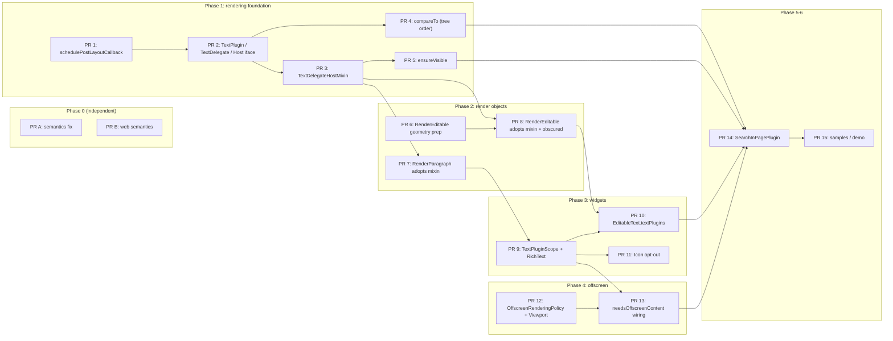

# Composable Text Plugins — Implementation Plan (PR breakdown)

**Status:** draft, 2026-11-02
**Design:** [text_plugins_design_doc.md](./text_plugins_design_doc.md) (RFC 170 / [flutter/rfc#35](https://github.com/flutter/rfc/pull/35))
**Prototype branch:** `text-plugin-testing` (31 commits, 41 files, +9,649 / −67 vs `upstream/master` @ `e71a5b5d8ba`)
**Tracking issue to link from every PR:** [flutter/flutter#65504](https://github.com/flutter/flutter/issues/65504) *(Ctrl+F support, finding text on a page, even when scrolled off screen)*
**Reviewer feedback already folded in:** [rfc_35_comments_summary.md](./rfc_35_comments_summary.md) (chunhtai), [rfc_35_renzo_comments_response.md](./rfc_35_renzo_comments_response.md) (Renzo), [talk plan §5](./text_plugins_forum_talk_plan.md) (doc‑vs‑prototype gaps)

---

## Table of contents

- [0. TL;DR](#0-tldr)
- [1. Where we are: branch inventory](#1-where-we-are-branch-inventory)
  - [1.1 File → PR map](#11-file--pr-map)
  - [1.2 Things that must NOT land in this series](#12-things-that-must-not-land-in-this-series)
  - [1.3 Verified state of the prototype](#13-verified-state-of-the-prototype)
- [2. Splitting principles](#2-splitting-principles)
- [3. Public-API gate: decisions to settle before specific PRs](#3-public-api-gate-decisions-to-settle-before-specific-prs)
- [4. Phase 0 — Pre-flight (independent PRs)](#4-phase-0--pre-flight-independent-prs)
- [5. Phase 1 — Rendering foundation (PR 1–5)](#5-phase-1--rendering-foundation-pr-15)
- [6. Phase 2 — Render object integration (PR 6–8)](#6-phase-2--render-object-integration-pr-68)
- [7. Phase 3 — Widgets layer (PR 9–11)](#7-phase-3--widgets-layer-pr-911)
- [8. Phase 4 — Offscreen content (PR 12–13)](#8-phase-4--offscreen-content-pr-1213)
- [9. Phase 5 — First-party `SearchInPagePlugin` (PR 14)](#9-phase-5--first-party-searchinpageplugin-pr-14)
- [10. Phase 6 — Samples and demo (PR 15)](#10-phase-6--samples-and-demo-pr-15)
- [11. Phase 7 — Follow-ups (separate tracks, F1–F8)](#11-phase-7--follow-ups-separate-tracks-f1f8)
- [12. Test migration map](#12-test-migration-map)
- [13. Per-PR checklist and description template](#13-per-pr-checklist-and-description-template)
- [14. Mechanics: carving PRs out of `text-plugin-testing`](#14-mechanics-carving-prs-out-of-text-plugin-testing)
- [15. Risk register](#15-risk-register)

---

## 0. TL;DR

The prototype is one 9.6k-line branch. It lands as **15 small, sequential PRs** (plus 2 unrelated pre-flight PRs and 8 follow-ups), ordered so that every PR is independently green, reviewable in under an hour, and adds no behavior for apps that do not use `TextPluginScope`.

The single biggest structural change versus the prototype: **`RenderParagraph` and `RenderEditable` will *mix in* `TextDelegateHostMixin` instead of each carrying its own copy of the delegate plumbing.** The prototype duplicates `_syncTextPluginDelegates`, `_flushTextPluginNotifications`, the painter helpers, and `handleEvent` forwarding three times (~250 lines each), and `TextDelegate` switches on `is RenderParagraph / RenderEditable / Host`. Landing the mixin first (PR 3) and talking to one host interface (PR 2) shrinks the `RenderParagraph` and `RenderEditable` PRs from ~300 lines each to ~100, and makes them pure "adopt the mixin" reviews.

| PR | Title | Layer | ~Code / ~Test lines | Depends on | Suggested reviewers (area) |
| :-- | :-- | :-- | :-- | :-- | :-- |
| **A** | Semantics merge-flag / sibling-conflict fix (unrelated) | semantics | 25 / 150 | — | a11y, chunhtai |
| **B** | Web engine semantics tree hardening (unrelated) | web engine | 90 / 60 | — | web (yjbanov, mdebbar) |
| **1** | `PipelineOwner.schedulePostLayoutCallback` | rendering | 30 / 100 | — | goderbauer, chunhtai |
| **2** | `TextPlugin`, `TextDelegate`, `TextDelegateHost` interface | rendering | 400 / 200 | 1 | goderbauer, chunhtai, LongCatIsLooong |
| **3** | `TextDelegateHostMixin` (lifecycle plumbing, painting, events) | rendering | 300 / 300 | 2 | goderbauer, chunhtai |
| **4** | `compareRenderObjectTreeOrder` + `TextDelegate.compareTo` | rendering | 70 / 100 | 2 | chunhtai, Renzo |
| **5** | `TextDelegate.showOnScreen` / `ensureVisible` | rendering | 60 / 80 | 3 | Piinks, chunhtai |
| **6** | `RenderEditable` local geometry helpers (prep) | rendering | 45 / 80 | — | justinmc, Renzo, LongCatIsLooong |
| **7** | `RenderParagraph` adopts the host mixin | rendering | 100 / 200 | 3 | LongCatIsLooong, chunhtai, Renzo |
| **8** | `RenderEditable` adopts the host mixin + obscured-text policy | rendering | 140 / 220 | 3, 6 | justinmc, Renzo |
| **9** | `TextPluginScope` + `RichText.textPlugins` + sample | widgets | 300 / 350 | 7 | goderbauer, chunhtai |
| **10** | `EditableText.textPlugins` | widgets | 20 / 100 | 8, 9 | justinmc, Renzo |
| **11** | `Icon` opts out of ambient plugins | widgets | 5 / 30 | 9 | goderbauer |
| **12** | `OffscreenRenderingPolicy` / `OffscreenContentRenderingStrategy` / `Viewport` | widgets (scrolling) | 110 / 150 | — *(parallel track)* | Piinks, goderbauer |
| **13** | `TextPlugin.needsOffscreenContent` wiring in `TextPluginScope` | widgets | 70 / 120 | 9, 12 | goderbauer, Piinks |
| **14** | `SearchInPagePlugin` + `SearchMatch` (first-party) + sample | widgets | 500 / 350 | 4, 5, 10, 13 | goderbauer, chunhtai, justinmc |
| **15** | API samples; demo app decision | examples | — | 14 | — |

> [!IMPORTANT]
> PR 12 has **no dependency on text plugins** and can be opened on day one, in parallel with PR 1. PR 6 is likewise independent. PRs A and B are unrelated bug fixes that are currently tangled into the branch and must be separated out first (see [§1.2](#12-things-that-must-not-land-in-this-series)).



---

## 1. Where we are: branch inventory

### 1.1 File → PR map

Every file changed on `text-plugin-testing` relative to `upstream/master`, and where it goes.

| File on branch | +/− | Destination PR | Notes |
| :-- | :-- | :-- | :-- |
| `rendering/object.dart` — `PipelineOwner` hunks (L1142–1165, L1240) | +25 | **PR 1** | `schedulePostLayoutCallback`, `_flushPostLayoutCallbacks` |
| `rendering/object.dart` — `_RenderObjectSemantics` hunks (L5974, L6630–6663) | +14 | **PR A** | Unrelated: sibling-merge conflict rebuild. Split out. |
| `semantics/semantics.dart` | +9 | **PR A** | Unrelated: `isMergedIntoParent` → `_updateChildrenMergeFlags`. |
| `test/semantics/semantics_update_test.dart` | +153 | **PR A** | Two new tests. |
| `engine/.../web_ui/.../semantics/semantics.dart` + test | +85/−52, +58 | **PR B** | Unrelated: null-safe child lookup, `try/finally` in `updateSemantics`. |
| `rendering/text_plugin.dart` `TextPlugin` (L47–119) | ~70 | **PR 2** | Drop `handlesSelectionHighlight`; add `supportsObscuredText`, `scopeKey`; `needsOffscreenContent` moves to PR 13. |
| `rendering/text_plugin.dart` `TextDelegate` (L138–625) | ~490 | **PR 2** (core), **PR 4** (`compareTo`), **PR 5** (`showOnScreen`/`ensureVisible`), **F1** (`selections`/`selectionColor`) | Rewritten to talk to a `TextDelegateHost` interface instead of `_paragraph/_editable/_host` switches. |
| `rendering/text_plugin.dart` `TextDelegateHostMixin` (L637–935) | ~300 | **PR 3** | Becomes *the* implementation used by `RenderParagraph`/`RenderEditable`. |
| `rendering.dart` export | +1 | **PR 2** | |
| `rendering/paragraph.dart` | +327/−2 | **PR 7** (≈100 lines after mixin), **F1** (selection notifications, `selections` de-`@visibleForTesting`, second background pass) | |
| `rendering/editable.dart` geometry helpers (L1979–1985, L2044–2055) | ~30 | **PR 6** | `getPositionForOffset(Offset)`, `getOffsetForCaret`, `getFullHeightForCaret`; also add `boxHeightStyle`/`boxWidthStyle` to `getBoxesForSelection`. |
| `rendering/editable.dart` plugin plumbing | ~245 | **PR 8** (≈140 lines after mixin) | Plus obscured-text policy (new). |
| `widgets/text_plugin.dart` | +267 | **PR 9** (scope, dedup, order, `none`, `exclude`), **PR 13** (`Listenable` subscription + `OffscreenContentRenderingStrategy` emission) | Fix tie-break on override and the `exclude` policy bug. |
| `widgets/basic.dart` `RichText.textPlugins` | +10 | **PR 9** | |
| `widgets.dart` exports | +2/−1 | **PR 9** | |
| `widgets/editable_text.dart` | +15/−1 | **PR 10** | |
| `widgets/viewport.dart` | +109/−6 | **PR 12** | Self-contained. |
| `widgets/selectable_region.dart` | +69/−1 | **F1** | Phase-2 experiment; the design doc explicitly defers it (§5.2.4). Has one lint (`avoid_redundant_argument_values` at L3789). |
| `test/widgets/text_plugin_test.dart` | +1,162 | Split across PR 2–14, see [§12](#12-test-migration-map) | |
| `examples/text_plugins/lib/plugins/search_in_page_plugin.dart` | +557 | **PR 14** → `packages/flutter/lib/src/widgets/search_in_page_plugin.dart` | Drop `package:flutter/material.dart` import. |
| `examples/text_plugins/**` (demo app, 6 other plugins, web assets, tests) | ~4,100 | **PR 15** (decision) | See [§10](#10-phase-6--samples-and-demo-pr-15). |
| `pubspec.yaml` workspace entry | +1 | **PR 15** (only if the demo stays under `examples/`) | |
| `Text-Plugins-One-Pager.md`, `text_plugins_design_doc.md`, `rfc_35_*.md`, `text_plugins_forum_talk_plan.md`, this file | ~2,000 | **Do not land** | Live in `flutter/rfc` and your notes; keep them on the prototype branch only. |

### 1.2 Things that must NOT land in this series

1. **Unrelated semantics fixes** (PR A, PR B). They were committed together with text-plugin work in `3253074b3a0` ("1"). They have different reviewers and different risk profiles; a regression in one would otherwise revert the other.
2. **Root-level markdown docs.** The RFC is the source of truth in `flutter/rfc`.
3. **`_SelectionHighlightTextPlugin` in `SelectableRegion` and the `@internal handlesSelectionHighlight` flag + second background pass in `RenderParagraph.paint`.** The RFC §5.2.4 says the initial proposal "keeps Flutter's built-in selection rendering unchanged." Landing it now would (a) install a `TextPluginScope` in every app that uses `SelectionArea`, (b) require goldens/benchmarks before anyone will approve it, and (c) contradict the RFC text reviewers just read. It becomes **F1**, co-owned with Renzo, and uses `paintOrder` rather than a special flag.
4. **`examples/text_plugins/build/`** (already untracked; just don't `git add -A`).
5. **`TextDelegate.onPointerEvent`** (recommend dropping — see [§3](#3-public-api-gate-decisions-to-settle-before-specific-prs) D4).

### 1.3 Verified state of the prototype

Checked on 2026-11-02 against the branch head `b5d60c535e3`:

- `flutter test packages/flutter/test/widgets/text_plugin_test.dart` → **17/17 pass**.
- `dart analyze --fatal-infos` on the six touched framework files → **1 info** (`selectable_region.dart:3789`, redundant `includePlaceholders: false`), which lives in the deferred F1 code.
- Demo tests (`examples/text_plugins/test/widget_test.dart`, 2 tests) not re-run here; they ran green per `b5d60c535e3`.

---

## 2. Splitting principles

1. **One concern per PR, ≤ ~300 lines of non-test code.** Flutter reviewers routinely bounce 1k-line framework PRs; the rendering pipeline PRs (1, 2, 3, 7, 8) are the ones that need the most careful eyes, so they are kept smallest.
2. **Every PR is green and shippable on its own.** No PR depends on a *future* PR to be correct; tests land in the same PR as the code they cover. "Dead" public API for a few weeks is acceptable (precedent: `rendering/selection.dart` primitives landed before `SelectableRegion`), **provided its shape is settled** — hence the API gate in §3.
3. **Zero cost when unused.** Every render-object PR must keep the `textPlugins == null` path free of allocations (no `TextDelegate`, no `ChangeNotifier`, no post-layout callback). Each such PR carries a test asserting it.
4. **Land in dependency order; prepare as a local stack.** flutter/flutter has no stacked-PR review; open PR *N+1* against `master` only after PR *N* lands (draft earlier is fine, with a "stacked on #N, review last commit only" note).
5. **Tests live next to the layer**: render-object behavior in `packages/flutter/test/rendering/`, widget behavior in `packages/flutter/test/widgets/`. The prototype puts everything in one widget test; it is split in [§12](#12-test-migration-map).
6. **Every PR links #65504 and flutter/rfc#35**, and records any RFC text that must change as a result (the RFC PR gets a follow-up commit per landed PR).
7. **Prefer additive API.** Getters can be added later without breaking anyone; dedup *semantics*, lifecycle *contracts*, and default *policies* cannot. Those are frozen in the PR that introduces them.

---

## 3. Public-API gate: decisions to settle before specific PRs

These come from the chunhtai / Renzo reviews and the talk-plan discrepancy list. Each is tied to the first PR whose review would be blocked without it.

| # | Decision | Settle before | Prototype today | Recommendation |
| :-- | :-- | :-- | :-- | :-- |
| D1 | Is `PipelineOwner.schedulePostLayoutCallback` acceptable as a pipeline hook? | PR 1 | `@internal`, flushed at end of `flushLayout()` | Keep `@internal`; add a `_debugDoingPostLayoutCallbacks` flag so `markNeedsLayout` from a callback asserts in debug (talk-plan gap 5.2 #3). |
| D2 | Lifecycle contract: does `didLayoutText` also fire in the same frame as `didAddText` / `didUpdateText`? (RFC §3.2 says "at most one"; code fires both.) | PR 2 | Fires both | Keep the code behavior (plugins implement one "layout is valid" hook), update RFC §3.2 and the sequence diagram. |
| D3 | `TextDelegate` metadata so plugins know what they are attached to: `isEditable`, `isReadOnly`, `isSelectable`, `isObscured` | PR 2 (on the host interface) | Absent | Add to `TextDelegateHost`; `RenderParagraph`/`RenderEditable` implement in PR 7/8. |
| D4 | Keep `TextDelegate.onPointerEvent`? | PR 2 | Present | Drop: redundant with `TextPlugin.handlePointerEvent` and a second way to do the same thing. |
| D5 | Plugin identity: delegates are reconciled by **instance**; constructing plugins inline in `build` churns every delegate each rebuild. | PR 3 | By instance | Document "hoist plugin instances into `State`" in `TextPluginScope` docs and the sample; leave room for an additive `TextPlugin.shouldUpdate(old)`/key protocol later. |
| D6 | `handlesSelectionHighlight` flag vs. `paintOrder` | PR 7 | `@internal` flag + hard-coded second background pass | Drop the flag; `RenderParagraph.paint` runs painters strictly by `paintOrder`. F1 uses `paintOrder => 100`. |
| D7 | Obscured text fields (Renzo P0) | PR 8 | Delegates created for `obscureText` fields; `delegate.text` returns the briefly revealed char | `RenderEditable(obscureText: true)` creates delegates only for plugins with `supportsObscuredText == true`; `delegate.text`/`textSpan` return the fully obscured string; `isObscured` exposed. |
| D8 | Scope dedup key | PR 9 | `runtimeType` | `Object get scopeKey => runtimeType` on `TextPlugin`; dedup by `scopeKey`; override = remove-then-insert so the inner plugin takes the inner tie-break slot. `exclude(types:)` keeps matching by `Type`. |
| D9 | Default eager cache extent and semantics-tree growth under eager rendering | PR 12 / 13 | `ScrollCacheExtent.pixels(1e6)`, semantics clip widens with it | Keep 1e6 as default but **investigate decoupling the semantics clip** (`RenderViewportBase.describeSemanticsClip`) before PR 13; see F7. |
| D10 | Where does `SearchInPagePlugin` live? | PR 14 | `examples/text_plugins` | `packages/flutter/lib/src/widgets/search_in_page_plugin.dart` (no Material dependency; same tier as `TextEditingController`). |
| D11 | Where does the demo live? | PR 15 | `examples/text_plugins` | API samples in `packages/flutter/examples/api` + full showcase outside the repo (see §10). |

> [!TIP]
> Reply to Renzo's five threads (drafts are in [rfc_35_renzo_comments_response.md §6](./rfc_35_renzo_comments_response.md)) and get D3/D7/D8 acknowledged there **before** opening PR 2. It is far cheaper to agree on a getter name in an RFC thread than in a framework PR.

---

## 4. Phase 0 — Pre-flight (independent PRs)

### PR A — Framework: rebuild semantics nodes when sibling-merge conflicts change

- **Files:** `semantics/semantics.dart` (+9), `rendering/object.dart` `_RenderObjectSemantics` hunks (+14), `test/semantics/semantics_update_test.dart` (+153).
- **Why separate:** unrelated to text plugins; different reviewers; must not be reverted with a plugin regression.
- **Tests:** the two `testWidgets` already in the branch.
- **Action:** write a real commit message (the prototype commit is titled "1"), file/locate an issue describing the bug the tests reproduce, link it.

### PR B — Web engine: tolerate missing children in `SemanticsObject` updates

- **Files:** `engine/src/flutter/lib/web_ui/lib/src/engine/semantics/semantics.dart` (+85/−52), its test (+58).
- **Same treatment as PR A.** Engine web reviewers.

### Housekeeping (no PR)

- Keep `text-plugin-testing` as the *integration* branch; never push it to a PR.
- Delete nothing from it; all carving is done on fresh branches from `upstream/master` (see §14).

---

## 5. Phase 1 — Rendering foundation (PR 1–5)

### PR 1 — `PipelineOwner.schedulePostLayoutCallback`

**Scope**

- `rendering/object.dart`: `_postLayoutCallbacks`, `schedulePostLayoutCallback` (`@internal`), `_flushPostLayoutCallbacks` (drains repeatedly until empty, then recurses into child owners), called at the end of `flushLayout()` before `flushPaint()`.
- Add `_debugDoingPostLayoutCallbacks` and assert in `markNeedsLayout` (debug only) that a render object is not dirtied from inside a post-layout callback (D1). Message should say "schedule a frame instead".

**Tests** (`test/rendering/object_test.dart` or new `test/rendering/pipeline_owner_post_layout_test.dart`)

- Callback runs after all dirty nodes have `debugNeedsLayout == false` and before any `paint`.
- Callback scheduled *from* a callback runs in the same flush.
- Callbacks on a child `PipelineOwner` run after the parent's.
- `requestVisualUpdate` is invoked (a frame is scheduled) when a callback is added outside a frame.
- Debug assert fires on `markNeedsLayout` inside a callback.

**Review notes:** this is the only PR touching the pipeline core. Keep it tiny; the whole justification (RFC §7.2's four timing bugs) goes in the PR description.

---

### PR 2 — `TextPlugin`, `TextDelegate`, and the `TextDelegateHost` interface

**Scope** (`rendering/text_plugin.dart`, exported from `rendering.dart`)

- `abstract class TextPlugin`: `const` ctor, `paintOrder`, `scopeKey` (D8, default `runtimeType`), `supportsObscuredText` (D7, default `false`), `didAddText`, `didUpdateText`, `didLayoutText`, `didRemoveText`, `handlePointerEvent`. **Not yet:** `needsOffscreenContent` (PR 13), `handlesSelectionHighlight` (dropped, D6).
- `abstract interface class TextDelegateHost` (name negotiable) — the contract a `RenderBox` fulfils to be wrapped by a delegate: `plainText` (cached by the host, see PR 3), `textSpan`, `textDirection`, `getBoxesForSelection(selection, {boxHeightStyle, boxWidthStyle})`, `getPositionForOffset`, `getWordBoundary`, `getOffsetForCaret`, `getFullHeightForCaret`, and metadata `isEditable`, `isReadOnly`, `isSelectable`, `isObscured` (D3).
- `class TextDelegate extends ChangeNotifier`: talks only to the host. Keeps `text`, `textSpan`, `placeholderRanges`, `textDirection`, `hasLayout`, `size`, `paintBounds`, `attached`, `backgroundPainter`/`foregroundPainter` (with `shouldRepaint` + listener management), `getBoxesForSelection(... includePlaceholders = false)` with the placeholder-splitting logic, geometry pass-throughs, `localToGlobal`/`globalToLocal`/`getTransformTo`, `markNeedsPaint`, `@internal` lifecycle flags. **Not yet:** `compareTo` (PR 4), `showOnScreen`/`ensureVisible` (PR 5), `selections`/`selectionColor` (F1), `onPointerEvent` (dropped, D4).

**Tests** (`test/rendering/text_plugin_test.dart`, new) using a hand-written `RenderBox implements TextDelegateHost` fake:

- `text` strips semantics labels, keeps `\uFFFC` placeholders; `placeholderRanges` coalesces runs.
- `getBoxesForSelection` splits around placeholders by default and does not when `includePlaceholders: true`; collapsed/invalid selections pass straight through.
- Setting a painter calls `markNeedsPaint` only when `shouldRepaint`/type changes; swapping painters re-wires the `repaint` listener; `dispose` detaches listeners and nulls painters.
- `hasLayout` is `false` until the host flips `hasValidLayout`, regardless of `kDebugMode`.

**RFC deltas:** §3.2 (D2 wording, `supportsObscuredText`, `scopeKey`), §3.3 (metadata getters, no `onPointerEvent`).

---

### PR 3 — `TextDelegateHostMixin`: delegate reconciliation, post-layout flush, painting, events

**Scope** (`rendering/text_plugin.dart`)

- `mixin TextDelegateHostMixin on RenderBox implements TextDelegateHost` providing: `textPlugins` getter/setter, `_syncTextPluginDelegates` (sort by `paintOrder` with stable tie-break, diff by instance, create/dispose, `didRemoveText` only when `didAddText` was dispatched), `_scheduleTextPluginFlush`/`_flushTextPluginNotifications` via PR 1, `markNeedsTextDelegateUpdate()`, `didLayoutTextDelegates()`, `paintTextPluginBackgrounds` / `paintTextPluginForegrounds` with the save/restore-balance debug check, `handleEvent` forwarding, `attach`/`detach`/`markNeedsLayout`/`dispose` overrides.
- **Cache `plainText` per text generation** inside the mixin (`markNeedsTextDelegateUpdate` invalidates) so `delegate.text`, `placeholderRanges`, and `getBoxesForSelection` do not call `toPlainText` repeatedly (talk-plan gap 5.2 #4).
- Keep the two paint helpers *unclipped*; clipping is the host's decision (RenderParagraph clips when `_needsClipping`).

**Tests** (`test/rendering/text_plugin_host_test.dart`) with a `LeafRenderObjectWidget` + `RenderBox with TextDelegateHostMixin` (reuse the prototype's `RenderCustomBadgeText` / `RenderLabeledColorBox` from `text_plugin_test.dart` L845–1100):

- Lifecycle order and pairing: `didAddText` → `didLayoutText` on first frame; `didUpdateText` → `didLayoutText` on text change; `didLayoutText` alone on relayout; `didRemoveText` on unmount; **no** `didRemoveText` if unmounted before first layout.
- `hasLayout == true` inside every callback (the "Lifecycle callbacks have valid layout" test, L738).
- Plugin list reconciliation keeps existing delegates (RFC §7.6) and dedups duplicate instances (RFC §7.7 part 2).
- Paint order: background painters by `paintOrder` then installation order; foreground after host content; a painter with unbalanced `save()` throws in debug (RFC §7.12).
- Pointer events reach `handlePointerEvent` in paint order.
- Painter `repaint` listenable triggers host repaint (L245).
- `textPlugins = null` → no delegates, no scheduled callback (zero-cost guarantee).

**RFC deltas:** §3.1 table (the mixin is the shared implementation), §6.1 (custom render boxes mix it in — already described).

---

### PR 4 — Document-order comparison: `compareRenderObjectTreeOrder` + `TextDelegate.compareTo`

**Scope**

- New top-level helper in `rendering/` (e.g. `object.dart` or a small `tree_order.dart`): `int compareRenderObjectTreeOrder(RenderObject a, RenderObject b)` — the LCA walk from the prototype, rewritten to **walk by depth without allocating two ancestor lists** (talk-plan discrepancy #6), falling back to `identityHashCode` order when the two objects do not share a root.
- `TextDelegate implements Comparable<TextDelegate>`; `compareTo` delegates to the helper.

**Tests**

- Unit: siblings in a `RenderFlex`, nested containers, ancestor/descendant, detached objects.
- Widget: `ListView.builder` of host widgets scrolled upward so items mount out of order; `sorted(delegates)` is document order (prototype test L397).

**Why separate:** Renzo asked (comment #1) for this to be shareable with `SelectableRegion.compareOrder`; making it a standalone helper with its own tests is what makes F2 possible.

---

### PR 5 — `TextDelegate.showOnScreen` and `ensureVisible`

**Scope:** the two methods from the prototype (L476–518). `ensureVisible` unions the boxes (`BoxHeightStyle.max`) or falls back to a caret rect.

**Tests:** host widget inside a `ListView`; `ensureVisible(range)` scrolls a range that is (a) below, (b) above, (c) already visible (no scroll); nested scroll views scroll both axes; collapsed range uses the caret rect (prototype test L353).

---

## 6. Phase 2 — Render object integration (PR 6–8)

### PR 6 — `RenderEditable`: local-coordinate geometry helpers (prep, independent)

**Scope** (`rendering/editable.dart`)

- Public `getPositionForOffset(Offset localOffset)`, `getOffsetForCaret(TextPosition, Rect)`, `getFullHeightForCaret(TextPosition)` — all accounting for `_paintOffset` (the prototype versions at L1979–1985, L2044–2055).
- `getBoxesForSelection(selection, {BoxHeightStyle? boxHeightStyle, BoxWidthStyle? boxWidthStyle})` defaulting to `selectionHeightStyle`/`selectionWidthStyle` (fixes talk-plan discrepancy #5 so `ensureVisible`'s `BoxHeightStyle.max` is honored for editables).

**Tests** (`test/rendering/editable_test.dart`): boxes/caret offsets shift with the internal scroll offset of a multi-line editable; explicit box styles are honored.

**Why separate:** pure additive API on a widely-used render object; text-input owners can approve it in minutes without reading anything about plugins.

---

### PR 7 — `RenderParagraph` adopts `TextDelegateHostMixin`

**Scope** (`rendering/paragraph.dart`, target ≈100 lines)

- `class RenderParagraph extends RenderBox with ..., TextDelegateHostMixin`; `textPlugins` ctor param; implement `TextDelegateHost` members (`plainText` via the mixin cache, `isEditable => false`, `isReadOnly => false`, `isSelectable => registrar != null`, `isObscured => false`).
- `set text`: call `markNeedsTextDelegateUpdate()` when the plain text changed (compare *once*, using the cached value — not twice as the prototype does).
- `performLayout`: `didLayoutTextDelegates()` after `_needsClipping` is computed.
- `paint`: `paintTextPluginBackgrounds` **before** `_SelectableFragment.paintSelection`, `paintTextPluginForegrounds` after glyphs/inline children and **before** `paintHandles`; both wrapped in the existing `_needsClipping` clip (RFC §3.5, §7.4, §7.9). Single pass by `paintOrder` — no `handlesSelectionHighlight` (D6).
- `handleEvent`: provided by the mixin; `hitTestSelf` already returns `true`.
- `dispose`/`attach`/`detach`/`markNeedsLayout` chain through the mixin.

**Tests** (`test/rendering/paragraph_test.dart`)

- Lifecycle via `RenderParagraph` directly (`text` setter → `didUpdateText`; style-only change → `didLayoutText` only).
- Painting: background under glyphs, foreground over glyphs, clipped under `TextOverflow.ellipsis`/`clip` (RFC §7.4) — use `tester.layers`/`paints` matchers or a recording canvas.
- Coexists with `SelectionRegistrar`: selection highlight still paints above background painters and below foreground painters (prototype test L325, moved here at the render level).
- Pointer events forwarded; `TextSpan.recognizer` still fires (RFC §7.8).
- Zero-cost: `RenderParagraph()` without plugins allocates no delegates and schedules no callback; existing `paragraph_test.dart` / `text_test.dart` / `selectable_region_test.dart` suites stay green (run them all).

**Perf gate:** run `dev/benchmarks/macrobenchmarks` text-heavy pages (`text_field_layout`, `large_images`, `complex_layout`) before/after; the only diff on the no-plugin path should be one null check per `paint`/`performLayout`/`set text`.

---

### PR 8 — `RenderEditable` adopts `TextDelegateHostMixin` + obscured-text policy

**Scope** (`rendering/editable.dart`, target ≈140 lines)

- Mix in; `textPlugins` ctor param; host members (`isEditable => true`, `isReadOnly => readOnly`, `isSelectable => true`, `isObscured => obscureText`).
- `set text` → `markNeedsTextDelegateUpdate()`; `performLayout` → `didLayoutTextDelegates()`.
- `_paintContents`: backgrounds after the `_backgroundRenderObject` child and before `_textPainter.paint`; foregrounds after `_foregroundRenderObject`. Painters receive `size` and paint in the editable's local coordinates; boxes from PR 6 already include `_paintOffset`, so they line up (add a test for a scrolled multi-line field).
- `handleEvent`: call `super.handleEvent` (mixin forwarding) **before** `_tap.addPointer`/`_longPress.addPointer`, matching the prototype order.
- **Obscured policy (D7):** when `obscureText == true`, `_syncTextPluginDelegates` filters out plugins with `supportsObscuredText == false`; re-sync when `obscureText` toggles (eye icon → `didAddText`/`didRemoveText`). For obscured delegates, `plainText`/`textSpan` return `obscuringCharacter * length`, never the briefly revealed character.

**Tests** (`test/rendering/editable_test.dart` + a widget-level test in PR 10)

- Typing updates fire `didUpdateText` once per frame; cursor blink does **not** fire anything.
- Painter alignment under internal scroll.
- Obscured: no delegates for default plugins; opted-in plugin sees only `•` characters with `tester.binding.platformDispatcher.brieflyShowPasswordTestValue = true` on Android/iOS; toggling `obscureText` adds/removes delegates.
- Existing `editable_test.dart`, `editable_text_test.dart`, `text_field_test.dart` stay green (run all three; they are long).

**RFC deltas:** §2.1 non-goal bullet, new §7.13 (obscured fields), §3.2/§3.3 (already in PR 2 text).

---

## 7. Phase 3 — Widgets layer (PR 9–11)

### PR 9 — `TextPluginScope`, `RichText.textPlugins`, exports, first sample

**Scope**

- `widgets/text_plugin.dart`: `TextPluginScope` (`new`, `.multiple`, `.exclude`, `.none`), `maybeOf`/`of`, `_InheritedTextPluginScope`. Dedup by `scopeKey` with remove-then-insert on override (D8); stable `mergeSort` by `paintOrder`. **Not yet:** `Listenable` subscription and `OffscreenContentRenderingStrategy` emission (PR 13) — `build` just returns the inherited widget.
- `widgets/basic.dart`: `RichText.textPlugins` (`textPlugins ?? TextPluginScope.maybeOf(context)` in create/update).
- `widgets.dart`: `export 'src/widgets/text_plugin.dart'`; `export 'rendering.dart' show TextDelegate, TextDelegateHostMixin, TextPlugin, …`.
- Docs: `TextPluginScope` class doc must state (D5) "create plugin instances once (e.g. in `State`) — the scope reconciles delegates by instance identity".
- Sample: `packages/flutter/examples/api/lib/widgets/text_plugin/text_plugin_scope.0.dart` — a ~80-line "highlight every occurrence of a word" plugin wrapping a `Column` of `Text`s, with `examples/api/test/widgets/text_plugin/text_plugin_scope.0_test.dart`. Reference it with `{@tool dartpad}` from the class doc.

**Tests** (`test/widgets/text_plugin_test.dart`, now much smaller)

- Lifecycle through `Text`/`RichText` (L112); `.none` (L273); `.exclude(types:)` (L700, without the selection-plugin half); dedup + ordering (L546) **plus** the new cases: inner subclass with the same `scopeKey` replaces the outer base instance; override takes the inner tie-break slot.
- Pointer events through widgets (L297); works alongside `SelectionArea` (L325, widget level).
- `TextPluginScope` rebuild with the same instances causes no `didRemoveText`/`didAddText` churn; with new instances it does (documents D5).

**RFC deltas:** §3.4 and §7.7 (`scopeKey`, override tie-break), §3 usage sample (hoist plugins).

---

### PR 10 — `EditableText.textPlugins`

**Scope:** `widgets/editable_text.dart` (+15): `EditableText.textPlugins` → `_Editable.textPlugins` → `RenderEditable.textPlugins` in create/update.

**Tests:** prototype test L583 (typing updates), plus widget-level obscured test: `TextField(obscureText: true)` inside a scope receives no `didAddText`; `SearchInPagePlugin`-style scanner never sees plaintext.

---

### PR 11 — `Icon` opts out of ambient text plugins

**Scope:** `widgets/icon.dart` passes `textPlugins: const <TextPlugin>[]` to its internal `RichText` (talk-plan gap 5.2 #5: icon glyphs are private-use code units that would otherwise be counted as words / spoken / searched).

**Tests:** an `Icon` inside a `TextPluginScope` registers no delegate; a sibling `Text` still does.

**Why separate:** it is a behavior decision reviewers may want to debate (should it be opt-out on `Icon` or a scope-level filter?). Keep it out of PR 9 so that debate does not block the scope itself.

---

## 8. Phase 4 — Offscreen content (PR 12–13)

### PR 12 — `OffscreenRenderingPolicy`, `OffscreenContentRenderingStrategy`, `Viewport` integration (independent)

**Scope** (`widgets/viewport.dart`, +109/−6 — exactly the prototype diff)

- `@immutable class OffscreenRenderingPolicy` (`.lazy()`, `.eager({cacheExtent = ScrollCacheExtent.pixels(1e6)})`, `==`/`hashCode`/`toString`).
- `class OffscreenContentRenderingStrategy extends InheritedWidget` with `of`/`maybeOf`, `updateShouldNotify`, `debugFillProperties`.
- `Viewport._effectiveScrollCacheExtent(context)` and `ShrinkWrappingViewport` consult the policy first.
- Docs explain why `1e6` and not `double.maxFinite` (RFC §5.1.3). **No reference to text plugins is required** for this PR to make sense: it is a general "pre-render a bounded list" capability. Mention `TextPluginScope` only as a future user.

**Tests** (`test/widgets/viewport_test.dart` or `scroll_view_test.dart`)

- Eager policy builds all items of a bounded `ListView.builder`; bounded `cacheExtent: ScrollCacheExtent.pixels(…)` builds only that far; nested `.lazy()` restores default behavior; policy change triggers relayout; `ShrinkWrappingViewport` honors it (prototype test L490).

**Open question to raise in the PR (D9 / F7):** `RenderViewportBase.describeSemanticsClip` widens with `_calculatedCacheExtent`, so an eager extent of 1e6 puts every pre-built item into the semantics tree. Ask the scrolling owners whether the semantics clip should stay at the default extent when the policy is eager. If yes, that is a small follow-up in `rendering/viewport.dart` (F7) that should land **before PR 13 enables eager mode from `TextPluginScope`**.

---

### PR 13 — `TextPlugin.needsOffscreenContent` and scope wiring

**Scope**

- `rendering/text_plugin.dart`: `bool get needsOffscreenContent => false` on `TextPlugin` (docs from prototype L52–69).
- `widgets/text_plugin.dart`: `_TextPluginScopeState` subscribes to plugins that are `Listenable`, recomputes on change, emits `OffscreenContentRenderingStrategy`. **Fix the `exclude` branch** so an inherited bounded policy is respected rather than reverting to the 1e6 default (talk-plan discrepancy #8).

**Tests:** prototype L439 (toggle on a `ChangeNotifier` plugin builds offscreen `ListView.builder` items, toggle off unmounts them and fires `didRemoveText`), plus: bounded policy survives under `TextPluginScope.exclude`; `.none` forces lazy; only viewports rebuild when the flag flips (onscreen `RichText`s do not).

---

## 9. Phase 5 — First-party `SearchInPagePlugin` (PR 14)

**Scope** (`packages/flutter/lib/src/widgets/search_in_page_plugin.dart`, exported from `widgets.dart`)

- Move `SearchMatch` and `SearchInPagePlugin` from the demo; replace `package:flutter/material.dart` with `foundation`/`rendering`/`scheduler` imports (`Color` comes from `dart:ui`).
- Align the public surface with RFC §3.6.1: constructor takes `query`, `caseSensitive`, `eagerLoadOffscreenText`, colors; getters/setters; `matches`, `activeMatchIndex`, `activeMatch`, `nextMatch`, `previousMatch`, `scrollToActiveMatch`. Decide the `eagerLoadOffscreenText` default (RFC says `true`, code says `false`; recommend **`false`** so a plugin merely being in the tree never changes scrolling behavior — Ctrl+F handler flips it on).
- Keep the incremental per-delegate indexing (`_matchesByDelegate`, `_orderedMatchingDelegates`, binary insert via `compareTo`, `_reconcileActiveMatch`) and `_notifyListenersSafely` (RFC §3.6.2, §3.6.4, §7.1).
- Sample: `examples/api/lib/widgets/search_in_page_plugin/search_in_page_plugin.0.dart` — search field + "n of m" + prev/next over a `ListView.builder`, with `onEditingComplete: () {}` (the fanchou bug) and `TextPluginScope.none` around the bar (RFC §7.10).

**Tests** (`test/widgets/search_in_page_plugin_test.dart`)

- Move the demo test "updates only the changed delegate on didUpdateText" (demo L336) and add: match ordering across out-of-order mounts; active match preserved across edits above it; `nextMatch` wraps and scrolls; `query` change triggers exactly one full rescan; `notifyListeners` is deferred during `persistentCallbacks` and immediate when idle; painters attached only to delegates with matches; `caseSensitive` toggling; obscured `TextField` is never searched.

**Why one PR:** the plugin is cohesive and ~500 lines, most of it already reviewed on the RFC. If reviewers push back on size, split painters + navigation (14a) from offscreen/eager handling (14b).

---

## 10. Phase 6 — Samples and demo (PR 15)

The prototype's `examples/text_plugins` (1,709-line `main.dart`, six community-style plugins, web assets) is a great showcase but a poor fit for `examples/`: that directory holds a handful of canonical apps, each is **built on every CI platform shard** (`dev/bots/test.dart::_runBuildTests`) and has its `test/` run in the framework shard (`run_framework_tests.dart::runExampleTests`). Adding ~4k lines there is a maintenance commitment the team will question.

**Recommendation**

1. **In-tree:** two or three API samples (PR 9: `TextPluginScope`; PR 14: `SearchInPagePlugin`; optionally a `TextDelegateHostMixin` sample for RFC §6.1). Each ≤ ~150 lines with a test. These are what `{@tool dartpad}` links to and what docs.flutter.dev embeds.
2. **Out of tree:** move the full demo (stock ticker, linkify, spoiler mask, read-aloud, linter, SEO) to a standalone repo (or `flutter/samples`) once PR 14 lands, and link it from the RFC and the `TextPluginScope` docs. Convert the demo plugins to the gesture-arena pattern (Renzo #3) there, where iteration is cheap.
3. Remove the `examples/text_plugins` workspace entry from the root `pubspec.yaml` on the integration branch once (2) is done.

If the team prefers it in-tree after all, land it as its own PR 15 **after** PR 14, trimmed to the plugins that exercise framework API not covered by samples, with `test/widget_test.dart` kept fast (< 10 s).

---

## 11. Phase 7 — Follow-ups (separate tracks, F1–F8)

Each gets a GitHub issue filed when PR 9 lands, cc'd to the named owner, so they can proceed without blocking the main series.

| # | Follow-up | Source | Prereqs | Notes |
| :-- | :-- | :-- | :-- | :-- |
| F1 | Public, subclassable `SelectionHighlightTextPlugin` (`paintOrder => 100`); `SelectableRegion` installs it; `TextDelegate.selections`/`selectionColor` on the host interface; remove legacy highlight painting from `RenderParagraph` and, later, `RenderEditable` | RFC §5.2.4 phase 2, Renzo #4, prototype `selectable_region.dart` + tests L633/L700 | PR 9 | Needs goldens for pixel parity with `_SelectableFragment.paintSelection` and macrobenchmarks (every `SelectionArea` app gains a scope). Co-own with Renzo. |
| F2 | Try `compareRenderObjectTreeOrder` in `MultiSelectableSelectionContainerDelegate.compareOrder` (opt-in) | Renzo #1 | PR 4 | `Selectable` is not a `RenderObject`; needs a handle or two-level compare. Behavior change for `Stack`/reversed layouts → experiment first. |
| F3 | Semantics annotations for plugin-decorated ranges (`TextPluginSemanticAnnotation`) | RFC §2.2.3 #4, talk D6 | PR 9 | Screen readers cannot see plugin-painted links today. Design the hook with the a11y team. |
| F4 | Gesture-arena participation / "interactive ranges" (`HitTestTarget` ahead of the paragraph, `MouseCursor`) | Renzo #3, talk D5 | PR 9 | Until then, docs recommend owning a `TapGestureRecognizer` and calling `addPointer` in `handlePointerEvent`; `isEditable`/`isSelectable` let plugins apply editor conventions. |
| F5 | Migrate `EditableText` spell-check squiggles to a first-party `SpellCheckPlugin` | Renzo #2 | PR 10 | Rendering half only; service/toolbar/replacement stay in `EditableText`. |
| F6 | `TextPluginScope` capture into overlays (`InheritedTheme`-style) | talk gap 5.2 #6 | PR 9 | Decide whether dialogs/tooltips should inherit the page scope. |
| F7 | Decouple semantics clip from eager layout cache extent in `RenderViewportBase` | talk gap 5.2 #1, D9 | PR 12 | Should land before or with PR 13 if scrolling owners agree it is a regression. |
| F8 | `TextDelegate` truncation info (`didExceedMaxLines`, visible range) and `hasCharacterBoxes` for non-text hosts | RFC §7.4, §6.1 | PR 7 | Additive getters; needed by search to skip ellipsized matches. |

---

## 12. Test migration map

Where each existing test on the branch ends up. Line numbers refer to `packages/flutter/test/widgets/text_plugin_test.dart` and `examples/text_plugins/test/widget_test.dart`.

| Existing test | → PR | New location |
| :-- | :-- | :-- |
| L112 lifecycle of `Text`/`RichText` | 9 | `test/widgets/text_plugin_test.dart` |
| L177 layout boxes and positions | 2 (fake host) + 7 (`RenderParagraph`) | `test/rendering/text_plugin_test.dart`, `paragraph_test.dart` |
| L212 multiple plugins paint in order | 3 (host) + 9 (scope ordering) | `test/rendering/text_plugin_host_test.dart`, widgets test |
| L245 repaint listenable | 2 | rendering test |
| L273 `TextPluginScope.none` | 9 | widgets test |
| L297 pointer events on `Text` | 7 (render) + 9 (widget) | both |
| L325 alongside `SelectionArea` | 7 (render) + 9 (widget) | both |
| L353 `ensureVisible` | 5 | rendering test with host widget |
| L397 `compareTo` out-of-order mount | 4 | rendering test with host widget |
| L439 `needsOffscreenContent` | 13 | widgets test |
| L490 strategy override / bounded extent | 12 | `viewport_test.dart` |
| L546 dedup by `Type` + `paintOrder` | 9 (rewritten for `scopeKey`) | widgets test |
| L583 `EditableText` typing | 10 | widgets test |
| L633 `SelectableRegion` installs highlight plugin | F1 | with F1 |
| L700 `exclude` preserves selection plugin | 9 (exclude half) + F1 | widgets test / F1 |
| L738 callbacks have valid layout | 3 | host test |
| L763 custom `RenderBox` hosts | 3 | host test (becomes the primary fixture) |
| demo L13 demo app smoke | 15 | with the demo, wherever it lives |
| demo L336 `SearchInPagePlugin` single-delegate update | 14 | `test/widgets/search_in_page_plugin_test.dart` |

---

## 13. Per-PR checklist and description template

### Checklist (run before requesting review)

- [ ] Branch is based on today's `upstream/master`; diff contains **only** the files in this PR's scope table.
- [ ] `./bin/dart analyze --fatal-infos <touched files>` and `./bin/dart format <touched files>` are clean.
- [ ] `./bin/flutter test <new/touched test files>` passes; for PR 7/8 also run `paragraph_test.dart`, `text_test.dart`, `selectable_region_test.dart`, `editable_test.dart`, `editable_text_test.dart`, `text_field_test.dart`.
- [ ] `./bin/dart dev/bots/analyze.dart` passes (license headers, `@docImport`s, no `material` import from `widgets`, public-member docs).
- [ ] Every public member has a `///` doc; new widgets/classes have `debugFillProperties` where applicable; a `{@tool dartpad}` sample exists for the user-facing entry points (PR 9, PR 14).
- [ ] "Zero cost when unused" test present for any render-object change.
- [ ] Description links **#65504** and **flutter/rfc#35**, lists the RFC sections this PR implements, and lists any RFC text that must change.
- [ ] A flutter/website docs issue is linked (PR template requirement) — one issue for the whole feature is fine; link it from PR 9 onward.
- [ ] For PR 7, 8, 12: before/after numbers from the relevant macrobenchmark pasted into the description.

### Description template

```markdown
Part N of the Composable Text Plugins series (RFC 170 / flutter/rfc#35). Tracking issue: #65504.

**This PR:** <one paragraph: what, why, which RFC sections (§x.y)>.

**Not in this PR (lands next):** <next PR's title>.

**Behavior for apps that don't use `TextPluginScope`:** unchanged — <how verified>.

**API decisions encoded here:** <D-numbers from the plan, one line each>.

**RFC follow-up:** <sections whose text will be updated after this lands, or "none">.

## Pre-launch Checklist
<standard template>
```

---

## 14. Mechanics: carving PRs out of `text-plugin-testing`

Work from fresh branches off `upstream/master`; pull hunks from the prototype; never rebase the prototype itself.

```bash
# One-time
git fetch upstream
git branch --list 'tp/*'            # naming: tp/01-post-layout, tp/02-core, ...

# Start a PR branch from master (or from the previous tp/ branch while waiting for it to land)
git checkout -b tp/01-post-layout upstream/master

# Pull a whole file from the prototype, then drop the hunks that belong to other PRs
git checkout text-plugin-testing -- packages/flutter/lib/src/rendering/object.dart
git reset -p -- packages/flutter/lib/src/rendering/object.dart   # keep only PipelineOwner hunks
git checkout -- packages/flutter/lib/src/rendering/object.dart    # discard the unstaged (unrelated) hunks
git diff --cached --stat

# Alternatively, apply only part of a file's diff:
git diff upstream/master text-plugin-testing -- packages/flutter/lib/src/rendering/text_plugin.dart > /tmp/tp.patch
# edit /tmp/tp.patch, then:
git apply --3way /tmp/tp.patch

# Verify
./bin/dart analyze --fatal-infos packages/flutter/lib/src/rendering/object.dart
./bin/dart format packages/flutter/lib/src/rendering/object.dart
./bin/flutter test packages/flutter/test/rendering/object_test.dart
./bin/dart dev/bots/analyze.dart

# Stack the next one locally
git checkout -b tp/02-core tp/01-post-layout
# ... when PR 1 lands on master:
git fetch upstream
git rebase --onto upstream/master tp/01-post-layout tp/02-core
```

Keep a running sanity check that the stack reproduces the prototype minus intentional changes:

```bash
git diff tp/14-search-in-page text-plugin-testing --stat   # should list only: docs, demo app, selectable_region.dart (F1), semantics (PR A/B)
```

Suggested cadence: open PR 1, PR 6, PR 12, PR A and PR B in week 1 (all independent). While they are in review, finish PR 2–3 locally. Expect the sequential chain 2 → 3 → 7 → 9 → 13 → 14 to be the critical path (~6 review cycles).

---

## 15. Risk register

| Risk | Where it bites | Mitigation |
| :-- | :-- | :-- |
| API frozen too early (e.g. dedup key, lifecycle contract) | PR 2, PR 9 | §3 gate; get Renzo/chunhtai sign-off on the RFC threads before opening PR 2. |
| `RenderParagraph`/`RenderEditable` perf regression on the no-plugin path | PR 7, PR 8 | Null-check-only fast path; macrobenchmark numbers in the PR; "zero-cost" tests. |
| Eager offscreen rendering balloons the semantics tree (web DOM, mobile `SemanticsUpdate`) | PR 12/13 | Raise in PR 12; F7 before PR 13 if owners agree. |
| Mixin method-resolution surprises (`attach`/`detach`/`markNeedsLayout`/`handleEvent`/`dispose` chains) on two of the most complex render objects | PR 7, PR 8 | Mixin applied last in the `with` list; each override calls `super`; the full existing text/selection/editable test suites run in the PR. |
| Plugin reconciliation by instance surprises users who construct plugins in `build` | PR 9 | Docs + sample hoist instances; test documents the churn; keep room for an additive key protocol. |
| Password leak via `brieflyShowPassword` | PR 8/10 | D7 default exclusion + fully-obscured `text` + widget test with `brieflyShowPasswordTestValue`. |
| `SelectableRegion` migration (F1) lands before it is benchmarked | F1 | Explicitly out of the series; needs goldens + benchmarks + Renzo co-ownership. |
| Demo app adds CI build cost on all platforms | PR 15 | Prefer API samples in-tree + showcase out of tree. |
| Review latency on the sequential chain | all | Front-load independent PRs (1, 6, 12, A, B); keep drafts of the next two PRs ready; ask one reviewer to own the series. |
