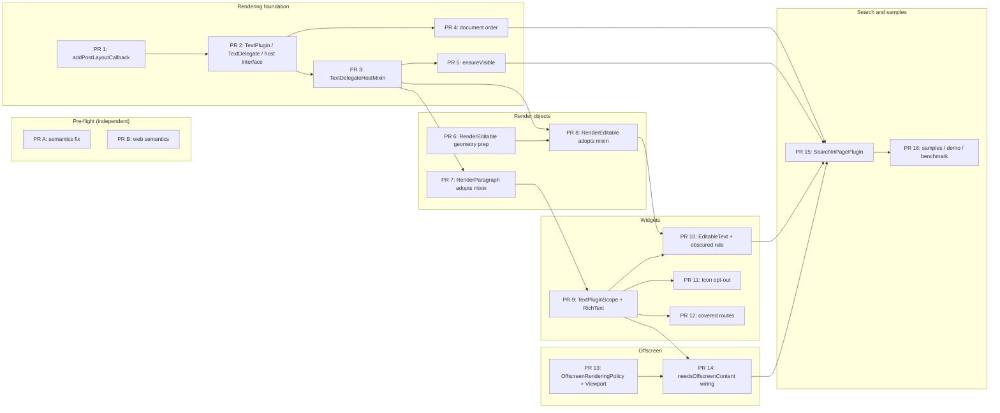

# Composable Text Plugins: implementation plan for the MVP (stage 1)

**Status:** updated 2026-11-16. Replaces the plan of 2026-11-02, which covered the earlier prototype with pointer events.
**Design:** [text_plugins_design_doc.md](./text_plugins_design_doc.md) (RFC 170 / [flutter/rfc#35](https://github.com/flutter/rfc/pull/35))
**Prototype branch:** `text-plugin-mvp` locally, pushed as `origin/text-plugin-testing` (53 commits, 43 code files, about +12,300 / −70 against `upstream/master` at `e71a5b5d8ba`)
**Tracking issue to link from every PR:** [flutter/flutter#65504](https://github.com/flutter/flutter/issues/65504) (Ctrl+F support, finding text on a page, even when scrolled off screen)

---

## Table of contents

- [0. Summary](#0-summary)
- [1. Scope: what the MVP is](#1-scope-what-the-mvp-is)
- [2. Where we are: branch inventory](#2-where-we-are-branch-inventory)
- [3. Splitting principles](#3-splitting-principles)
- [4. Decisions](#4-decisions)
- [5. Pre-flight PRs (unrelated fixes)](#5-pre-flight-prs-unrelated-fixes)
- [6. Rendering foundation (PR 1 to 5)](#6-rendering-foundation-pr-1-to-5)
- [7. Render object integration (PR 6 to 8)](#7-render-object-integration-pr-6-to-8)
- [8. Widgets layer (PR 9 to 12)](#8-widgets-layer-pr-9-to-12)
- [9. Offscreen content (PR 13 and 14)](#9-offscreen-content-pr-13-and-14)
- [10. First-party search plugin (PR 15)](#10-first-party-search-plugin-pr-15)
- [11. Samples, demo and benchmark (PR 16)](#11-samples-demo-and-benchmark-pr-16)
- [12. MVP follow-ups](#12-mvp-follow-ups)
- [13. Test migration map](#13-test-migration-map)
- [14. Per-PR checklist and description template](#14-per-pr-checklist-and-description-template)
- [15. Mechanics: carving PRs out of the prototype](#15-mechanics-carving-prs-out-of-the-prototype)
- [16. Risk register](#16-risk-register)

---

## 0. Summary

This plan lands **stage 1 only**: a text plugin can read text and paint on it. That is what Ctrl+F needs. Stages 2 and 3 and the selection migration are not part of this plan ([Section 1](#1-scope-what-the-mvp-is)).

The prototype is one branch of about 12,300 lines. It lands as **16 small PRs in sequence**, plus 2 unrelated pre-flight PRs. Every PR is green on its own, small enough to review in one sitting, and changes nothing for an app that does not use `TextPluginScope`.

The biggest structural change against the prototype: **`RenderParagraph` and `RenderEditable` mix in `TextDelegateHostMixin`** instead of each carrying its own copy of the delegate code. The prototype has that code three times (about 250 lines each). Landing the mixin first (PR 3) behind one host interface (PR 2) turns the `RenderParagraph` and `RenderEditable` PRs into "adopt the mixin" reviews of about 100 lines each.

The line counts are rough estimates.

| PR | Title | Layer | ~Code / ~Test lines | Depends on | Suggested reviewers (area) |
| :-- | :-- | :-- | :-- | :-- | :-- |
| **A** | Semantics merge-flag / sibling-conflict fix (unrelated) | semantics | 25 / 150 | | a11y, chunhtai |
| **B** | Web engine semantics tree hardening (unrelated) | web engine | 90 / 60 | | web (yjbanov, mdebbar) |
| **1** | `RendererBinding.addPostLayoutCallback` and the layout assertion | rendering | 100 / 150 | | goderbauer, chunhtai, loic-sharma |
| **2** | `TextPlugin`, `TextDelegate`, `TextDelegateHost` interface | rendering | 400 / 200 | 1 | goderbauer, chunhtai, LongCatIsLooong |
| **3** | `TextDelegateHostMixin` (lifecycle plumbing, painting) | rendering | 250 / 300 | 2 | goderbauer, chunhtai |
| **4** | Document order: `compareTo` and `sortInDocumentOrder` | rendering | 150 / 150 | 2 | chunhtai, Renzo |
| **5** | `TextDelegate.showOnScreen` / `ensureVisible` | rendering | 80 / 120 | 3 | Piinks, chunhtai, loic-sharma |
| **6** | `RenderEditable` local geometry helpers (prep) | rendering | 45 / 80 | | justinmc, Renzo, LongCatIsLooong |
| **7** | `RenderParagraph` adopts the host mixin | rendering | 100 / 200 | 3 | LongCatIsLooong, chunhtai, Renzo |
| **8** | `RenderEditable` adopts the host mixin | rendering | 120 / 180 | 3, 6 | justinmc, Renzo |
| **9** | `TextPluginScope` + `RichText.textPlugins` + sample | widgets | 300 / 350 | 7 | goderbauer, chunhtai |
| **10** | `EditableText.textPlugins` and the obscured-text rule | widgets | 25 / 120 | 8, 9 | justinmc, Renzo |
| **11** | `Icon` opts out of ambient plugins | widgets | 5 / 30 | 9 | goderbauer |
| **12** | Covered routes: `TextPluginSuspension` in `Overlay` | widgets | 80 / 130 | 9 | loic-sharma, chunhtai, goderbauer |
| **13** | `OffscreenRenderingPolicy` / `OffscreenContentRenderingStrategy` / `Viewport` | widgets (scrolling) | 110 / 150 | *(parallel track)* | Piinks, goderbauer |
| **14** | `TextPlugin.needsOffscreenContent` wiring in `TextPluginScope` | widgets | 70 / 120 | 9, 13 | goderbauer, Piinks |
| **15** | `SearchInPagePlugin` + `SearchMatch` (first-party) + sample | widgets | 500 / 350 | 4, 5, 10, 14 | goderbauer, chunhtai, justinmc |
| **16** | API samples; demo app and benchmark decision | examples | | 15 | |

> [!IMPORTANT]
> PR 13 does not depend on text plugins and can be opened on day one, in parallel with PR 1. PR 6 is independent too. PRs A and B are unrelated bug fixes that are tangled into the branch and have to be separated out first ([Section 2.2](#22-things-that-must-not-land-in-this-series)).



---

## 1. Scope: what the MVP is

The RFC describes three stages. This plan covers the first.

| | In this plan | Where it is described |
| :-- | :-- | :-- |
| **Stage 1: painter only (MVP)** | Yes | RFC sections 3 to 7 |
| Stage 2: annotations (pointer events, semantics, cursors, focus) | No | RFC section 8, branch `text-plugin-annotations` |
| Stage 3: widgets on text | No | RFC section 9, branch `text-plugin-with-widget` |
| Selection as a plugin | No | RFC section 5.2.5, branch `text-plugin-selection` |

What a stage 1 plugin can do:

- Hear about every text in its scope: added, updated, laid out, removed.
- Read the text and its geometry.
- Set one painter behind the text and one in front of it, and ask for a repaint.
- Ask to scroll a range into view.
- Ask scroll views to lay out offscreen content, so that all text can be found.

What it cannot do, and this plan does not add: react to pointer events, change semantics, take focus, show widgets, change the text or its layout (RFC section 3.9).

The RFC shows that the later stages build on stage 1 without changing its API (RFC sections 8.3 and 9.2). Nothing in this plan has to anticipate them.

---

## 2. Where we are: branch inventory

### 2.1 File to PR map

Every code file changed on the prototype against `upstream/master`, and where it goes.

| File on branch | + lines | Destination PR | Notes |
| :-- | :-- | :-- | :-- |
| `rendering/binding.dart` | 67 | **PR 1** | `addPostLayoutCallback`, `flushPostLayoutCallbacks`, `debugDoingPostLayoutCallbacks`, the call in `drawFrame` |
| `rendering/object.dart`, hunk in `_debugCanPerformMutations` | 27 | **PR 1** | The assertion that a post-layout callback does not dirty layout |
| `flutter_test/lib/src/binding.dart`, `test/rendering/rendering_tester.dart` | 1 each | **PR 1** | Both flush layout themselves, so both call `flushPostLayoutCallbacks` |
| `rendering/object.dart`, `_RenderObjectSemantics` hunks | 14 | **PR A** | Unrelated: sibling-merge conflict rebuild. Split out |
| `semantics/semantics.dart` | 9 | **PR A** | Unrelated |
| `test/semantics/semantics_update_test.dart` | 153 | **PR A** | Two tests |
| `engine/.../web_ui/.../semantics/semantics.dart` and its test | 137, 58 | **PR B** | Unrelated |
| `rendering/text_plugin.dart`, `TextPlugin` | ~70 | **PR 2** | Drop `handlesSelectionHighlight`. `needsOffscreenContent` moves to PR 14 |
| `rendering/text_plugin.dart`, `TextDelegate` | ~560 | **PR 2** (core), **PR 4** (`compareTo`, `sortInDocumentOrder`), **PR 5** (`showOnScreen`, `ensureVisible`) | Rewritten to talk to a `TextDelegateHost` interface. `selections` and `selectionColor` do not land |
| `rendering/text_plugin.dart`, `TextDelegateHostMixin` | ~300 | **PR 3** | Becomes the one implementation used by `RenderParagraph` and `RenderEditable` |
| `rendering.dart` export | 1 | **PR 2** | |
| `rendering/paragraph.dart` | 328 | **PR 7** (about 100 lines after the mixin) | The selection parts do not land: selection notifications, the second background pass |
| `rendering/editable.dart`, geometry helpers | ~30 | **PR 6** | |
| `rendering/editable.dart`, plugin plumbing | ~245 | **PR 8** (about 120 lines after the mixin) | |
| `widgets/text_plugin.dart` | 338 | **PR 9** (scope, dedup, order, `none`, `exclude`), **PR 12** (`TextPluginSuspension`), **PR 14** (listening to plugins, emitting the offscreen strategy) | |
| `widgets/basic.dart`, `RichText.textPlugins` | 10 | **PR 9** | |
| `widgets.dart` exports | 3 | **PR 9** | |
| `widgets/editable_text.dart` | 25 | **PR 10** | Includes the obscured-text rule |
| `widgets/overlay.dart` | 18 | **PR 12** | |
| `widgets/viewport.dart` | 115 | **PR 13** | Self-contained |
| `widgets/selectable_region.dart` | 70 | **Does not land** | Selection highlight as a plugin. Outside the MVP |
| `test/widgets/text_plugin_test.dart` | 1,663 | Split across PR 1 to 14, see [Section 13](#13-test-migration-map) | 26 tests |
| `examples/text_plugins/lib/plugins/search_in_page_plugin.dart` | 563 | **PR 15**, as `packages/flutter/lib/src/widgets/search_in_page_plugin.dart` | Already imports `widgets.dart` only |
| `examples/text_plugins/lib/widgets/search_in_page_bar.dart` | 357 | **PR 15** (as the sample) or **PR 16** | The Material search bars. They are not part of the plugin |
| `examples/text_plugins/lib/benchmark.dart` | 451 | **PR 16** (decision) | See [Section 11](#11-samples-demo-and-benchmark-pr-16) |
| `examples/text_plugins/**` (demo app, four other plugins, web assets, tests) | ~3,000 | **PR 16** (decision) | |
| `pubspec.yaml` workspace entry | 1 | **PR 16**, only if the demo stays under `examples/` | |
| Root-level `*.md` files, including this one | | **Do not land** | They live in `flutter/rfc` and in notes |

### 2.2 Things that must not land in this series

1. **The unrelated semantics fixes** (PR A, PR B). They have other reviewers and other risks. A regression in one must not revert the other.
2. **Root-level markdown docs.** The RFC in `flutter/rfc` is the source of truth.
3. **Selection as a plugin.** That is `_SelectionHighlightTextPlugin` in `SelectableRegion`, the `@internal` flag `handlesSelectionHighlight`, the second background pass in `RenderParagraph.paint`, and `TextDelegate.selections` / `selectionColor`. All of it is still on the prototype branch. The RFC keeps built-in selection rendering unchanged in stage 1.
4. **Build output and generated folders** under `examples/text_plugins` (`build/`, `macos/`).

Pointer events are not on this list because they are no longer on the branch. The MVP prototype has no `handlePointerEvent`.

### 2.3 Verified state of the prototype

Checked on 2026-11-16 at `a47b438302a`:

- `flutter test packages/flutter/test/widgets/text_plugin_test.dart`: 26 of 26 pass.
- `flutter test` in `examples/text_plugins`: 4 of 4 pass.
- `dart analyze --fatal-infos` on the touched framework files: one info, `selectable_region.dart:3789` (a redundant argument), in code that does not land.
- A wider run (all of `test/rendering`, plus the editable text, text field, selection, list, overlay and layout-builder suites) has 7 failures. All are pixel comparisons against reference images. The one in `text_field_test.dart` fails the same way without the latest changes. The six in `localized_fonts_test.dart` were not rechecked against a clean checkout.
- The benchmark ran on macOS in profile mode. Results are in RFC section 3.8.1.

---

## 3. Splitting principles

1. **One concern per PR, at most about 300 lines of non-test code.** The pipeline PRs (1, 2, 3, 7, 8) need the most careful review, so they are the smallest.
2. **Every PR is green and shippable on its own.** No PR needs a later PR to be correct. Tests land with the code they cover. Public API that is unused for a few weeks is acceptable, provided its shape is settled ([Section 4](#4-decisions)).
3. **No cost when unused.** Every render-object PR keeps the `textPlugins == null` path free of allocations: no `TextDelegate`, no post-layout callback. Each such PR has a test for it.
4. **Land in dependency order; prepare as a local stack.** Open PR N+1 against `master` after PR N lands. A draft earlier is fine, with a note to review the last commit only.
5. **Tests live next to the layer**: render-object behavior in `packages/flutter/test/rendering/`, widget behavior in `packages/flutter/test/widgets/`. The prototype has everything in one widget test file.
6. **Every PR links #65504 and flutter/rfc#35**, and records RFC text that has to change.
7. **Prefer additive API.** Getters can be added later. Dedup rules, lifecycle contracts and default policies cannot change later, so they are fixed in the PR that introduces them.

---

## 4. Decisions

### 4.1 Settled in the RFC review

These were open in the plan of 2026-11-02. The second column is what the prototype does now.

| # | Decision | Outcome | First PR | RFC |
| :-- | :-- | :-- | :-- | :-- |
| D1 | Where the post-layout hook lives | On the binding: `RendererBinding.addPostLayoutCallback`, run once per frame in `drawFrame` after layout. A binding that flushes layout itself calls `flushPostLayoutCallbacks`. Marking layout dirty from a callback throws in debug mode | PR 1 | 7.2, 7.16 |
| D2 | Does `didLayoutText` also fire in the frame of `didAddText` / `didUpdateText` | Yes, right after them | PR 2 | 3.2 |
| D3 | Pointer events on plugins | None in stage 1. `handlePointerEvent` and `onPointerEvent` are gone | PR 2 | 3.9, 7.8 |
| D4 | Who owns a plugin | The app. The scope takes instances and does not dispose them. A stateful plugin is created in a `State` | PR 9 | 3.7 |
| D5 | Is `TextDelegate` read-only | Yes, except for its own painters, a repaint request and a scroll request. `renderObject` is `@internal` | PR 2 | 3.3 |
| D6 | Obscured text fields | Never given to any plugin. No opt-in flag | PR 10 | 7.13 |
| D7 | Scope dedup key | `runtimeType`. An inner scope replaces a plugin of the same type | PR 9 | 3.4 |
| D8 | Text in a covered route | Not given to plugins while covered. The `Overlay` suspends them | PR 12 | 7.14 |
| D9 | Scrolling from a lifecycle callback | Allowed. The delegate's scroll methods wait for the end of the frame | PR 5 | 7.16 |
| D10 | Ordering many texts | `TextDelegate.sortInDocumentOrder`, one walk of the tree | PR 4 | 5.1.2 |
| D11 | Search plugin and its UI | The plugin has no UI and does not depend on a design system. The search bar is separate | PR 15 | 3.6 |

### 4.2 Still open

From RFC section 11, plus two carried over from the earlier plan.

| # | Question | Settle before | Recommendation |
| :-- | :-- | :-- | :-- |
| O1 | Where does `SearchInPagePlugin` live | PR 15 | `packages/flutter/lib/src/widgets/search_in_page_plugin.dart`. It needs nothing above the widgets layer |
| O2 | Where do the demo and the benchmark live | PR 16 | API samples in `packages/flutter/examples/api`; the full demo outside the repo ([Section 11](#11-samples-demo-and-benchmark-pr-16)) |
| O3 | Default eager cache extent, and growth of the semantics tree under eager rendering | PR 13 / 14 | Keep the default, and ask the scrolling owners whether the semantics clip should stay at the normal extent (F1) |
| O4 | Should a kept-alive tab, a hidden `IndexedStack` child and an `Offstage` child be left out like a covered route | After PR 12 | `TextPluginSuspension` can be reused. Decide per widget (F2) |
| O5 | Should the framework publish reference values for `paintOrder` | PR 9 | Not for the MVP |
| O6 | Spell check as a first-party plugin, and in which repo | After the MVP | Not part of this plan |

### 4.3 Carried over from the earlier plan, to check while carving

These were recommendations in the plan of 2026-11-02. They were not checked again against the current branch.

- **Dedup tie-break.** When an inner scope replaces a plugin, the inner plugin should take the inner position in the order, not the outer one.
- **`TextPluginScope.exclude` and the offscreen policy.** An inherited bounded policy should be kept, not replaced by the default.
- **Metadata on the delegate** (`isEditable`, `isReadOnly`, `isSelectable`). Not needed by any stage 1 plugin. Additive later.

---

## 5. Pre-flight PRs (unrelated fixes)

### PR A: rebuild semantics nodes when sibling-merge conflicts change

- **Files:** `semantics/semantics.dart` (+9), the `_RenderObjectSemantics` hunks of `rendering/object.dart` (+14), `test/semantics/semantics_update_test.dart` (+153).
- **Why separate:** unrelated to text plugins, other reviewers, and it must not be reverted together with a plugin regression.
- **Action:** write a real commit message, and file or find an issue that describes the bug the tests reproduce.

### PR B: web engine tolerates missing children in `SemanticsObject` updates

- **Files:** `engine/src/flutter/lib/web_ui/lib/src/engine/semantics/semantics.dart` and its test.
- Same treatment as PR A. Web engine reviewers.

### Housekeeping (no PR)

- Keep the prototype as the integration branch. Never open a PR from it.
- Delete nothing from it. All carving is done on fresh branches from `upstream/master` ([Section 15](#15-mechanics-carving-prs-out-of-the-prototype)).

---

## 6. Rendering foundation (PR 1 to 5)

### PR 1: `RendererBinding.addPostLayoutCallback` and the layout assertion

**Scope**

- `rendering/binding.dart`: `addPostLayoutCallback` (`@internal`), `flushPostLayoutCallbacks` (`@protected`, runs until the list is empty), `debugDoingPostLayoutCallbacks`. `drawFrame` calls the flush after `rootPipelineOwner.flushLayout()` and before painting.
- `rendering/object.dart`: in `_debugCanPerformMutations`, throw "was mutated during a post-layout callback" while the callbacks run.
- `flutter_test/lib/src/binding.dart` and `test/rendering/rendering_tester.dart`: both copy the frame steps and flush layout themselves, so both call `flushPostLayoutCallbacks`.

**Tests** (new file in `test/rendering/`, plus the widget test from the prototype)

- A callback runs once, after layout and before paint.
- A callback registered by a callback runs in the same frame.
- A callback registered outside a frame asks for a frame.
- Marking a render object as needing layout in a callback throws in debug mode. After the frame it does not.

**Review notes**

- This is the only PR that touches the frame pipeline. Keep it small. The reason for the hook (the four timing problems in RFC 7.2) goes in the description.
- Say plainly what the binding-level hook costs: a binding that overrides `drawFrame` without calling the inherited method has to call the flush, and a render tree that is laid out by hand outside a frame does not run the callbacks at that point (RFC 7.16).

---

### PR 2: `TextPlugin`, `TextDelegate`, and the `TextDelegateHost` interface

**Scope** (`rendering/text_plugin.dart`, exported from `rendering.dart`)

- `abstract class TextPlugin`: `const` constructor, `paintOrder`, `didAddText`, `didUpdateText`, `didLayoutText`, `didRemoveText`. Not yet: `needsOffscreenContent` (PR 14). Never: `handlesSelectionHighlight`.
- `abstract interface class TextDelegateHost` (name open): what a `RenderBox` provides to be wrapped by a delegate. `plainText`, `textSpan`, `textDirection`, `getBoxesForSelection`, `getPositionForOffset`, `getWordBoundary`, `getOffsetForCaret`, `getFullHeightForCaret`.
- `class TextDelegate`: talks only to the host. `text`, `textSpan`, `placeholderRanges`, `textDirection`, `hasLayout`, `size`, `paintBounds`, `attached`, `backgroundPainter` and `foregroundPainter`, `getBoxesForSelection` with the placeholder splitting, the geometry pass-throughs, `localToGlobal`, `globalToLocal`, `markNeedsPaint`, and the `@internal` members, including `renderObject`. Not yet: `compareTo` and `sortInDocumentOrder` (PR 4), `showOnScreen` and `ensureVisible` (PR 5).

**Tests** (`test/rendering/text_plugin_test.dart`, new) with a hand-written fake host:

- `text` leaves out semantics labels and keeps placeholders; `placeholderRanges` merges runs.
- `getBoxesForSelection` splits around placeholders by default.
- Setting a painter repaints only when needed; swapping painters moves the `repaint` listener; `dispose` detaches listeners.
- `hasLayout` is false until the host says the layout is valid, in debug and in release.

---

### PR 3: `TextDelegateHostMixin`: delegate reconciliation, post-layout flush, painting

**Scope** (`rendering/text_plugin.dart`)

- `mixin TextDelegateHostMixin on RenderBox implements TextDelegateHost`: the `textPlugins` getter and setter, delegate reconciliation (order by `paintOrder`, compare by instance, create and dispose, `didRemoveText` only after `didAddText`), scheduling and running the notifications through PR 1, `markNeedsTextDelegateUpdate()`, `didLayoutTextDelegates()`, the two paint helpers with the save/restore check, and the `attach`, `detach`, `markNeedsLayout` and `dispose` overrides.
- Cache the plain text in the mixin, so that `delegate.text`, `placeholderRanges` and `getBoxesForSelection` do not build it again and again.
- The two paint helpers do not clip. Clipping is the host's decision.

**Tests** (`test/rendering/text_plugin_host_test.dart`) with a `RenderBox with TextDelegateHostMixin`. The prototype's `RenderCustomBadgeText` and `RenderLabeledColorBox` can be reused.

- Order and pairing of the callbacks: add then layout on the first frame; update then layout on a text change; layout alone on a relayout; remove on unmount; no remove if unmounted before the first layout.
- `hasLayout` is true inside every callback.
- Reconciliation keeps existing delegates and ignores duplicate instances.
- Paint order: background painters by `paintOrder` then installation order; foreground after the host's content; a painter that leaves the canvas unbalanced throws in debug mode.
- A painter's `repaint` listenable repaints the host.
- With `textPlugins = null` there are no delegates and no scheduled callback.

---

### PR 4: document order: `compareTo` and `sortInDocumentOrder`

**Scope**

- `TextDelegate implements Comparable<TextDelegate>`. `compareTo` walks both ancestor chains to the root. For two children of a parent that keeps a sibling list it then walks that list from both at once; for other parents it visits the children of the common parent.
- `static void TextDelegate.sortInDocumentOrder(List<TextDelegate>)`: marks the ancestors of every delegate, then walks the tree once.
- Optional, as suggested in the earlier plan: put the logic in a helper that takes render objects, so that other code can use it.

**Tests**

- `sortInDocumentOrder` and `compareTo` agree, across parents with and without a sibling list (in the prototype).
- A lazy list scrolled upward, so that items mount out of order (in the prototype).
- Detached delegates and delegates in different trees.

**Notes for the description**

- The cost and the measurement: ordering 1,000 matches among 10,000 siblings went from about 1 s to 10 to 15 ms (RFC 3.8.1, 5.1.2).
- The known limit: document order follows the child order in the tree. It runs bottom to top in a reversed list, and it is wrong for a column that lays out upward and for a `Stack` whose later children are placed higher. This is not in the RFC yet.

---

### PR 5: `TextDelegate.showOnScreen` and `ensureVisible`

**Scope:** the two methods from the prototype. `ensureVisible` joins the boxes of the range, or uses a caret rectangle. Both wait for the end of the frame when they are called while a frame is being produced, and drop the scroll if the text is gone by then.

**Tests**

- A range below, above and already in view; nested scroll views; a collapsed range.
- Called from a lifecycle callback: nothing moves inside the callback, the scroll runs at the end of the frame, the next frame shows the text. For a `ListView` and for a `SingleChildScrollView` (in the prototype).
- Called outside a frame: it scrolls right away (in the prototype).

**Known gap, not fixed in this PR:** a range inside a multi-line text field that is scrolled out of view inside the field (RFC 7.15, follow-up F3).

---

## 7. Render object integration (PR 6 to 8)

### PR 6: `RenderEditable` local-coordinate geometry helpers (prep, independent)

**Scope** (`rendering/editable.dart`)

- Public `getPositionForOffset(Offset localOffset)`, `getOffsetForCaret(TextPosition, Rect)`, `getFullHeightForCaret(TextPosition)`, all in local coordinates that include the paint offset.
- `getBoxesForSelection` takes optional box height and width styles.

**Tests** (`test/rendering/editable_test.dart`): boxes and caret offsets move with the internal scroll offset of a multi-line editable; explicit box styles are used.

**Why separate:** additive API on a widely used render object. Text input owners can approve it without reading about plugins.

---

### PR 7: `RenderParagraph` adopts `TextDelegateHostMixin`

**Scope** (`rendering/paragraph.dart`, about 100 lines)

- Mix in; a `textPlugins` constructor parameter; implement the host members.
- `set text`: compare the spans first, and only when they differ read the old plain text and call `markNeedsTextDelegateUpdate()` if the text changed. The prototype learned this the hard way: building the old plain text on every rebuild cost several milliseconds per frame on a page of 10,000 texts (RFC 3.8.1).
- `performLayout`: `didLayoutTextDelegates()`.
- `paint`: plugin backgrounds before the selection highlight; plugin foregrounds after the glyphs and inline children and before the selection handles; both inside the existing clip (RFC 3.5, 7.4, 7.9). One pass, by `paintOrder`.

**Tests** (`test/rendering/paragraph_test.dart`)

- Lifecycle through `RenderParagraph` directly: a text change gives `didUpdateText`; a style-only change gives `didLayoutText` only; a rebuild with an equal span gives nothing.
- Painting: background under the glyphs, foreground over them, clipped when the text overflows.
- With a `SelectionRegistrar`: the selection highlight paints above plugin backgrounds and below plugin foregrounds.
- No cost when unused: no delegates and no callback without plugins. The existing `paragraph_test.dart`, `text_test.dart` and `selectable_region_test.dart` stay green.

**Performance gate:** the text-heavy macrobenchmarks before and after. Without plugins the only difference should be a null check in `paint`, `performLayout` and `set text`.

---

### PR 8: `RenderEditable` adopts `TextDelegateHostMixin`

**Scope** (`rendering/editable.dart`, about 120 lines)

- Mix in; a `textPlugins` constructor parameter; host members.
- `set text` and `performLayout` as in PR 7.
- Painting: backgrounds after the background child and before the text; foregrounds after the foreground child. The boxes from PR 6 include the paint offset, so painters line up in a scrolled field.

**Tests** (`test/rendering/editable_test.dart`)

- Typing gives one `didUpdateText` per frame. A blinking cursor gives nothing.
- Painters line up under internal scroll.
- The existing `editable_test.dart`, `editable_text_test.dart` and `text_field_test.dart` stay green.

**To decide in review:** the obscured-text rule is applied in `EditableText` today (PR 10). `RenderEditable` itself does not apply it, so code that creates a `RenderEditable` directly with `obscureText` and plugins would get delegates. Consider applying the rule here too.

---

## 8. Widgets layer (PR 9 to 12)

### PR 9: `TextPluginScope`, `RichText.textPlugins`, exports, first sample

**Scope**

- `widgets/text_plugin.dart`: `TextPluginScope` (`new`, `.multiple`, `.exclude`, `.none`), `maybeOf` and `of`, the inherited widget. Dedup by `runtimeType`; stable order by `paintOrder`. Not yet: listening to plugins and emitting the offscreen strategy (PR 14); `TextPluginSuspension` (PR 12).
- `widgets/basic.dart`: `RichText.textPlugins`, falling back to the scope.
- `widgets.dart`: the exports.
- Docs: the `TextPluginScope` class doc states the ownership rule (D4): create a stateful plugin once, in a `State`, and dispose it there.
- Sample: `packages/flutter/examples/api/lib/widgets/text_plugin/text_plugin_scope.0.dart`, a small "highlight every occurrence of a word" plugin, with a test.

**Tests** (`test/widgets/text_plugin_test.dart`, now much smaller)

- Lifecycle through `Text` and `RichText`; `.none`; `.exclude(types:)`; dedup and order.
- Works alongside `SelectionArea`.
- A rebuild with the same plugin instances causes no remove or add. With new instances it does. This documents D4.

**Note for the description:** what a new plugin in every build costs. On a page of 10,000 texts a rebuild of the scope alone took 120 to 310 ms, against under 0.1 ms with one instance (measured with the benchmark, one run).

---

### PR 10: `EditableText.textPlugins` and the obscured-text rule

**Scope:** `widgets/editable_text.dart`. `EditableText.textPlugins` goes down to `RenderEditable`. When `obscureText` is true, no plugin is passed: neither the plugins of the scope nor the ones in `EditableText.textPlugins` (D6).

**Tests:** typing updates; an obscured field is not registered with any plugin; toggling `obscureText` removes and adds the text (all in the prototype).

---

### PR 11: `Icon` opts out of ambient text plugins

**Scope:** `widgets/icon.dart` passes an empty plugin list to its internal `RichText`. Icon glyphs are private-use characters that would otherwise be searched, counted and read aloud. This is not on the prototype branch yet.

**Tests:** an `Icon` inside a `TextPluginScope` registers no text; a `Text` next to it still does.

**Why separate:** reviewers may want to discuss whether this belongs on `Icon` or in the scope. That should not block PR 9.

---

### PR 12: covered routes: `TextPluginSuspension` in `Overlay`

**Scope**

- `widgets/text_plugin.dart`: `TextPluginSuspension` (`@internal`). While `suspended` is true it withholds all plugins from its child, including the plugins of a `TextPluginScope` inside the child. It builds the same subtree in both states, so the child keeps its state.
- `widgets/overlay.dart`: every overlay entry is wrapped in it, suspended while the entry is below an opaque entry.

**Tests** (in the prototype)

- Text in a route covered by an opaque route is taken from the plugin and given back when the route is uncovered. During the transition both routes are given to plugins.
- A route below a non-opaque route keeps its plugins.
- A `TextPluginScope` inside a covered route does not install its plugins.

**Review notes**

- This PR touches `Overlay`, which every app uses. It adds two small widgets per overlay entry, also in apps without plugins. Say so, and run the overlay, navigator and route test suites.
- Kept-alive tabs, `IndexedStack` and `Offstage` are not handled (O4, F2).

---

## 9. Offscreen content (PR 13 and 14)

### PR 13: `OffscreenRenderingPolicy`, `OffscreenContentRenderingStrategy`, `Viewport` integration (independent)

**Scope** (`widgets/viewport.dart`, the prototype diff as it is)

- `OffscreenRenderingPolicy` (`.lazy()`, `.eager({cacheExtent})`).
- `OffscreenContentRenderingStrategy`, an inherited widget with `of` and `maybeOf`.
- `Viewport` and `ShrinkWrappingViewport` ask the policy first.
- The docs explain the default extent (RFC 5.1.3). The PR makes sense without text plugins: it is a general way to lay out a bounded list ahead of time.

**Tests:** an eager policy builds all items of a bounded lazy list; a bounded extent builds only that far; a nested lazy policy restores the default; a policy change causes a relayout (in the prototype).

**Question to raise in the PR (O3, F1):** the semantics clip of a viewport grows with the cache extent, so an eager extent puts every pre-built item into the semantics tree. Ask the scrolling owners whether the clip should stay at the normal extent when the policy is eager.

---

### PR 14: `TextPlugin.needsOffscreenContent` and scope wiring

**Scope**

- `rendering/text_plugin.dart`: `bool get needsOffscreenContent => false` on `TextPlugin`.
- `widgets/text_plugin.dart`: the scope listens to plugins that are `Listenable`, recomputes when they change, and emits `OffscreenContentRenderingStrategy`.

**Tests:** toggling the flag on a plugin builds the offscreen items of a lazy list, and toggling it off unmounts them (in the prototype). Add: a bounded policy is kept under `TextPluginScope.exclude`; `.none` forces lazy.

---

## 10. First-party search plugin (PR 15)

**Scope** (`packages/flutter/lib/src/widgets/search_in_page_plugin.dart`, exported from `widgets.dart`; location is O1)

- Move `SearchMatch` and `SearchInPagePlugin` from the demo. The file already has no Material import: it uses `widgets.dart`, `scheduler.dart`, `foundation.dart` and `dart:ui`.
- Public surface as in RFC 3.6: the query, case sensitivity, eager loading of offscreen text, the highlight colors, `matches`, `activeMatchIndex`, `activeMatch`, `nextMatch`, `previousMatch`, `scrollToActiveMatch`.
- Keep the per-text match index, `sortInDocumentOrder` for a new query, binary insertion for a new matching text, and the postponed notifications (RFC 3.6.2, 3.6.4, 7.1).
- The plugin has no UI (D11). The sample shows a search bar written with ordinary widgets: a search field, "n of m", previous and next, over a lazy list. The two Material bars of the demo are a starting point.

**Tests** (`test/widgets/search_in_page_plugin_test.dart`)

- Move the demo test "updates only the changed delegate on didUpdateText".
- Add: match order across out-of-order mounts; the active match is kept across edits above it; `nextMatch` wraps and scrolls; a new query scans once; notifications are postponed during a frame; painters only on texts with matches; case sensitivity; an obscured field is never searched; a covered route is not counted.

**Performance gate:** the first search and the append frame from the benchmark, before and after (RFC 3.8.1).

**If reviewers ask for a split:** painters and navigation first, then eager loading of offscreen text.

---

## 11. Samples, demo and benchmark (PR 16)

The prototype's `examples/text_plugins` is a good showcase: a 1,457-line `main.dart`, five plugins, a benchmark, web assets. It is a poor fit for `examples/`. That directory holds a few canonical apps, each is built on every CI platform shard and has its tests run in the framework shard. Adding about 4,000 lines there is a maintenance commitment the team will question.

**Recommendation**

1. **In the tree:** two or three API samples. PR 9: `TextPluginScope`. PR 15: `SearchInPagePlugin` with a search bar. Optionally one for `TextDelegateHostMixin` (RFC 6.1). Each at most about 150 lines, with a test.
2. **Outside the tree:** move the full demo (search, stock ticker, read-aloud, spell-check linter, SEO) to its own repository or to `flutter/samples` once PR 15 lands, and link it from the RFC and from the `TextPluginScope` docs.
3. **The benchmark:** decide with the reviewers whether it becomes a tracked benchmark under `dev/benchmarks`, or stays with the demo as the source of the numbers in the RFC. If it is tracked, the measurements the RFC still owes belong with it (F4).
4. Remove the `examples/text_plugins` workspace entry from the root `pubspec.yaml` on the integration branch once (2) is done.

If the team wants the demo in the tree after all, land it as PR 16 after PR 15, cut down to what the samples do not cover, with a fast test.

---

## 12. MVP follow-ups

These are follow-ups to stage 1. Each gets an issue when PR 9 lands.

Follow-ups that belong to later stages are not listed here: pointer events and semantics annotations (stage 2), widgets on text (stage 3), and selection as a plugin. See the RFC.

| # | Follow-up | Source | After | Notes |
| :-- | :-- | :-- | :-- | :-- |
| F1 | Keep the semantics clip at the normal extent under eager layout | O3 | PR 13 | Should land before or with PR 14 if the scrolling owners agree |
| F2 | Leave out text in a kept-alive tab, a hidden `IndexedStack` child and an `Offstage` child | RFC 7.14, O4 | PR 12 | Reuse `TextPluginSuspension` |
| F3 | `ensureVisible` for a range inside a scrolled multi-line text field | RFC 7.15 | PR 8 | The fix belongs in the delegate: bring the range into view inside the field first, then scroll the ancestors. A demo test pins the gap today |
| F4 | The measurements the RFC still owes | RFC 3.8.1 | PR 15 | Repeat over several runs; idle cost while scrolling; the frame that turns eager rendering on; a lazy list; a mobile device |
| F5 | Document order for layouts that show children in another order | PR 4 notes | PR 4 | Reversed lists first, because "next match" moves up the screen there. Record the limit in the RFC |
| F6 | Diacritic-insensitive matching in search | Review (Justin) | PR 15 | Fold both strings and keep a map back to the original offsets. Dart has no Unicode normalization, so it needs a generated table |
| F7 | `TextDelegate` truncation info (`didExceedMaxLines`, the visible range) | RFC 7.4 | PR 7 | Additive getters. Search needs them to skip matches that are cut off |
| F8 | Should a dialog or a tooltip inherit the scope of the page | Earlier plan | PR 9 | Decide whether overlays capture the scope |
| F9 | Try document order in `SelectableRegion` | Review (Renzo) | PR 4 | A `Selectable` does not expose a render object, so this needs a way to get one, and a second rule for fragments of one text. An experiment, not a default |

---

## 13. Test migration map

Where each test on the branch ends up. The first list is `packages/flutter/test/widgets/text_plugin_test.dart`, the second `examples/text_plugins/test/widget_test.dart`.

| Existing test | To PR | New location |
| :-- | :-- | :-- |
| TextPlugin tracks lifecycle of Text and RichText widgets in subtree | 9 | widgets test |
| TextDelegate queries layout boxes and positions accurately | 2 (fake host) + 7 (`RenderParagraph`) | rendering tests |
| Multiple TextPlugins compose and paint in installation order | 3 (host) + 9 (scope order) | host test, widgets test |
| CustomPainter repaint listenable triggers paragraph repaint | 2 | rendering test |
| TextPluginScope.none disables ancestor plugins for subtree | 9 | widgets test |
| TextPluginScope works alongside SelectionArea | 7 (render) + 9 (widget) | both |
| TextDelegate.ensureVisible scrolls offscreen text range into view | 5 | rendering test with a host widget |
| TextDelegate.compareTo sorts delegates in document order when mounted out of order | 4 | rendering test with a host widget |
| TextDelegate.sortInDocumentOrder and compareTo agree on document order | 4 | rendering test |
| TextPlugin.needsOffscreenContent configures OffscreenContentRenderingStrategy | 14 | widgets test |
| OffscreenContentRenderingStrategy can override policy or bound cacheExtent | 13 | `viewport_test.dart` |
| TextPluginScope deduplicates by Type and orders by paintOrder | 9 | widgets test |
| TextPlugin tracks lifecycle and typing updates of EditableText in subtree | 10 | widgets test |
| An obscured EditableText is not registered with any TextPlugin | 10 | widgets test |
| SelectableRegion installs _SelectionHighlightTextPlugin … | Does not land | Selection is outside the MVP |
| TextPluginScope.exclude filters out feature plugins while preserving _SelectionHighlightTextPlugin | 9, the exclude half only | widgets test |
| Lifecycle callbacks have valid layout | 3 | host test |
| Custom RenderBox … participate via TextDelegateHostMixin | 3 | host test, as the main fixture |
| Text in a route covered by an opaque route is not given to plugins | 12 | widgets test |
| Text in a route below a non-opaque route stays with its plugins | 12 | widgets test |
| A TextPluginScope inside a covered route does not install its plugins | 12 | widgets test |
| RendererBinding.addPostLayoutCallback runs once, after layout and before paint | 1 | rendering or widgets test |
| A plugin that dirties layout in a lifecycle callback gets a clear error | 1 (the assertion) + 3 (through a plugin) | both |
| Layout can be dirtied after the frame that ran the lifecycle callback | 1 | with the assertion test |
| A scroll requested in a lifecycle callback runs after the frame | 5 | with `ensureVisible` |
| A scroll requested outside a frame happens right away | 5 | with `ensureVisible` |
| Demo: TextPluginsDemoApp showcases search, stock tickers, and SEO plugins | 16 | with the demo, wherever it lives |
| Demo: SearchInPagePlugin updates only the changed delegate on didUpdateText | 15 | `test/widgets/search_in_page_plugin_test.dart` |
| Demo: Search does not count a match in a covered route | 15 | search plugin test |
| Demo: Known gap: search does not scroll a multi-line text field … | F3 | flips when the gap is fixed |

---

## 14. Per-PR checklist and description template

### Checklist (run before asking for review)

- [ ] The branch is based on today's `upstream/master`. The diff contains only the files of this PR.
- [ ] `./bin/dart analyze --fatal-infos <touched files>` and `./bin/dart format <touched files>` are clean.
- [ ] `./bin/flutter test <new and touched test files>` passes. For PR 7 and 8 also run `paragraph_test.dart`, `text_test.dart`, `selectable_region_test.dart`, `editable_test.dart`, `editable_text_test.dart`, `text_field_test.dart`. For PR 12 also run the overlay, navigator and route suites.
- [ ] `./bin/dart dev/bots/analyze.dart` passes (license headers, doc imports, no `material` import from `widgets`, docs on public members).
- [ ] Every public member has a doc comment. New widgets have `debugFillProperties` where it applies. The user-facing entry points have a sample (PR 9, PR 15).
- [ ] A "no cost when unused" test is present for every render-object change.
- [ ] The description links **#65504** and **flutter/rfc#35**, lists the RFC sections this PR implements, and lists RFC text that has to change.
- [ ] A flutter/website docs issue is linked. One issue for the whole feature is fine; link it from PR 9 on.
- [ ] For PR 7, 8, 13 and 15: before and after numbers from the relevant benchmark are in the description.

### Description template

```markdown
Part N of the Composable Text Plugins series, stage 1 (RFC 170 / flutter/rfc#35). Tracking issue: #65504.

**This PR:** <one paragraph: what, why, which RFC sections>.

**Not in this PR (lands next):** <the next PR's title>.

**Behavior for apps that don't use `TextPluginScope`:** unchanged. <how this was checked>.

**Decisions encoded here:** <D numbers from the plan, one line each>.

**RFC follow-up:** <sections whose text changes after this lands, or "none">.

## Pre-launch Checklist
<standard template>
```

---

## 15. Mechanics: carving PRs out of the prototype

Work from fresh branches off `upstream/master`. Pull hunks from the prototype. Do not rebase the prototype itself.

The prototype is the local branch `text-plugin-mvp`. It is pushed as `origin/text-plugin-testing`. `origin/text-plugin-mvp` is an older state.

```bash
# One-time
git fetch upstream
git branch --list 'tp/*'            # naming: tp/01-post-layout, tp/02-core, ...

# Start a PR branch from master (or from the previous tp/ branch while waiting for it to land)
git checkout -b tp/01-post-layout upstream/master

# Pull a whole file from the prototype, then drop the hunks that belong to other PRs
git checkout text-plugin-mvp -- packages/flutter/lib/src/rendering/object.dart
git reset -p -- packages/flutter/lib/src/rendering/object.dart   # keep only the assertion hunk
git checkout -- packages/flutter/lib/src/rendering/object.dart    # discard the unstaged (unrelated) hunks
git diff --cached --stat

# Alternatively, apply only part of a file's diff:
git diff upstream/master text-plugin-mvp -- packages/flutter/lib/src/rendering/text_plugin.dart > /tmp/tp.patch
# edit /tmp/tp.patch, then:
git apply --3way /tmp/tp.patch

# Verify
./bin/dart analyze --fatal-infos packages/flutter/lib/src/rendering/binding.dart
./bin/dart format packages/flutter/lib/src/rendering/binding.dart
./bin/flutter test packages/flutter/test/rendering/
./bin/dart dev/bots/analyze.dart

# Stack the next one locally
git checkout -b tp/02-core tp/01-post-layout
# ... when PR 1 lands on master:
git fetch upstream
git rebase --onto upstream/master tp/01-post-layout tp/02-core
```

Keep checking that the stack reproduces the prototype apart from the intended differences:

```bash
git diff tp/15-search-in-page text-plugin-mvp --stat
# should list only: docs, the demo app, selectable_region.dart and the other selection parts, the semantics fixes (PR A and B)
```

As of 2026-11-13 the prototype was about 880 commits behind `upstream/master`, and 12 files had changed on both sides, including `paragraph.dart`, `editable.dart`, `overlay.dart` and `object.dart`. Expect to resolve conflicts when pulling hunks into fresh branches.

Suggested cadence: open PR 1, PR 6, PR 13, PR A and PR B in the first week. They are all independent. While they are in review, finish PR 2 and 3 locally. The chain 2, 3, 7, 9, 14, 15 is the critical path, about 6 review cycles.

---

## 16. Risk register

| Risk | Where it bites | Mitigation |
| :-- | :-- | :-- |
| API fixed too early (the dedup key, the lifecycle contract) | PR 2, PR 9 | The decisions in [Section 4](#4-decisions) are settled on the RFC. Point reviewers at them |
| Slower `RenderParagraph` / `RenderEditable` without plugins | PR 7, PR 8 | A null check only on that path; benchmark numbers in the PR; "no cost" tests |
| Slower frames with plugins on a large page | PR 4, PR 7, PR 15 | The two problems the benchmark found are fixed. Keep the benchmark runnable and rerun it per PR |
| A binding that copies the frame steps does not run the post-layout callbacks | PR 1 | `flushPostLayoutCallbacks` is `@protected` and documented. The `flutter_test` binding is updated in the same PR |
| Eager offscreen rendering grows the semantics tree | PR 13 / 14 | Raise it in PR 13; F1 before PR 14 if the owners agree |
| Mixin override chains (`attach`, `detach`, `markNeedsLayout`, `dispose`) on two of the most complex render objects | PR 7, PR 8 | The mixin goes last in the `with` list; every override calls `super`; the full existing text, selection and editable suites run in the PR |
| A plugin created in `build` | PR 9 | Docs and the sample create it in a `State`; a test documents the churn; the cost is measured |
| A plugin reads a password | PR 8 / 10 | Obscured fields are never given to a plugin (D6), with a test. Decide whether `RenderEditable` applies the rule too |
| `Overlay` change affects every app | PR 12 | Two small widgets per entry; the overlay, navigator and route suites run in the PR |
| "Next match" moves the wrong way in a reversed list | PR 4, PR 15 | State the limit in the PR and the RFC; F5 |
| The demo adds CI build cost on all platforms | PR 16 | API samples in the tree, the showcase outside it |
| Review latency on the sequential chain | all | Open the independent PRs first (1, 6, 13, A, B); keep drafts of the next two PRs ready; ask one reviewer to own the series |
