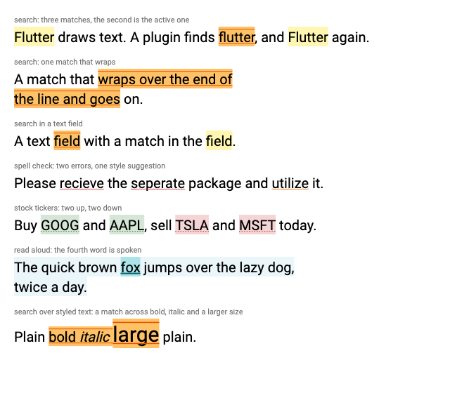

# Composable Text Plugins: the inline-span prototype (report)

**Date:** 2026-11-20, second revision
**Branch:** `text-plugin-mvp-inline-span`, cut from `text-plugin-mvp` at `0d2e3bd20d2`
**Plan:** [text_plugins_inline_span_plan.md](./text_plugins_inline_span_plan.md)
**Compared against:** the painter prototype (the MVP), [text_plugins_design_doc.md](./text_plugins_design_doc.md)

> [!NOTE]
> The first revision of this report ended with "keep the painter", because the span approach missed the performance budget of the plan on a page of 10,000 paragraphs. The reviewer judged that case too far from real use to decide the question. This revision keeps those numbers as data, adds measurements at the size of a real app, adds rendered images of both approaches, adds tests for what a span split does to hard text, and replaces the verdict with pros and cons.

---

## Table of contents

- [0. Summary](#0-summary)
- [1. The two approaches, and what was built](#1-the-two-approaches-and-what-was-built)
- [2. Pros and cons](#2-pros-and-cons)
- [3. What it looks like](#3-what-it-looks-like)
- [4. Performance](#4-performance)
- [5. What a span split does to the text](#5-what-a-span-split-does-to-the-text)
- [6. Stage 1 correctness tests](#6-stage-1-correctness-tests)
- [7. The two span options, A and B](#7-the-two-span-options-a-and-b)
- [8. The lifecycle at build time](#8-the-lifecycle-at-build-time)
- [9. Stage 2: interaction](#9-stage-2-interaction)
- [10. Stage 3: widgets](#10-stage-3-widgets)
- [11. How to choose](#11-how-to-choose)
- [12. What was not done, and where this report can be wrong](#12-what-was-not-done-and-where-this-report-can-be-wrong)
- [13. Proposed changes to the design doc](#13-proposed-changes-to-the-design-doc)
- [Appendix A: how to reproduce](#appendix-a-how-to-reproduce)
- [Appendix B: time log](#appendix-b-time-log)

---

## 0. Summary

Both approaches work. Neither is wrong. They differ in what they are good at, and the difference comes from one fact: **a painter is an input to paint, a span is an input to layout.**

| | Painter (MVP) | Inline span |
| :-- | :-- | :-- |
| What a plugin hands over | A painter that draws on a canvas | A list of ranges with styles |
| What it can draw | Any shape | What a `TextStyle` can say, or an inline widget |
| Can it change the text itself (color of the glyphs, weight, size, hide characters) | No | Yes |
| Does it touch the app's text | Never | Yes, it splits the app's spans |
| Cost when a decoration changes | A repaint of the text | A new paragraph and a layout of the text |
| At the size of a screen (4 to 40 texts change) | 0.04 to 0.24 ms | 0.2 to 2.0 ms |
| At the size of a page (300 to 1,000 texts change at once) | 9 to 13 ms | 58 to 89 ms |
| Tap, cursor, link semantics on a range | Needs new machinery (stage 2) | Free in static text, impossible in an editable field |
| Widgets on a range | Needs a host (stage 3) | Inline chips and anchors in static text; a host for the rest |

The short version of the trade:

- **The span approach is the smaller idea with the larger reach.** A plugin author learns one data class. The same mechanism restyles glyphs, makes a range tappable and puts a chip in the line. It reuses what the framework already does for the composing underline and for spell check.
- **The painter is the safer and cheaper mechanism for decoration.** It cannot break the app's text, it draws any shape, and it costs 5 to 20 times less per change. It does nothing beyond decoration, so stages 2 and 3 are separate designs.

At the size of what is on a screen, the cost difference is real in ratio and small in milliseconds. It becomes a dropped frame when a few hundred texts change in the same frame. For find-in-page that happens in one situation: the whole page is mounted (the page is not lazy, or the search turned on eager loading of offscreen text) *and* the query is common, as it is after the first one or two typed letters. [Section 4](#4-performance) has the numbers and one measured way to soften it.

---

## 1. The two approaches, and what was built

**Painter (the MVP, `text-plugin-mvp`).** The text is never changed. A plugin sets a painter on a `TextDelegate`. The render object calls it behind and in front of the glyphs and gives it the layout while it paints.

**Inline span (this branch).** A plugin returns `TextSpanDecoration`s: a range of the original text and what to do with it. The framework splits the `InlineSpan` tree once for all plugins and gives the result to the text painter that the text already has. Nothing new is painted.

On this branch, 134 new or ported tests pass.

| Part | Where |
| :-- | :-- |
| `TextSpanDecoration` and the merge `decorateTextSpan` (546 lines) | `painting/text_span_decoration.dart` |
| `TextPlugin.buildDecorations`, `TextDelegate.markNeedsDecoration`, the lifecycle at build time, Option B | `rendering/text_plugin.dart` |
| Option A: `TextPluginSpanBuilder` in `Text` and `EditableText`; the experiment-only `decorationLayer` switch | `widgets/text_plugin.dart` and three more files |
| Stage 3 host: `TextWidgetPlugin`, `TextPositioned` (about 370 lines) | `widgets/text_plugin.dart` |
| Selection highlight as a span plugin, behind a debug flag | `widgets/selectable_region.dart` |
| Stage 1 plugins ported: search, spell check, stock ticker, read aloud | `examples/text_plugins/lib/plugins/` |
| Stage 2 plugins: links, spoiler. Stage 3 plugins: mention chip, suggestion menu, frosted spoiler | same |
| A benchmark and an image test that run on both branches | `benchmark.dart`, `test/visual_test.dart` |

Two ways of building the span were compared throughout. **Option A** builds it in the widget layer, **Option B** in the render object ([Section 7](#7-the-two-span-options-a-and-b)).

Framework code against the common base, `packages/flutter/lib` only:

| Branch | Stages | Lines added |
| :-- | :-- | :-- |
| `text-plugin-mvp` (painter) | 1 | 1,916 |
| `text-plugin-annotations-rebased`, on top of stage 1 | 2 | 1,427 more |
| `text-plugin-with-widget-rebased`, on top of stage 1 | 3 | 1,845 more |
| `text-plugin-mvp-inline-span` | 1, 2 and a small 3, with both options | 3,023 |

The last row is not a fair total against the first three. It carries two options and a switch that a real change would not, its stage 3 host is a small rebuild, and its stage 2 does less ([Sections 9](#9-stage-2-interaction) and [10](#10-stage-3-widgets)).

---

## 2. Pros and cons

Every item points at a test, a measurement or an image.

### 2.1 Inline span: pros

| # | Pro | Evidence |
| :-- | :-- | :-- |
| S+1 | **Less to learn, less to write.** One data class instead of a painter class and a layout object. Every ported plugin got shorter: search 550 to 446 lines (including two options that only exist for the experiment), spell check 213 to 184, read aloud 381 to 326. The links plugin is 157 lines against 232 on the annotation branch | Section 1 |
| S+2 | **It can change the glyphs.** Color and weight of spoken words, white text on a dark match, strike-through and a smaller size for deleted words. A painter can only draw behind or over the glyphs | [Image 3](#33-what-only-a-span-can-do) |
| S+3 | **It can change the layout.** The `||` of a spoiler take no room. A painter cannot remove a character from a line | Image 3; `a spoiler: the delimiters take no room` |
| S+4 | **The engine draws the highlight, so it follows the runs.** A match across bold, italic and a larger size is one continuous highlight. The painter version of the same match is three separate bordered boxes with seams | [Images 1 and 2](#3-what-it-looks-like), last row |
| S+5 | **Interaction is free in static text.** A range with a recognizer gets hit testing, the arena, the cursor, and its own semantics node with the link flag. No new code in the render objects | [Section 9](#9-stage-2-interaction) |
| S+6 | **A screen reader can be told something else.** A hidden spoiler is spoken as "Spoiler, hidden" | `a spoiler: a screen reader hears the label` |
| S+7 | **Inline widgets are one more field.** A ticker becomes a badge, a mention becomes a chip, in static text | Image 3; [Section 10](#10-stage-3-widgets) |
| S+8 | **No new phase in the frame.** The post-layout callback phase and its assertion in `RenderObject` are not needed. That is PR 1 of the 16 in the implementation plan | [Section 8](#8-the-lifecycle-at-build-time) |
| S+9 | **There is prior art in the framework.** The composing underline and spell check already split spans this way. A plugin decoration, the composing underline and the caret coexist | `H9` |
| S+10 | **Typing in a field costs the same.** The span is rebuilt on every keystroke anyway | P5: 0.87 against 0.73 ms |
| S+11 | **In Option B the app does not see it.** `RichText.text` and `RenderParagraph.text` stay the span the app made | `what code outside of the plugin sees` |

### 2.2 Inline span: cons

| # | Con | Evidence |
| :-- | :-- | :-- |
| S-1 | **Every change costs a new paragraph and a layout of that text**, 5 to 20 times the cost of a repaint, and the cost grows with the length of the text. About 55 µs for a sentence, 190 µs for a paragraph of 500 characters, 2.5 ms for 8,000 characters | [Section 4](#4-performance) |
| S-2 | **A frame is dropped when a few hundred texts change together.** 300 paragraphs: 58 ms. 1,000 short paragraphs: 79 ms. Budget: 16.6 ms | R2, P2 |
| S-3 | **An animated highlight lays the text out on every frame.** 40 texts: 2.0 ms a frame against 0.24 | R5 |
| S-4 | **Shapes are limited to what a style can say.** Flat boxes of the run height. No padding, no rounded fill, no box around a paragraph. A rounded *border* is possible with a stroked `Paint` | Images 2 and 3 |
| S-5 | **It rewrites the app's span tree, and that has traps.** Recognizers, cursors and hover callbacks are not inherited and have to be copied to every piece. A span with a semantics label cannot be split. A list of children can be a `List<TextSpan>`. The merge handles these, and each was a bug before it did | [Section 5](#5-what-a-span-split-does-to-the-text) |
| S-6 | **A subclass of `TextSpan` is lost in the pieces.** An app that finds its spans by type, or overrides a method, loses that for decorated text | `a subclass of TextSpan is not kept` |
| S-7 | **A decoration that changes the font breaks joined scripts.** A size change in the middle of an Arabic word separates the letters. A color change does not | `Arabic: a split that changes the font size` |
| S-8 | **A decoration that changes the font moves the text.** Bold words are wider. The lines of the paragraph, and the page below it, shift while the user types a query | Image 3, first row |
| S-9 | **A wrong range damages the text, not only the highlight.** A span boundary inside a surrogate pair shows two broken characters. The merge now moves such a cut, but the class of problem exists only here | `a surrogate pair` |
| S-10 | **Text fields are second class.** No recognizer in an editable field (the framework asserts), no inline widget in any field | [Sections 9](#9-stage-2-interaction), [10](#10-stage-3-widgets) |
| S-11 | **No keyboard focus, and one recognizer per range.** Tab skips a link. Two plugins cannot both listen. An ordinary tap recognizer takes the double click from a `SelectionArea` | Section 9 |
| S-12 | **Hover is per piece.** One range that another plugin split reports enter and exit three times | `hover: a link that another plugin splits` |
| S-13 | **Selection needed a change in `RenderParagraph`** to survive a decoration. Without it, a highlight clears the user's selection | `H2` |
| S-14 | **Option A has costs of its own**: a widget around every text, every text re-created when the first plugin is added (0.8 s for 10,000), and no decoration for a `RichText` that an app creates directly. **Option B cannot insert widgets** | [Section 7](#7-the-two-span-options-a-and-b) |
| S-15 | **The document order is not known in a lifecycle callback.** The search plugin sorts later. The active-match color for a text that scrolls in is one frame late | [Section 8](#8-the-lifecycle-at-build-time) |

### 2.3 Painter: pros

| # | Pro | Evidence |
| :-- | :-- | :-- |
| P+1 | **The cheapest change there is: a repaint.** About 6 µs for a sentence, 29 µs for a paragraph with eight matches. It stays inside one frame for 1,000 texts | [Section 4](#4-performance) |
| P+2 | **Any shape.** Rounded boxes with padding, a border around the active match, a hand-drawn wave, a rounded tint around a whole paragraph | [Image 1](#31-the-painter-prototype) |
| P+3 | **It cannot break the text.** Shaping, line breaks, selection, semantics, the app's own spans and recognizers are untouched by construction. None of S-5 to S-9 can happen | By design |
| P+4 | **Text fields are the same as static text.** Same API, same result | Image 1, third row |
| P+5 | **Animation is cheap.** 40 animated highlights cost 0.24 ms a frame | R5 |
| P+6 | **The document order is valid in a callback**, so a plugin can keep its matches sorted as texts arrive | Design doc 7.2 |
| P+7 | **It covers every text**, also a `RichText` created directly, with no widget added to the tree | Design doc 3.5 |

### 2.4 Painter: cons

| # | Con | Evidence |
| :-- | :-- | :-- |
| P-1 | **More concepts and more machinery.** `TextPluginPainter`, `TextLayout` that is only valid during `paint`, two paint passes in two render objects, a new post-layout phase in the binding | Design doc 3.3, 3.5, 7.16 |
| P-2 | **It cannot change the glyphs or the layout.** No recoloring, no weight, no hidden characters, no inline widget | By design |
| P-3 | **It cannot say anything to a screen reader or take a tap.** Stage 2 is a second design with its own hit testing and semantics code: 1,427 lines on its branch | Design doc 8 |
| P-4 | **Widgets need a third design.** 1,845 lines on its branch | Design doc 9 |
| P-5 | **A match across styled runs is drawn box by box.** With a border, the seams between bold, italic and a larger size show. A plugin has to merge boxes itself to avoid this | Image 1, last row |
| P-6 | **Plugins are longer**, because each has a painter class with its own `shouldRepaint` | S+1 |
| P-7 | **A decoration from a callback only works because paint comes after layout.** The same timing cannot support anything that affects layout later | [Section 8](#8-the-lifecycle-at-build-time) |

---

## 3. What it looks like

The same widget tree with the same four plugins, rendered by the test engine with Roboto at 20 px on both branches ([visual_test.dart](./examples/text_plugins/test/visual_test.dart)).

### 3.1 The painter prototype


### 3.2 The inline-span prototype



Row by row:

| Row | Painter | Span |
| :-- | :-- | :-- |
| Search | Rounded boxes with a little padding. The active match has a border | Flat boxes, exactly the height of the run. The active match has a line above and below it, which reads less clearly than a border |
| A match that wraps | Two rounded boxes, each with its border | Two flat boxes |
| Text field | Same as static text | Same as static text |
| Spell check | A drawn wave, 1.5 px | The engine's wavy underline. Thinner, with a smaller wave |
| Stock tickers | Rounded pills, dashed underline | Flat boxes, dotted underline. Close |
| Read aloud | A rounded tint around the block of the paragraph | The tint follows the line ends and has a ragged right edge |
| A match across bold, italic and large text | Three boxes with borders, of three heights, with seams | One continuous highlight that steps up at the larger size |

Neither picture is "right". The painter's shapes are what a designer would ask for. The span's last row is what a designer would ask for.

### 3.3 What only a span can do

[visual_span_only_test.dart](./examples/text_plugins/test/visual_span_only_test.dart):


- Rows 1, 2 and 7 change the glyphs: color, weight, size, strike-through. The bold words in row 1 are wider than they were, which is S-8.
- Row 3 is the stroked-`Paint` trick. It gives a rounded border, not a rounded fill, and it overlaps its neighbours a little. It is a layout-level style change (fact F1 of the plan).
- Row 4 replaces each ticker with a widget. The boxes after the tickers are the arrow characters, which Roboto does not have. That is the test's font, not the approach.
- Rows 5 and 6 are the same string. In row 5 the `||` take no room.

---

## 4. Performance

Profile mode, macOS, Apple M1 Pro, the same harness on both branches. Raw output is in [benchmark_results](./examples/text_plugins/benchmark_results/).

"Change" is the time of the call that changes something, such as setting the query, which scans the text. "Frame" is the time in `drawFrame` for the frames that follow. Milliseconds.

> [!IMPORTANT]
> Each number is from one run of the app. Between two runs of the same code, small numbers moved by up to a factor of two (the same case gave 0.106 and 0.061 ms) and larger ones by up to 25 %. Read the table for orders of magnitude. The ratios between painter and span are 4 to 20 and are stable across the runs.

### 4.1 At the size of an app

| Case | Painter | Span A | Span B |
| :-- | :-- | :-- | :-- |
| **R1. Lazy list of 10,000 items; only the items on screen exist.** Keystroke in the search field, 4 matches on screen | 0.06 | 0.25 | 0.22 |
| R1. Next match | 0.07 | 0.12 | 0.13 |
| R1. Scroll by 120 px in a frame with a search active (without a plugin: 0.5) | 0.70 | 0.47 | 0.50 |
| **R2. Article: 300 paragraphs of 500 characters, all mounted.** Keystroke, a rare word: 15 texts change | 0.90 | 3.38 | 3.08 |
| R2. Keystroke, a common word: all 300 texts change, 2,400 matches | **9.7** | **63.4** | **59.1** |
| R2. Next match | 0.09 | 0.20 | 0.19 |
| **R3. One text, the highlighted word moves.** 59 characters | 0.016 | 0.061 | 0.060 |
| R3. 339 characters | 0.020 | 0.155 | 0.141 |
| R3. 1,489 characters | 0.039 | 0.500 | 0.528 |
| R3. 7,889 characters | 0.133 | 2.56 | 2.53 |
| **R5. Animated highlight, a new color every frame.** 10 texts | 0.07 | 0.49 | 0.49 |
| R5. 40 texts | 0.24 | 2.05 | 2.03 |
| **R6. Selection drag across 40 paragraphs**, one pointer move. Built-in highlight on the span branch: 0.07 | 0.07 (painter plugin) | 0.15 (span plugin) | 0.12 (span plugin) |
| **P5. Typing** one character in a field of 1,800 characters with 40 matches (without a plugin: 0.6 to 0.7) | 0.73 | 0.87 | 0.87 |

What this says:

- **What is on a screen is cheap either way.** A keystroke with a handful of visible matches, the next match, scrolling, typing, dragging a selection: all are a fraction of a millisecond in both approaches. The span approach is several times slower in ratio and 0.1 to 0.2 ms slower in fact.
- **Scrolling a lazy list is a tie.** A new item is laid out once in both approaches. The decoration is part of that layout.
- **The selection highlight as a span plugin costs about twice the built-in highlight**, and is still 0.12 to 0.15 ms a pointer move.
- **The cost of one change grows with the length of the text** (R3). A span costs about 40 µs plus 0.3 µs per character. A painter costs about 15 µs plus 0.015 µs per character. For an ordinary sentence the ratio is 4. For a page-long text it is 20.
- **One realistic case drops frames: R2 with a common word.** An article-sized page that is fully mounted, and a query that matches every paragraph. That is what the first one or two letters typed into a search field do. 59 ms is three to four frames.

### 4.2 When is the whole page mounted?

The span approach misses a frame when roughly 100 long paragraphs or 300 sentences change in one frame. On a lazy list that cannot happen, because only what is on screen exists. It can happen in two ways:

1. The page is a `Column` in a `SingleChildScrollView`, which is how short and medium pages are usually written.
2. The search plugin asked for offscreen content (`needsOffscreenContent`), which makes lazy lists build up to a million pixels of content. Find-in-page does this on purpose, so that it can count and reach matches that are off screen. So the feature that the MVP exists for is the one that turns a lazy page into a fully mounted one.

Whether that is "likely" depends on the app. It is the honest boundary of the span approach: fine on what is visible, expensive on everything at once.

### 4.3 One way to soften it, measured

The cost can be spread. The span search plugin got an option to give new decorations to at most N texts in a frame and the rest in the next frames.

| R2, common word, 300 texts change, Option B | Longest frame | Frames until every highlight is there | Total |
| :-- | :-- | :-- | :-- |
| All at once | 58 ms | 1 | 58 ms |
| At most 50 texts a frame | 11.7 ms | 7 | 62 ms |
| At most 25 texts a frame | 5.9 ms | 13 | 60 ms |

No frame is dropped, and the highlights arrive over about 0.1 to 0.2 seconds. The plugin does not know which texts are on screen, so it cannot do the visible ones first. That would need a new piece of information on the delegate. This is 30 lines in the plugin. It is also work that the painter approach does not need.

### 4.4 The stress cases, as recorded

These are the cases of the first revision: N short paragraphs, all mounted, 10 % of them match.

| Case | Painter | Span A | Span B |
| :-- | :-- | :-- | :-- |
| P2. Keystroke, N=1,000 (100 texts change): change + frame | 0.95 + 1.85 | 0.72 + 7.86 | 0.73 + 6.54 |
| **P2. Keystroke, N=10,000 (1,000 texts change): change + frame** | **12.6 + 13.3** | **9.5 + 89.4** | **9.2 + 78.7** |
| P6. First search, N=10,000: change + frame | 17.3 + 14.8 | 9.8 + 85.3 | 9.8 + 80.9 |
| P2b. Next match, N=10,000 | 1.70 | 1.59 | 2.00 |
| P3. Keystroke that matches nothing, N=10,000 | 8.2 | 5.4 | 5.6 |
| P4. Moving word in a paragraph of 2,000 words | 0.26 | 5.07 | 5.05 |
| P8. First plugin added to a scope, N=10,000: added / removed | 108 / 16 | 804 / 704 | 51 / 43 |
| P1. Frame that rebuilds all 10,000 paragraph widgets, no-op plugin (without a scope: 34) | 33.7 | 44.1 | 36.8 |

The decision rule of the plan was P2 at N=10,000 inside 16.6 ms of `drawFrame`. The painter passes (13.3). Both span options miss it (89.4 and 78.7). With the scan of the text included, the painter's keystroke is 25.9 ms, which is also more than a frame. The reviewer's judgement is that 1,000 highlights changing in one frame is not a case to decide on. It is recorded here as the upper end of the scale, not as the verdict.

A plugin can change its decorations by notifying, so that every text in the scope asks again, or by naming the texts that changed. The numbers above are for naming. Notifying costs 36 to 45 ms at N=10,000 even when nothing matches, because every text is asked. Both options support both ways.

### 4.5 Why

`TextPainter` has no way to change only the paint of a laid-out paragraph. A new highlight splits a span, which is a layout change of the span tree. Even a color-only change creates the `ui.Paragraph` again (fact F3 of the plan, in `text_painter.dart`). An engine API to restyle a range of a laid-out paragraph would remove most of S-1 to S-3. Nothing in the framework can.

---

## 5. What a span split does to the text

A plugin computes ranges from a string. A range can end anywhere, also inside something that the text shaper treats as one unit. With a painter the text is not touched, so the worst case is a highlight in the wrong place. With spans the range becomes a span boundary. [text_span_decoration_shaping_test.dart](./packages/flutter/test/painting/text_span_decoration_shaping_test.dart) records what the engine does then, with macOS system fonts, on the native test engine.

| Text | Split | Result |
| :-- | :-- | :-- |
| Latin kerning pair `AV`, Roboto | Color, background or underline, between the letters | **Unchanged.** Same width as unsplit, and narrower than the letters apart |
| Ligature `fi`, Roboto | Background, inside the ligature | **Unchanged.** 55.37 wide, as unsplit. The letters apart are 58.98 |
| Arabic word, Arial Unicode | Color, inside the word | **Unchanged.** 207.9, as unsplit. Two separate words are 201.0, so the font really joins |
| Arabic word | **Font size**, inside the word | **The joining breaks.** 201.5, the width of two separate words |
| Letter plus combining accent | Color, between the two | **Unchanged**, widths and boxes |
| Family emoji (three people joined by zero-width joiners) | Color, after the first person | **Unchanged.** Still one glyph |
| Emoji outside the basic plane | A span boundary between its two code units | **Broken.** Two replacement characters, the emoji is gone. No error is reported, and the plain text is the same string |
| Hebrew run inside Latin text | Color, inside the run | **Unchanged.** Every caret position is where it was |
| A long word in a narrow box | Color, inside the word | **Unchanged.** No new place for a line break |

So:

- **A decoration that only changes paint (color, background, underline) is safe** for every case that was tried. The engine shapes adjacent runs with the same font together.
- **A decoration that changes the font is not** (S-7). This is a limit for plugin authors, and the API cannot stop them: `TextSpanDecoration.style` is a whole `TextStyle`. A rule such as "only paint properties" could be enforced by the merge.
- **A range that cuts a surrogate pair corrupts the text** (S-9). The merge now moves such a cut to after the pair, with a test. A plugin that takes ranges from a `RegExp` on a Dart string can produce such a range.

Not tried: the web engine, complex scripts beyond Arabic and Hebrew, and vertical or justified text.

---

## 6. Stage 1 correctness tests

[text_plugin_span_test.dart](./packages/flutter/test/widgets/text_plugin_span_test.dart), each test once per option, and [text_span_decoration_test.dart](./packages/flutter/test/painting/text_span_decoration_test.dart).

| Id | Hazard | Result | Notes |
| :-- | :-- | :-- | :-- |
| H1 | A split changes shaping | Pass for paint-only styles | [Section 5](#5-what-a-span-split-does-to-the-text) |
| H2 | Selection is lost when a decoration appears | Pass, after a fix | `RenderParagraph` keeps its selectable fragments when the span changes and the plain text does not |
| H3 | The app's recognizer is lost by a split | Pass | The merge copies recognizer, cursor and hover callbacks to every piece |
| H4 | A semantics label is duplicated | Pass, merge level | A span with a label or identifier is never split |
| H5 | Offsets drift after a `WidgetSpan` | Pass | Plugins compute against the original text. The merge returns a table that maps offsets |
| H6 | A text without decorations is touched | Pass | The original span is used by identity |
| H7 | A decoration from state set in `didAddText` is a frame late | Pass | A second test shows the one-frame delay with post-layout timing |
| H8 | A match in the part that `maxLines` cuts off | Pass | A match across the ellipsis itself was not tested |
| H9 | Text field: composing underline and a plugin on one range | Pass | Plain text, caret rectangles and the underline are unchanged |
| H10 | Obscured text, covered routes, `none`, `exclude` | Pass | |
| H12 | Stage 1 changes semantics | Pass | The semantics dump is the same with 0, 1 and 4 highlights |
| H13 | A plugin notifies from a build-time callback | Pass | Through `TextPlugin.deferToEndOfFrame` |
| H14 | Document order | Pass, after the frame | |
| H15 | First plugin added to a scope | A re-creates the text, B does not | |
| H16 | A `RichText` created directly | A does not decorate it, B does | |

Defects that these tests found. Each is a trap of the approach, and each is fixed:

1. A span's `children` list has the type the app gave it. `EditableText` builds a `List<TextSpan>`, and adding a placeholder to a copy threw.
2. Option B must not replace the span as soon as a plugin asks. A selection that changes during a drag reads the boxes of the text right after it notifies, and the text then needs layout. Option B now applies decorations at the start of the next frame.
3. `OverlayPortalController.show()` cannot be called during a frame, so a `WidgetSpan` anchor keeps its portal shown at all times.
4. A range can cut a surrogate pair ([Section 5](#5-what-a-span-split-does-to-the-text)).

---

## 7. The two span options, A and B

| | A, widget layer | B, render layer |
| :-- | :-- | :-- |
| Keystroke, article of 300 paragraphs, common word | 63 ms | 59 ms |
| First plugin added to 10,000 texts | 804 ms, every text is re-created | 51 ms |
| Cost on a rebuild without changes | About 1 µs per text | None measured |
| Decorates a `RichText` created directly | No | Yes |
| What `RichText.text` holds | The decorated span | The app's span |
| Can insert a `WidgetSpan` | Yes | No, asserts |
| Can host stage 3 widgets | Yes, the wrapper is the host | Not built |
| Precise invalidation of one text | Yes, a `setState` of one wrapper | Yes |
| When a requested decoration is applied | Next build | Start of the next frame |

For decoration and interaction, B is better on every row. A exists for inline widgets. If spans were chosen, the natural shape is B, with A's wrapper only around a text that has a widget on it.

---

## 8. The lifecycle at build time

On this branch `didAddText` and `didUpdateText` run before `buildDecorations` for the same text, in both options.

- A decoration that depends on what a callback did is in the first frame (H7). With post-layout callbacks it is one frame late, because the span is an input to layout and layout is over.
- The post-layout callback phase and its assertion are gone.

What it cost:

- The search plugin can no longer keep its matches sorted as texts arrive. It sorts when a count or a "next" is asked for. For a text that scrolls into a lazy list, the plugin learns at the end of the frame whether its match is now the first one, so the active-match color for such a text is one frame late. This follows from how the port is written. There is no test for it.
- The read-aloud plugin builds its word list at the end of the frame.
- A plugin needs `deferToEndOfFrame` to tell a search bar about a new count.

This timing belongs to spans. It does not carry over to the painter, whose callbacks are rightly after layout.

---

## 9. Stage 2: interaction

[stage2_test.dart](./examples/text_plugins/test/stage2_test.dart), 32 tests, each on both options.

| Need | With spans | Test |
| :-- | :-- | :-- |
| Tap on a range | Works, no new hit-testing code | `tap: a tap on a link opens it` |
| A drag that starts on a link scrolls | Works | `arena: a drag that starts on a link` |
| Mouse cursor, enter and exit | Works | `hover: cursor and enter/exit callbacks` |
| Hover over a range that another plugin split | Reports enter and exit once per piece | `hover: a link that another plugin splits` |
| Semantics of a link | Its own node, a tap action, the link flag. No URL | `semantics: a link is its own node` |
| A spoken label instead of the text | Works | `a spoiler: a screen reader hears the label` |
| Keyboard focus | Not possible | `focus: Tab does not reach a link` |
| Two plugins on one range | Only the one on top is called | `two plugins on one range` |
| A spoiler over a link | Works: the first tap reveals, the second opens | `a spoiler over a link` |
| A plugin over the app's own recognizer | The plugin wins on its range, the app keeps the rest | `a plugin over a recognizer of the app` |
| A link in an editable text field | Not possible, except on macOS. `RenderEditable` asserts `readOnly` | `a recognizer in a text field that can be edited is rejected` |
| A link in a read-only field | Works with a modifier key | `a link in a read-only field` |
| A link in a `SelectionArea` | Works only with a recognizer that stays out of the arena without a modifier key. An ordinary one takes the double click | `an ordinary tap recognizer on a span takes the double click` |
| Hiding the `||` of a spoiler | Works. A painter cannot | `a spoiler: the delimiters take no room` |

Against the annotation design of the painter stage 2, as the design doc describes it (that branch was not run for this report):

| | Annotations (design doc, Section 8) | Spans |
| :-- | :-- | :-- |
| New hit testing, cursor and semantics code | Yes | None |
| Link in an editable field | Yes | No |
| Tab and Enter, focus ring | Yes | No |
| Two plugins in the arena | Yes | No |
| Link with a URL for a screen reader | Yes | Flag only |
| Hover for the range as a whole | Yes | Per piece |

The cost of S-1 matters less here than in stage 1. A link or a label changes when the text changes, and then the text is laid out anyway.

---

## 10. Stage 3: widgets

[stage3_test.dart](./examples/text_plugins/test/stage3_test.dart), 26 tests, Option A. **S1** replaces the range with a `WidgetSpan`. **S2** inserts a `WidgetSpan` of no size and places things relative to it. **S3** leaves the text alone and lets a host place widgets on ranges, as the painter stage 3 does.

| | S1, replacement | S2, anchor | S3, host |
| :-- | :-- | :-- | :-- |
| The text that is laid out | The range becomes one placeholder | One more code unit per anchor | Unchanged |
| The size of the text | Changes | Unchanged | Unchanged |
| Offsets of other plugins | Right, through the mapping table | Right | Right |
| In a text field | No. The framework drops it, or the caret would be wrong | No | Yes |
| A widget with state, when another is added before it | No key: the state moves to the wrong widget. `ValueKey`: lost. `GlobalKey`: kept | Same | Not tested |
| Selection across it | Copies what the widget shows | Not tested | Copies the text, if the widget opts out of selection |
| **Mention chip** | Works in static text | Works, but cannot cover the name: it does not know its size | Works, covers the name exactly |
| **Suggestion menu that floats** | Fails: the menu is in the line and pushes content down | Works, over the content below | Works |
| The menu in a text field | Fails | Fails | Works |
| **Frosted spoiler** on one line | Works | Not expressible: an anchor has no size | Works |
| A spoiler that wraps | Fails: one box, on lines of its own | Not expressible | One box on the bounding rectangle |

`WidgetSpan` is right for one and a half use cases: an inline chip in static text (S1), and an invisible anchor for something that floats in the `Overlay` (S2). The second was not expected by the plan. Neither reaches a text field, because a field needs its rendered text to be the string of its controller.

The S3 here is a small rebuild of the design on `text-plugin-with-widget-rebased`, not a port. It lacks one widget per line of a wrapped range, choosing the side of a popup that fits, repositioning of the overlay layer on a relayout without a rebuild, and Option B. One of the three defects in Section 9.4 of the design doc was re-tested and does not occur: opening a menu builds the widgets of that text only.

---

## 11. How to choose

Three shapes are coherent.

**Shape 1: painter for stage 1, then the annotation and host designs.** This is the current RFC. It is the choice if decoration has to be cheap at any page size, has to look designed, and must never be able to disturb the app's text. Its price is three mechanisms over three stages and the largest API.

**Shape 2: spans in the render layer (Option B) for stages 1 and 2, a host for stage 3.** One data class covers decoration and interaction. It is the choice if the value of text plugins is mainly "restyle and annotate text with almost no new API", pages that are fully mounted are of moderate size, and a plugin that changes hundreds of texts can be expected to spread the work. Its price is S-1 to S-3 on big pages, flat shapes, and the limits in text fields. It would still need something else for links in editable fields and for focus.

**Shape 3: both in one plugin API.** A plugin may return decorations *and* set painters. Spans for what only spans can do (S+2, S+3, S+5, S+6), a painter for shapes and for anything that changes often. The two do not conflict as long as no decoration replaces text, because offsets stay the same. This was not built. Its price is that the framework carries both, and a plugin author has to know which to use.

What tips the choice:

| If this matters most | Then |
| :-- | :-- |
| Find-in-page on long pages with every match highlighted at once, on low-end devices | Painter |
| The look of the highlight (rounded, padded, bordered) | Painter |
| Never touching the app's spans | Painter |
| The smallest API and the least new machinery | Span, Option B |
| Recoloring or restyling the text itself | Span |
| Links, cursors and labels in static text soon, without a second design | Span |
| Text fields treated like any other text | Painter, plus its stage 2 and 3 |

My reading, as an opinion and not as a result: the measurements at app size remove performance as a reason to rule spans out, and the images and the shaping tests show that the real differences are elsewhere. The two strongest arguments for the painter are now P+3 (it cannot break the text) and P+2 (shapes). The two strongest for spans are S+1 (size of the idea) and S+2 to S+6 (reach). Shape 3 is the one I would want to see tried next, because the two lists barely overlap.

---

## 12. What was not done, and where this report can be wrong

Not done, against the plan:

| Plan | What happened |
| :-- | :-- |
| Shaping on both engines, with a golden | Native test engine only, widths and boxes only. Not run on the web engine |
| Counting `ui.Paragraph` constructions | Not instrumented. The benchmark counts decorated spans |
| The element approach for a direct `RichText` in Option A | Not built |
| The "undecorated span" property | Replaced by keeping the selectable fragments when the plain text is unchanged |
| Option B decorates in `performLayout` | It decorates when the text or the plugins are set, and at the start of the next frame when a plugin asks |
| Port the stage 2 plugins and the stage 3 host from their branches | Rewritten for the span API. The host is a small rebuild, Option A only |
| All three defects of design doc 9.4 re-tested | One of three |
| A match across the ellipsis; the labelled-span test at widget level | Not done |
| `Paint` shaders | Only the stroked-background trick, in an image |
| The demo app shows the new plugins | Not added to `main.dart`. They are in tests only |
| Shape 3, both mechanisms in one API | Not built |

Where it can be wrong:

- **One run per number**, with the variance stated in [Section 4](#4-performance). No low-end device, no web, no mobile.
- **The images are from the test engine**, not from the demo app on a screen. They are real font rendering, at one size, on a white background.
- **The painter stage 2 and stage 3 columns are from the design doc**, not from running those branches.
- **The lines-of-code comparison is rough.**
- **The batching in Section 4.3 is a sketch.** It does not order the work by what is visible.
- **A pre-existing failure.** `text_field_test.dart`, "text selection style 1", fails a golden comparison by 7.04 % on this branch and identically on `text-plugin-mvp`. It was not investigated.

---

## 13. Proposed changes to the design doc

These are proposals. The design doc was not edited.

- **A new section "Why not decorate through `InlineSpan`?"**, with the summary table of [Section 0](#0-summary), the two images, the app-size numbers of [Section 4.1](#41-at-the-size-of-an-app) and the table of [Section 5](#5-what-a-span-split-does-to-the-text). It answers the most likely first question of a reviewer, in both directions.
- **Section 3.6 (search plugin), a note on P-5**: a match across styled runs is painted box by box, and the plugin should merge adjacent boxes on a line before it draws a border. The image shows why.
- **Section 8 (stage 2)**: add the two cases that are tests here and not yet on the annotation branch (the second tap on a spoiler over a link; an ordinary tap recognizer taking the double click in a `SelectionArea`), and the open question whether an annotation in static text could be implemented by giving the span a recognizer, cursor and label.
- **Section 9 (stage 3)**: a paragraph "Why not `WidgetSpan`?" with the table of [Section 10](#10-stage-3-widgets); the anchor with an `OverlayPortal` as a way to get a floating menu in static text with no framework change; and per-text invalidation as the fix for the first defect of 9.4.
- **Section 7.2 (why the callbacks run after layout)**: one sentence that the opposite was tried for spans, and what it cost.

---

## Appendix A: how to reproduce

Tests:

```bash
bin/flutter test packages/flutter/test/painting/text_span_decoration_test.dart
bin/flutter test packages/flutter/test/painting/text_span_decoration_shaping_test.dart
bin/flutter test packages/flutter/test/widgets/text_plugin_span_test.dart
bin/flutter test examples/text_plugins/test
```

Images (written to `examples/text_plugins/test/visual/`):

```bash
bin/flutter test --update-goldens --dart-define=VISUAL_PREFIX=span \
    examples/text_plugins/test/visual_test.dart examples/text_plugins/test/visual_span_only_test.dart
```

Benchmark on this branch (`BENCH=realistic` for the app-size cases only, `BENCH=stress` for the others):

```bash
cd examples/text_plugins
../../bin/flutter run --profile -d macos -t lib/benchmark.dart --dart-define=BENCH=realistic
```

On the painter branch: check out `text-plugin-mvp`, copy `lib/benchmark.dart` and `test/visual_test.dart` from this branch, copy `lib/benchmark_compat_painter.dart.txt` from this branch to `lib/benchmark_compat.dart`, and run the same commands with `VISUAL_PREFIX=painter`.

## Appendix B: time log

The plan set a timebox of 10 hours. The work was done by an agent in two sittings on 2026-11-20. Wall-clock times:

| Work | From | To |
| :-- | :-- | :-- |
| M1 to M7 of the plan: the merge, both options, ports, stress benchmark, stages 2 and 3, first report | 15:14 | 16:10 |
| Second round: app-size benchmark on both branches, images, shaping tests, batching, this revision | 16:16 | 17:00 |

About an hour and three quarters in total. What is missing in [Section 12](#12-what-was-not-done-and-where-this-report-can-be-wrong) was not attempted, not cut for time.
