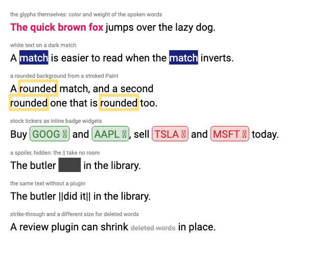

# Composable Text Plugins: the inline-span prototype (report)

**Date:** 2026-11-20, third revision
**Branch:** `text-plugin-mvp-inline-span`, cut from `text-plugin-mvp` at `0d2e3bd20d2`
**Plan:** [text_plugins_inline_span_plan.md](./text_plugins_inline_span_plan.md)
**Compared against:** the painter prototype (the MVP), [text_plugins_design_doc.md](./text_plugins_design_doc.md)

> [!NOTE]
> The first revision of this report ended with "keep the painter", because the span approach missed the performance budget of the plan on a page of 10,000 paragraphs. The reviewer judged that case too far from real use to decide the question. This revision keeps those numbers as data, adds measurements at the size of a real app, adds rendered images of both approaches, adds tests for what a span split does to hard text, and replaces the verdict with pros and cons.
>
> The third revision measures every benchmark case again with a CPU profiler, split into Dart side and engine side ([Section 4](#4-performance)). It also corrects the numbers for color-only changes, which were about twice too high because of the text the benchmark used.

---

## Table of contents

- [0. Summary](#0-summary)
- [1. The two approaches, and what was built](#1-the-two-approaches-and-what-was-built)
  - [1.1 What the API looks like](#11-what-the-api-looks-like)
- [2. Pros and cons](#2-pros-and-cons)
- [3. What it looks like](#3-what-it-looks-like)
- [4. Performance](#4-performance)
- [5. What a span split does to the text](#5-what-a-span-split-does-to-the-text)
- [6. Stage 1 correctness tests](#6-stage-1-correctness-tests)
- [7. The two span options, A and B](#7-the-two-span-options-a-and-b)
- [8. The lifecycle at build time](#8-the-lifecycle-at-build-time)
- [9. Stage 2: interaction](#9-stage-2-interaction)
- [10. Stage 3: widgets](#10-stage-3-widgets)
- [11. How to choose](#11-how-to-choose)
- [12. What was not done, and where this report can be wrong](#12-what-was-not-done-and-where-this-report-can-be-wrong)
- [13. Proposed changes to the design doc](#13-proposed-changes-to-the-design-doc)
- [Appendix A: how to reproduce](#appendix-a-how-to-reproduce)
- [Appendix B: time log](#appendix-b-time-log)

---

## 0. Summary

Both approaches work. Neither is wrong. They differ in what they are good at, and the difference comes from one fact: **a painter is an input to paint, a span is an input to layout.**

| | Painter (MVP) | Inline span |
| :-- | :-- | :-- |
| What a plugin hands over | A painter that draws on a canvas | A list of ranges with styles |
| What it can draw | Any shape | What a `TextStyle` can say, or an inline widget |
| Can it change the text itself (color of the glyphs, weight, size, hide characters) | No | Yes |
| Does it touch the app's text | Never | Yes, it splits the app's spans |
| Cost when a decoration changes | A repaint of the text | A new paragraph and a layout of the text |
| At the size of a screen (4 to 40 texts change) | 0.06 to 0.26 ms | 0.12 to 1.0 ms |
| At the size of a page (300 to 1,000 texts change at once) | 8 to 23 ms | 69 to 82 ms |
| Where the extra time is | | On the engine side: `ui.Paragraph.layout`, building the paragraph, drawing it |
| Tap, cursor, link semantics on a range | Needs new machinery (stage 2) | Free in static text, impossible in an editable field |
| Widgets on a range | Needs a host (stage 3) | Inline chips and anchors in static text; a host for the rest |

The short version of the trade:

- **The span approach is the smaller idea with the larger reach.** A plugin author learns one data class. The same mechanism restyles glyphs, makes a range tappable and puts a chip in the line. It reuses what the framework already does for the composing underline and for spell check.
- **The painter is the safer and cheaper mechanism for decoration.** It cannot break the app's text, it draws any shape, and it costs 3 to 18 times less for a new highlight, and 1.3 to 4 times less for a change of color only. It does nothing beyond decoration, so stages 2 and 3 are separate designs.

A text that gets a new highlight costs about 230 µs with a span and about 25 µs with a painter, for a paragraph of 500 characters. At the size of what is on a screen, the cost difference is real in ratio and small in milliseconds. It becomes a dropped frame when a few hundred texts change in the same frame. For find-in-page that happens in one situation: the whole page is mounted (the page is not lazy, or the search turned on eager loading of offscreen text) *and* the query is common, as it is after the first one or two typed letters. About 70 such paragraphs fill a 60 Hz frame. [Section 4.6](#46-when-does-it-matter) has the cost per text, how likely a dropped frame is in each situation, and one measured way to soften it.

---

## 1. The two approaches, and what was built

**Painter (the MVP, `text-plugin-mvp`).** The text is never changed. A plugin sets a painter on a `TextDelegate`. The render object calls it behind and in front of the glyphs and gives it the layout while it paints.

**Inline span (this branch).** A plugin returns `TextSpanDecoration`s: a range of the original text and what to do with it. The framework splits the `InlineSpan` tree once for all plugins and gives the result to the text painter that the text already has. Nothing new is painted.

On this branch, 134 new or ported tests pass.

| Part | Where |
| :-- | :-- |
| `TextSpanDecoration` and the merge `decorateTextSpan` (546 lines) | `painting/text_span_decoration.dart` |
| `TextPlugin.buildDecorations`, `TextDelegate.markNeedsDecoration`, the lifecycle at build time, Option B | `rendering/text_plugin.dart` |
| Option A: `TextPluginSpanBuilder` in `Text` and `EditableText`; the experiment-only `decorationLayer` switch | `widgets/text_plugin.dart` and three more files |
| Stage 3 host: `TextWidgetPlugin`, `TextPositioned` (about 370 lines) | `widgets/text_plugin.dart` |
| Selection highlight as a span plugin, behind a debug flag | `widgets/selectable_region.dart` |
| Stage 1 plugins ported: search, spell check, stock ticker, read aloud | `examples/text_plugins/lib/plugins/` |
| Stage 2 plugins: links, spoiler. Stage 3 plugins: mention chip, suggestion menu, frosted spoiler | same |
| A benchmark and an image test that run on both branches | `benchmark.dart`, `test/visual_test.dart` |

Two ways of building the span were compared throughout. **Option A** builds it in the widget layer, **Option B** in the render object ([Section 7](#7-the-two-span-options-a-and-b)). [Section 1.1](#11-what-the-api-looks-like) shows the API of all three side by side.

Framework code against the common base, `packages/flutter/lib` only:

| Branch | Stages | Lines added |
| :-- | :-- | :-- |
| `text-plugin-mvp` (painter) | 1 | 1,916 |
| `text-plugin-annotations-rebased`, on top of stage 1 | 2 | 1,427 more |
| `text-plugin-with-widget-rebased`, on top of stage 1 | 3 | 1,845 more |
| `text-plugin-mvp-inline-span` | 1, 2 and a small 3, with both options | 3,023 |

The last row is not a fair total against the first three. It carries two options and a switch that a real change would not, its stage 3 host is a small rebuild, and its stage 2 does less ([Sections 9](#9-stage-2-interaction) and [10](#10-stage-3-widgets)).

### 1.1 What the API looks like

The three are the painter prototype (the MVP), span Option A and span Option B. **Option A and Option B have the same plugin API.** They differ in where the framework applies the decorations, which shows in a few places listed at the end.

#### What an app writes

The same in all three:

```dart
TextPluginScope(
  plugin: SpellcheckLinterPlugin(),
  child: const Text('We recieve mail.'),
)
```

`TextPluginScope.multiple`, `.exclude`, `.none` and `TextPluginSuspension` are the same too. On this branch a scope also has `decorationLayer: TextDecorationLayer.widget` (A) or `.render` (B). That switch exists so that one build can run both options. It is not a proposed API.

#### What a plugin author sees

| | Painter (MVP) | Span, Option A and Option B |
| :-- | :-- | :-- |
| `TextPlugin`, lifecycle | `didAddText`, `didUpdateText`, `didRemoveText` | The same three |
| When the lifecycle runs | After the layout phase of the frame | While the text is built, before layout |
| `TextPlugin`, how it decorates | Nothing on the plugin. It sets painters on the delegate | `List<TextSpanDecoration> buildDecorations(TextDelegate delegate)` |
| `TextPlugin`, other | `needsOffscreenContent`, `paintOrder` | The same, and `notifiesDecorationChanges`, and the static `deferToEndOfFrame` |
| `TextDelegate`, reading | `text`, `textSpan`, `placeholderRanges`, `selections`, `selectionColor`, `textDirection`, `attached` | The same, and `isEditable`, `isSelectable` |
| `TextDelegate`, decorating | `backgroundPainter`, `foregroundPainter` (settable) | `markNeedsDecoration()` |
| `TextDelegate`, other | `ensureVisible`, `compareTo`, `sortInDocumentOrder`, `addListener` | The same |
| Classes that a plugin implements | `TextPlugin` and a `TextPluginPainter` (`paint(Canvas, TextLayout)`, `shouldRepaint`, a `repaint` listenable) | `TextPlugin` |
| Classes that a plugin is given | `TextDelegate`, and `TextLayout` while it paints (`size`, `getBoxesForSelection`, `getPositionForOffset`, `getWordBoundary`, `getOffsetForCaret`, `getFullHeightForCaret`) | `TextDelegate` |
| Classes that a plugin creates | `Paint`, `Path` and whatever it draws with | `TextSpanDecoration` |
| Does a plugin see the layout of the text | Yes, during `paint` only | No |

The data class of the span API:

```dart
class TextSpanDecoration {
  const TextSpanDecoration({
    required this.range,     // In the plain text that the app wrote.
    this.style,              // Merged onto the style of the range.
    this.recognizer,         // Stage 2: tap and other gestures.
    this.mouseCursor,        // Stage 2.
    this.onEnter,            // Stage 2: hover.
    this.onExit,
    this.semanticsLabel,     // Stage 2: what a screen reader says instead.
    this.replacement,        // Stage 3: a WidgetSpan in place of the range.
  });
}
```

A range is always in the text that the app wrote, whatever other plugins do to the same text. The framework merges the decorations of all plugins into one span tree with `decorateTextSpan`.

#### The same plugin, written twice

The spell check plugin of the example app. Finding the misspelled words is the same code in both and is left out.

Painter (MVP), from `text-plugin-mvp`:

```dart
class SpellcheckLinterPlugin extends TextPlugin {
  @override
  void didAddText(TextDelegate delegate) => _lintDelegate(delegate);

  @override
  void didUpdateText(TextDelegate delegate) => _lintDelegate(delegate);

  @override
  void didRemoveText(TextDelegate delegate) {
    delegate.foregroundPainter = null;
    _issuesByDelegate.remove(delegate);
  }

  void _lintDelegate(TextDelegate delegate) {
    final List<SpellcheckIssue> issues = _findIssues(delegate.text);
    _issuesByDelegate[delegate] = issues;
    delegate.foregroundPainter = issues.isEmpty
        ? null
        : _SpellcheckSquigglePainter(delegate: delegate, issues: issues);
  }
}

class _SpellcheckSquigglePainter extends TextPluginPainter {
  _SpellcheckSquigglePainter({required this.delegate, required this.issues});

  final TextDelegate delegate;
  final List<SpellcheckIssue> issues;

  @override
  void paint(Canvas canvas, TextLayout layout) {
    final paint = Paint()
      ..color = const Color(0xFFD32F2F)
      ..style = PaintingStyle.stroke
      ..strokeWidth = 1.5;
    for (final SpellcheckIssue issue in issues) {
      final List<ui.TextBox> boxes = layout.getBoxesForSelection(
        TextSelection(baseOffset: issue.range.start, extentOffset: issue.range.end),
      );
      for (final box in boxes) {
        final Rect rect = box.toRect();
        final double baseY = rect.bottom - 0.5;
        final path = Path()..moveTo(rect.left, baseY);
        var up = true;
        for (double x = rect.left + 3; x <= rect.right; x += 3) {
          path.lineTo(x, baseY + (up ? -1.6 : 1.6));
          up = !up;
        }
        canvas.drawPath(path, paint);
      }
    }
  }

  @override
  bool shouldRepaint(_SpellcheckSquigglePainter oldDelegate) => oldDelegate.issues != issues;
}
```

Span (Option A and Option B, the same file), from this branch:

```dart
class SpellcheckLinterPlugin extends TextPlugin {
  static const TextStyle _errorStyle = TextStyle(
    decoration: TextDecoration.underline,
    decorationStyle: TextDecorationStyle.wavy,
    decorationColor: Color(0xFFD32F2F),
  );

  @override
  void didAddText(TextDelegate delegate) => _lintDelegate(delegate);

  @override
  void didUpdateText(TextDelegate delegate) => _lintDelegate(delegate);

  @override
  void didRemoveText(TextDelegate delegate) => _issuesByDelegate.remove(delegate);

  @override
  List<TextSpanDecoration> buildDecorations(TextDelegate delegate) {
    return <TextSpanDecoration>[
      for (final SpellcheckIssue issue in issuesFor(delegate))
        TextSpanDecoration(range: issue.range, style: _errorStyle),
    ];
  }

  void _lintDelegate(TextDelegate delegate) {
    _issuesByDelegate[delegate] = _findIssues(delegate.text);
  }
}
```

Both listings are shortened from the real files (one severity instead of two, the scan in a helper). The real files are 213 lines (painter) and 184 lines (span).

What the pair shows: the painter plugin decides how the wave looks and draws it, and the span plugin can only ask for the wave that the engine has. The painter plugin has to know about boxes, paints and `shouldRepaint`. The span plugin does not.

#### A decoration that changes later

A search plugin whose query changes, in both APIs:

```dart
// Painter: give the texts that changed a new painter.
// The framework calls shouldRepaint and repaints the text.
delegate.backgroundPainter = _MatchPainter(matches, activeIndex);

// Or keep one painter and give it a Listenable (a sketch). Nothing is created per change.
_MatchPainter(...) : super(repaint: animation);

// Span: say which texts changed. The framework calls buildDecorations
// for each of them again.
delegate.markNeedsDecoration();

// Or, the simple way: the plugin is a ChangeNotifier with
// notifiesDecorationChanges, and every text in the scope is asked again.
notifyListeners();
```

#### Stage 2 and stage 3

| | Painter (MVP and its follow-up branches) | Span |
| :-- | :-- | :-- |
| A tappable range | A separate annotation API, on `text-plugin-annotations-rebased` | `TextSpanDecoration(range: ..., recognizer: ..., mouseCursor: ...)`, static text only |
| A label for a screen reader | The annotation API | `TextSpanDecoration(range: ..., semanticsLabel: ...)` |
| A widget in the line | Not possible | `TextSpanDecoration(range: ..., replacement: WidgetSpan(...))`, Option A, static text only |
| A widget over or behind a range | A host API, on `text-plugin-with-widget-rebased` | `mixin TextWidgetPlugin on TextPlugin` with `buildTextWidgets(context, delegate, layer)` that returns `TextPositioned(range: ..., child: ...)`, Option A only |

#### Where Option A and Option B differ for someone who uses them

| | Option A, widget layer | Option B, render layer |
| :-- | :-- | :-- |
| Who applies the decorations | `Text` and `EditableText`, in `build`, through a `TextPluginSpanBuilder` around the render object widget | `RenderParagraph` and `RenderEditable`, through `TextDelegateHostMixin` |
| What the app sees in `RichText.text` and `RenderParagraph.text` | The decorated span | The span that the app made |
| A `RichText` that the app creates directly | Not decorated | Decorated |
| `markNeedsDecoration()` | Rebuilds the widget of that text | The render object applies the new decorations at the start of the next frame, with no rebuild |
| `replacement` and `TextWidgetPlugin` | Work | An assertion fails: a render object cannot create widgets |
| An extra widget for each text | Yes, when a plugin is in scope | No |
| Adding the first plugin to a scope | Every text below is created again | Nothing is created again |

---

## 2. Pros and cons

Every item points at a test, a measurement or an image.

### 2.1 Inline span: pros

| # | Pro | Evidence |
| :-- | :-- | :-- |
| S+1 | **Less to learn, less to write.** One data class instead of a painter class and a layout object. Every ported plugin got shorter: search 550 to 446 lines (including two options that only exist for the experiment), spell check 213 to 184, read aloud 381 to 326. The links plugin is 157 lines against 232 on the annotation branch | Section 1 |
| S+2 | **It can change the glyphs.** Color and weight of spoken words, white text on a dark match, strike-through and a smaller size for deleted words. A painter can only draw behind or over the glyphs | [Image 3](#33-what-only-a-span-can-do) |
| S+3 | **It can change the layout.** The `||` of a spoiler take no room. A painter cannot remove a character from a line | Image 3; `a spoiler: the delimiters take no room` |
| S+4 | **The engine draws the highlight, so it follows the runs.** A match across bold, italic and a larger size is one continuous highlight. The painter version of the same match is three separate bordered boxes with seams | [Images 1 and 2](#3-what-it-looks-like), last row |
| S+5 | **Interaction is free in static text.** A range with a recognizer gets hit testing, the arena, the cursor, and its own semantics node with the link flag. No new code in the render objects | [Section 9](#9-stage-2-interaction) |
| S+6 | **A screen reader can be told something else.** A hidden spoiler is spoken as "Spoiler, hidden" | `a spoiler: a screen reader hears the label` |
| S+7 | **Inline widgets are one more field.** A ticker becomes a badge, a mention becomes a chip, in static text | Image 3; [Section 10](#10-stage-3-widgets) |
| S+8 | **No new phase in the frame.** The post-layout callback phase and its assertion in `RenderObject` are not needed. That is PR 1 of the 16 in the implementation plan | [Section 8](#8-the-lifecycle-at-build-time) |
| S+9 | **There is prior art in the framework.** The composing underline and spell check already split spans this way. A plugin decoration, the composing underline and the caret coexist | `H9` |
| S+10 | **Typing in a field costs the same.** The span is rebuilt on every keystroke anyway | Typing in a field: 0.79 against 0.70 ms |
| S+11 | **In Option B the app does not see it.** `RichText.text` and `RenderParagraph.text` stay the span the app made | `what code outside of the plugin sees` |

### 2.2 Inline span: cons

| # | Con | Evidence |
| :-- | :-- | :-- |
| S-1 | **Every change costs a new `ui.Paragraph` for that text**, and a change of ranges also a layout of its render object, 3 to 18 times the cost of a repaint for a new highlight, and the cost grows with the length of the text. About 70 µs for a sentence, 230 µs for a paragraph of 500 characters, 2.4 ms for 8,000 characters. Almost all of it is engine time. A change of color only is cheaper, about 25 µs for a sentence, because the engine finds the shaping in its cache | [Section 4](#4-performance) |
| S-2 | **A frame is dropped when a few hundred texts change together.** 300 paragraphs of 500 characters: 68 to 75 ms, whether they hold 300 matches or 2,400. 1,000 short paragraphs: 82 ms. One paragraph of 24,000 characters with 1,000 matches: 17 ms, also for "next match". Budget: 16.6 ms | [Section 4.1](#41-every-case-time-dart-side-engine-side) |
| S-3 | **An animated highlight builds the paragraph again on every frame.** The render object only repaints, but `TextPainter.paint` creates a new `ui.Paragraph` and lays it out first, because there is no way to change the paint of an existing one. The engine's cache saves the shaping, not the rest. 40 texts: 1.0 ms a frame against 0.26 | [Sections 4.2](#42-the-cases-in-which-the-span-approach-is-slower-where-the-engine-time-goes) and [4.3](#43-the-frame-phases) |
| S-4 | **Shapes are limited to what a style can say.** Flat boxes of the run height. No padding, no rounded fill, no box around a paragraph. A rounded *border* is possible with a stroked `Paint` | Images 2 and 3 |
| S-5 | **It rewrites the app's span tree, and that has traps.** Recognizers, cursors and hover callbacks are not inherited and have to be copied to every piece. A span with a semantics label cannot be split. A list of children can be a `List<TextSpan>`. The merge handles these, and each was a bug before it did | [Section 5](#5-what-a-span-split-does-to-the-text) |
| S-6 | **A subclass of `TextSpan` is lost in the pieces.** An app that finds its spans by type, or overrides a method, loses that for decorated text | `a subclass of TextSpan is not kept` |
| S-7 | **A decoration that changes the font breaks joined scripts.** A size change in the middle of an Arabic word separates the letters. A color change does not | `Arabic: a split that changes the font size` |
| S-8 | **A decoration that changes the font moves the text.** Bold words are wider. The lines of the paragraph, and the page below it, shift while the user types a query | Image 3, first row |
| S-9 | **A wrong range damages the text, not only the highlight.** A span boundary inside a surrogate pair shows two broken characters. The merge now moves such a cut, but the class of problem exists only here | `a surrogate pair` |
| S-10 | **Text fields are second class.** No recognizer in an editable field (the framework asserts), no inline widget in any field | [Sections 9](#9-stage-2-interaction), [10](#10-stage-3-widgets) |
| S-11 | **No keyboard focus, and one recognizer per range.** Tab skips a link. Two plugins cannot both listen. An ordinary tap recognizer takes the double click from a `SelectionArea` | Section 9 |
| S-12 | **Hover is per piece.** One range that another plugin split reports enter and exit three times | `hover: a link that another plugin splits` |
| S-13 | **Selection needed a change in `RenderParagraph`** to survive a decoration. Without it, a highlight clears the user's selection | `H2` |
| S-14 | **Option A has costs of its own**: a widget around every text, every text re-created when the first plugin is added (0.8 s for 10,000), and no decoration for a `RichText` that an app creates directly. **Option B cannot insert widgets** | [Section 7](#7-the-two-span-options-a-and-b) |
| S-15 | **The document order is not known in a lifecycle callback.** The search plugin sorts later. The active-match color for a text that scrolls in is one frame late | [Section 8](#8-the-lifecycle-at-build-time) |

### 2.3 Painter: pros

| # | Pro | Evidence |
| :-- | :-- | :-- |
| P+1 | **The cheapest change there is: a repaint.** About 7 µs for a sentence, 28 µs for a paragraph with eight matches. 300 paragraphs change in 8 ms. 1,000 short ones change in about 12 ms of frame time, next to 11 ms of the plugin's own scan | [Section 4](#4-performance) |
| P+2 | **Any shape.** Rounded boxes with padding, a border around the active match, a hand-drawn wave, a rounded tint around a whole paragraph | [Image 1](#31-the-painter-prototype) |
| P+3 | **It cannot break the text.** Shaping, line breaks, selection, semantics, the app's own spans and recognizers are untouched by construction. None of S-5 to S-9 can happen | By design |
| P+4 | **Text fields are the same as static text.** Same API, same result | Image 1, third row |
| P+5 | **Animation is cheap.** 40 animated highlights cost 0.26 ms a frame | Section 4.1 |
| P+6 | **The document order is valid in a callback**, so a plugin can keep its matches sorted as texts arrive | Design doc 7.2 |
| P+7 | **It covers every text**, also a `RichText` created directly, with no widget added to the tree | Design doc 3.5 |

### 2.4 Painter: cons

| # | Con | Evidence |
| :-- | :-- | :-- |
| P-1 | **More concepts and more machinery.** `TextPluginPainter`, `TextLayout` that is only valid during `paint`, two paint passes in two render objects, a new post-layout phase in the binding | Design doc 3.3, 3.5, 7.16 |
| P-2 | **It cannot change the glyphs or the layout.** No recoloring, no weight, no hidden characters, no inline widget | By design |
| P-3 | **It cannot say anything to a screen reader or take a tap.** Stage 2 is a second design with its own hit testing and semantics code: 1,427 lines on its branch | Design doc 8 |
| P-4 | **Widgets need a third design.** 1,845 lines on its branch | Design doc 9 |
| P-5 | **A match across styled runs is drawn box by box.** With a border, the seams between bold, italic and a larger size show. A plugin has to merge boxes itself to avoid this | Image 1, last row |
| P-6 | **Plugins are longer**, because each has a painter class with its own `shouldRepaint` | S+1 |
| P-7 | **A decoration from a callback only works because paint comes after layout.** The same timing cannot support anything that affects layout later | [Section 8](#8-the-lifecycle-at-build-time) |

---

## 3. What it looks like

The same widget tree with the same four plugins, rendered by the test engine with Roboto at 20 px on both branches ([visual_test.dart](./examples/text_plugins/test/visual_test.dart)).

### 3.1 The painter prototype


### 3.2 The inline-span prototype


Row by row:

| Row | Painter | Span |
| :-- | :-- | :-- |
| Search | Rounded boxes with a little padding. The active match has a border | Flat boxes, exactly the height of the run. The active match has a line above and below it, which reads less clearly than a border |
| A match that wraps | Two rounded boxes, each with its border | Two flat boxes |
| Text field | Same as static text | Same as static text |
| Spell check | A drawn wave, 1.5 px | The engine's wavy underline. Thinner, with a smaller wave |
| Stock tickers | Rounded pills, dashed underline | Flat boxes, dotted underline. Close |
| Read aloud | A rounded tint around the block of the paragraph | The tint follows the line ends and has a ragged right edge |
| A match across bold, italic and large text | Three boxes with borders, of three heights, with seams | One continuous highlight that steps up at the larger size |

Neither picture is "right". The painter's shapes are what a designer would ask for. The span's last row is what a designer would ask for.

### 3.3 What only a span can do

[visual_span_only_test.dart](./examples/text_plugins/test/visual_span_only_test.dart):



- Rows 1, 2 and 7 change the glyphs: color, weight, size, strike-through. The bold words in row 1 are wider than they were, which is S-8.
- Row 3 is the stroked-`Paint` trick. It gives a rounded border, not a rounded fill, and it overlaps its neighbours a little. It is a layout-level style change (fact F1 of the plan).
- Row 4 replaces each ticker with a widget. The boxes after the tickers are the arrow characters, which Roboto does not have. That is the test's font, not the approach.
- Rows 5 and 6 are the same string. In row 5 the `||` take no room.

---

## 4. Performance

Profile mode, macOS, Apple M1 Pro. The same benchmark runs on both branches. Each case runs in a loop for 7.5 seconds while the CPU profiler of the Dart VM samples the UI thread for 5 of them, about 3,800 samples a case. The profiler names Dart functions and the native functions of the engine.

For every case there is a file with the profile, and a summary:

- [cpu/painter](./examples/text_plugins/benchmark_results/cpu/painter/), [cpu/span_b](./examples/text_plugins/benchmark_results/cpu/span_b/), [cpu/span_a](./examples/text_plugins/benchmark_results/cpu/span_a/): one file for each case, and `summary.tsv`.
- [tool/cpu_profile.dart](./examples/text_plugins/tool/cpu_profile.dart) takes the samples and sorts them.

**Dart side and engine side.** Every sample is put in one of two groups by the function that was running:

- *Dart side*: Dart code (the plugin, the text plugin machinery, the rest of the framework), and the Dart VM's own work for it (allocation, garbage collection).
- *Engine side*: native code of the engine. For text it is told apart further: building a paragraph (`ParagraphBuilder`), `ui.Paragraph.layout` (shaping the text and breaking it into lines), drawing the text (`ui.Paragraph.paint`), queries such as the boxes of a range, and everything else.

The time of a case is the time of one round of its loop: the call that makes the change, and all frames that follow.

**"Search query changes by one letter"** is the user typing one letter in the search box of find-in-page. In the benchmark it is one assignment, `search.query = 'fox'` after `'fo'`. The plugin scans every text in its scope again, the texts whose matches changed get new highlights, and a frame is produced. It is not typing in the text that is shown; that is the case "Typing in a field". The share of the samples in a group, times that, is the time in the group.

> [!IMPORTANT]
> Read these numbers with three things in mind.
>
> 1. **One run per number.** Repeated runs of the same case differ by up to 25 %, small ones by more. The differences that matter here are factors of 2 to 20.
> 2. **The text matters, because the engine has a cache** ([Section 4.4](#44-the-engines-paragraph-cache)). The first runs of this benchmark used paragraphs that all end with the same sentence, and the engine does not cache such text. The numbers in this section are from text in which every paragraph is different. The runs with the old text are kept in [cpu_uniform_text](./examples/text_plugins/benchmark_results/cpu_uniform_text/) and compared in Section 4.4. The stopwatch files of the earlier revisions (`*_2026-11-20.txt`) used the old text.
> 3. **macOS slowed the app down when its window was not visible** (App Nap): ten times slower, with a twentieth of the samples. The example app now tells macOS not to. Every case in the tables has its full number of samples.

### 4.1 Every case: time, Dart side, engine side

Milliseconds for one round. "D" is the Dart side, "E" the engine side. Span is Option B (the render layer). Option A is in the last column.

| Case | Painter | D | E | Span B | D | E | Span / painter | Span A |
| :-- | --: | --: | --: | --: | --: | --: | --: | --: |
| **Lazy list of 10,000 items (about 30 on screen)** | | | | | | | | |
| Search query changes by one letter, 4 matches on screen, new highlights | 0.065 | 0.039 | 0.026 | 0.287 | 0.051 | 0.237 | 4.4 | 0.307 |
| Search query changes by one letter, highlights that were shown before | 0.062 | 0.036 | 0.025 | 0.145 | 0.052 | 0.094 | 2.4 | 0.156 |
| Next match | 0.094 | 0.054 | 0.039 | 0.121 | 0.058 | 0.062 | 1.3 | 0.130 |
| Scroll 120 px with a search active | 0.228 | 0.070 | 0.159 | 0.229 | 0.073 | 0.156 | 1.0 | 0.238 |
| **Article: 300 paragraphs of 500 characters, all mounted** | | | | | | | | |
| Search query changes by one letter, rare word: 15 texts change, 15 matches, new highlights | 0.81 | 0.64 | 0.18 | 3.45 | 0.72 | 2.73 | 4.2 | 3.83 |
| Search query changes by one letter, rare word, highlights shown before | 0.78 | 0.58 | 0.19 | 1.42 | 0.67 | 0.75 | 1.8 | 1.48 |
| **Search query changes by one letter, common word: all 300 texts change, about 2,400 matches** | **8.26** | 2.26 | 6.00 | **68.70** | 4.53 | 64.17 | **8.3** | 72.33 |
| Next match | 0.144 | 0.074 | 0.070 | 0.244 | 0.088 | 0.156 | 1.7 | 0.250 |
| **One text, the highlighted word moves** | | | | | | | | |
| 10 words (59 characters) | 0.018 | 0.008 | 0.010 | 0.061 | 0.013 | 0.048 | 3.4 | 0.065 |
| 50 words (339 characters) | 0.023 | 0.009 | 0.014 | 0.148 | 0.014 | 0.134 | 6.4 | 0.156 |
| 200 words (1,489 characters) | 0.037 | 0.008 | 0.029 | 0.481 | 0.014 | 0.467 | 13 | 0.505 |
| 1,000 words (7,889 characters) | 0.144 | 0.012 | 0.133 | 2.35 | 0.021 | 2.33 | 16 | 2.43 |
| 2,000 words (16,889 characters) | 0.269 | 0.013 | 0.256 | 4.95 | 0.032 | 4.92 | 18 | 5.15 |
| **Animated highlight: only the color changes, every frame** | | | | | | | | |
| 10 texts | 0.081 | 0.027 | 0.054 | 0.255 | 0.045 | 0.210 | 3.1 | 0.259 |
| 40 texts | 0.263 | 0.085 | 0.178 | 1.02 | 0.16 | 0.86 | 3.9 | 1.05 |
| **Other** | | | | | | | | |
| Selection drag across 40 paragraphs, one pointer move | 0.069 | 0.038 | 0.030 | 0.091 | 0.042 | 0.049 | 1.3 | 0.096 |
| Typing in a field of 1,800 characters with 40 matches | 0.696 | 0.060 | 0.635 | 0.786 | 0.080 | 0.707 | 1.1 | 0.809 |
| **Stress: N short paragraphs, all mounted, 10 % match** | | | | | | | | |
| N=1,000, search query changes by one letter: 100 texts change, 100 matches | 1.38 | 0.83 | 0.54 | 6.94 | 1.24 | 5.70 | 5.0 | 7.73 |
| N=1,000, next match | 0.220 | 0.127 | 0.093 | 0.262 | 0.126 | 0.136 | 1.2 | 0.270 |
| N=1,000, search query change that matches nothing | 0.331 | 0.327 | 0.004 | 0.336 | 0.332 | 0.003 | 1.0 | 0.339 |
| **N=10,000, search query changes by one letter: 1,000 texts change, 1,000 matches** | **23.2** | 15.6 | 7.5 | **82.3** | 19.3 | 63.0 | **3.6** | 91.6 |
| N=10,000, next match | 1.35 | 0.82 | 0.54 | 1.36 | 0.74 | 0.62 | 1.0 | 1.51 |
| N=10,000, search query change that matches nothing | 5.53 | 5.52 | 0.01 | 3.35 | 3.35 | 0.01 | 0.6 | 3.61 |
| N=1,000, every paragraph widget is rebuilt, plugin does nothing | 1.55 | 1.54 | 0.01 | 1.59 | 1.58 | 0.01 | 1.0 | 1.98 |
| N=1,000, the first plugin is added to a scope, or removed | 3.78 | 1.62 | 2.15 | 1.68 | 1.67 | 0.01 | 0.4 | 67.03 |

What the table says:

- **Where the span approach is slower, the extra time is on the engine side.** In the common-word query change on the article the Dart side grows by 2.3 ms and the engine side by 58 ms. In the moving word of 2,000 words the Dart side grows by 0.02 ms and the engine side by 4.7 ms.
- **Where little changes, or the text is laid out anyway, the two are level**: scrolling, typing, the next match, a search query change that matches nothing, a rebuild.
- **The painter's cost is mostly Dart for a query change** (the plugin scanning the text and sorting its matches), and that part is the same in both prototypes.
- **Option A and Option B are within 10 % of each other**, except for the first plugin added to a scope, where Option A re-creates every text.

### 4.2 The cases in which the span approach is slower: where the engine time goes

Milliseconds for one round, by the kind of work. "Other engine" is the display list, layers and memory.

| | Plugin (Dart) | Text plugin machinery (Dart) | Framework and VM (Dart) | Build paragraph | **`Paragraph.layout`** | Draw text | Range queries | Other engine |
| :-- | --: | --: | --: | --: | --: | --: | --: | --: |
| **Article, common word, painter** | 1.36 | 0.17 | 0.73 | 0 | 0 | 2.22 | 2.03 | 1.75 |
| **Article, common word, span** | 0.93 | 1.14 | 2.46 | 6.08 | **44.04** | 9.49 | 1.10 | 3.47 |
| Article, rare word, painter | 0.59 | 0.00 | 0.05 | 0 | 0 | 0.11 | 0.01 | 0.06 |
| Article, rare word, span | 0.59 | 0.02 | 0.10 | 0.17 | **2.18** | 0.26 | 0.02 | 0.11 |
| Article, rare word, shown before, span | 0.53 | 0.02 | 0.11 | 0.18 | 0.19 | 0.27 | 0.02 | 0.09 |
| Lazy list query change, painter | 0.024 | 0.001 | 0.015 | 0 | 0 | 0.004 | 0.002 | 0.019 |
| Lazy list query change, span | 0.020 | 0.004 | 0.026 | 0.044 | **0.150** | 0.016 | 0.005 | 0.021 |
| Lazy list query change, shown before, span | 0.020 | 0.005 | 0.027 | 0.040 | 0.014 | 0.015 | 0.003 | 0.022 |
| Moving word, 2,000 words, painter | 0.001 | 0.000 | 0.012 | 0 | 0 | 0.216 | 0.001 | 0.038 |
| Moving word, 2,000 words, span | 0.000 | 0.009 | 0.023 | 0.114 | **4.282** | 0.463 | 0.006 | 0.056 |
| Animated highlight, 40 texts, painter | 0.019 | 0.011 | 0.056 | 0 | 0 | 0.058 | 0.019 | 0.101 |
| Animated highlight, 40 texts, span | 0.004 | 0.036 | 0.123 | **0.382** | 0.138 | 0.183 | 0.024 | 0.131 |
| Stress N=10,000, query change, painter | 11.35 | 0.80 | 3.50 | 0 | 0 | 2.03 | 1.43 | 4.07 |
| Stress N=10,000, query change, span | 7.81 | 1.18 | 10.33 | 11.02 | **37.02** | 7.04 | 3.11 | 4.83 |

Four things stand out.

**1. `ui.Paragraph.layout` is the cost of a new highlight.** In the common-word query change it is 44 of the 69 ms, in the long text 4.3 of 4.95 ms. The functions with the most samples are HarfBuzz and ICU: the character map lookup, `apply_forward` and the `GPOS` pair positioning of OpenType, and the break iterator. In the article case the engine spends 39 % of all samples shaping the text again and 14 % finding character properties again, although no character changed.

**2. The painter never builds or lays out a paragraph.** Those two columns are zero in every painter row. Its engine time is drawing the same glyphs again and asking for the boxes of the matches.

**3. Drawing costs more too.** The same glyphs take 9.5 ms to draw in the span row and 2.2 ms in the painter row. A paragraph that was just created has to prepare its glyph runs again, and a text with highlights is more runs.

**4. A color-only change is a different profile.** In the animated highlight `Paragraph.layout` is small (0.14 ms), because the engine finds the shaping in its cache. What is left is creating a `ParagraphBuilder` and giving it the text and the styles again (0.38 ms, the largest item), breaking the lines again, and drawing. That is 3.9 times the painter instead of 8.

### 4.3 The frame phases

A query change and a color change take different paths through the framework.

| Milliseconds in | Layout phase | Paint phase | Composite | Outside of a frame |
| :-- | --: | --: | --: | --: |
| Article, common word, painter | 0.00 | 6.62 | 0.71 | 0.93 |
| Article, common word, span | **53.10** | 10.88 | 1.65 | 0.83 |
| Animated highlight, 40 texts, painter | 0.00 | 0.20 | 0.05 | 0.02 |
| Animated highlight, 40 texts, span | 0.00 | **0.91** | 0.06 | 0.01 |
| Typing in a field, painter | 0.52 | 0.13 | 0.01 | 0.02 |
| Typing in a field, span | 0.59 | 0.12 | 0.02 | 0.01 |

- **A color-only change is a repaint.** The render object is not laid out. The paragraph is built again inside `TextPainter.paint`, which finds `_rebuildParagraphForPaint` set. The comment in `text_painter.dart` says that there is no API to make only that update.
- **A change of ranges is a layout pass.** When a query goes from `fo` to `fox`, the pieces of the span have different strings, and `TextSpan.compareTo` returns `layout` whenever the text of a child or the number of children differs. `InlineSpan` has no normal form, so it cannot see that the plain text and the fonts are the same. The render object is laid out, and its parent with it. On the page of 10,000 paragraphs that is also 7 ms more on the Dart side.
- **Typing is a layout pass in both prototypes**, of the same size.

### 4.4 The engine's paragraph cache

SkParagraph keeps the result of shaping in a cache (`ParagraphCache.cpp`). Three properties of it decide what a decoration costs:

1. **The key includes the style runs.** Two paragraphs are the same entry if they have the same text, and the same runs with the same fonts *at the same positions*. A color-only change keeps the runs, so the shaping is found. A highlight that covers different characters is different runs, so it is not, although the fonts of all runs are the same and the shaping would be identical.
2. **It holds 128 paragraphs.**
3. **It does not store a paragraph that begins or ends with the same 40 characters as the one it stored last.** The engine takes that for a user who is typing.

The third property is why the first runs of this benchmark were too slow for color-only changes. Every paragraph ended with the same sentence, so almost none were stored. With different paragraphs:

| Span B, milliseconds | Old text (not cached) | Different paragraphs | Painter |
| :-- | --: | --: | --: |
| Animated highlight, 40 texts | 1.91 (layout 1.00) | 1.02 (layout 0.14) | 0.26 |
| Animated highlight, 10 texts | 0.48 (layout 0.25) | 0.26 (layout 0.03) | 0.08 |
| Article, next match | 0.38 | 0.24 | 0.14 |
| Article, common-word query change | 67.5 (layout 41.5) | 68.7 (layout 44.0) | 8.3 |
| Stress N=10,000, query change | 85.7 (layout 37.9) | 82.3 (layout 37.0) | 23.2 |
| Moving word, 200 words | 0.51 | 0.48 | 0.04 |

So the earlier numbers for a color-only change were about twice too high, and the numbers for a new highlight were right.

The first property is why a query change is expensive. It also shows in the rows "highlights shown before" of Section 4.1: when the user types a letter and deletes it, both highlights are in the cache, and the query change costs 1.8 to 2.4 times the painter instead of 4.2 to 4.4. A page with more than 128 texts that change gets nothing from the cache at all.

### 4.5 What each part of the cost would take to remove

| Part | Share in the common-word query change | What would remove it | Where |
| :-- | :-- | :-- | :-- |
| Shaping a text whose characters and fonts did not change | 44 of 69 ms | A cache key that ignores where runs with the same font begin and end. The range change then costs what "shown before" costs | Engine, `ParagraphCache` |
| The same, when more than 128 texts change | | A larger cache, or one per paragraph object | Engine |
| All of the above, for a background color | 69 ms become 11 ms | The framework draws the highlight itself and does not put it into the span. Tried: [Section 4.9](#49-experiment-the-framework-paints-the-highlight) | Framework |
| Building the paragraph and breaking its lines again for a change of paint | 6 ms, and most of the animated highlight | A way to change the paint of a range of an existing paragraph. SkParagraph has `updateForegroundPaint(from, to, paint)` and `updateBackgroundPaint(from, to, paint)` in `Paragraph.h`. Nothing in Flutter's engine calls them and `dart:ui` does not expose them. There is no such function for underlines | Engine and `dart:ui` |
| A layout pass of the render tree for a change that is paint only | 2 ms here, 7 ms at N=10,000 | A comparison that knows the decoration did not change text or fonts. The `AttributedText` proposal has a normal form. The prototype could also say so itself, since it knows what it added | Framework |
| Drawing a new paragraph costs more than drawing the same one again | 7 ms | Follows from the two above | |

None of this exists today, except the last row as an experiment. With all of it, a highlight through a span would be a change of paint on an existing paragraph, which is what a painter is. Without it, the costs in Section 4.1 are what a plugin gets.

### 4.6 When does it matter?

#### The cost for each text that changes

The cost of a change is close to proportional to the number of texts that change, so the tables above can be read as a cost per text. The number of matches in a text hardly counts for the span approach ([Section 4.8](#48-by-the-number-of-matches)).

| One text that changes | Painter | Span, new highlight | Span, highlight the engine has seen, or color only | From |
| :-- | --: | --: | --: | :-- |
| A short text of one line (about 80 characters) | 14 to 23 µs | 70 to 80 µs | 25 to 36 µs | Lazy list, stress pages, animated highlight |
| A paragraph of about 500 characters | 17 to 28 µs | 230 to 250 µs | about 95 µs | Article, Section 4.8 |
| One long text, for each 1,000 characters | about 16 µs | about 300 µs | not measured | The moving word |

These are the times of a case divided by the number of texts that changed. They include the share of the plugin's scan and of the frame. The third column needs the engine's cache, which holds 128 paragraphs.

#### How many texts fill a frame

Dividing a frame by the cost per text gives the number of texts that can get a new highlight in one frame. These are extrapolations, not measurements, on an Apple M1 Pro, with the frame doing nothing else.

| Texts that get a new highlight in the same frame | Span, 60 Hz (16.6 ms) | Span, 120 Hz (8.3 ms) | Painter, 60 Hz |
| :-- | --: | --: | --: |
| Paragraphs of about 500 characters | about 70 | about 35 | 600 to 1,000 |
| Short texts of one line | 200 to 240 | 100 to 120 | 700 to 1,200 |
| One long text | about 50,000 characters | about 25,000 characters | about 1,000,000 characters |

In matches: the lowest number that misses a frame is about 70, if each match is in a different paragraph of 500 characters and all of them are mounted. If the matches are close together it takes thousands. One paragraph with 1,000 matches was at the limit (17 ms, a third of it a defect of the prototype).

#### How likely is a dropped frame

This is a judgement from the numbers above, case by case. It was not measured in a real app.

| Situation | Texts that change in one frame | Span | Dropped frame at 60 Hz? |
| :-- | :-- | :-- | :-- |
| Search in a lazy list, a chat or a feed, without offscreen content | At most what is on screen, 10 to 40 | 0.3 to 3 ms | No |
| **Find-in-page that mounts offscreen content, on a page of more than about 70 paragraphs, while the user types the first letters** | Most of the page | 16 ms and up, 70 ms for 300 paragraphs | **Yes, likely each time** |
| The same on a page that is not lazy (a `Column` in a scroll view) | Most of the page | The same | **Yes, likely each time** |
| The same, later letters of the query, when few texts still match | The texts that still match | 0.2 ms a paragraph | No, unless 70 or more paragraphs still match |
| Next or previous match | Two | 0.1 to 0.4 ms | No. Yes if the match is in a text of 25,000 characters or more |
| A word that moves through one text (read aloud) | One | 0.06 to 5 ms | No. Yes for a text of more than about 50,000 characters, at 120 Hz about 25,000 |
| An animated highlight, color only, on what is on screen | 10 to 40 | 0.3 to 1 ms a frame | No |
| Spell check or search highlights in a field while the user types | One | The same as without a plugin | No |
| Selection drag with the selection highlight as a plugin | The texts that the pointer passes | 0.1 ms | No |

Two things make the two "yes" rows likely rather than rare, when their conditions hold:

1. **The first letters of a query match almost everything.** A single letter such as `e` is in nearly every paragraph of an English page. So the first query change gives a new highlight to nearly every mounted text.
2. **A text that loses its matches changes too.** When the second letter narrows the query, every text that matched the first letter gets different highlights or none. Removing the highlights is a change of the span as well. Its cost was not measured apart. It may be lower, because the engine may still have the text without highlights in its cache.

And the conditions are not unusual. A page written as a `Column` in a scroll view is common for short and medium pages. And the search plugin asks for offscreen content (`needsOffscreenContent`) on purpose, so that it can count and reach matches that are off screen, which makes a lazy list build up to a million pixels of content. So the feature that the MVP exists for is the one that turns a lazy page into a fully mounted one.

Three things that move the thresholds:

- **A slower device.** The thresholds divide by how much slower the device is. On a phone that is four times slower, about 18 paragraphs would fill a 60 Hz frame, which is close to what fits on a screen. No such device was measured.
- **Other work in the same frame.** The thresholds give the whole frame to the highlight.
- **A highlight that the engine has seen.** Typing a letter and deleting it costs about half, as long as fewer than 128 texts are involved.

With the painter none of the rows is a dropped frame up to about 600 paragraphs that change at once.

#### Spreading the work

The work can be spread. The span search plugin has an option to give new decorations to at most N texts in a frame. This was measured with the old text, which for this case gives the same times:

| Article, common word, 300 texts change, Option B | Longest frame | Frames until every highlight is there | Total |
| :-- | :-- | :-- | :-- |
| All at once | 58 ms | 1 | 58 ms |
| At most 50 texts a frame | 11.7 ms | 7 | 62 ms |
| At most 25 texts a frame | 5.9 ms | 13 | 60 ms |

No frame is dropped, and the highlights arrive over 0.1 to 0.2 seconds. The plugin does not know which texts are on screen, so it cannot do the visible ones first. This is 30 lines in the plugin, and work that the painter approach does not need.

### 4.7 The decision rule of the plan, as recorded

The rule was the query change on the page of 10,000 paragraphs inside 16.6 ms of `drawFrame`. Per round, with the plugin's scan included: painter 23.2 ms, span 82.3 ms (B) and 91.6 ms (A). Without the scan, which is not in `drawFrame`, the painter is at about 12 ms and passes, and the span options are at about 75 ms and do not. The reviewer's judgement is that 1,000 highlights changing in one frame is not a case to decide on. It is recorded here as the upper end of the scale, not as the verdict.

### 4.8 By the number of matches

The article above has 300 paragraphs and about 2,400 matches, eight in a paragraph. These cases ask what the number of matches does. Painter and Option A only. Option B was not run, because the two options are within 10 % of each other everywhere else.

- **300 matches in 300 paragraphs**: the article, with one match in every paragraph.
- **1,000 matches in 300 paragraphs**: the article, with three or four matches in every paragraph.
- **1,000 matches in 1 paragraph**: one text of 2,000 words, about 24,000 characters, in which every second word matches.

The query is a different part of the matching word in every round, so every highlight is new. Files: [cpu_matches](./examples/text_plugins/benchmark_results/cpu_matches/).

| Case | Painter | D | E | Span A | D | E | Span / painter |
| :-- | --: | --: | --: | --: | --: | --: | --: |
| **300 matches in 300 paragraphs**, search query changes by one letter | **5.02** | 1.47 | 3.55 | **68.27** | 3.70 | 64.57 | **14** |
| 300 matches in 300 paragraphs, next match | 0.144 | 0.076 | 0.068 | 0.430 | 0.094 | 0.337 | 3.0 |
| **1,000 matches in 300 paragraphs**, search query changes by one letter | **6.47** | 1.78 | 4.69 | **74.60** | 4.05 | 70.55 | **12** |
| 1,000 matches in 300 paragraphs, next match | 0.135 | 0.072 | 0.063 | 0.222 | 0.053 | 0.169 | 1.6 |
| **1,000 matches in 1 paragraph**, search query changes by one letter | **1.78** | 0.44 | 1.34 | **16.88** | 6.17 | 10.71 | **9.5** |
| **1,000 matches in 1 paragraph, next match** | **1.77** | 0.39 | 1.38 | **15.74** | 4.82 | 10.93 | **8.9** |

Where the time of the span rows goes, in milliseconds:

| Span A | Text plugin machinery (Dart) | Build paragraph | `Paragraph.layout` | Draw text | Layout phase | Paint phase |
| :-- | --: | --: | --: | --: | --: | --: |
| 300 matches in 300 paragraphs, query change | 0.51 | 4.39 | **50.96** | 6.23 | 56.98 | 7.48 |
| 1,000 matches in 300 paragraphs, query change | 0.94 | 5.62 | **52.46** | 8.61 | 60.09 | 9.55 |
| 1,000 matches in 1 paragraph, query change | **5.66** | 1.43 | **6.23** | 2.14 | 8.31 | 2.21 |
| 1,000 matches in 1 paragraph, next match | **4.16** | 1.54 | **6.20** | 2.15 | 0.00 | 10.73 |

What this says:

- **The cost of the span approach follows the number of texts that change and their length, not the number of matches.** 300 matches, 1,000 matches and 2,400 matches in the same 300 paragraphs cost 68, 75 and 72 ms. Each paragraph is shaped again once, whether it has one match or eight. So 300 matches is as bad as 2,400 if they are in 300 different paragraphs of this length, and it is bad: four frames at 60 Hz.
- **The painter's cost follows the number of matches a little** (5.0, 6.5 and 8.3 ms), because it asks for the boxes of every match and draws one shape for each.
- **One paragraph with 1,000 matches costs 17 ms, one frame.** It is one text, so the engine shapes 24,000 characters once (6.2 ms). The rest is building and drawing a paragraph of about 2,000 style runs.
- **In that paragraph, "next match" costs the same 16 ms as a new query.** Only two matches change color, but the unit of work is the whole text: all of its decorations are merged again and the paragraph is created again. The layout phase is 0, the time is in the paint phase, where `TextPainter.paint` creates the paragraph. The engine shaped the text again each time, so its cache did not help. The likely reason is the third rule of [Section 4.4](#44-the-engines-paragraph-cache): the paragraph begins with the same 40 characters as the one stored last, which is itself. This was read from the code, not tested. With the painter the same click costs 1.8 ms, and in the article, where the two matches are in short paragraphs, it costs 0.2 to 0.4 ms with spans.
- **A third of the 17 ms is a defect of the prototype, not of the approach.** `_Decorator._piece` in the merge looks at every decoration of the text for every piece of it, which is quadratic in the number of decorations in one text: 2,000 pieces times 1,000 decorations. That is the 4.2 to 5.7 ms in the first column. A merge that walks the sorted decorations once would remove most of it. It was not fixed. It does not show in the other cases, which have at most eight decorations in a text. The engine part, 10.7 ms, would stay.

### 4.9 Experiment: the framework paints the highlight

Section 4.5 says that the cost goes away if a highlight does not become a new paragraph. This was tried in the simplest form, on 2026-11-23, after a review comment that the framework could paint highlights itself.

**What was built.** Behind a flag (`debugPaintHighlightsInFramework`, or `--dart-define=TEXT_HIGHLIGHT_PAINT=framework`), a decoration that sets nothing but a background color is not put into the span. `TextDelegateSet.decorate` keeps it in a list. `RenderParagraph` and `RenderEditable` ask the paragraph they already have for the boxes of each range and draw a rectangle for each, right before they paint the text. A change of such a decoration marks the render object as needing paint, and nothing else. Every other decoration (an underline, a weight, a recognizer, a replacement) goes into the span as before. The plugin API and the plugins are unchanged. It is 95 lines, and it is tested in both options (measured in Option B only).

**Result.** The article, 300 paragraphs of 500 characters, Option B, milliseconds for one round:

| Case | Painter | Span | Span, framework paints the background |
| :-- | --: | --: | --: |
| **Search query changes by one letter, common word: all 300 texts change, about 2,400 matches** | **8.26** | **68.70** | **11.18** |
| Search query changes by one letter, rare word: 15 texts change | 0.81 | 3.45 | 1.35 |
| The same, highlights shown before | 0.78 | 1.42 | 1.30 |
| Next match | 0.144 | 0.244 | 0.460 |

Where the time of the common-word case goes:

| | Dart side | Build paragraph | `Paragraph.layout` | Draw text | Range queries | Other engine |
| :-- | --: | --: | --: | --: | --: | --: |
| Painter | 2.26 | 0 | 0 | 2.22 | 2.03 | 1.75 |
| Span | 4.53 | 6.08 | 44.04 | 9.49 | 1.10 | 3.47 |
| Span, framework paints the background | 3.21 | 0.10 | 0.26 | 2.86 | 2.39 | 2.37 |

Files: [cpu_framework_highlights](./examples/text_plugins/benchmark_results/cpu_framework_highlights/). Tests: `text_plugin_framework_highlight_test.dart`, 10 tests. Image: `test/visual/span_framework_stage1.png`, next to `span_stage1.png`.

What this says:

- **It works.** The 69 ms become 11 ms, against 8 ms for the painter. The paragraph is not built and not laid out. The profile has the shape of the painter's profile: drawing the same glyphs again, and asking for the boxes of the matches.
- **The remaining 3 ms over the painter** are on the Dart side (the plugin still builds a list of 2,400 decorations and the framework compares it with the last one) and in the one text that has the active match, which still goes through the span because its style has an underline and an overline.
- **It looks the same.** The two images differ in one place that could be found by eye: a highlight that ends at the end of a line includes the trailing space when the framework draws it.
- **"Next match" got slower**, 0.46 ms against 0.24. Before, the two texts whose match changes between normal and active changed only in color, which is a repaint. Now the normal match is not in the span and the active one is, so the span of both texts changes in structure, which is a layout. A plugin that kept the active match a background color too, or a fast path that covered underlines, would not have this.

What it does not show:

- **Only a background color is covered.** An underline, a wavy underline and a strike-through could be drawn by the framework in the same way, with code that does not exist yet. A color of the glyphs cannot, without a function of the engine that changes the paint of a range of an existing paragraph. A change of font, weight or size is a layout by nature.
- **It gives up S+4.** A match across bold, italic and a larger size is drawn box by box again, as with the painter. In the image of this run that row is still drawn by the engine, because it is the active match.
- **It is a second mechanism inside the first.** A plugin author sees one API, but `TextStyle(backgroundColor: ...)` costs a repaint and `TextStyle(backgroundColor: ..., fontWeight: ...)` costs a paragraph. That cliff is not visible in the API. A separate field for paint-only decorations would make it visible.
- **This is the framework half of the idea.** The same effect inside the engine (a paragraph whose paint can be changed, or a shaping cache that ignores where runs of the same font begin and end) would cover glyph color too and keep S+4. It was not tried.
- One run for each number. Only the article was run, not the other cases.

---

## 5. What a span split does to the text

A plugin computes ranges from a string. A range can end anywhere, also inside something that the text shaper treats as one unit. With a painter the text is not touched, so the worst case is a highlight in the wrong place. With spans the range becomes a span boundary. [text_span_decoration_shaping_test.dart](./packages/flutter/test/painting/text_span_decoration_shaping_test.dart) records what the engine does then, with macOS system fonts, on the native test engine.

| Text | Split | Result |
| :-- | :-- | :-- |
| Latin kerning pair `AV`, Roboto | Color, background or underline, between the letters | **Unchanged.** Same width as unsplit, and narrower than the letters apart |
| Ligature `fi`, Roboto | Background, inside the ligature | **Unchanged.** 55.37 wide, as unsplit. The letters apart are 58.98 |
| Arabic word, Arial Unicode | Color, inside the word | **Unchanged.** 207.9, as unsplit. Two separate words are 201.0, so the font really joins |
| Arabic word | **Font size**, inside the word | **The joining breaks.** 201.5, the width of two separate words |
| Letter plus combining accent | Color, between the two | **Unchanged**, widths and boxes |
| Family emoji (three people joined by zero-width joiners) | Color, after the first person | **Unchanged.** Still one glyph |
| Emoji outside the basic plane | A span boundary between its two code units | **Broken.** Two replacement characters, the emoji is gone. No error is reported, and the plain text is the same string |
| Hebrew run inside Latin text | Color, inside the run | **Unchanged.** Every caret position is where it was |
| A long word in a narrow box | Color, inside the word | **Unchanged.** No new place for a line break |

So:

- **A decoration that only changes paint (color, background, underline) is safe** for every case that was tried. The engine shapes adjacent runs with the same font together.
- **A decoration that changes the font is not** (S-7). This is a limit for plugin authors, and the API cannot stop them: `TextSpanDecoration.style` is a whole `TextStyle`. A rule such as "only paint properties" could be enforced by the merge.
- **A range that cuts a surrogate pair corrupts the text** (S-9). The merge now moves such a cut to after the pair, with a test. A plugin that takes ranges from a `RegExp` on a Dart string can produce such a range.

Not tried: the web engine, complex scripts beyond Arabic and Hebrew, and vertical or justified text.

---

## 6. Stage 1 correctness tests

[text_plugin_span_test.dart](./packages/flutter/test/widgets/text_plugin_span_test.dart), each test once per option, and [text_span_decoration_test.dart](./packages/flutter/test/painting/text_span_decoration_test.dart).

| Id | Hazard | Result | Notes |
| :-- | :-- | :-- | :-- |
| H1 | A split changes shaping | Pass for paint-only styles | [Section 5](#5-what-a-span-split-does-to-the-text) |
| H2 | Selection is lost when a decoration appears | Pass, after a fix | `RenderParagraph` keeps its selectable fragments when the span changes and the plain text does not |
| H3 | The app's recognizer is lost by a split | Pass | The merge copies recognizer, cursor and hover callbacks to every piece |
| H4 | A semantics label is duplicated | Pass, merge level | A span with a label or identifier is never split |
| H5 | Offsets drift after a `WidgetSpan` | Pass | Plugins compute against the original text. The merge returns a table that maps offsets |
| H6 | A text without decorations is touched | Pass | The original span is used by identity |
| H7 | A decoration from state set in `didAddText` is a frame late | Pass | A second test shows the one-frame delay with post-layout timing |
| H8 | A match in the part that `maxLines` cuts off | Pass | A match across the ellipsis itself was not tested |
| H9 | Text field: composing underline and a plugin on one range | Pass | Plain text, caret rectangles and the underline are unchanged |
| H10 | Obscured text, covered routes, `none`, `exclude` | Pass | |
| H12 | Stage 1 changes semantics | Pass | The semantics dump is the same with 0, 1 and 4 highlights |
| H13 | A plugin notifies from a build-time callback | Pass | Through `TextPlugin.deferToEndOfFrame` |
| H14 | Document order | Pass, after the frame | |
| H15 | First plugin added to a scope | A re-creates the text, B does not | |
| H16 | A `RichText` created directly | A does not decorate it, B does | |

Defects that these tests found. Each is a trap of the approach, and each is fixed:

1. A span's `children` list has the type the app gave it. `EditableText` builds a `List<TextSpan>`, and adding a placeholder to a copy threw.
2. Option B must not replace the span as soon as a plugin asks. A selection that changes during a drag reads the boxes of the text right after it notifies, and the text then needs layout. Option B now applies decorations at the start of the next frame.
3. `OverlayPortalController.show()` cannot be called during a frame, so a `WidgetSpan` anchor keeps its portal shown at all times.
4. A range can cut a surrogate pair ([Section 5](#5-what-a-span-split-does-to-the-text)).

---

## 7. The two span options, A and B

| | A, widget layer | B, render layer |
| :-- | :-- | :-- |
| Search query changes by one letter, article of 300 paragraphs, common word | 72 ms | 69 ms |
| First plugin added to 1,000 texts, or removed | 67 ms, every text is re-created | 1.7 ms |
| First plugin added to 10,000 texts (stopwatch, earlier run) | 804 ms, every text is re-created | 51 ms |
| Cost on a rebuild without changes | About 1 µs per text | None measured |
| Decorates a `RichText` created directly | No | Yes |
| What `RichText.text` holds | The decorated span | The app's span |
| Can insert a `WidgetSpan` | Yes | No, asserts |
| Can host stage 3 widgets | Yes, the wrapper is the host | Not built |
| Precise invalidation of one text | Yes, a `setState` of one wrapper | Yes |
| When a requested decoration is applied | Next build | Start of the next frame |

For decoration and interaction, B is better on every row. A exists for inline widgets. If spans were chosen, the natural shape is B, with A's wrapper only around a text that has a widget on it.

---

## 8. The lifecycle at build time

On this branch `didAddText` and `didUpdateText` run before `buildDecorations` for the same text, in both options.

- A decoration that depends on what a callback did is in the first frame (H7). With post-layout callbacks it is one frame late, because the span is an input to layout and layout is over.
- The post-layout callback phase and its assertion are gone.

What it cost:

- The search plugin can no longer keep its matches sorted as texts arrive. It sorts when a count or a "next" is asked for. For a text that scrolls into a lazy list, the plugin learns at the end of the frame whether its match is now the first one, so the active-match color for such a text is one frame late. This follows from how the port is written. There is no test for it.
- The read-aloud plugin builds its word list at the end of the frame.
- A plugin needs `deferToEndOfFrame` to tell a search bar about a new count.

This timing belongs to spans. It does not carry over to the painter, whose callbacks are rightly after layout.

---

## 9. Stage 2: interaction

[stage2_test.dart](./examples/text_plugins/test/stage2_test.dart), 32 tests, each on both options.

| Need | With spans | Test |
| :-- | :-- | :-- |
| Tap on a range | Works, no new hit-testing code | `tap: a tap on a link opens it` |
| A drag that starts on a link scrolls | Works | `arena: a drag that starts on a link` |
| Mouse cursor, enter and exit | Works | `hover: cursor and enter/exit callbacks` |
| Hover over a range that another plugin split | Reports enter and exit once per piece | `hover: a link that another plugin splits` |
| Semantics of a link | Its own node, a tap action, the link flag. No URL | `semantics: a link is its own node` |
| A spoken label instead of the text | Works | `a spoiler: a screen reader hears the label` |
| Keyboard focus | Not possible | `focus: Tab does not reach a link` |
| Two plugins on one range | Only the one on top is called | `two plugins on one range` |
| A spoiler over a link | Works: the first tap reveals, the second opens | `a spoiler over a link` |
| A plugin over the app's own recognizer | The plugin wins on its range, the app keeps the rest | `a plugin over a recognizer of the app` |
| A link in an editable text field | Not possible, except on macOS. `RenderEditable` asserts `readOnly` | `a recognizer in a text field that can be edited is rejected` |
| A link in a read-only field | Works with a modifier key | `a link in a read-only field` |
| A link in a `SelectionArea` | Works only with a recognizer that stays out of the arena without a modifier key. An ordinary one takes the double click | `an ordinary tap recognizer on a span takes the double click` |
| Hiding the `||` of a spoiler | Works. A painter cannot | `a spoiler: the delimiters take no room` |

Against the annotation design of the painter stage 2, as the design doc describes it (that branch was not run for this report):

| | Annotations (design doc, Section 8) | Spans |
| :-- | :-- | :-- |
| New hit testing, cursor and semantics code | Yes | None |
| Link in an editable field | Yes | No |
| Tab and Enter, focus ring | Yes | No |
| Two plugins in the arena | Yes | No |
| Link with a URL for a screen reader | Yes | Flag only |
| Hover for the range as a whole | Yes | Per piece |

The cost of S-1 matters less here than in stage 1. A link or a label changes when the text changes, and then the text is laid out anyway.

---

## 10. Stage 3: widgets

[stage3_test.dart](./examples/text_plugins/test/stage3_test.dart), 26 tests, Option A. **S1** replaces the range with a `WidgetSpan`. **S2** inserts a `WidgetSpan` of no size and places things relative to it. **S3** leaves the text alone and lets a host place widgets on ranges, as the painter stage 3 does.

| | S1, replacement | S2, anchor | S3, host |
| :-- | :-- | :-- | :-- |
| The text that is laid out | The range becomes one placeholder | One more code unit per anchor | Unchanged |
| The size of the text | Changes | Unchanged | Unchanged |
| Offsets of other plugins | Right, through the mapping table | Right | Right |
| In a text field | No. The framework drops it, or the caret would be wrong | No | Yes |
| A widget with state, when another is added before it | No key: the state moves to the wrong widget. `ValueKey`: lost. `GlobalKey`: kept | Same | Not tested |
| Selection across it | Copies what the widget shows | Not tested | Copies the text, if the widget opts out of selection |
| **Mention chip** | Works in static text | Works, but cannot cover the name: it does not know its size | Works, covers the name exactly |
| **Suggestion menu that floats** | Fails: the menu is in the line and pushes content down | Works, over the content below | Works |
| The menu in a text field | Fails | Fails | Works |
| **Frosted spoiler** on one line | Works | Not expressible: an anchor has no size | Works |
| A spoiler that wraps | Fails: one box, on lines of its own | Not expressible | One box on the bounding rectangle |

`WidgetSpan` is right for one and a half use cases: an inline chip in static text (S1), and an invisible anchor for something that floats in the `Overlay` (S2). The second was not expected by the plan. Neither reaches a text field, because a field needs its rendered text to be the string of its controller.

The S3 here is a small rebuild of the design on `text-plugin-with-widget-rebased`, not a port. It lacks one widget per line of a wrapped range, choosing the side of a popup that fits, repositioning of the overlay layer on a relayout without a rebuild, and Option B. One of the three defects in Section 9.4 of the design doc was re-tested and does not occur: opening a menu builds the widgets of that text only.

---

## 11. How to choose

Three shapes are coherent.

**Shape 1: painter for stage 1, then the annotation and host designs.** This is the current RFC. It is the choice if decoration has to be cheap at any page size, has to look designed, and must never be able to disturb the app's text. Its price is three mechanisms over three stages and the largest API.

**Shape 2: spans in the render layer (Option B) for stages 1 and 2, a host for stage 3.** One data class covers decoration and interaction. It is the choice if the value of text plugins is mainly "restyle and annotate text with almost no new API", pages that are fully mounted are of moderate size, and a plugin that changes hundreds of texts can be expected to spread the work. Its price is S-1 to S-3 on big pages, flat shapes, and the limits in text fields. It would still need something else for links in editable fields and for focus.

**Shape 3: both in one plugin API.** A plugin may return decorations *and* set painters. Spans for what only spans can do (S+2, S+3, S+5, S+6), a painter for shapes and for anything that changes often. The two do not conflict as long as no decoration replaces text, because offsets stay the same. This was not built. Its price is that the framework carries both, and a plugin author has to know which to use.

What tips the choice:

| If this matters most | Then |
| :-- | :-- |
| Find-in-page on long pages with every match highlighted at once, on low-end devices | Painter |
| The look of the highlight (rounded, padded, bordered) | Painter |
| Never touching the app's spans | Painter |
| The smallest API and the least new machinery | Span, Option B |
| Recoloring or restyling the text itself | Span |
| Links, cursors and labels in static text soon, without a second design | Span |
| Text fields treated like any other text | Painter, plus its stage 2 and 3 |

My reading, as an opinion and not as a result: the measurements at app size remove performance as a reason to rule spans out, and the images and the shaping tests show that the real differences are elsewhere. The two strongest arguments for the painter are now P+3 (it cannot break the text) and P+2 (shapes). The two strongest for spans are S+1 (size of the idea) and S+2 to S+6 (reach). Shape 3 is the one I would want to see tried next, because the two lists barely overlap.

---

## 12. What was not done, and where this report can be wrong

Not done, against the plan:

| Plan | What happened |
| :-- | :-- |
| Shaping on both engines, with a golden | Native test engine only, widths and boxes only. Not run on the web engine |
| Counting `ui.Paragraph` constructions | Not instrumented. The benchmark counts decorated spans |
| The element approach for a direct `RichText` in Option A | Not built |
| The "undecorated span" property | Replaced by keeping the selectable fragments when the plain text is unchanged |
| Option B decorates in `performLayout` | It decorates when the text or the plugins are set, and at the start of the next frame when a plugin asks |
| Port the stage 2 plugins and the stage 3 host from their branches | Rewritten for the span API. The host is a small rebuild, Option A only |
| All three defects of design doc 9.4 re-tested | One of three |
| A match across the ellipsis; the labelled-span test at widget level | Not done |
| `Paint` shaders | Only the stroked-background trick, in an image |
| The demo app shows the new plugins | Not added to `main.dart`. They are in tests only |
| Shape 3, both mechanisms in one API | Not built |

Where it can be wrong:

- **The cases by number of matches (Section 4.8) were run for the painter and Option A only**, once each. The quadratic step of the merge that they found was not fixed, so the numbers for one paragraph with 1,000 matches are about a third too high for the span approach.
- **One run per number**, with the variance stated in [Section 4](#4-performance). No low-end device, no web, no mobile.
- **The profiler sees the UI thread only.** Time on the raster thread is not in any number of Section 4. A text with highlights is more draw calls, so the raster side may differ too. It was not measured.
- **The split into Dart side and engine side is by the function at the top of the stack.** A sample in `malloc` that the engine called counts as engine. A sample in a VM stub counts as Dart. The sampling period is 1 ms, so a case of 0.02 ms a round is resolved only because the loop runs it many thousands of times.
- **The benchmark text changed the result once already.** The first text defeated the engine's paragraph cache and made color-only changes look twice as expensive ([Section 4.4](#44-the-engines-paragraph-cache)). The current text has paragraphs that are all different, which is closer to a real page, but a real page may hit or miss the cache in ways this text does not. The stopwatch files of the earlier revisions (`*_2026-11-20.txt`, the breakdown, the batching table) were made with the first text and were not run again.
- **macOS App Nap spoiled several runs** before it was found: the app ran ten times slower when its window was covered or the display was asleep. Those runs were thrown away. A run is trusted here only if its `summary.tsv` shows about 3,000 samples or more for every case.
- **The loops repeat the same change many times.** A loop that alternates between two queries would have everything in the cache after the first round. The "new highlights" cases therefore walk through a list of different queries, and the "shown before" cases alternate on purpose. The stress cases alternate between two queries and rely on changing more texts than the cache holds. At N=1,000 that is 200 paragraphs against 128 entries, so a part of them may have been found in the cache and that number may be somewhat low. A real session is somewhere between the two.
- **The images are from the test engine**, not from the demo app on a screen. They are real font rendering, at one size, on a white background.
- **The painter stage 2 and stage 3 columns are from the design doc**, not from running those branches.
- **The lines-of-code comparison is rough.**
- **The batching in Section 4.6 is a sketch.** It does not order the work by what is visible.
- **A pre-existing failure.** `text_field_test.dart`, "text selection style 1", fails a golden comparison by 7.04 % on this branch and identically on `text-plugin-mvp`. It was not investigated.

---

## 13. Proposed changes to the design doc

These are proposals. The design doc was not edited.

- **A new section "Why not decorate through `InlineSpan`?"**, with the summary table of [Section 0](#0-summary), the two images, the app-size numbers of [Section 4.1](#41-every-case-time-dart-side-engine-side) and the table of [Section 5](#5-what-a-span-split-does-to-the-text). It answers the most likely first question of a reviewer, in both directions.
- **Section 3.6 (search plugin), a note on P-5**: a match across styled runs is painted box by box, and the plugin should merge adjacent boxes on a line before it draws a border. The image shows why.
- **Section 8 (stage 2)**: add the two cases that are tests here and not yet on the annotation branch (the second tap on a spoiler over a link; an ordinary tap recognizer taking the double click in a `SelectionArea`), and the open question whether an annotation in static text could be implemented by giving the span a recognizer, cursor and label.
- **Section 9 (stage 3)**: a paragraph "Why not `WidgetSpan`?" with the table of [Section 10](#10-stage-3-widgets); the anchor with an `OverlayPortal` as a way to get a floating menu in static text with no framework change; and per-text invalidation as the fix for the first defect of 9.4.
- **Section 7.2 (why the callbacks run after layout)**: one sentence that the opposite was tried for spans, and what it cost.

---

## Appendix A: how to reproduce

Tests:

```bash
bin/flutter test packages/flutter/test/painting/text_span_decoration_test.dart
bin/flutter test packages/flutter/test/painting/text_span_decoration_shaping_test.dart
bin/flutter test packages/flutter/test/widgets/text_plugin_span_test.dart
bin/flutter test examples/text_plugins/test
```

Images (written to `examples/text_plugins/test/visual/`):

```bash
bin/flutter test --update-goldens --dart-define=VISUAL_PREFIX=span \
    examples/text_plugins/test/visual_test.dart examples/text_plugins/test/visual_span_only_test.dart
```

Benchmark on this branch (`BENCH=realistic` for the app-size cases only, `BENCH=stress` for the others):

```bash
cd examples/text_plugins
../../bin/flutter run --profile -d macos -t lib/benchmark.dart --dart-define=BENCH=realistic
```

CPU samples of every case (Section 4). The first command runs the loops and waits in each for the profiler. The second, in another terminal, connects to the VM service that the log names, and writes one file per case and `summary.tsv`:

```bash
cd examples/text_plugins
../../bin/flutter run --profile -d macos -t lib/benchmark.dart \
    --dart-define=BENCH=loops --dart-define=LOOP_VARIANT=1 > /tmp/bench.log
dart tool/cpu_profile.dart /tmp/bench.log benchmark_results/cpu/span_b
```

`LOOP_VARIANT=0` is Option A. `--dart-define=TEXT=uniform` is the first benchmark text. `--dart-define=LOOP_ONLY=R2` runs only the cases whose name starts with `R2`. Keep the window of the app visible.

On the painter branch: check out `text-plugin-mvp`, copy `lib/benchmark.dart`, `tool/cpu_profile.dart`, `macos/Runner/MainFlutterWindow.swift` and `test/visual_test.dart` from this branch, copy `lib/benchmark_compat_painter.dart.txt` from this branch to `lib/benchmark_compat.dart`, and run the same commands with `VISUAL_PREFIX=painter`.

## Appendix B: time log

The plan set a timebox of 10 hours. The work was done by an agent in four sittings on 2026-11-20. Wall-clock times:

| Work | From | To |
| :-- | :-- | :-- |
| M1 to M7 of the plan: the merge, both options, ports, stress benchmark, stages 2 and 3, first report | 15:14 | 16:10 |
| Second round: app-size benchmark on both branches, images, shaping tests, batching, second revision | 16:16 | 17:00 |
| Third round: where the time of a change goes, CPU samples of every case on both branches, the paragraph cache, third revision | 19:10 | 20:30 |
| The API section, the cases by number of matches | 20:31 | 21:05 |
| 2026-11-23: the framework paints the background (Section 4.9) | 11:06 | 11:20 |

About three and a half hours in total. What is missing in [Section 12](#12-what-was-not-done-and-where-this-report-can-be-wrong) was not attempted, not cut for time.
